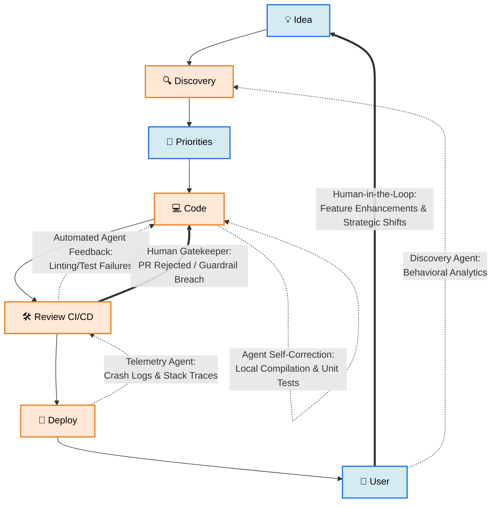

# Rusty Krab Lab

> :construction_worker: CAUTION :wrench: SOFTWARE EXPERIMENT IN PROGRESS :construction_worker:

---

## :rocket: Space Shuttle Launch Stack 3D-STL

Powered by Markdown-STL (Stereolithography), see the [STL (Stereolithography) File Format](<https://en.wikipedia.org/wiki/STL_(file_format)>).

```stl
solid space_shuttle_launch_stack
facet normal 0.2897 -0.83511 -0.46762
outer loop
vertex 2.12 -15.223 7.389
vertex 3.77 -14.799 7.654
vertex 3.689 -15.069 8.086
endloop
endfacet
facet normal 0.28969 -0.78601 -0.54613
outer loop
vertex 2.12 -15.223 7.389
vertex 3.689 -14.528 7.221
vertex 3.77 -14.799 7.654
endloop
endfacet
facet normal 0.26187 -0.74073 -0.61866
outer loop
vertex 2.12 -15.223 7.389
vertex 3.455 -14.285 6.831
vertex 3.689 -14.528 7.221
endloop
endfacet
facet normal 0.20637 -0.70026 -0.68341
outer loop
vertex 2.12 -15.223 7.389
vertex 3.09 -14.091 6.522
vertex 3.455 -14.285 6.831
endloop
endfacet
facet normal 0.13376 -0.67228 -0.72811
outer loop
vertex 2.12 -15.223 7.389
vertex 2.63 -13.967 6.323
vertex 3.09 -14.091 6.522
endloop
endfacet
facet normal 0.04636 -0.65726 -0.75223
outer loop
vertex 2.12 -15.223 7.389
vertex 2.12 -13.924 6.254
vertex 2.63 -13.967 6.323
endloop
endfacet
facet normal -0.04636 -0.65726 -0.75223
outer loop
vertex 2.12 -15.223 7.389
vertex 1.61 -13.967 6.323
vertex 2.12 -13.924 6.254
endloop
endfacet
facet normal -0.13376 -0.67228 -0.72811
outer loop
vertex 2.12 -15.223 7.389
vertex 1.15 -14.091 6.522
vertex 1.61 -13.967 6.323
endloop
endfacet
facet normal -0.20637 -0.70026 -0.68341
outer loop
vertex 2.12 -15.223 7.389
vertex 0.785 -14.285 6.831
vertex 1.15 -14.091 6.522
endloop
endfacet
facet normal -0.26187 -0.74073 -0.61866
outer loop
vertex 2.12 -15.223 7.389
vertex 0.551 -14.528 7.221
vertex 0.785 -14.285 6.831
endloop
endfacet
facet normal -0.28969 -0.78601 -0.54613
outer loop
vertex 2.12 -15.223 7.389
vertex 0.47 -14.799 7.654
vertex 0.551 -14.528 7.221
endloop
endfacet
facet normal -0.2897 -0.83511 -0.46762
outer loop
vertex 2.12 -15.223 7.389
vertex 0.551 -15.069 8.086
vertex 0.47 -14.799 7.654
endloop
endfacet
facet normal -0.2616 -0.88099 -0.39423
outer loop
vertex 2.12 -15.223 7.389
vertex 0.785 -15.313 8.476
vertex 0.551 -15.069 8.086
endloop
endfacet
facet normal -0.20667 -0.92105 -0.33009
outer loop
vertex 2.12 -15.223 7.389
vertex 1.15 -15.506 8.786
vertex 0.785 -15.313 8.476
endloop
endfacet
facet normal -0.13328 -0.94926 -0.28484
outer loop
vertex 2.12 -15.223 7.389
vertex 1.61 -15.63 8.984
vertex 1.15 -15.506 8.786
endloop
endfacet
facet normal -0.04602 -0.9643 -0.26078
outer loop
vertex 2.12 -15.223 7.389
vertex 2.12 -15.673 9.053
vertex 1.61 -15.63 8.984
endloop
endfacet
facet normal 0.04602 -0.9643 -0.26078
outer loop
vertex 2.12 -15.223 7.389
vertex 2.63 -15.63 8.984
vertex 2.12 -15.673 9.053
endloop
endfacet
facet normal 0.13328 -0.94926 -0.28484
outer loop
vertex 2.12 -15.223 7.389
vertex 3.09 -15.506 8.786
vertex 2.63 -15.63 8.984
endloop
endfacet
facet normal 0.20667 -0.92105 -0.33009
outer loop
vertex 2.12 -15.223 7.389
vertex 3.455 -15.313 8.476
vertex 3.09 -15.506 8.786
endloop
endfacet
facet normal 0.2616 -0.88099 -0.39423
outer loop
vertex 2.12 -15.223 7.389
vertex 3.689 -15.069 8.086
vertex 3.455 -15.313 8.476
endloop
endfacet
facet normal 0.62164 -0.71132 -0.32802
outer loop
vertex 3.689 -15.069 8.086
vertex 3.77 -14.799 7.654
vertex 5.02 -13.951 8.184
endloop
endfacet
facet normal 0.6215 -0.7111 -0.32874
outer loop
vertex 3.689 -15.069 8.086
vertex 5.02 -13.951 8.184
vertex 4.878 -14.426 8.943
endloop
endfacet
facet normal 0.62138 -0.60661 -0.4959
outer loop
vertex 3.77 -14.799 7.654
vertex 3.689 -14.528 7.221
vertex 4.878 -13.476 7.424
endloop
endfacet
facet normal 0.62166 -0.60675 -0.49537
outer loop
vertex 3.77 -14.799 7.654
vertex 4.878 -13.476 7.424
vertex 5.02 -13.951 8.184
endloop
endfacet
facet normal 0.56161 -0.50771 -0.65331
outer loop
vertex 3.689 -14.528 7.221
vertex 3.455 -14.285 6.831
vertex 4.466 -13.047 6.738
endloop
endfacet
facet normal 0.56075 -0.50755 -0.65418
outer loop
vertex 3.689 -14.528 7.221
vertex 4.466 -13.047 6.738
vertex 4.878 -13.476 7.424
endloop
endfacet
facet normal 0.44394 -0.42297 -0.78995
outer loop
vertex 3.455 -14.285 6.831
vertex 3.09 -14.091 6.522
vertex 3.825 -12.707 6.194
endloop
endfacet
facet normal 0.44536 -0.42298 -0.78914
outer loop
vertex 3.455 -14.285 6.831
vertex 3.825 -12.707 6.194
vertex 4.466 -13.047 6.738
endloop
endfacet
facet normal 0.28632 -0.36172 -0.88723
outer loop
vertex 3.09 -14.091 6.522
vertex 2.63 -13.967 6.323
vertex 3.016 -12.489 5.845
endloop
endfacet
facet normal 0.28535 -0.36187 -0.88748
outer loop
vertex 3.09 -14.091 6.522
vertex 3.016 -12.489 5.845
vertex 3.825 -12.707 6.194
endloop
endfacet
facet normal 0.09924 -0.32955 -0.93891
outer loop
vertex 2.63 -13.967 6.323
vertex 2.12 -13.924 6.254
vertex 2.12 -12.414 5.724
endloop
endfacet
facet normal 0.09921 -0.32956 -0.93891
outer loop
vertex 2.63 -13.967 6.323
vertex 2.12 -12.414 5.724
vertex 3.016 -12.489 5.845
endloop
endfacet
facet normal -0.09924 -0.32957 -0.9389
outer loop
vertex 2.12 -13.924 6.254
vertex 1.61 -13.967 6.323
vertex 1.224 -12.489 5.845
endloop
endfacet
facet normal -0.09921 -0.32955 -0.93891
outer loop
vertex 2.12 -13.924 6.254
vertex 1.224 -12.489 5.845
vertex 2.12 -12.414 5.724
endloop
endfacet
facet normal -0.28613 -0.36219 -0.8871
outer loop
vertex 1.61 -13.967 6.323
vertex 1.15 -14.091 6.522
vertex 0.415 -12.707 6.194
endloop
endfacet
facet normal -0.28545 -0.3616 -0.88756
outer loop
vertex 1.61 -13.967 6.323
vertex 0.415 -12.707 6.194
vertex 1.224 -12.489 5.845
endloop
endfacet
facet normal -0.44441 -0.42227 -0.79006
outer loop
vertex 1.15 -14.091 6.522
vertex 0.785 -14.285 6.831
vertex -0.226 -13.047 6.738
endloop
endfacet
facet normal -0.4451 -0.42338 -0.78907
outer loop
vertex 1.15 -14.091 6.522
vertex -0.226 -13.047 6.738
vertex 0.415 -12.707 6.194
endloop
endfacet
facet normal -0.56117 -0.50818 -0.65333
outer loop
vertex 0.785 -14.285 6.831
vertex 0.551 -14.528 7.221
vertex -0.638 -13.476 7.424
endloop
endfacet
facet normal -0.56101 -0.50728 -0.65417
outer loop
vertex 0.785 -14.285 6.831
vertex -0.638 -13.476 7.424
vertex -0.226 -13.047 6.738
endloop
endfacet
facet normal -0.62162 -0.60642 -0.49582
outer loop
vertex 0.551 -14.528 7.221
vertex 0.47 -14.799 7.654
vertex -0.78 -13.951 8.184
endloop
endfacet
facet normal -0.62152 -0.60686 -0.49541
outer loop
vertex 0.551 -14.528 7.221
vertex -0.78 -13.951 8.184
vertex -0.638 -13.476 7.424
endloop
endfacet
facet normal -0.62133 -0.71151 -0.32819
outer loop
vertex 0.47 -14.799 7.654
vertex 0.551 -15.069 8.086
vertex -0.638 -14.426 8.943
endloop
endfacet
facet normal -0.62168 -0.71099 -0.32864
outer loop
vertex 0.47 -14.799 7.654
vertex -0.638 -14.426 8.943
vertex -0.78 -13.951 8.184
endloop
endfacet
facet normal -0.56142 -0.80991 -0.16986
outer loop
vertex 0.551 -15.069 8.086
vertex 0.785 -15.313 8.476
vertex -0.226 -14.854 9.629
endloop
endfacet
facet normal -0.56042 -0.81073 -0.16924
outer loop
vertex 0.551 -15.069 8.086
vertex -0.226 -14.854 9.629
vertex -0.638 -14.426 8.943
endloop
endfacet
facet normal -0.44437 -0.89519 -0.03411
outer loop
vertex 0.785 -15.313 8.476
vertex 1.15 -15.506 8.786
vertex 0.415 -15.194 10.173
endloop
endfacet
facet normal -0.44539 -0.89468 -0.03437
outer loop
vertex 0.785 -15.313 8.476
vertex 0.415 -15.194 10.173
vertex -0.226 -14.854 9.629
endloop
endfacet
facet normal -0.28531 -0.9563 0.06394
outer loop
vertex 1.15 -15.506 8.786
vertex 1.61 -15.63 8.984
vertex 1.224 -15.412 10.522
endloop
endfacet
facet normal -0.28528 -0.95631 0.06394
outer loop
vertex 1.15 -15.506 8.786
vertex 1.224 -15.412 10.522
vertex 0.415 -15.194 10.173
endloop
endfacet
facet normal -0.09897 -0.98835 0.11562
outer loop
vertex 1.61 -15.63 8.984
vertex 2.12 -15.673 9.053
vertex 2.12 -15.487 10.643
endloop
endfacet
facet normal -0.09833 -0.98844 0.11543
outer loop
vertex 1.61 -15.63 8.984
vertex 2.12 -15.487 10.643
vertex 1.224 -15.412 10.522
endloop
endfacet
facet normal 0.09893 -0.9884 0.11527
outer loop
vertex 2.12 -15.673 9.053
vertex 2.63 -15.63 8.984
vertex 3.016 -15.412 10.522
endloop
endfacet
facet normal 0.09835 -0.98841 0.11563
outer loop
vertex 2.12 -15.673 9.053
vertex 3.016 -15.412 10.522
vertex 2.12 -15.487 10.643
endloop
endfacet
facet normal 0.2853 -0.9563 0.06393
outer loop
vertex 2.63 -15.63 8.984
vertex 3.09 -15.506 8.786
vertex 3.825 -15.194 10.173
endloop
endfacet
facet normal 0.28528 -0.95631 0.06395
outer loop
vertex 2.63 -15.63 8.984
vertex 3.825 -15.194 10.173
vertex 3.016 -15.412 10.522
endloop
endfacet
facet normal 0.44471 -0.89504 -0.03363
outer loop
vertex 3.09 -15.506 8.786
vertex 3.455 -15.313 8.476
vertex 4.466 -14.854 9.629
endloop
endfacet
facet normal 0.4452 -0.89476 -0.03465
outer loop
vertex 3.09 -15.506 8.786
vertex 4.466 -14.854 9.629
vertex 3.825 -15.194 10.173
endloop
endfacet
facet normal 0.5609 -0.81017 -0.17033
outer loop
vertex 3.455 -15.313 8.476
vertex 3.689 -15.069 8.086
vertex 4.878 -14.426 8.943
endloop
endfacet
facet normal 0.56072 -0.81058 -0.16897
outer loop
vertex 3.455 -15.313 8.476
vertex 4.878 -14.426 8.943
vertex 4.466 -14.854 9.629
endloop
endfacet
facet normal 0.83732 -0.52001 -0.16878
outer loop
vertex 4.878 -14.426 8.943
vertex 5.02 -13.951 8.184
vertex 5.97 -12.679 8.978
endloop
endfacet
facet normal 0.83734 -0.52002 -0.16867
outer loop
vertex 4.878 -14.426 8.943
vertex 5.97 -12.679 8.978
vertex 5.782 -13.309 9.987
endloop
endfacet
facet normal 0.83715 -0.37969 -0.39372
outer loop
vertex 5.02 -13.951 8.184
vertex 4.878 -13.476 7.424
vertex 5.782 -12.048 7.969
endloop
endfacet
facet normal 0.83726 -0.37971 -0.39346
outer loop
vertex 5.02 -13.951 8.184
vertex 5.782 -12.048 7.969
vertex 5.97 -12.679 8.978
endloop
endfacet
facet normal 0.75527 -0.24605 -0.60747
outer loop
vertex 4.878 -13.476 7.424
vertex 4.466 -13.047 6.738
vertex 5.235 -11.479 7.059
endloop
endfacet
facet normal 0.75507 -0.24606 -0.60772
outer loop
vertex 4.878 -13.476 7.424
vertex 5.235 -11.479 7.059
vertex 5.782 -12.048 7.969
endloop
endfacet
facet normal 0.59973 -0.1321 -0.78923
outer loop
vertex 4.466 -13.047 6.738
vertex 3.825 -12.707 6.194
vertex 4.383 -11.028 6.337
endloop
endfacet
facet normal 0.59917 -0.1322 -0.78963
outer loop
vertex 4.466 -13.047 6.738
vertex 4.383 -11.028 6.337
vertex 5.235 -11.479 7.059
endloop
endfacet
facet normal 0.38428 -0.04978 -0.92187
outer loop
vertex 3.825 -12.707 6.194
vertex 3.016 -12.489 5.845
vertex 3.31 -10.738 5.873
endloop
endfacet
facet normal 0.38512 -0.0495 -0.92154
outer loop
vertex 3.825 -12.707 6.194
vertex 3.31 -10.738 5.873
vertex 4.383 -11.028 6.337
endloop
endfacet
facet normal 0.13332 -0.00614 -0.99105
outer loop
vertex 3.016 -12.489 5.845
vertex 2.12 -12.414 5.724
vertex 2.12 -10.638 5.713
endloop
endfacet
facet normal 0.13272 -0.00644 -0.99113
outer loop
vertex 3.016 -12.489 5.845
vertex 2.12 -10.638 5.713
vertex 3.31 -10.738 5.873
endloop
endfacet
facet normal -0.13329 -0.00653 -0.99106
outer loop
vertex 2.12 -12.414 5.724
vertex 1.224 -12.489 5.845
vertex 0.93 -10.738 5.873
endloop
endfacet
facet normal -0.13275 -0.00614 -0.99113
outer loop
vertex 2.12 -12.414 5.724
vertex 0.93 -10.738 5.873
vertex 2.12 -10.638 5.713
endloop
endfacet
facet normal -0.38441 -0.04924 -0.92185
outer loop
vertex 1.224 -12.489 5.845
vertex 0.415 -12.707 6.194
vertex -0.143 -11.028 6.337
endloop
endfacet
facet normal -0.38502 -0.04991 -0.92156
outer loop
vertex 1.224 -12.489 5.845
vertex -0.143 -11.028 6.337
vertex 0.93 -10.738 5.873
endloop
endfacet
facet normal -0.59958 -0.13247 -0.78928
outer loop
vertex 0.415 -12.707 6.194
vertex -0.226 -13.047 6.738
vertex -0.995 -11.479 7.059
endloop
endfacet
facet normal -0.59928 -0.13192 -0.78959
outer loop
vertex 0.415 -12.707 6.194
vertex -0.995 -11.479 7.059
vertex -0.143 -11.028 6.337
endloop
endfacet
facet normal -0.75518 -0.24621 -0.60752
outer loop
vertex -0.226 -13.047 6.738
vertex -0.638 -13.476 7.424
vertex -1.542 -12.048 7.969
endloop
endfacet
facet normal -0.75513 -0.24594 -0.60769
outer loop
vertex -0.226 -13.047 6.738
vertex -1.542 -12.048 7.969
vertex -0.995 -11.479 7.059
endloop
endfacet
facet normal -0.83723 -0.37957 -0.39366
outer loop
vertex -0.638 -13.476 7.424
vertex -0.78 -13.951 8.184
vertex -1.73 -12.679 8.978
endloop
endfacet
facet normal -0.8372 -0.37981 -0.39351
outer loop
vertex -0.638 -13.476 7.424
vertex -1.73 -12.679 8.978
vertex -1.542 -12.048 7.969
endloop
endfacet
facet normal -0.83736 -0.51996 -0.16875
outer loop
vertex -0.78 -13.951 8.184
vertex -0.638 -14.426 8.943
vertex -1.542 -13.309 9.987
endloop
endfacet
facet normal -0.83731 -0.52005 -0.1687
outer loop
vertex -0.78 -13.951 8.184
vertex -1.542 -13.309 9.987
vertex -1.73 -12.679 8.978
endloop
endfacet
facet normal -0.7551 -0.65403 0.04544
outer loop
vertex -0.638 -14.426 8.943
vertex -0.226 -14.854 9.629
vertex -0.995 -13.878 10.898
endloop
endfacet
facet normal -0.75541 -0.65369 0.04529
outer loop
vertex -0.638 -14.426 8.943
vertex -0.995 -13.878 10.898
vertex -1.542 -13.309 9.987
endloop
endfacet
facet normal -0.59982 -0.76717 0.2273
outer loop
vertex -0.226 -14.854 9.629
vertex 0.415 -15.194 10.173
vertex -0.143 -14.329 11.62
endloop
endfacet
facet normal -0.59909 -0.76771 0.22741
outer loop
vertex -0.226 -14.854 9.629
vertex -0.143 -14.329 11.62
vertex -0.995 -13.878 10.898
endloop
endfacet
facet normal -0.38421 -0.85041 0.35942
outer loop
vertex 0.415 -15.194 10.173
vertex 1.224 -15.412 10.522
vertex 0.93 -14.619 12.084
endloop
endfacet
facet normal -0.38518 -0.84992 0.35954
outer loop
vertex 0.415 -15.194 10.173
vertex 0.93 -14.619 12.084
vertex -0.143 -14.329 11.62
endloop
endfacet
facet normal -0.13272 -0.89355 0.4289
outer loop
vertex 1.224 -15.412 10.522
vertex 2.12 -15.487 10.643
vertex 2.12 -14.719 12.243
endloop
endfacet
facet normal -0.13239 -0.89366 0.42878
outer loop
vertex 1.224 -15.412 10.522
vertex 2.12 -14.719 12.243
vertex 0.93 -14.619 12.084
endloop
endfacet
facet normal 0.1327 -0.89364 0.42871
outer loop
vertex 2.12 -15.487 10.643
vertex 3.016 -15.412 10.522
vertex 3.31 -14.619 12.084
endloop
endfacet
facet normal 0.1324 -0.89359 0.42892
outer loop
vertex 2.12 -15.487 10.643
vertex 3.31 -14.619 12.084
vertex 2.12 -14.719 12.243
endloop
endfacet
facet normal 0.38437 -0.85011 0.35997
outer loop
vertex 3.016 -15.412 10.522
vertex 3.825 -15.194 10.173
vertex 4.383 -14.329 11.62
endloop
endfacet
facet normal 0.38507 -0.85015 0.35913
outer loop
vertex 3.016 -15.412 10.522
vertex 4.383 -14.329 11.62
vertex 3.31 -14.619 12.084
endloop
endfacet
facet normal 0.59962 -0.76745 0.22689
outer loop
vertex 3.825 -15.194 10.173
vertex 4.466 -14.854 9.629
vertex 5.235 -13.878 10.898
endloop
endfacet
facet normal 0.59924 -0.7675 0.22772
outer loop
vertex 3.825 -15.194 10.173
vertex 5.235 -13.878 10.898
vertex 4.383 -14.329 11.62
endloop
endfacet
facet normal 0.75523 -0.65387 0.04563
outer loop
vertex 4.466 -14.854 9.629
vertex 4.878 -14.426 8.943
vertex 5.782 -13.309 9.987
endloop
endfacet
facet normal 0.75531 -0.65382 0.04515
outer loop
vertex 4.466 -14.854 9.629
vertex 5.782 -13.309 9.987
vertex 5.235 -13.878 10.898
endloop
endfacet
facet normal 0.96793 -0.25006 0.02421
outer loop
vertex 5.782 -13.309 9.987
vertex 5.97 -12.679 8.978
vertex 6.32 -11.237 9.879
endloop
endfacet
facet normal 0.96792 -0.25003 0.02486
outer loop
vertex 5.782 -13.309 9.987
vertex 6.32 -11.237 9.879
vertex 6.114 -11.925 10.98
endloop
endfacet
facet normal 0.96805 -0.0874 -0.23503
outer loop
vertex 5.97 -12.679 8.978
vertex 5.782 -12.048 7.969
vertex 6.114 -10.549 8.779
endloop
endfacet
facet normal 0.96782 -0.08747 -0.23596
outer loop
vertex 5.97 -12.679 8.978
vertex 6.114 -10.549 8.779
vertex 6.32 -11.237 9.879
endloop
endfacet
facet normal 0.87311 0.06708 -0.48289
outer loop
vertex 5.782 -12.048 7.969
vertex 5.235 -11.479 7.059
vertex 5.518 -9.929 7.786
endloop
endfacet
facet normal 0.87343 0.06717 -0.4823
outer loop
vertex 5.782 -12.048 7.969
vertex 5.518 -9.929 7.786
vertex 6.114 -10.549 8.779
endloop
endfacet
facet normal 0.69264 0.19831 -0.69348
outer loop
vertex 5.235 -11.479 7.059
vertex 4.383 -11.028 6.337
vertex 4.589 -9.436 6.998
endloop
endfacet
facet normal 0.69311 0.19847 -0.69296
outer loop
vertex 5.235 -11.479 7.059
vertex 4.589 -9.436 6.998
vertex 5.518 -9.929 7.786
endloop
endfacet
facet normal 0.44519 0.29388 -0.84584
outer loop
vertex 4.383 -11.028 6.337
vertex 3.31 -10.738 5.873
vertex 3.418 -9.12 6.492
endloop
endfacet
facet normal 0.44486 0.29372 -0.84607
outer loop
vertex 4.383 -11.028 6.337
vertex 3.418 -9.12 6.492
vertex 4.589 -9.436 6.998
endloop
endfacet
facet normal 0.15345 0.34391 -0.92638
outer loop
vertex 3.31 -10.738 5.873
vertex 2.12 -10.638 5.713
vertex 2.12 -9.011 6.317
endloop
endfacet
facet normal 0.15378 0.34409 -0.92626
outer loop
vertex 3.31 -10.738 5.873
vertex 2.12 -9.011 6.317
vertex 3.418 -9.12 6.492
endloop
endfacet
facet normal -0.15346 0.34413 -0.9263
outer loop
vertex 2.12 -10.638 5.713
vertex 0.93 -10.738 5.873
vertex 0.822 -9.12 6.492
endloop
endfacet
facet normal -0.15377 0.34389 -0.92633
outer loop
vertex 2.12 -10.638 5.713
vertex 0.822 -9.12 6.492
vertex 2.12 -9.011 6.317
endloop
endfacet
facet normal -0.44517 0.29363 -0.84594
outer loop
vertex 0.93 -10.738 5.873
vertex -0.143 -11.028 6.337
vertex -0.349 -9.436 6.998
endloop
endfacet
facet normal -0.44488 0.29395 -0.84598
outer loop
vertex 0.93 -10.738 5.873
vertex -0.349 -9.436 6.998
vertex 0.822 -9.12 6.492
endloop
endfacet
facet normal -0.69271 0.19871 -0.69331
outer loop
vertex -0.143 -11.028 6.337
vertex -0.995 -11.479 7.059
vertex -1.278 -9.929 7.786
endloop
endfacet
facet normal -0.69306 0.19811 -0.69313
outer loop
vertex -0.143 -11.028 6.337
vertex -1.278 -9.929 7.786
vertex -0.349 -9.436 6.998
endloop
endfacet
facet normal -0.87318 0.06744 -0.4827
outer loop
vertex -0.995 -11.479 7.059
vertex -1.542 -12.048 7.969
vertex -1.874 -10.549 8.779
endloop
endfacet
facet normal -0.87336 0.06683 -0.48246
outer loop
vertex -0.995 -11.479 7.059
vertex -1.874 -10.549 8.779
vertex -1.278 -9.929 7.786
endloop
endfacet
facet normal -0.96793 -0.0879 -0.23532
outer loop
vertex -1.542 -12.048 7.969
vertex -1.73 -12.679 8.978
vertex -2.08 -11.237 9.879
endloop
endfacet
facet normal -0.96792 -0.08702 -0.23569
outer loop
vertex -1.542 -12.048 7.969
vertex -2.08 -11.237 9.879
vertex -1.874 -10.549 8.779
endloop
endfacet
facet normal -0.96801 -0.24974 0.02443
outer loop
vertex -1.73 -12.679 8.978
vertex -1.542 -13.309 9.987
vertex -1.874 -11.925 10.98
endloop
endfacet
facet normal -0.96785 -0.25032 0.02466
outer loop
vertex -1.73 -12.679 8.978
vertex -1.874 -11.925 10.98
vertex -2.08 -11.237 9.879
endloop
endfacet
facet normal -0.87325 -0.4045 0.27169
outer loop
vertex -1.542 -13.309 9.987
vertex -0.995 -13.878 10.898
vertex -1.278 -12.545 11.973
endloop
endfacet
facet normal -0.8733 -0.4044 0.27166
outer loop
vertex -1.542 -13.309 9.987
vertex -1.278 -12.545 11.973
vertex -1.874 -11.925 10.98
endloop
endfacet
facet normal -0.69262 -0.53636 0.48229
outer loop
vertex -0.995 -13.878 10.898
vertex -0.143 -14.329 11.62
vertex -0.349 -13.037 12.761
endloop
endfacet
facet normal -0.69292 -0.53601 0.48224
outer loop
vertex -0.995 -13.878 10.898
vertex -0.349 -13.037 12.761
vertex -1.278 -12.545 11.973
endloop
endfacet
facet normal -0.44518 -0.6316 0.63474
outer loop
vertex -0.143 -14.329 11.62
vertex 0.93 -14.619 12.084
vertex 0.822 -13.354 13.267
endloop
endfacet
facet normal -0.44525 -0.63155 0.63474
outer loop
vertex -0.143 -14.329 11.62
vertex 0.822 -13.354 13.267
vertex -0.349 -13.037 12.761
endloop
endfacet
facet normal -0.15287 -0.68209 0.71511
outer loop
vertex 0.93 -14.619 12.084
vertex 2.12 -14.719 12.243
vertex 2.12 -13.463 13.441
endloop
endfacet
facet normal -0.15314 -0.68192 0.71521
outer loop
vertex 0.93 -14.619 12.084
vertex 2.12 -13.463 13.441
vertex 0.822 -13.354 13.267
endloop
endfacet
facet normal 0.15287 -0.68194 0.71525
outer loop
vertex 2.12 -14.719 12.243
vertex 3.31 -14.619 12.084
vertex 3.418 -13.354 13.267
endloop
endfacet
facet normal 0.15313 -0.68206 0.71508
outer loop
vertex 2.12 -14.719 12.243
vertex 3.418 -13.354 13.267
vertex 2.12 -13.463 13.441
endloop
endfacet
facet normal 0.44519 -0.63156 0.63477
outer loop
vertex 3.31 -14.619 12.084
vertex 4.383 -14.329 11.62
vertex 4.589 -13.037 12.761
endloop
endfacet
facet normal 0.44524 -0.63158 0.63471
outer loop
vertex 3.31 -14.619 12.084
vertex 4.589 -13.037 12.761
vertex 3.418 -13.354 13.267
endloop
endfacet
facet normal 0.69266 -0.53614 0.48247
outer loop
vertex 4.383 -14.329 11.62
vertex 5.235 -13.878 10.898
vertex 5.518 -12.545 11.973
endloop
endfacet
facet normal 0.69288 -0.53621 0.48207
outer loop
vertex 4.383 -14.329 11.62
vertex 5.518 -12.545 11.973
vertex 4.589 -13.037 12.761
endloop
endfacet
facet normal 0.87326 -0.40444 0.27173
outer loop
vertex 5.235 -13.878 10.898
vertex 5.782 -13.309 9.987
vertex 6.114 -11.925 10.98
endloop
endfacet
facet normal 0.87329 -0.40445 0.27162
outer loop
vertex 5.235 -13.878 10.898
vertex 6.114 -11.925 10.98
vertex 5.518 -12.545 11.973
endloop
endfacet
facet normal 0.98764 -0.08304 0.1329
outer loop
vertex 6.114 -11.925 10.98
vertex 6.32 -11.237 9.879
vertex 6.32 8.777 22.385
endloop
endfacet
facet normal 0.98764 -0.08304 0.1329
outer loop
vertex 6.114 -11.925 10.98
vertex 6.32 8.777 22.385
vertex 6.114 8.089 23.486
endloop
endfacet
facet normal 0.98763 0.0831 -0.13298
outer loop
vertex 6.32 -11.237 9.879
vertex 6.114 -10.549 8.779
vertex 6.114 9.465 21.285
endloop
endfacet
facet normal 0.98763 0.0831 -0.13298
outer loop
vertex 6.32 -11.237 9.879
vertex 6.114 9.465 21.285
vertex 6.32 8.777 22.385
endloop
endfacet
facet normal 0.89115 0.24042 -0.38476
outer loop
vertex 6.114 -10.549 8.779
vertex 5.518 -9.929 7.786
vertex 5.518 10.085 20.292
endloop
endfacet
facet normal 0.89115 0.24042 -0.38476
outer loop
vertex 6.114 -10.549 8.779
vertex 5.518 10.085 20.292
vertex 6.114 9.465 21.285
endloop
endfacet
facet normal 0.7073 0.3746 -0.5995
outer loop
vertex 5.518 -9.929 7.786
vertex 4.589 -9.436 6.998
vertex 4.589 10.578 19.504
endloop
endfacet
facet normal 0.7073 0.3746 -0.5995
outer loop
vertex 5.518 -9.929 7.786
vertex 4.589 10.578 19.504
vertex 5.518 10.085 20.292
endloop
endfacet
facet normal 0.45394 0.47217 -0.75564
outer loop
vertex 4.589 -9.436 6.998
vertex 3.418 -9.12 6.492
vertex 3.418 10.894 18.998
endloop
endfacet
facet normal 0.45394 0.47217 -0.75564
outer loop
vertex 4.589 -9.436 6.998
vertex 3.418 10.894 18.998
vertex 4.589 10.578 19.504
endloop
endfacet
facet normal 0.15687 0.52338 -0.83753
outer loop
vertex 3.418 -9.12 6.492
vertex 2.12 -9.011 6.317
vertex 2.12 11.003 18.824
endloop
endfacet
facet normal 0.15624 0.52341 -0.83764
outer loop
vertex 3.418 -9.12 6.492
vertex 2.12 11.003 18.824
vertex 3.418 10.894 18.998
endloop
endfacet
facet normal -0.15687 0.52335 -0.83755
outer loop
vertex 2.12 -9.011 6.317
vertex 0.822 -9.12 6.492
vertex 0.822 10.894 18.998
endloop
endfacet
facet normal -0.15624 0.52344 -0.83762
outer loop
vertex 2.12 -9.011 6.317
vertex 0.822 10.894 18.998
vertex 2.12 11.003 18.824
endloop
endfacet
facet normal -0.45394 0.47217 -0.75564
outer loop
vertex 0.822 -9.12 6.492
vertex -0.349 -9.436 6.998
vertex -0.349 10.578 19.504
endloop
endfacet
facet normal -0.45394 0.47217 -0.75564
outer loop
vertex 0.822 -9.12 6.492
vertex -0.349 10.578 19.504
vertex 0.822 10.894 18.998
endloop
endfacet
facet normal -0.7073 0.3746 -0.5995
outer loop
vertex -0.349 -9.436 6.998
vertex -1.278 -9.929 7.786
vertex -1.278 10.085 20.292
endloop
endfacet
facet normal -0.7073 0.3746 -0.5995
outer loop
vertex -0.349 -9.436 6.998
vertex -1.278 10.085 20.292
vertex -0.349 10.578 19.504
endloop
endfacet
facet normal -0.89115 0.24042 -0.38476
outer loop
vertex -1.278 -9.929 7.786
vertex -1.874 -10.549 8.779
vertex -1.874 9.465 21.285
endloop
endfacet
facet normal -0.89115 0.24042 -0.38476
outer loop
vertex -1.278 -9.929 7.786
vertex -1.874 9.465 21.285
vertex -1.278 10.085 20.292
endloop
endfacet
facet normal -0.98763 0.0831 -0.13298
outer loop
vertex -1.874 -10.549 8.779
vertex -2.08 -11.237 9.879
vertex -2.08 8.777 22.385
endloop
endfacet
facet normal -0.98763 0.0831 -0.13298
outer loop
vertex -1.874 -10.549 8.779
vertex -2.08 8.777 22.385
vertex -1.874 9.465 21.285
endloop
endfacet
facet normal -0.98764 -0.08304 0.1329
outer loop
vertex -2.08 -11.237 9.879
vertex -1.874 -11.925 10.98
vertex -1.874 8.089 23.486
endloop
endfacet
facet normal -0.98764 -0.08304 0.1329
outer loop
vertex -2.08 -11.237 9.879
vertex -1.874 8.089 23.486
vertex -2.08 8.777 22.385
endloop
endfacet
facet normal -0.89115 -0.24042 0.38476
outer loop
vertex -1.874 -11.925 10.98
vertex -1.278 -12.545 11.973
vertex -1.278 7.469 24.479
endloop
endfacet
facet normal -0.89115 -0.24042 0.38476
outer loop
vertex -1.874 -11.925 10.98
vertex -1.278 7.469 24.479
vertex -1.874 8.089 23.486
endloop
endfacet
facet normal -0.7071 -0.37472 0.59966
outer loop
vertex -1.278 -12.545 11.973
vertex -0.349 -13.037 12.761
vertex -0.349 6.976 25.267
endloop
endfacet
facet normal -0.7073 -0.3746 0.5995
outer loop
vertex -1.278 -12.545 11.973
vertex -0.349 6.976 25.267
vertex -1.278 7.469 24.479
endloop
endfacet
facet normal -0.45426 -0.47209 0.7555
outer loop
vertex -0.349 -13.037 12.761
vertex 0.822 -13.354 13.267
vertex 0.822 6.66 25.773
endloop
endfacet
facet normal -0.45394 -0.47219 0.75563
outer loop
vertex -0.349 -13.037 12.761
vertex 0.822 6.66 25.773
vertex -0.349 6.976 25.267
endloop
endfacet
facet normal -0.15624 -0.52341 0.83764
outer loop
vertex 0.822 -13.354 13.267
vertex 2.12 -13.463 13.441
vertex 2.12 6.551 25.947
endloop
endfacet
facet normal -0.15624 -0.52341 0.83764
outer loop
vertex 0.822 -13.354 13.267
vertex 2.12 6.551 25.947
vertex 0.822 6.66 25.773
endloop
endfacet
facet normal 0.15624 -0.52341 0.83764
outer loop
vertex 2.12 -13.463 13.441
vertex 3.418 -13.354 13.267
vertex 3.418 6.66 25.773
endloop
endfacet
facet normal 0.15624 -0.52341 0.83764
outer loop
vertex 2.12 -13.463 13.441
vertex 3.418 6.66 25.773
vertex 2.12 6.551 25.947
endloop
endfacet
facet normal 0.45426 -0.4721 0.75549
outer loop
vertex 3.418 -13.354 13.267
vertex 4.589 -13.037 12.761
vertex 4.589 6.976 25.267
endloop
endfacet
facet normal 0.45394 -0.47217 0.75564
outer loop
vertex 3.418 -13.354 13.267
vertex 4.589 6.976 25.267
vertex 3.418 6.66 25.773
endloop
endfacet
facet normal 0.7071 -0.37471 0.59967
outer loop
vertex 4.589 -13.037 12.761
vertex 5.518 -12.545 11.973
vertex 5.518 7.469 24.479
endloop
endfacet
facet normal 0.7073 -0.37462 0.59949
outer loop
vertex 4.589 -13.037 12.761
vertex 5.518 7.469 24.479
vertex 4.589 6.976 25.267
endloop
endfacet
facet normal 0.89115 -0.24042 0.38476
outer loop
vertex 5.518 -12.545 11.973
vertex 6.114 -11.925 10.98
vertex 6.114 8.089 23.486
endloop
endfacet
facet normal 0.89115 -0.24042 0.38476
outer loop
vertex 5.518 -12.545 11.973
vertex 6.114 8.089 23.486
vertex 5.518 7.469 24.479
endloop
endfacet
facet normal 0.93366 -0.35504 -0.04717
outer loop
vertex 6.114 8.089 23.486
vertex 6.32 8.777 22.385
vertex 6.39 8.947 22.491
endloop
endfacet
facet normal 0.93281 -0.35702 -0.04911
outer loop
vertex 6.114 8.089 23.486
vertex 6.39 8.947 22.491
vertex 6.181 8.247 23.61
endloop
endfacet
facet normal 0.93247 -0.20085 -0.30025
outer loop
vertex 6.32 8.777 22.385
vertex 6.114 9.465 21.285
vertex 6.181 9.646 21.372
endloop
endfacet
facet normal 0.93361 -0.19842 -0.29832
outer loop
vertex 6.32 8.777 22.385
vertex 6.181 9.646 21.372
vertex 6.39 8.947 22.491
endloop
endfacet
facet normal 0.84185 -0.05124 -0.53727
outer loop
vertex 6.114 9.465 21.285
vertex 5.518 10.085 20.292
vertex 5.575 10.277 20.363
endloop
endfacet
facet normal 0.84119 -0.0527 -0.53817
outer loop
vertex 6.114 9.465 21.285
vertex 5.575 10.277 20.363
vertex 6.181 9.646 21.372
endloop
endfacet
facet normal 0.66859 0.0778 -0.73955
outer loop
vertex 5.518 10.085 20.292
vertex 4.589 10.578 19.504
vertex 4.63 10.777 19.562
endloop
endfacet
facet normal 0.66772 0.07562 -0.74056
outer loop
vertex 5.518 10.085 20.292
vertex 4.63 10.777 19.562
vertex 5.575 10.277 20.363
endloop
endfacet
facet normal 0.42861 0.16627 -0.88806
outer loop
vertex 4.589 10.578 19.504
vertex 3.418 10.894 18.998
vertex 3.44 11.099 19.047
endloop
endfacet
facet normal 0.42977 0.16992 -0.88681
outer loop
vertex 4.589 10.578 19.504
vertex 3.44 11.099 19.047
vertex 4.63 10.777 19.562
endloop
endfacet
facet normal 0.1475 0.21555 -0.96529
outer loop
vertex 3.418 10.894 18.998
vertex 2.12 11.003 18.824
vertex 2.12 11.209 18.87
endloop
endfacet
facet normal 0.14737 0.21495 -0.96544
outer loop
vertex 3.418 10.894 18.998
vertex 2.12 11.209 18.87
vertex 3.44 11.099 19.047
endloop
endfacet
facet normal -0.1475 0.21561 -0.96527
outer loop
vertex 2.12 11.003 18.824
vertex 0.822 10.894 18.998
vertex 0.801 11.099 19.047
endloop
endfacet
facet normal -0.14751 0.21555 -0.96529
outer loop
vertex 2.12 11.003 18.824
vertex 0.801 11.099 19.047
vertex 2.12 11.209 18.87
endloop
endfacet
facet normal -0.4292 0.17011 -0.88704
outer loop
vertex 0.822 10.894 18.998
vertex -0.349 10.578 19.504
vertex -0.39 10.777 19.562
endloop
endfacet
facet normal -0.42919 0.16815 -0.88742
outer loop
vertex 0.822 10.894 18.998
vertex -0.39 10.777 19.562
vertex 0.801 11.099 19.047
endloop
endfacet
facet normal -0.66873 0.07836 -0.73936
outer loop
vertex -0.349 10.578 19.504
vertex -1.278 10.085 20.292
vertex -1.334 10.277 20.363
endloop
endfacet
facet normal -0.66866 0.07777 -0.73949
outer loop
vertex -0.349 10.578 19.504
vertex -1.334 10.277 20.363
vertex -0.39 10.777 19.562
endloop
endfacet
facet normal -0.84131 -0.05285 -0.53796
outer loop
vertex -1.278 10.085 20.292
vertex -1.874 9.465 21.285
vertex -1.941 9.646 21.372
endloop
endfacet
facet normal -0.84257 -0.04736 -0.5365
outer loop
vertex -1.278 10.085 20.292
vertex -1.941 9.646 21.372
vertex -1.334 10.277 20.363
endloop
endfacet
facet normal -0.93354 -0.19812 -0.29874
outer loop
vertex -1.874 9.465 21.285
vertex -2.08 8.777 22.385
vertex -2.15 8.947 22.491
endloop
endfacet
facet normal -0.93257 -0.2011 -0.2998
outer loop
vertex -1.874 9.465 21.285
vertex -2.15 8.947 22.491
vertex -1.941 9.646 21.372
endloop
endfacet
facet normal -0.93273 -0.35727 -0.04874
outer loop
vertex -2.08 8.777 22.385
vertex -1.874 8.089 23.486
vertex -1.941 8.247 23.61
endloop
endfacet
facet normal -0.93372 -0.35482 -0.04756
outer loop
vertex -2.08 8.777 22.385
vertex -1.941 8.247 23.61
vertex -2.15 8.947 22.491
endloop
endfacet
facet normal -0.84304 -0.50227 0.19239
outer loop
vertex -1.874 8.089 23.486
vertex -1.278 7.469 24.479
vertex -1.334 7.617 24.62
endloop
endfacet
facet normal -0.84137 -0.50594 0.19006
outer loop
vertex -1.874 8.089 23.486
vertex -1.334 7.617 24.62
vertex -1.941 8.247 23.61
endloop
endfacet
facet normal -0.66896 -0.62993 0.39456
outer loop
vertex -1.278 7.469 24.479
vertex -0.349 6.976 25.267
vertex -0.39 7.116 25.421
endloop
endfacet
facet normal -0.66918 -0.62946 0.39494
outer loop
vertex -1.278 7.469 24.479
vertex -0.39 7.116 25.421
vertex -1.334 7.617 24.62
endloop
endfacet
facet normal -0.42968 -0.7203 0.54455
outer loop
vertex -0.349 6.976 25.267
vertex 0.822 6.66 25.773
vertex 0.801 6.795 25.935
endloop
endfacet
facet normal -0.42882 -0.72235 0.54251
outer loop
vertex -0.349 6.976 25.267
vertex 0.801 6.795 25.935
vertex -0.39 7.116 25.421
endloop
endfacet
facet normal -0.14772 -0.77185 0.61841
outer loop
vertex 0.822 6.66 25.773
vertex 2.12 6.551 25.947
vertex 2.12 6.684 26.113
endloop
endfacet
facet normal -0.14861 -0.76908 0.62164
outer loop
vertex 0.822 6.66 25.773
vertex 2.12 6.684 26.113
vertex 0.801 6.795 25.935
endloop
endfacet
facet normal 0.1479 -0.76956 0.62121
outer loop
vertex 2.12 6.551 25.947
vertex 3.418 6.66 25.773
vertex 3.44 6.795 25.935
endloop
endfacet
facet normal 0.14828 -0.77178 0.61836
outer loop
vertex 2.12 6.551 25.947
vertex 3.44 6.795 25.935
vertex 2.12 6.684 26.113
endloop
endfacet
facet normal 0.42924 -0.72225 0.54231
outer loop
vertex 3.418 6.66 25.773
vertex 4.589 6.976 25.267
vertex 4.63 7.116 25.421
endloop
endfacet
facet normal 0.42925 -0.72166 0.54309
outer loop
vertex 3.418 6.66 25.773
vertex 4.63 7.116 25.421
vertex 3.44 6.795 25.935
endloop
endfacet
facet normal 0.66838 -0.63164 0.3928
outer loop
vertex 4.589 6.976 25.267
vertex 5.518 7.469 24.479
vertex 5.575 7.617 24.62
endloop
endfacet
facet normal 0.66868 -0.63009 0.39479
outer loop
vertex 4.589 6.976 25.267
vertex 5.575 7.617 24.62
vertex 4.63 7.116 25.421
endloop
endfacet
facet normal 0.84169 -0.50563 0.18948
outer loop
vertex 5.518 7.469 24.479
vertex 6.114 8.089 23.486
vertex 6.181 8.247 23.61
endloop
endfacet
facet normal 0.84183 -0.5052 0.18997
outer loop
vertex 5.518 7.469 24.479
vertex 6.181 8.247 23.61
vertex 5.575 7.617 24.62
endloop
endfacet
facet normal 0.98769 -0.0829 0.13262
outer loop
vertex 6.181 8.247 23.61
vertex 6.39 8.947 22.491
vertex 6.39 11.66 24.187
endloop
endfacet
facet normal 0.98768 -0.08291 0.13268
outer loop
vertex 6.181 8.247 23.61
vertex 6.39 11.66 24.187
vertex 6.181 10.961 25.306
endloop
endfacet
facet normal 0.98768 0.08291 -0.13268
outer loop
vertex 6.39 8.947 22.491
vertex 6.181 9.646 21.372
vertex 6.181 12.36 23.068
endloop
endfacet
facet normal 0.98769 0.0829 -0.13262
outer loop
vertex 6.39 8.947 22.491
vertex 6.181 12.36 23.068
vertex 6.39 11.66 24.187
endloop
endfacet
facet normal 0.89112 0.24054 -0.38477
outer loop
vertex 6.181 9.646 21.372
vertex 5.575 10.277 20.363
vertex 5.575 12.99 22.059
endloop
endfacet
facet normal 0.89104 0.24056 -0.38495
outer loop
vertex 6.181 9.646 21.372
vertex 5.575 12.99 22.059
vertex 6.181 12.36 23.068
endloop
endfacet
facet normal 0.70682 0.37472 -0.59999
outer loop
vertex 5.575 10.277 20.363
vertex 4.63 10.777 19.562
vertex 4.63 13.491 21.257
endloop
endfacet
facet normal 0.70734 0.3747 -0.59939
outer loop
vertex 5.575 10.277 20.363
vertex 4.63 13.491 21.257
vertex 5.575 12.99 22.059
endloop
endfacet
facet normal 0.45461 0.47214 -0.75526
outer loop
vertex 4.63 10.777 19.562
vertex 3.44 11.099 19.047
vertex 3.44 13.812 20.743
endloop
endfacet
facet normal 0.45379 0.47204 -0.75581
outer loop
vertex 4.63 10.777 19.562
vertex 3.44 13.812 20.743
vertex 4.63 13.491 21.257
endloop
endfacet
facet normal 0.15594 0.52346 -0.83766
outer loop
vertex 3.44 11.099 19.047
vertex 2.12 11.209 18.87
vertex 2.12 13.923 20.566
endloop
endfacet
facet normal 0.15633 0.52357 -0.83752
outer loop
vertex 3.44 11.099 19.047
vertex 2.12 13.923 20.566
vertex 3.44 13.812 20.743
endloop
endfacet
facet normal -0.15606 0.52359 -0.83756
outer loop
vertex 2.12 11.209 18.87
vertex 0.801 11.099 19.047
vertex 0.801 13.812 20.743
endloop
endfacet
facet normal -0.15645 0.52342 -0.83759
outer loop
vertex 2.12 11.209 18.87
vertex 0.801 13.812 20.743
vertex 2.12 13.923 20.566
endloop
endfacet
facet normal -0.45431 0.4719 -0.75559
outer loop
vertex 0.801 11.099 19.047
vertex -0.39 10.777 19.562
vertex -0.39 13.491 21.257
endloop
endfacet
facet normal -0.45349 0.47244 -0.75574
outer loop
vertex 0.801 11.099 19.047
vertex -0.39 13.491 21.257
vertex 0.801 13.812 20.743
endloop
endfacet
facet normal -0.7072 0.37478 -0.59951
outer loop
vertex -0.39 10.777 19.562
vertex -1.334 10.277 20.363
vertex -1.334 12.99 22.059
endloop
endfacet
facet normal -0.70771 0.37425 -0.59923
outer loop
vertex -0.39 10.777 19.562
vertex -1.334 12.99 22.059
vertex -0.39 13.491 21.257
endloop
endfacet
facet normal -0.89081 0.24079 -0.38532
outer loop
vertex -1.334 10.277 20.363
vertex -1.941 9.646 21.372
vertex -1.941 12.36 23.068
endloop
endfacet
facet normal -0.89073 0.24094 -0.38542
outer loop
vertex -1.334 10.277 20.363
vertex -1.941 12.36 23.068
vertex -1.334 12.99 22.059
endloop
endfacet
facet normal -0.98768 0.08294 -0.13267
outer loop
vertex -1.941 9.646 21.372
vertex -2.15 8.947 22.491
vertex -2.15 11.66 24.187
endloop
endfacet
facet normal -0.98769 0.08288 -0.13263
outer loop
vertex -1.941 9.646 21.372
vertex -2.15 11.66 24.187
vertex -1.941 12.36 23.068
endloop
endfacet
facet normal -0.98769 -0.08288 0.13263
outer loop
vertex -2.15 8.947 22.491
vertex -1.941 8.247 23.61
vertex -1.941 10.961 25.306
endloop
endfacet
facet normal -0.98768 -0.08294 0.13267
outer loop
vertex -2.15 8.947 22.491
vertex -1.941 10.961 25.306
vertex -2.15 11.66 24.187
endloop
endfacet
facet normal -0.89086 -0.2408 0.3852
outer loop
vertex -1.941 8.247 23.61
vertex -1.334 7.617 24.62
vertex -1.334 10.33 26.316
endloop
endfacet
facet normal -0.89095 -0.24065 0.3851
outer loop
vertex -1.941 8.247 23.61
vertex -1.334 10.33 26.316
vertex -1.941 10.961 25.306
endloop
endfacet
facet normal -0.7074 -0.37457 0.5994
outer loop
vertex -1.334 7.617 24.62
vertex -0.39 7.116 25.421
vertex -0.39 9.83 27.117
endloop
endfacet
facet normal -0.7072 -0.37478 0.59951
outer loop
vertex -1.334 7.617 24.62
vertex -0.39 9.83 27.117
vertex -1.334 10.33 26.316
endloop
endfacet
facet normal -0.45349 -0.47244 0.75574
outer loop
vertex -0.39 7.116 25.421
vertex 0.801 6.795 25.935
vertex 0.801 9.508 27.631
endloop
endfacet
facet normal -0.4538 -0.47223 0.75568
outer loop
vertex -0.39 7.116 25.421
vertex 0.801 9.508 27.631
vertex -0.39 9.83 27.117
endloop
endfacet
facet normal -0.15707 -0.52314 0.83765
outer loop
vertex 0.801 6.795 25.935
vertex 2.12 6.684 26.113
vertex 2.12 9.398 27.808
endloop
endfacet
facet normal -0.15606 -0.52359 0.83756
outer loop
vertex 0.801 6.795 25.935
vertex 2.12 9.398 27.808
vertex 0.801 9.508 27.631
endloop
endfacet
facet normal 0.15695 -0.52351 0.83744
outer loop
vertex 2.12 6.684 26.113
vertex 3.44 6.795 25.935
vertex 3.44 9.508 27.631
endloop
endfacet
facet normal 0.15594 -0.52324 0.8378
outer loop
vertex 2.12 6.684 26.113
vertex 3.44 9.508 27.631
vertex 2.12 9.398 27.808
endloop
endfacet
facet normal 0.45379 -0.47224 0.75569
outer loop
vertex 3.44 6.795 25.935
vertex 4.63 7.116 25.421
vertex 4.63 9.83 27.117
endloop
endfacet
facet normal 0.45411 -0.47228 0.75547
outer loop
vertex 3.44 6.795 25.935
vertex 4.63 9.83 27.117
vertex 3.44 9.508 27.631
endloop
endfacet
facet normal 0.70702 -0.37487 0.59966
outer loop
vertex 4.63 7.116 25.421
vertex 5.575 7.617 24.62
vertex 5.575 10.33 26.316
endloop
endfacet
facet normal 0.70682 -0.37488 0.59989
outer loop
vertex 4.63 7.116 25.421
vertex 5.575 10.33 26.316
vertex 4.63 9.83 27.117
endloop
endfacet
facet normal 0.89117 -0.24042 0.38473
outer loop
vertex 5.575 7.617 24.62
vertex 6.181 8.247 23.61
vertex 6.181 10.961 25.306
endloop
endfacet
facet normal 0.89125 -0.2404 0.38456
outer loop
vertex 5.575 7.617 24.62
vertex 6.181 10.961 25.306
vertex 5.575 10.33 26.316
endloop
endfacet
facet normal 0.93361 0.19842 0.29832
outer loop
vertex 6.181 10.961 25.306
vertex 6.39 11.66 24.187
vertex 6.32 11.83 24.293
endloop
endfacet
facet normal 0.93297 0.19979 0.29941
outer loop
vertex 6.181 10.961 25.306
vertex 6.32 11.83 24.293
vertex 6.114 11.142 25.394
endloop
endfacet
facet normal 0.93281 0.35702 0.04911
outer loop
vertex 6.39 11.66 24.187
vertex 6.181 12.36 23.068
vertex 6.114 12.518 23.192
endloop
endfacet
facet normal 0.93366 0.35504 0.04717
outer loop
vertex 6.39 11.66 24.187
vertex 6.114 12.518 23.192
vertex 6.32 11.83 24.293
endloop
endfacet
facet normal 0.84203 0.50463 -0.19064
outer loop
vertex 6.181 12.36 23.068
vertex 5.575 12.99 22.059
vertex 5.518 13.138 22.199
endloop
endfacet
facet normal 0.84169 0.50563 -0.18948
outer loop
vertex 6.181 12.36 23.068
vertex 5.518 13.138 22.199
vertex 6.114 12.518 23.192
endloop
endfacet
facet normal 0.66846 0.63123 -0.39333
outer loop
vertex 5.575 12.99 22.059
vertex 4.63 13.491 21.257
vertex 4.589 13.631 21.412
endloop
endfacet
facet normal 0.6686 0.63048 -0.39429
outer loop
vertex 5.575 12.99 22.059
vertex 4.589 13.631 21.412
vertex 5.518 13.138 22.199
endloop
endfacet
facet normal 0.42887 0.72332 -0.54118
outer loop
vertex 4.63 13.491 21.257
vertex 3.44 13.812 20.743
vertex 3.418 13.947 20.906
endloop
endfacet
facet normal 0.42886 0.7239 -0.54041
outer loop
vertex 4.63 13.491 21.257
vertex 3.418 13.947 20.906
vertex 4.589 13.631 21.412
endloop
endfacet
facet normal 0.14797 0.76999 -0.62066
outer loop
vertex 3.44 13.812 20.743
vertex 2.12 13.923 20.566
vertex 2.12 14.056 20.731
endloop
endfacet
facet normal 0.14822 0.77138 -0.61887
outer loop
vertex 3.44 13.812 20.743
vertex 2.12 14.056 20.731
vertex 3.418 13.947 20.906
endloop
endfacet
facet normal -0.14801 0.77096 -0.61945
outer loop
vertex 2.12 13.923 20.566
vertex 0.801 13.812 20.743
vertex 0.822 13.947 20.906
endloop
endfacet
facet normal -0.14833 0.76995 -0.62063
outer loop
vertex 2.12 13.923 20.566
vertex 0.822 13.947 20.906
vertex 2.12 14.056 20.731
endloop
endfacet
facet normal -0.42844 0.724 -0.54061
outer loop
vertex 0.801 13.812 20.743
vertex -0.39 13.491 21.257
vertex -0.349 13.631 21.412
endloop
endfacet
facet normal -0.42931 0.72197 -0.54264
outer loop
vertex 0.801 13.812 20.743
vertex -0.349 13.631 21.412
vertex 0.822 13.947 20.906
endloop
endfacet
facet normal -0.66981 0.62809 -0.39605
outer loop
vertex -0.39 13.491 21.257
vertex -1.334 12.99 22.059
vertex -1.278 13.138 22.199
endloop
endfacet
facet normal -0.66832 0.63131 -0.39344
outer loop
vertex -0.39 13.491 21.257
vertex -1.278 13.138 22.199
vertex -0.349 13.631 21.412
endloop
endfacet
facet normal -0.8413 0.50601 -0.19018
outer loop
vertex -1.334 12.99 22.059
vertex -1.941 12.36 23.068
vertex -1.874 12.518 23.192
endloop
endfacet
facet normal -0.8433 0.50161 -0.19296
outer loop
vertex -1.334 12.99 22.059
vertex -1.874 12.518 23.192
vertex -1.278 13.138 22.199
endloop
endfacet
facet normal -0.93372 0.35482 0.04756
outer loop
vertex -1.941 12.36 23.068
vertex -2.15 11.66 24.187
vertex -2.08 11.83 24.293
endloop
endfacet
facet normal -0.93273 0.35727 0.04874
outer loop
vertex -1.941 12.36 23.068
vertex -2.08 11.83 24.293
vertex -1.874 12.518 23.192
endloop
endfacet
facet normal -0.93302 0.19993 0.29915
outer loop
vertex -2.15 11.66 24.187
vertex -1.941 10.961 25.306
vertex -1.874 11.142 25.394
endloop
endfacet
facet normal -0.93357 0.19825 0.29856
outer loop
vertex -2.15 11.66 24.187
vertex -1.874 11.142 25.394
vertex -2.08 11.83 24.293
endloop
endfacet
facet normal -0.84276 0.04753 0.53618
outer loop
vertex -1.941 10.961 25.306
vertex -1.334 10.33 26.316
vertex -1.278 10.522 26.387
endloop
endfacet
facet normal -0.84206 0.05061 0.53701
outer loop
vertex -1.941 10.961 25.306
vertex -1.278 10.522 26.387
vertex -1.874 11.142 25.394
endloop
endfacet
facet normal -0.66866 -0.07777 0.73949
outer loop
vertex -1.334 10.33 26.316
vertex -0.39 9.83 27.117
vertex -0.349 10.029 27.175
endloop
endfacet
facet normal -0.66873 -0.07836 0.73936
outer loop
vertex -1.334 10.33 26.316
vertex -0.349 10.029 27.175
vertex -1.278 10.522 26.387
endloop
endfacet
facet normal -0.42922 -0.17228 0.88662
outer loop
vertex -0.39 9.83 27.117
vertex 0.801 9.508 27.631
vertex 0.822 9.713 27.681
endloop
endfacet
facet normal -0.4292 -0.17011 0.88704
outer loop
vertex -0.39 9.83 27.117
vertex 0.822 9.713 27.681
vertex -0.349 10.029 27.175
endloop
endfacet
facet normal -0.14774 -0.22 0.96425
outer loop
vertex 0.801 9.508 27.631
vertex 2.12 9.398 27.808
vertex 2.12 9.604 27.855
endloop
endfacet
facet normal -0.14774 -0.22005 0.96424
outer loop
vertex 0.801 9.508 27.631
vertex 2.12 9.604 27.855
vertex 0.822 9.713 27.681
endloop
endfacet
facet normal 0.1476 -0.21938 0.96441
outer loop
vertex 2.12 9.398 27.808
vertex 3.44 9.508 27.631
vertex 3.418 9.713 27.681
endloop
endfacet
facet normal 0.14773 -0.22 0.96425
outer loop
vertex 2.12 9.398 27.808
vertex 3.418 9.713 27.681
vertex 2.12 9.604 27.855
endloop
endfacet
facet normal 0.42918 -0.17011 0.88705
outer loop
vertex 3.44 9.508 27.631
vertex 4.63 9.83 27.117
vertex 4.589 10.029 27.175
endloop
endfacet
facet normal 0.42923 -0.17028 0.887
outer loop
vertex 3.44 9.508 27.631
vertex 4.589 10.029 27.175
vertex 3.418 9.713 27.681
endloop
endfacet
facet normal 0.66772 -0.07562 0.74056
outer loop
vertex 4.63 9.83 27.117
vertex 5.575 10.33 26.316
vertex 5.518 10.522 26.387
endloop
endfacet
facet normal 0.66859 -0.0778 0.73955
outer loop
vertex 4.63 9.83 27.117
vertex 5.518 10.522 26.387
vertex 4.589 10.029 27.175
endloop
endfacet
facet normal 0.84211 0.05067 0.53692
outer loop
vertex 5.575 10.33 26.316
vertex 6.181 10.961 25.306
vertex 6.114 11.142 25.394
endloop
endfacet
facet normal 0.84185 0.05124 0.53727
outer loop
vertex 5.575 10.33 26.316
vertex 6.114 11.142 25.394
vertex 5.518 10.522 26.387
endloop
endfacet
facet normal 0.98764 -0.08305 0.13289
outer loop
vertex 6.114 11.142 25.394
vertex 6.32 11.83 24.293
vertex 6.32 15.307 26.466
endloop
endfacet
facet normal 0.98763 -0.08308 0.13299
outer loop
vertex 6.114 11.142 25.394
vertex 6.32 15.307 26.466
vertex 6.114 14.619 27.566
endloop
endfacet
facet normal 0.98764 0.08305 -0.13289
outer loop
vertex 6.32 11.83 24.293
vertex 6.114 12.518 23.192
vertex 6.114 15.995 25.365
endloop
endfacet
facet normal 0.98764 0.08305 -0.13289
outer loop
vertex 6.32 11.83 24.293
vertex 6.114 15.995 25.365
vertex 6.32 15.307 26.466
endloop
endfacet
facet normal 0.89115 0.24045 -0.38474
outer loop
vertex 6.114 12.518 23.192
vertex 5.518 13.138 22.199
vertex 5.518 16.615 24.372
endloop
endfacet
facet normal 0.89115 0.24045 -0.38474
outer loop
vertex 6.114 12.518 23.192
vertex 5.518 16.615 24.372
vertex 6.114 15.995 25.365
endloop
endfacet
facet normal 0.70698 0.37469 -0.59982
outer loop
vertex 5.518 13.138 22.199
vertex 4.589 13.631 21.412
vertex 4.589 17.108 23.584
endloop
endfacet
facet normal 0.7073 0.37465 -0.59947
outer loop
vertex 5.518 13.138 22.199
vertex 4.589 17.108 23.584
vertex 5.518 16.615 24.372
endloop
endfacet
facet normal 0.45394 0.47207 -0.7557
outer loop
vertex 4.589 13.631 21.412
vertex 3.418 13.947 20.906
vertex 3.418 17.424 23.078
endloop
endfacet
facet normal 0.45394 0.47207 -0.7557
outer loop
vertex 4.589 13.631 21.412
vertex 3.418 17.424 23.078
vertex 4.589 17.108 23.584
endloop
endfacet
facet normal 0.15687 0.52342 -0.83751
outer loop
vertex 3.418 13.947 20.906
vertex 2.12 14.056 20.731
vertex 2.12 17.533 22.904
endloop
endfacet
facet normal 0.15624 0.5233 -0.83771
outer loop
vertex 3.418 13.947 20.906
vertex 2.12 17.533 22.904
vertex 3.418 17.424 23.078
endloop
endfacet
facet normal -0.15687 0.52324 -0.83762
outer loop
vertex 2.12 14.056 20.731
vertex 0.822 13.947 20.906
vertex 0.822 17.424 23.078
endloop
endfacet
facet normal -0.15624 0.52347 -0.8376
outer loop
vertex 2.12 14.056 20.731
vertex 0.822 17.424 23.078
vertex 2.12 17.533 22.904
endloop
endfacet
facet normal -0.45394 0.47207 -0.7557
outer loop
vertex 0.822 13.947 20.906
vertex -0.349 13.631 21.412
vertex -0.349 17.108 23.584
endloop
endfacet
facet normal -0.45394 0.47207 -0.7557
outer loop
vertex 0.822 13.947 20.906
vertex -0.349 17.108 23.584
vertex 0.822 17.424 23.078
endloop
endfacet
facet normal -0.70698 0.37482 -0.59974
outer loop
vertex -0.349 13.631 21.412
vertex -1.278 13.138 22.199
vertex -1.278 16.615 24.372
endloop
endfacet
facet normal -0.7073 0.37452 -0.59955
outer loop
vertex -0.349 13.631 21.412
vertex -1.278 16.615 24.372
vertex -0.349 17.108 23.584
endloop
endfacet
facet normal -0.89115 0.24045 -0.38474
outer loop
vertex -1.278 13.138 22.199
vertex -1.874 12.518 23.192
vertex -1.874 15.995 25.365
endloop
endfacet
facet normal -0.89115 0.24045 -0.38474
outer loop
vertex -1.278 13.138 22.199
vertex -1.874 15.995 25.365
vertex -1.278 16.615 24.372
endloop
endfacet
facet normal -0.98764 0.08305 -0.13289
outer loop
vertex -1.874 12.518 23.192
vertex -2.08 11.83 24.293
vertex -2.08 15.307 26.466
endloop
endfacet
facet normal -0.98764 0.08305 -0.13289
outer loop
vertex -1.874 12.518 23.192
vertex -2.08 15.307 26.466
vertex -1.874 15.995 25.365
endloop
endfacet
facet normal -0.98764 -0.08303 0.13291
outer loop
vertex -2.08 11.83 24.293
vertex -1.874 11.142 25.394
vertex -1.874 14.619 27.566
endloop
endfacet
facet normal -0.98763 -0.08311 0.13298
outer loop
vertex -2.08 11.83 24.293
vertex -1.874 14.619 27.566
vertex -2.08 15.307 26.466
endloop
endfacet
facet normal -0.89115 -0.24037 0.38479
outer loop
vertex -1.874 11.142 25.394
vertex -1.278 10.522 26.387
vertex -1.278 13.999 28.559
endloop
endfacet
facet normal -0.89115 -0.24037 0.38479
outer loop
vertex -1.874 11.142 25.394
vertex -1.278 13.999 28.559
vertex -1.874 14.619 27.566
endloop
endfacet
facet normal -0.7073 -0.37452 0.59955
outer loop
vertex -1.278 10.522 26.387
vertex -0.349 10.029 27.175
vertex -0.349 13.506 29.347
endloop
endfacet
facet normal -0.7073 -0.37452 0.59955
outer loop
vertex -1.278 10.522 26.387
vertex -0.349 13.506 29.347
vertex -1.278 13.999 28.559
endloop
endfacet
facet normal -0.45394 -0.47207 0.7557
outer loop
vertex -0.349 10.029 27.175
vertex 0.822 9.713 27.681
vertex 0.822 13.19 29.853
endloop
endfacet
facet normal -0.45394 -0.47207 0.7557
outer loop
vertex -0.349 10.029 27.175
vertex 0.822 13.19 29.853
vertex -0.349 13.506 29.347
endloop
endfacet
facet normal -0.15624 -0.52347 0.8376
outer loop
vertex 0.822 9.713 27.681
vertex 2.12 9.604 27.855
vertex 2.12 13.081 30.028
endloop
endfacet
facet normal -0.15687 -0.52324 0.83762
outer loop
vertex 0.822 9.713 27.681
vertex 2.12 13.081 30.028
vertex 0.822 13.19 29.853
endloop
endfacet
facet normal 0.15624 -0.5233 0.83771
outer loop
vertex 2.12 9.604 27.855
vertex 3.418 9.713 27.681
vertex 3.418 13.19 29.853
endloop
endfacet
facet normal 0.15687 -0.52342 0.83751
outer loop
vertex 2.12 9.604 27.855
vertex 3.418 13.19 29.853
vertex 2.12 13.081 30.028
endloop
endfacet
facet normal 0.45394 -0.47207 0.7557
outer loop
vertex 3.418 9.713 27.681
vertex 4.589 10.029 27.175
vertex 4.589 13.506 29.347
endloop
endfacet
facet normal 0.45394 -0.47207 0.7557
outer loop
vertex 3.418 9.713 27.681
vertex 4.589 13.506 29.347
vertex 3.418 13.19 29.853
endloop
endfacet
facet normal 0.7073 -0.37452 0.59955
outer loop
vertex 4.589 10.029 27.175
vertex 5.518 10.522 26.387
vertex 5.518 13.999 28.559
endloop
endfacet
facet normal 0.7073 -0.37452 0.59955
outer loop
vertex 4.589 10.029 27.175
vertex 5.518 13.999 28.559
vertex 4.589 13.506 29.347
endloop
endfacet
facet normal 0.89115 -0.24037 0.38479
outer loop
vertex 5.518 10.522 26.387
vertex 6.114 11.142 25.394
vertex 6.114 14.619 27.566
endloop
endfacet
facet normal 0.89115 -0.24037 0.38479
outer loop
vertex 5.518 10.522 26.387
vertex 6.114 14.619 27.566
vertex 5.518 13.999 28.559
endloop
endfacet
facet normal 0.98429 -0.01324 0.17605
outer loop
vertex 6.114 14.619 27.566
vertex 6.32 15.307 26.466
vertex 6.07 17.851 28.055
endloop
endfacet
facet normal 0.98444 -0.01311 0.17521
outer loop
vertex 6.114 14.619 27.566
vertex 6.07 17.851 28.055
vertex 5.877 17.204 29.091
endloop
endfacet
facet normal 0.98434 0.15212 -0.08911
outer loop
vertex 6.32 15.307 26.466
vertex 6.114 15.995 25.365
vertex 5.877 18.498 27.02
endloop
endfacet
facet normal 0.9844 0.15203 -0.08853
outer loop
vertex 6.32 15.307 26.466
vertex 5.877 18.498 27.02
vertex 6.07 17.851 28.055
endloop
endfacet
facet normal 0.88815 0.30912 -0.34006
outer loop
vertex 6.114 15.995 25.365
vertex 5.518 16.615 24.372
vertex 5.316 19.082 26.087
endloop
endfacet
facet normal 0.88799 0.30917 -0.34042
outer loop
vertex 6.114 15.995 25.365
vertex 5.316 19.082 26.087
vertex 5.877 18.498 27.02
endloop
endfacet
facet normal 0.70494 0.44286 -0.55401
outer loop
vertex 5.518 16.615 24.372
vertex 4.589 17.108 23.584
vertex 4.442 19.545 25.345
endloop
endfacet
facet normal 0.70494 0.44286 -0.55401
outer loop
vertex 5.518 16.615 24.372
vertex 4.442 19.545 25.345
vertex 5.316 19.082 26.087
endloop
endfacet
facet normal 0.45239 0.54026 -0.70955
outer loop
vertex 4.589 17.108 23.584
vertex 3.418 17.424 23.078
vertex 3.341 19.842 24.87
endloop
endfacet
facet normal 0.45197 0.54021 -0.70985
outer loop
vertex 4.589 17.108 23.584
vertex 3.341 19.842 24.87
vertex 4.442 19.545 25.345
endloop
endfacet
facet normal 0.15573 0.59137 -0.79122
outer loop
vertex 3.418 17.424 23.078
vertex 2.12 17.533 22.904
vertex 2.12 19.944 24.706
endloop
endfacet
facet normal 0.15568 0.59135 -0.79124
outer loop
vertex 3.418 17.424 23.078
vertex 2.12 19.944 24.706
vertex 3.341 19.842 24.87
endloop
endfacet
facet normal -0.15573 0.59135 -0.79124
outer loop
vertex 2.12 17.533 22.904
vertex 0.822 17.424 23.078
vertex 0.899 19.842 24.87
endloop
endfacet
facet normal -0.15568 0.59137 -0.79123
outer loop
vertex 2.12 17.533 22.904
vertex 0.899 19.842 24.87
vertex 2.12 19.944 24.706
endloop
endfacet
facet normal -0.4524 0.5401 -0.70967
outer loop
vertex 0.822 17.424 23.078
vertex -0.349 17.108 23.584
vertex -0.202 19.545 25.345
endloop
endfacet
facet normal -0.45197 0.54038 -0.70973
outer loop
vertex 0.822 17.424 23.078
vertex -0.202 19.545 25.345
vertex 0.899 19.842 24.87
endloop
endfacet
facet normal -0.70494 0.44286 -0.55401
outer loop
vertex -0.349 17.108 23.584
vertex -1.278 16.615 24.372
vertex -1.076 19.082 26.087
endloop
endfacet
facet normal -0.70494 0.44286 -0.55401
outer loop
vertex -0.349 17.108 23.584
vertex -1.076 19.082 26.087
vertex -0.202 19.545 25.345
endloop
endfacet
facet normal -0.88816 0.309 -0.34014
outer loop
vertex -1.278 16.615 24.372
vertex -1.874 15.995 25.365
vertex -1.637 18.498 27.02
endloop
endfacet
facet normal -0.88798 0.3093 -0.34033
outer loop
vertex -1.278 16.615 24.372
vertex -1.637 18.498 27.02
vertex -1.076 19.082 26.087
endloop
endfacet
facet normal -0.98432 0.15231 -0.08899
outer loop
vertex -1.874 15.995 25.365
vertex -2.08 15.307 26.466
vertex -1.83 17.851 28.055
endloop
endfacet
facet normal -0.98442 0.15183 -0.08866
outer loop
vertex -1.874 15.995 25.365
vertex -1.83 17.851 28.055
vertex -1.637 18.498 27.02
endloop
endfacet
facet normal -0.98432 -0.01352 0.17588
outer loop
vertex -2.08 15.307 26.466
vertex -1.874 14.619 27.566
vertex -1.637 17.204 29.091
endloop
endfacet
facet normal -0.98442 -0.01281 0.17539
outer loop
vertex -2.08 15.307 26.466
vertex -1.637 17.204 29.091
vertex -1.83 17.851 28.055
endloop
endfacet
facet normal -0.88817 -0.17009 0.42688
outer loop
vertex -1.874 14.619 27.566
vertex -1.278 13.999 28.559
vertex -1.076 16.621 30.024
endloop
endfacet
facet normal -0.88789 -0.17065 0.42724
outer loop
vertex -1.874 14.619 27.566
vertex -1.076 16.621 30.024
vertex -1.637 17.204 29.091
endloop
endfacet
facet normal -0.7049 -0.30386 0.64092
outer loop
vertex -1.278 13.999 28.559
vertex -0.349 13.506 29.347
vertex -0.202 16.158 30.766
endloop
endfacet
facet normal -0.70499 -0.30376 0.64087
outer loop
vertex -1.278 13.999 28.559
vertex -0.202 16.158 30.766
vertex -1.076 16.621 30.024
endloop
endfacet
facet normal -0.45242 -0.40104 0.79655
outer loop
vertex -0.349 13.506 29.347
vertex 0.822 13.19 29.853
vertex 0.899 15.86 31.241
endloop
endfacet
facet normal -0.45225 -0.40116 0.79658
outer loop
vertex -0.349 13.506 29.347
vertex 0.899 15.86 31.241
vertex -0.202 16.158 30.766
endloop
endfacet
facet normal -0.15636 -0.45179 0.87832
outer loop
vertex 0.822 13.19 29.853
vertex 2.12 13.081 30.028
vertex 2.12 15.758 31.405
endloop
endfacet
facet normal -0.15573 -0.45208 0.87828
outer loop
vertex 0.822 13.19 29.853
vertex 2.12 15.758 31.405
vertex 0.899 15.86 31.241
endloop
endfacet
facet normal 0.15636 -0.45202 0.8782
outer loop
vertex 2.12 13.081 30.028
vertex 3.418 13.19 29.853
vertex 3.341 15.86 31.241
endloop
endfacet
facet normal 0.15573 -0.45183 0.8784
outer loop
vertex 2.12 13.081 30.028
vertex 3.341 15.86 31.241
vertex 2.12 15.758 31.405
endloop
endfacet
facet normal 0.45242 -0.40111 0.79651
outer loop
vertex 3.418 13.19 29.853
vertex 4.589 13.506 29.347
vertex 4.442 16.158 30.766
endloop
endfacet
facet normal 0.45224 -0.40108 0.79662
outer loop
vertex 3.418 13.19 29.853
vertex 4.442 16.158 30.766
vertex 3.341 15.86 31.241
endloop
endfacet
facet normal 0.7049 -0.30381 0.64095
outer loop
vertex 4.589 13.506 29.347
vertex 5.518 13.999 28.559
vertex 5.316 16.621 30.024
endloop
endfacet
facet normal 0.705 -0.30381 0.64084
outer loop
vertex 4.589 13.506 29.347
vertex 5.316 16.621 30.024
vertex 4.442 16.158 30.766
endloop
endfacet
facet normal 0.88819 -0.17032 0.42675
outer loop
vertex 5.518 13.999 28.559
vertex 6.114 14.619 27.566
vertex 5.877 17.204 29.091
endloop
endfacet
facet normal 0.88787 -0.17039 0.42739
outer loop
vertex 5.518 13.999 28.559
vertex 5.877 17.204 29.091
vertex 5.316 16.621 30.024
endloop
endfacet
facet normal 0.95895 0.12303 0.25548
outer loop
vertex 5.877 17.204 29.091
vertex 6.07 17.851 28.055
vertex 5.32 20.395 29.645
endloop
endfacet
facet normal 0.95879 0.12289 0.25617
outer loop
vertex 5.877 17.204 29.091
vertex 5.32 20.395 29.645
vertex 5.163 19.871 30.484
endloop
endfacet
facet normal 0.95888 0.28382 -0.00139
outer loop
vertex 6.07 17.851 28.055
vertex 5.877 18.498 27.02
vertex 5.163 20.919 28.807
endloop
endfacet
facet normal 0.95883 0.28397 -0.00207
outer loop
vertex 6.07 17.851 28.055
vertex 5.163 20.919 28.807
vertex 5.32 20.395 29.645
endloop
endfacet
facet normal 0.86503 0.43691 -0.24665
outer loop
vertex 5.877 18.498 27.02
vertex 5.316 19.082 26.087
vertex 4.709 21.392 28.05
endloop
endfacet
facet normal 0.86527 0.43678 -0.24602
outer loop
vertex 5.877 18.498 27.02
vertex 4.709 21.392 28.05
vertex 5.163 20.919 28.807
endloop
endfacet
facet normal 0.68661 0.56717 -0.45485
outer loop
vertex 5.316 19.082 26.087
vertex 4.442 19.545 25.345
vertex 4.001 21.767 27.45
endloop
endfacet
facet normal 0.68627 0.56723 -0.45529
outer loop
vertex 5.316 19.082 26.087
vertex 4.001 21.767 27.45
vertex 4.709 21.392 28.05
endloop
endfacet
facet normal 0.4403 0.66178 -0.60678
outer loop
vertex 4.442 19.545 25.345
vertex 3.341 19.842 24.87
vertex 3.109 22.008 27.064
endloop
endfacet
facet normal 0.44111 0.6618 -0.60617
outer loop
vertex 4.442 19.545 25.345
vertex 3.109 22.008 27.064
vertex 4.001 21.767 27.45
endloop
endfacet
facet normal 0.15161 0.71129 -0.68635
outer loop
vertex 3.341 19.842 24.87
vertex 2.12 19.944 24.706
vertex 2.12 22.091 26.931
endloop
endfacet
facet normal 0.15198 0.71135 -0.68621
outer loop
vertex 3.341 19.842 24.87
vertex 2.12 22.091 26.931
vertex 3.109 22.008 27.064
endloop
endfacet
facet normal -0.1516 0.71138 -0.68627
outer loop
vertex 2.12 19.944 24.706
vertex 0.899 19.842 24.87
vertex 1.131 22.008 27.064
endloop
endfacet
facet normal -0.15199 0.71125 -0.68631
outer loop
vertex 2.12 19.944 24.706
vertex 1.131 22.008 27.064
vertex 2.12 22.091 26.931
endloop
endfacet
facet normal -0.44027 0.662 -0.60656
outer loop
vertex 0.899 19.842 24.87
vertex -0.202 19.545 25.345
vertex 0.239 21.767 27.45
endloop
endfacet
facet normal -0.44116 0.66153 -0.60643
outer loop
vertex 0.899 19.842 24.87
vertex 0.239 21.767 27.45
vertex 1.131 22.008 27.064
endloop
endfacet
facet normal -0.68664 0.56705 -0.45496
outer loop
vertex -0.202 19.545 25.345
vertex -1.076 19.082 26.087
vertex -0.469 21.392 28.05
endloop
endfacet
facet normal -0.68624 0.56738 -0.45515
outer loop
vertex -0.202 19.545 25.345
vertex -0.469 21.392 28.05
vertex 0.239 21.767 27.45
endloop
endfacet
facet normal -0.86498 0.43707 -0.24653
outer loop
vertex -1.076 19.082 26.087
vertex -1.637 18.498 27.02
vertex -0.923 20.919 28.807
endloop
endfacet
facet normal -0.86533 0.43658 -0.24618
outer loop
vertex -1.076 19.082 26.087
vertex -0.923 20.919 28.807
vertex -0.469 21.392 28.05
endloop
endfacet
facet normal -0.95893 0.28364 -0.0015
outer loop
vertex -1.637 18.498 27.02
vertex -1.83 17.851 28.055
vertex -1.08 20.395 29.645
endloop
endfacet
facet normal -0.95877 0.28418 -0.00193
outer loop
vertex -1.637 18.498 27.02
vertex -1.08 20.395 29.645
vertex -0.923 20.919 28.807
endloop
endfacet
facet normal -0.9589 0.12322 0.25559
outer loop
vertex -1.83 17.851 28.055
vertex -1.637 17.204 29.091
vertex -0.923 19.871 30.484
endloop
endfacet
facet normal -0.95885 0.12266 0.25604
outer loop
vertex -1.83 17.851 28.055
vertex -0.923 19.871 30.484
vertex -1.08 20.395 29.645
endloop
endfacet
facet normal -0.86487 -0.03035 0.50107
outer loop
vertex -1.637 17.204 29.091
vertex -1.076 16.621 30.024
vertex -0.469 19.399 31.24
endloop
endfacet
facet normal -0.86506 -0.02997 0.50078
outer loop
vertex -1.637 17.204 29.091
vertex -0.469 19.399 31.24
vertex -0.923 19.871 30.484
endloop
endfacet
facet normal -0.6868 -0.1603 0.70895
outer loop
vertex -1.076 16.621 30.024
vertex -0.202 16.158 30.766
vertex 0.239 19.023 31.841
endloop
endfacet
facet normal -0.68686 -0.16023 0.70891
outer loop
vertex -1.076 16.621 30.024
vertex 0.239 19.023 31.841
vertex -0.469 19.399 31.24
endloop
endfacet
facet normal -0.44042 -0.25511 0.86079
outer loop
vertex -0.202 16.158 30.766
vertex 0.899 15.86 31.241
vertex 1.131 18.783 32.226
endloop
endfacet
facet normal -0.44023 -0.25524 0.86084
outer loop
vertex -0.202 16.158 30.766
vertex 1.131 18.783 32.226
vertex 0.239 19.023 31.841
endloop
endfacet
facet normal -0.15176 -0.30488 0.94022
outer loop
vertex 0.899 15.86 31.241
vertex 2.12 15.758 31.405
vertex 2.12 18.7 32.359
endloop
endfacet
facet normal -0.15202 -0.30477 0.94022
outer loop
vertex 0.899 15.86 31.241
vertex 2.12 18.7 32.359
vertex 1.131 18.783 32.226
endloop
endfacet
facet normal 0.15175 -0.3048 0.94025
outer loop
vertex 2.12 15.758 31.405
vertex 3.341 15.86 31.241
vertex 3.109 18.783 32.226
endloop
endfacet
facet normal 0.15202 -0.30487 0.94018
outer loop
vertex 2.12 15.758 31.405
vertex 3.109 18.783 32.226
vertex 2.12 18.7 32.359
endloop
endfacet
facet normal 0.44042 -0.25518 0.86076
outer loop
vertex 3.341 15.86 31.241
vertex 4.442 16.158 30.766
vertex 4.001 19.023 31.841
endloop
endfacet
facet normal 0.44022 -0.25516 0.86087
outer loop
vertex 3.341 15.86 31.241
vertex 4.001 19.023 31.841
vertex 3.109 18.783 32.226
endloop
endfacet
facet normal 0.68679 -0.16027 0.70897
outer loop
vertex 4.442 16.158 30.766
vertex 5.316 16.621 30.024
vertex 4.709 19.399 31.24
endloop
endfacet
facet normal 0.68687 -0.16026 0.70889
outer loop
vertex 4.442 16.158 30.766
vertex 4.709 19.399 31.24
vertex 4.001 19.023 31.841
endloop
endfacet
facet normal 0.86484 -0.03022 0.50114
outer loop
vertex 5.316 16.621 30.024
vertex 5.877 17.204 29.091
vertex 5.163 19.871 30.484
endloop
endfacet
facet normal 0.8651 -0.03014 0.5007
outer loop
vertex 5.316 16.621 30.024
vertex 5.163 19.871 30.484
vertex 4.709 19.399 31.24
endloop
endfacet
facet normal 0.89921 0.27519 0.34014
outer loop
vertex 5.163 19.871 30.484
vertex 5.32 20.395 29.645
vertex 4.17 22.515 30.97
endloop
endfacet
facet normal 0.89944 0.27543 0.33932
outer loop
vertex 5.163 19.871 30.484
vertex 4.17 22.515 30.97
vertex 4.07 22.18 31.507
endloop
endfacet
facet normal 0.89928 0.42624 0.09805
outer loop
vertex 5.32 20.395 29.645
vertex 5.163 20.919 28.807
vertex 4.07 22.851 30.433
endloop
endfacet
facet normal 0.89932 0.42594 0.09904
outer loop
vertex 5.32 20.395 29.645
vertex 4.07 22.851 30.433
vertex 4.17 22.515 30.97
endloop
endfacet
facet normal 0.81156 0.5694 -0.13094
outer loop
vertex 5.163 20.919 28.807
vertex 4.709 21.392 28.05
vertex 3.779 23.154 29.948
endloop
endfacet
facet normal 0.8115 0.56946 -0.13113
outer loop
vertex 5.163 20.919 28.807
vertex 3.779 23.154 29.948
vertex 4.07 22.851 30.433
endloop
endfacet
facet normal 0.64357 0.69209 -0.32686
outer loop
vertex 4.709 21.392 28.05
vertex 4.001 21.767 27.45
vertex 3.325 23.394 29.564
endloop
endfacet
facet normal 0.64302 0.69225 -0.32758
outer loop
vertex 4.709 21.392 28.05
vertex 3.325 23.394 29.564
vertex 3.779 23.154 29.948
endloop
endfacet
facet normal 0.41369 0.78052 -0.46867
outer loop
vertex 4.001 21.767 27.45
vertex 3.109 22.008 27.064
vertex 2.754 23.549 29.317
endloop
endfacet
facet normal 0.41437 0.78046 -0.46816
outer loop
vertex 4.001 21.767 27.45
vertex 2.754 23.549 29.317
vertex 3.325 23.394 29.564
endloop
endfacet
facet normal 0.1425 0.82736 -0.5433
outer loop
vertex 3.109 22.008 27.064
vertex 2.12 22.091 26.931
vertex 2.12 23.602 29.232
endloop
endfacet
facet normal 0.14203 0.82732 -0.54349
outer loop
vertex 3.109 22.008 27.064
vertex 2.12 23.602 29.232
vertex 2.754 23.549 29.317
endloop
endfacet
facet normal -0.1425 0.82732 -0.54335
outer loop
vertex 2.12 22.091 26.931
vertex 1.131 22.008 27.064
vertex 1.487 23.549 29.317
endloop
endfacet
facet normal -0.14223 0.82739 -0.54332
outer loop
vertex 2.12 22.091 26.931
vertex 1.487 23.549 29.317
vertex 2.12 23.602 29.232
endloop
endfacet
facet normal -0.41365 0.78063 -0.46852
outer loop
vertex 1.131 22.008 27.064
vertex 0.239 21.767 27.45
vertex 0.915 23.394 29.564
endloop
endfacet
facet normal -0.41382 0.78056 -0.46849
outer loop
vertex 1.131 22.008 27.064
vertex 0.915 23.394 29.564
vertex 1.487 23.549 29.317
endloop
endfacet
facet normal -0.64356 0.6921 -0.32684
outer loop
vertex 0.239 21.767 27.45
vertex -0.469 21.392 28.05
vertex 0.462 23.154 29.948
endloop
endfacet
facet normal -0.64366 0.69204 -0.32679
outer loop
vertex 0.239 21.767 27.45
vertex 0.462 23.154 29.948
vertex 0.915 23.394 29.564
endloop
endfacet
facet normal -0.81158 0.56937 -0.13097
outer loop
vertex -0.469 21.392 28.05
vertex -0.923 20.919 28.807
vertex 0.17 22.851 30.433
endloop
endfacet
facet normal -0.81075 0.57036 -0.1318
outer loop
vertex -0.469 21.392 28.05
vertex 0.17 22.851 30.433
vertex 0.462 23.154 29.948
endloop
endfacet
facet normal -0.89919 0.42641 0.09817
outer loop
vertex -0.923 20.919 28.807
vertex -1.08 20.395 29.645
vertex 0.07 22.515 30.97
endloop
endfacet
facet normal -0.89946 0.42567 0.09884
outer loop
vertex -0.923 20.919 28.807
vertex 0.07 22.515 30.97
vertex 0.17 22.851 30.433
endloop
endfacet
facet normal -0.89929 0.27503 0.34005
outer loop
vertex -1.08 20.395 29.645
vertex -0.923 19.871 30.484
vertex 0.17 22.18 31.507
endloop
endfacet
facet normal -0.89932 0.27568 0.33945
outer loop
vertex -1.08 20.395 29.645
vertex 0.17 22.18 31.507
vertex 0.07 22.515 30.97
endloop
endfacet
facet normal -0.81128 0.13195 0.56958
outer loop
vertex -0.923 19.871 30.484
vertex -0.469 19.399 31.24
vertex 0.462 21.877 31.992
endloop
endfacet
facet normal -0.81094 0.13123 0.57022
outer loop
vertex -0.923 19.871 30.484
vertex 0.462 21.877 31.992
vertex 0.17 22.18 31.507
endloop
endfacet
facet normal -0.64411 0.00973 0.76487
outer loop
vertex -0.469 19.399 31.24
vertex 0.239 19.023 31.841
vertex 0.915 21.637 32.377
endloop
endfacet
facet normal -0.64445 0.0101 0.76458
outer loop
vertex -0.469 19.399 31.24
vertex 0.915 21.637 32.377
vertex 0.462 21.877 31.992
endloop
endfacet
facet normal -0.41288 -0.079 0.90735
outer loop
vertex 0.239 19.023 31.841
vertex 1.131 18.783 32.226
vertex 1.487 21.482 32.623
endloop
endfacet
facet normal -0.41195 -0.07959 0.90772
outer loop
vertex 0.239 19.023 31.841
vertex 1.487 21.482 32.623
vertex 0.915 21.637 32.377
endloop
endfacet
facet normal -0.14259 -0.12591 0.98174
outer loop
vertex 1.131 18.783 32.226
vertex 2.12 18.7 32.359
vertex 2.12 21.429 32.709
endloop
endfacet
facet normal -0.14386 -0.12541 0.98162
outer loop
vertex 1.131 18.783 32.226
vertex 2.12 21.429 32.709
vertex 1.487 21.482 32.623
endloop
endfacet
facet normal 0.14257 -0.12566 0.98178
outer loop
vertex 2.12 18.7 32.359
vertex 3.109 18.783 32.226
vertex 2.754 21.482 32.623
endloop
endfacet
facet normal 0.14367 -0.12589 0.98159
outer loop
vertex 2.12 18.7 32.359
vertex 2.754 21.482 32.623
vertex 2.12 21.429 32.709
endloop
endfacet
facet normal 0.41293 -0.07926 0.90731
outer loop
vertex 3.109 18.783 32.226
vertex 4.001 19.023 31.841
vertex 3.325 21.637 32.377
endloop
endfacet
facet normal 0.41249 -0.07923 0.90751
outer loop
vertex 3.109 18.783 32.226
vertex 3.325 21.637 32.377
vertex 2.754 21.482 32.623
endloop
endfacet
facet normal 0.64414 0.00964 0.76485
outer loop
vertex 4.001 19.023 31.841
vertex 4.709 19.399 31.24
vertex 3.779 21.877 31.992
endloop
endfacet
facet normal 0.64379 0.00959 0.76515
outer loop
vertex 4.001 19.023 31.841
vertex 3.779 21.877 31.992
vertex 3.325 21.637 32.377
endloop
endfacet
facet normal 0.81136 0.13175 0.5695
outer loop
vertex 4.709 19.399 31.24
vertex 5.163 19.871 30.484
vertex 4.07 22.18 31.507
endloop
endfacet
facet normal 0.81152 0.13181 0.56926
outer loop
vertex 4.709 19.399 31.24
vertex 4.07 22.18 31.507
vertex 3.779 21.877 31.992
endloop
endfacet
facet normal 0.83132 0.38868 0.39728
outer loop
vertex 4.07 22.18 31.507
vertex 4.17 22.515 30.97
vertex 2.87 24.212 32.03
endloop
endfacet
facet normal 0.83056 0.38754 0.39999
outer loop
vertex 4.07 22.18 31.507
vertex 2.87 24.212 32.03
vertex 2.833 24.089 32.226
endloop
endfacet
facet normal 0.83113 0.52768 0.1754
outer loop
vertex 4.17 22.515 30.97
vertex 4.07 22.851 30.433
vertex 2.833 24.334 31.833
endloop
endfacet
facet normal 0.8309 0.52926 0.17171
outer loop
vertex 4.17 22.515 30.97
vertex 2.833 24.334 31.833
vertex 2.87 24.212 32.03
endloop
endfacet
facet normal 0.74992 0.66047 -0.03733
outer loop
vertex 4.07 22.851 30.433
vertex 3.779 23.154 29.948
vertex 2.727 24.445 31.656
endloop
endfacet
facet normal 0.75059 0.65981 -0.03573
outer loop
vertex 4.07 22.851 30.433
vertex 2.727 24.445 31.656
vertex 2.833 24.334 31.833
endloop
endfacet
facet normal 0.59433 0.77382 -0.21903
outer loop
vertex 3.779 23.154 29.948
vertex 3.325 23.394 29.564
vertex 2.561 24.533 31.515
endloop
endfacet
facet normal 0.5952 0.77344 -0.21801
outer loop
vertex 3.779 23.154 29.948
vertex 2.561 24.533 31.515
vertex 2.727 24.445 31.656
endloop
endfacet
facet normal 0.38318 0.85512 -0.34921
outer loop
vertex 3.325 23.394 29.564
vertex 2.754 23.549 29.317
vertex 2.352 24.59 31.425
endloop
endfacet
facet normal 0.38349 0.85506 -0.34901
outer loop
vertex 3.325 23.394 29.564
vertex 2.352 24.59 31.425
vertex 2.561 24.533 31.515
endloop
endfacet
facet normal 0.13124 0.89865 -0.41857
outer loop
vertex 2.754 23.549 29.317
vertex 2.12 23.602 29.232
vertex 2.12 24.609 31.394
endloop
endfacet
facet normal 0.12959 0.89866 -0.41907
outer loop
vertex 2.754 23.549 29.317
vertex 2.12 24.609 31.394
vertex 2.352 24.59 31.425
endloop
endfacet
facet normal -0.13146 0.89855 -0.41872
outer loop
vertex 2.12 23.602 29.232
vertex 1.487 23.549 29.317
vertex 1.888 24.59 31.425
endloop
endfacet
facet normal -0.12955 0.89885 -0.41866
outer loop
vertex 2.12 23.602 29.232
vertex 1.888 24.59 31.425
vertex 2.12 24.609 31.394
endloop
endfacet
facet normal -0.38266 0.85525 -0.34945
outer loop
vertex 1.487 23.549 29.317
vertex 0.915 23.394 29.564
vertex 1.679 24.533 31.515
endloop
endfacet
facet normal -0.38355 0.85494 -0.34923
outer loop
vertex 1.487 23.549 29.317
vertex 1.679 24.533 31.515
vertex 1.888 24.59 31.425
endloop
endfacet
facet normal -0.595 0.77346 -0.2185
outer loop
vertex 0.915 23.394 29.564
vertex 0.462 23.154 29.948
vertex 1.513 24.445 31.656
endloop
endfacet
facet normal -0.59534 0.77325 -0.2183
outer loop
vertex 0.915 23.394 29.564
vertex 1.513 24.445 31.656
vertex 1.679 24.533 31.515
endloop
endfacet
facet normal -0.74935 0.66107 -0.03816
outer loop
vertex 0.462 23.154 29.948
vertex 0.17 22.851 30.433
vertex 1.407 24.334 31.833
endloop
endfacet
facet normal -0.75098 0.65933 -0.03626
outer loop
vertex 0.462 23.154 29.948
vertex 1.407 24.334 31.833
vertex 1.513 24.445 31.656
endloop
endfacet
facet normal -0.83134 0.52742 0.1752
outer loop
vertex 0.17 22.851 30.433
vertex 0.07 22.515 30.97
vertex 1.37 24.212 32.03
endloop
endfacet
facet normal -0.83033 0.52998 0.17226
outer loop
vertex 0.17 22.851 30.433
vertex 1.37 24.212 32.03
vertex 1.407 24.334 31.833
endloop
endfacet
facet normal -0.83116 0.38891 0.39739
outer loop
vertex 0.07 22.515 30.97
vertex 0.17 22.18 31.507
vertex 1.407 24.089 32.226
endloop
endfacet
facet normal -0.83099 0.38693 0.39969
outer loop
vertex 0.07 22.515 30.97
vertex 1.407 24.089 32.226
vertex 1.37 24.212 32.03
endloop
endfacet
facet normal -0.74958 0.25521 0.61073
outer loop
vertex 0.17 22.18 31.507
vertex 0.462 21.877 31.992
vertex 1.513 23.978 32.404
endloop
endfacet
facet normal -0.75102 0.25768 0.60792
outer loop
vertex 0.17 22.18 31.507
vertex 1.513 23.978 32.404
vertex 1.407 24.089 32.226
endloop
endfacet
facet normal -0.59569 0.14342 0.79031
outer loop
vertex 0.462 21.877 31.992
vertex 0.915 21.637 32.377
vertex 1.679 23.89 32.544
endloop
endfacet
facet normal -0.59334 0.14142 0.79243
outer loop
vertex 0.462 21.877 31.992
vertex 1.679 23.89 32.544
vertex 1.513 23.978 32.404
endloop
endfacet
facet normal -0.38056 0.06017 0.9228
outer loop
vertex 0.915 21.637 32.377
vertex 1.487 21.482 32.623
vertex 1.888 23.834 32.635
endloop
endfacet
facet normal -0.38441 0.06208 0.92107
outer loop
vertex 0.915 21.637 32.377
vertex 1.888 23.834 32.635
vertex 1.679 23.89 32.544
endloop
endfacet
facet normal -0.13313 0.01787 0.99094
outer loop
vertex 1.487 21.482 32.623
vertex 2.12 21.429 32.709
vertex 2.12 23.814 32.666
endloop
endfacet
facet normal -0.13096 0.01727 0.99124
outer loop
vertex 1.487 21.482 32.623
vertex 2.12 23.814 32.666
vertex 1.888 23.834 32.635
endloop
endfacet
facet normal 0.13294 0.01767 0.99097
outer loop
vertex 2.12 21.429 32.709
vertex 2.754 21.482 32.623
vertex 2.352 23.834 32.635
endloop
endfacet
facet normal 0.13091 0.01787 0.99123
outer loop
vertex 2.12 21.429 32.709
vertex 2.352 23.834 32.635
vertex 2.12 23.814 32.666
endloop
endfacet
facet normal 0.38097 0.0608 0.92259
outer loop
vertex 2.754 21.482 32.623
vertex 3.325 21.637 32.377
vertex 2.561 23.89 32.544
endloop
endfacet
facet normal 0.38467 0.06105 0.92103
outer loop
vertex 2.754 21.482 32.623
vertex 2.561 23.89 32.544
vertex 2.352 23.834 32.635
endloop
endfacet
facet normal 0.59511 0.1429 0.79084
outer loop
vertex 3.325 21.637 32.377
vertex 3.779 21.877 31.992
vertex 2.727 23.978 32.404
endloop
endfacet
facet normal 0.59296 0.14233 0.79255
outer loop
vertex 3.325 21.637 32.377
vertex 2.727 23.978 32.404
vertex 2.561 23.89 32.544
endloop
endfacet
facet normal 0.74988 0.25617 0.60997
outer loop
vertex 3.779 21.877 31.992
vertex 4.07 22.18 31.507
vertex 2.833 24.089 32.226
endloop
endfacet
facet normal 0.75138 0.25705 0.60775
outer loop
vertex 3.779 21.877 31.992
vertex 2.833 24.089 32.226
vertex 2.727 23.978 32.404
endloop
endfacet
facet normal 0.79342 0.4368 0.42389
outer loop
vertex 2.833 24.089 32.226
vertex 2.87 24.212 32.03
vertex 2.12 25.06 32.56
endloop
endfacet
facet normal 0.7933 0.57297 0.20584
outer loop
vertex 2.87 24.212 32.03
vertex 2.833 24.334 31.833
vertex 2.12 25.06 32.56
endloop
endfacet
facet normal 0.71719 0.69684 0.0075
outer loop
vertex 2.833 24.334 31.833
vertex 2.727 24.445 31.656
vertex 2.12 25.06 32.56
endloop
endfacet
facet normal 0.56847 0.8057 -0.16642
outer loop
vertex 2.727 24.445 31.656
vertex 2.561 24.533 31.515
vertex 2.12 25.06 32.56
endloop
endfacet
facet normal 0.36637 0.88377 -0.29108
outer loop
vertex 2.561 24.533 31.515
vertex 2.352 24.59 31.425
vertex 2.12 25.06 32.56
endloop
endfacet
facet normal 0.12363 0.92551 -0.35798
outer loop
vertex 2.352 24.59 31.425
vertex 2.12 24.609 31.394
vertex 2.12 25.06 32.56
endloop
endfacet
facet normal -0.12363 0.92551 -0.35798
outer loop
vertex 2.12 24.609 31.394
vertex 1.888 24.59 31.425
vertex 2.12 25.06 32.56
endloop
endfacet
facet normal -0.36637 0.88377 -0.29108
outer loop
vertex 1.888 24.59 31.425
vertex 1.679 24.533 31.515
vertex 2.12 25.06 32.56
endloop
endfacet
facet normal -0.56847 0.8057 -0.16642
outer loop
vertex 1.679 24.533 31.515
vertex 1.513 24.445 31.656
vertex 2.12 25.06 32.56
endloop
endfacet
facet normal -0.71719 0.69684 0.0075
outer loop
vertex 1.513 24.445 31.656
vertex 1.407 24.334 31.833
vertex 2.12 25.06 32.56
endloop
endfacet
facet normal -0.7933 0.57297 0.20584
outer loop
vertex 1.407 24.334 31.833
vertex 1.37 24.212 32.03
vertex 2.12 25.06 32.56
endloop
endfacet
facet normal -0.79342 0.4368 0.42389
outer loop
vertex 1.37 24.212 32.03
vertex 1.407 24.089 32.226
vertex 2.12 25.06 32.56
endloop
endfacet
facet normal -0.71752 0.3128 0.62235
outer loop
vertex 1.407 24.089 32.226
vertex 1.513 23.978 32.404
vertex 2.12 25.06 32.56
endloop
endfacet
facet normal -0.56637 0.20255 0.79887
outer loop
vertex 1.513 23.978 32.404
vertex 1.679 23.89 32.544
vertex 2.12 25.06 32.56
endloop
endfacet
facet normal -0.36748 0.12591 0.92147
outer loop
vertex 1.679 23.89 32.544
vertex 1.888 23.834 32.635
vertex 2.12 25.06 32.56
endloop
endfacet
facet normal -0.12485 0.0841 0.9886
outer loop
vertex 1.888 23.834 32.635
vertex 2.12 23.814 32.666
vertex 2.12 25.06 32.56
endloop
endfacet
facet normal 0.12485 0.0841 0.9886
outer loop
vertex 2.12 23.814 32.666
vertex 2.352 23.834 32.635
vertex 2.12 25.06 32.56
endloop
endfacet
facet normal 0.36748 0.12591 0.92147
outer loop
vertex 2.352 23.834 32.635
vertex 2.561 23.89 32.544
vertex 2.12 25.06 32.56
endloop
endfacet
facet normal 0.56637 0.20255 0.79887
outer loop
vertex 2.561 23.89 32.544
vertex 2.727 23.978 32.404
vertex 2.12 25.06 32.56
endloop
endfacet
facet normal 0.71752 0.3128 0.62235
outer loop
vertex 2.727 23.978 32.404
vertex 2.833 24.089 32.226
vertex 2.12 25.06 32.56
endloop
endfacet
facet normal 0.99861 -0.02795 0.04476
outer loop
vertex -1.732 -19.902 2.989
vertex -1.676 -19.341 2.09
vertex -1.676 -18.662 2.514
endloop
endfacet
facet normal 0.99861 -0.02797 0.04472
outer loop
vertex -1.732 -19.902 2.989
vertex -1.676 -18.662 2.514
vertex -1.732 -19.224 3.413
endloop
endfacet
facet normal 0.89094 0.24053 -0.38519
outer loop
vertex -1.676 -19.341 2.09
vertex -2.158 -18.84 1.288
vertex -2.158 -18.161 1.712
endloop
endfacet
facet normal 0.89094 0.24053 -0.38519
outer loop
vertex -1.676 -19.341 2.09
vertex -2.158 -18.161 1.712
vertex -1.676 -18.662 2.514
endloop
endfacet
facet normal 0.54481 0.44462 -0.71098
outer loop
vertex -2.158 -18.84 1.288
vertex -3.048 -18.533 0.798
vertex -3.048 -17.855 1.222
endloop
endfacet
facet normal 0.54446 0.44427 -0.71147
outer loop
vertex -2.158 -18.84 1.288
vertex -3.048 -17.855 1.222
vertex -2.158 -18.161 1.712
endloop
endfacet
facet normal 0.05203 0.52894 -0.84706
outer loop
vertex -3.048 -18.533 0.798
vertex -4.108 -18.504 0.751
vertex -4.108 -17.825 1.175
endloop
endfacet
facet normal 0.05253 0.52949 -0.84669
outer loop
vertex -3.048 -18.533 0.798
vertex -4.108 -17.825 1.175
vertex -3.048 -17.855 1.222
endloop
endfacet
facet normal -0.45435 0.47234 -0.75529
outer loop
vertex -4.108 -18.504 0.751
vertex -5.053 -18.759 1.16
vertex -5.053 -18.081 1.584
endloop
endfacet
facet normal -0.45475 0.47173 -0.75543
outer loop
vertex -4.108 -18.504 0.751
vertex -5.053 -18.081 1.584
vertex -4.108 -17.825 1.175
endloop
endfacet
facet normal -0.83853 0.28859 -0.46215
outer loop
vertex -5.053 -18.759 1.16
vertex -5.631 -19.231 1.914
vertex -5.631 -18.552 2.338
endloop
endfacet
facet normal -0.83838 0.28901 -0.46215
outer loop
vertex -5.053 -18.759 1.16
vertex -5.631 -18.552 2.338
vertex -5.053 -18.081 1.584
endloop
endfacet
facet normal -0.99861 0.02798 -0.04474
outer loop
vertex -5.631 -19.231 1.914
vertex -5.687 -19.792 2.813
vertex -5.687 -19.114 3.237
endloop
endfacet
facet normal -0.99861 0.02794 -0.04474
outer loop
vertex -5.631 -19.231 1.914
vertex -5.687 -19.114 3.237
vertex -5.631 -18.552 2.338
endloop
endfacet
facet normal -0.89094 -0.24079 0.38503
outer loop
vertex -5.687 -19.792 2.813
vertex -5.205 -20.293 3.615
vertex -5.205 -19.615 4.039
endloop
endfacet
facet normal -0.89094 -0.24079 0.38503
outer loop
vertex -5.687 -19.792 2.813
vertex -5.205 -19.615 4.039
vertex -5.687 -19.114 3.237
endloop
endfacet
facet normal -0.54481 -0.44415 0.71127
outer loop
vertex -5.205 -20.293 3.615
vertex -4.315 -20.6 4.105
vertex -4.315 -19.921 4.529
endloop
endfacet
facet normal -0.54446 -0.44475 0.71117
outer loop
vertex -5.205 -20.293 3.615
vertex -4.315 -19.921 4.529
vertex -5.205 -19.615 4.039
endloop
endfacet
facet normal -0.05203 -0.52951 0.84671
outer loop
vertex -4.315 -20.6 4.105
vertex -3.255 -20.629 4.152
vertex -3.255 -19.951 4.576
endloop
endfacet
facet normal -0.05253 -0.52893 0.84704
outer loop
vertex -4.315 -20.6 4.105
vertex -3.255 -19.951 4.576
vertex -4.315 -19.921 4.529
endloop
endfacet
facet normal 0.45371 -0.47121 0.75638
outer loop
vertex -3.255 -20.629 4.152
vertex -2.31 -20.374 3.744
vertex -2.31 -19.695 4.167
endloop
endfacet
facet normal 0.45475 -0.47223 0.75512
outer loop
vertex -3.255 -20.629 4.152
vertex -2.31 -19.695 4.167
vertex -3.255 -19.951 4.576
endloop
endfacet
facet normal 0.83877 -0.2887 0.46165
outer loop
vertex -2.31 -20.374 3.744
vertex -1.732 -19.902 2.989
vertex -1.732 -19.224 3.413
endloop
endfacet
facet normal 0.83838 -0.28822 0.46265
outer loop
vertex -2.31 -20.374 3.744
vertex -1.732 -19.224 3.413
vertex -2.31 -19.695 4.167
endloop
endfacet
facet normal 0.98562 0.10873 0.12937
outer loop
vertex -1.732 -19.224 3.413
vertex -1.676 -18.662 2.514
vertex -1.94 -17.335 3.41
endloop
endfacet
facet normal 0.98554 0.10873 0.12994
outer loop
vertex -1.732 -19.224 3.413
vertex -1.94 -17.335 3.41
vertex -1.989 -17.823 4.19
endloop
endfacet
facet normal 0.87929 0.37413 -0.29474
outer loop
vertex -1.676 -18.662 2.514
vertex -2.158 -18.161 1.712
vertex -2.359 -16.9 2.713
endloop
endfacet
facet normal 0.8792 0.37412 -0.29504
outer loop
vertex -1.676 -18.662 2.514
vertex -2.359 -16.9 2.713
vertex -1.94 -17.335 3.41
endloop
endfacet
facet normal 0.53735 0.57509 -0.61687
outer loop
vertex -2.158 -18.161 1.712
vertex -3.048 -17.855 1.222
vertex -3.131 -16.634 2.288
endloop
endfacet
facet normal 0.53761 0.57515 -0.61658
outer loop
vertex -2.158 -18.161 1.712
vertex -3.131 -16.634 2.288
vertex -2.359 -16.9 2.713
endloop
endfacet
facet normal 0.05192 0.65903 -0.75032
outer loop
vertex -3.048 -17.855 1.222
vertex -4.108 -17.825 1.175
vertex -4.051 -16.609 2.247
endloop
endfacet
facet normal 0.05135 0.65879 -0.75058
outer loop
vertex -3.048 -17.855 1.222
vertex -4.051 -16.609 2.247
vertex -3.131 -16.634 2.288
endloop
endfacet
facet normal -0.44887 0.60219 -0.66021
outer loop
vertex -4.108 -17.825 1.175
vertex -5.053 -18.081 1.584
vertex -4.872 -16.83 2.602
endloop
endfacet
facet normal -0.44779 0.60301 -0.6602
outer loop
vertex -4.108 -17.825 1.175
vertex -4.872 -16.83 2.602
vertex -4.051 -16.609 2.247
endloop
endfacet
facet normal -0.82741 0.4218 -0.37079
outer loop
vertex -5.053 -18.081 1.584
vertex -5.631 -18.552 2.338
vertex -5.374 -17.24 3.257
endloop
endfacet
facet normal -0.82771 0.42135 -0.37062
outer loop
vertex -5.053 -18.081 1.584
vertex -5.374 -17.24 3.257
vertex -4.872 -16.83 2.602
endloop
endfacet
facet normal -0.98552 0.16442 0.04139
outer loop
vertex -5.631 -18.552 2.338
vertex -5.687 -19.114 3.237
vertex -5.422 -17.727 4.037
endloop
endfacet
facet normal -0.9856 0.16388 0.04167
outer loop
vertex -5.631 -18.552 2.338
vertex -5.422 -17.727 4.037
vertex -5.374 -17.24 3.257
endloop
endfacet
facet normal -0.87928 -0.10072 0.46553
outer loop
vertex -5.687 -19.114 3.237
vertex -5.205 -19.615 4.039
vertex -5.004 -18.162 4.733
endloop
endfacet
facet normal -0.87939 -0.10041 0.46539
outer loop
vertex -5.687 -19.114 3.237
vertex -5.004 -18.162 4.733
vertex -5.422 -17.727 4.037
endloop
endfacet
facet normal -0.53736 -0.30203 0.78741
outer loop
vertex -5.205 -19.615 4.039
vertex -4.315 -19.921 4.529
vertex -4.231 -18.428 5.159
endloop
endfacet
facet normal -0.5377 -0.30167 0.78732
outer loop
vertex -5.205 -19.615 4.039
vertex -4.231 -18.428 5.159
vertex -5.004 -18.162 4.733
endloop
endfacet
facet normal -0.05176 -0.38588 0.9211
outer loop
vertex -4.315 -19.921 4.529
vertex -3.255 -19.951 4.576
vertex -3.311 -18.454 5.2
endloop
endfacet
facet normal -0.05195 -0.38577 0.92113
outer loop
vertex -4.315 -19.921 4.529
vertex -3.311 -18.454 5.2
vertex -4.231 -18.428 5.159
endloop
endfacet
facet normal 0.4488 -0.3297 0.83059
outer loop
vertex -3.255 -19.951 4.576
vertex -2.31 -19.695 4.167
vertex -2.49 -18.232 4.845
endloop
endfacet
facet normal 0.44838 -0.32956 0.83087
outer loop
vertex -3.255 -19.951 4.576
vertex -2.49 -18.232 4.845
vertex -3.311 -18.454 5.2
endloop
endfacet
facet normal 0.82746 -0.14854 0.54152
outer loop
vertex -2.31 -19.695 4.167
vertex -1.732 -19.224 3.413
vertex -1.989 -17.823 4.19
endloop
endfacet
facet normal 0.82807 -0.14863 0.54057
outer loop
vertex -2.31 -19.695 4.167
vertex -1.989 -17.823 4.19
vertex -2.49 -18.232 4.845
endloop
endfacet
facet normal 0.99858 -0.02817 0.04511
outer loop
vertex -1.989 -17.823 4.19
vertex -1.94 -17.335 3.41
vertex -1.94 -15.724 4.416
endloop
endfacet
facet normal 0.99859 -0.02817 0.04509
outer loop
vertex -1.989 -17.823 4.19
vertex -1.94 -15.724 4.416
vertex -1.989 -16.211 5.197
endloop
endfacet
facet normal 0.89084 0.24081 -0.38524
outer loop
vertex -1.94 -17.335 3.41
vertex -2.359 -16.9 2.713
vertex -2.359 -15.289 3.72
endloop
endfacet
facet normal 0.89065 0.24083 -0.38566
outer loop
vertex -1.94 -17.335 3.41
vertex -2.359 -15.289 3.72
vertex -1.94 -15.724 4.416
endloop
endfacet
facet normal 0.54467 0.44452 -0.71115
outer loop
vertex -2.359 -16.9 2.713
vertex -3.131 -16.634 2.288
vertex -3.131 -15.023 3.295
endloop
endfacet
facet normal 0.54467 0.44452 -0.71115
outer loop
vertex -2.359 -16.9 2.713
vertex -3.131 -15.023 3.295
vertex -2.359 -15.289 3.72
endloop
endfacet
facet normal 0.05212 0.52909 -0.84696
outer loop
vertex -3.131 -16.634 2.288
vertex -4.051 -16.609 2.247
vertex -4.051 -14.997 3.254
endloop
endfacet
facet normal 0.0527 0.52931 -0.84679
outer loop
vertex -3.131 -16.634 2.288
vertex -4.051 -14.997 3.254
vertex -3.131 -15.023 3.295
endloop
endfacet
facet normal -0.45386 0.47197 -0.75581
outer loop
vertex -4.051 -16.609 2.247
vertex -4.872 -16.83 2.602
vertex -4.872 -15.219 3.608
endloop
endfacet
facet normal -0.45359 0.47217 -0.75585
outer loop
vertex -4.051 -16.609 2.247
vertex -4.872 -15.219 3.608
vertex -4.051 -14.997 3.254
endloop
endfacet
facet normal -0.83858 0.28863 -0.46203
outer loop
vertex -4.872 -16.83 2.602
vertex -5.374 -17.24 3.257
vertex -5.374 -15.628 4.264
endloop
endfacet
facet normal -0.83868 0.28847 -0.46195
outer loop
vertex -4.872 -16.83 2.602
vertex -5.374 -15.628 4.264
vertex -4.872 -15.219 3.608
endloop
endfacet
facet normal -0.99864 0.02763 -0.0442
outer loop
vertex -5.374 -17.24 3.257
vertex -5.422 -17.727 4.037
vertex -5.422 -16.116 5.044
endloop
endfacet
facet normal -0.99864 0.0276 -0.04419
outer loop
vertex -5.374 -17.24 3.257
vertex -5.422 -16.116 5.044
vertex -5.374 -15.628 4.264
endloop
endfacet
facet normal -0.89109 -0.24055 0.38483
outer loop
vertex -5.422 -17.727 4.037
vertex -5.004 -18.162 4.733
vertex -5.004 -16.551 5.74
endloop
endfacet
facet normal -0.89109 -0.24055 0.38483
outer loop
vertex -5.422 -17.727 4.037
vertex -5.004 -16.551 5.74
vertex -5.422 -16.116 5.044
endloop
endfacet
facet normal -0.54482 -0.44447 0.71107
outer loop
vertex -5.004 -18.162 4.733
vertex -4.231 -18.428 5.159
vertex -4.231 -16.817 6.166
endloop
endfacet
facet normal -0.54482 -0.44447 0.71107
outer loop
vertex -5.004 -18.162 4.733
vertex -4.231 -16.817 6.166
vertex -5.004 -16.551 5.74
endloop
endfacet
facet normal -0.0527 -0.52931 0.84679
outer loop
vertex -4.231 -18.428 5.159
vertex -3.311 -18.454 5.2
vertex -3.311 -16.843 6.207
endloop
endfacet
facet normal -0.0527 -0.52931 0.84679
outer loop
vertex -4.231 -18.428 5.159
vertex -3.311 -16.843 6.207
vertex -4.231 -16.817 6.166
endloop
endfacet
facet normal 0.45432 -0.47219 0.7554
outer loop
vertex -3.311 -18.454 5.2
vertex -2.49 -18.232 4.845
vertex -2.49 -16.621 5.852
endloop
endfacet
facet normal 0.45432 -0.47219 0.7554
outer loop
vertex -3.311 -18.454 5.2
vertex -2.49 -16.621 5.852
vertex -3.311 -16.843 6.207
endloop
endfacet
facet normal 0.83891 -0.28836 0.46161
outer loop
vertex -2.49 -18.232 4.845
vertex -1.989 -17.823 4.19
vertex -1.989 -16.211 5.197
endloop
endfacet
facet normal 0.83908 -0.28835 0.4613
outer loop
vertex -2.49 -18.232 4.845
vertex -1.989 -16.211 5.197
vertex -2.49 -16.621 5.852
endloop
endfacet
facet normal 0.99859 -0.02818 0.04508
outer loop
vertex -1.989 -16.211 5.197
vertex -1.94 -15.724 4.416
vertex -1.94 -14.452 5.211
endloop
endfacet
facet normal 0.99859 -0.02818 0.04508
outer loop
vertex -1.989 -16.211 5.197
vertex -1.94 -14.452 5.211
vertex -1.989 -14.939 5.992
endloop
endfacet
facet normal 0.89065 0.24098 -0.38557
outer loop
vertex -1.94 -15.724 4.416
vertex -2.359 -15.289 3.72
vertex -2.359 -14.017 4.515
endloop
endfacet
facet normal 0.89065 0.24098 -0.38557
outer loop
vertex -1.94 -15.724 4.416
vertex -2.359 -14.017 4.515
vertex -1.94 -14.452 5.211
endloop
endfacet
facet normal 0.54467 0.44408 -0.71143
outer loop
vertex -2.359 -15.289 3.72
vertex -3.131 -15.023 3.295
vertex -3.131 -13.751 4.089
endloop
endfacet
facet normal 0.54531 0.44426 -0.71082
outer loop
vertex -2.359 -15.289 3.72
vertex -3.131 -13.751 4.089
vertex -2.359 -14.017 4.515
endloop
endfacet
facet normal 0.0527 0.52926 -0.84682
outer loop
vertex -3.131 -15.023 3.295
vertex -4.051 -14.997 3.254
vertex -4.051 -13.725 4.049
endloop
endfacet
facet normal 0.05178 0.52881 -0.84716
outer loop
vertex -3.131 -15.023 3.295
vertex -4.051 -13.725 4.049
vertex -3.131 -13.751 4.089
endloop
endfacet
facet normal -0.45359 0.47234 -0.75575
outer loop
vertex -4.051 -14.997 3.254
vertex -4.872 -15.219 3.608
vertex -4.872 -13.947 4.403
endloop
endfacet
facet normal -0.45359 0.47234 -0.75575
outer loop
vertex -4.051 -14.997 3.254
vertex -4.872 -13.947 4.403
vertex -4.051 -13.725 4.049
endloop
endfacet
facet normal -0.83868 0.28865 -0.46183
outer loop
vertex -4.872 -15.219 3.608
vertex -5.374 -15.628 4.264
vertex -5.374 -14.356 5.059
endloop
endfacet
facet normal -0.83868 0.28865 -0.46183
outer loop
vertex -4.872 -15.219 3.608
vertex -5.374 -14.356 5.059
vertex -4.872 -13.947 4.403
endloop
endfacet
facet normal -0.99864 0.02761 -0.04418
outer loop
vertex -5.374 -15.628 4.264
vertex -5.422 -16.116 5.044
vertex -5.422 -14.844 5.839
endloop
endfacet
facet normal -0.99864 0.02761 -0.04418
outer loop
vertex -5.374 -15.628 4.264
vertex -5.422 -14.844 5.839
vertex -5.374 -14.356 5.059
endloop
endfacet
facet normal -0.89109 -0.24052 0.38484
outer loop
vertex -5.422 -16.116 5.044
vertex -5.004 -16.551 5.74
vertex -5.004 -15.279 6.535
endloop
endfacet
facet normal -0.89109 -0.24052 0.38484
outer loop
vertex -5.422 -16.116 5.044
vertex -5.004 -15.279 6.535
vertex -5.422 -14.844 5.839
endloop
endfacet
facet normal -0.54482 -0.44443 0.71109
outer loop
vertex -5.004 -16.551 5.74
vertex -4.231 -16.817 6.166
vertex -4.231 -15.545 6.961
endloop
endfacet
facet normal -0.54482 -0.44443 0.71109
outer loop
vertex -5.004 -16.551 5.74
vertex -4.231 -15.545 6.961
vertex -5.004 -15.279 6.535
endloop
endfacet
facet normal -0.0527 -0.52896 0.84701
outer loop
vertex -4.231 -16.817 6.166
vertex -3.311 -16.843 6.207
vertex -3.311 -15.57 7.002
endloop
endfacet
facet normal -0.05212 -0.52928 0.84685
outer loop
vertex -4.231 -16.817 6.166
vertex -3.311 -15.57 7.002
vertex -4.231 -15.545 6.961
endloop
endfacet
facet normal 0.45432 -0.47214 0.75543
outer loop
vertex -3.311 -16.843 6.207
vertex -2.49 -16.621 5.852
vertex -2.49 -15.349 6.647
endloop
endfacet
facet normal 0.45386 -0.472 0.75579
outer loop
vertex -3.311 -16.843 6.207
vertex -2.49 -15.349 6.647
vertex -3.311 -15.57 7.002
endloop
endfacet
facet normal 0.83908 -0.28833 0.46132
outer loop
vertex -2.49 -16.621 5.852
vertex -1.989 -16.211 5.197
vertex -1.989 -14.939 5.992
endloop
endfacet
facet normal 0.83908 -0.28833 0.46132
outer loop
vertex -2.49 -16.621 5.852
vertex -1.989 -14.939 5.992
vertex -2.49 -15.349 6.647
endloop
endfacet
facet normal 0.67849 -0.64171 -0.35757
outer loop
vertex -1.989 -14.939 5.992
vertex -1.94 -14.452 5.211
vertex -1.852 -14.374 5.238
endloop
endfacet
facet normal 0.67405 -0.64468 -0.36061
outer loop
vertex -1.989 -14.939 5.992
vertex -1.852 -14.374 5.238
vertex -1.903 -14.886 6.058
endloop
endfacet
facet normal 0.60207 -0.462 -0.6512
outer loop
vertex -1.94 -14.452 5.211
vertex -2.359 -14.017 4.515
vertex -2.292 -13.917 4.506
endloop
endfacet
facet normal 0.6058 -0.45836 -0.65031
outer loop
vertex -1.94 -14.452 5.211
vertex -2.292 -13.917 4.506
vertex -1.852 -14.374 5.238
endloop
endfacet
facet normal 0.3708 -0.32006 -0.87182
outer loop
vertex -2.359 -14.017 4.515
vertex -3.131 -13.751 4.089
vertex -3.104 -13.638 4.059
endloop
endfacet
facet normal 0.36795 -0.32494 -0.87122
outer loop
vertex -2.359 -14.017 4.515
vertex -3.104 -13.638 4.059
vertex -2.292 -13.917 4.506
endloop
endfacet
facet normal 0.0341 -0.27265 -0.96151
outer loop
vertex -3.131 -13.751 4.089
vertex -4.051 -13.725 4.049
vertex -4.07 -13.611 4.016
endloop
endfacet
facet normal 0.03551 -0.26435 -0.96377
outer loop
vertex -3.131 -13.751 4.089
vertex -4.07 -13.611 4.016
vertex -3.104 -13.638 4.059
endloop
endfacet
facet normal -0.30663 -0.30419 -0.90191
outer loop
vertex -4.051 -13.725 4.049
vertex -4.872 -13.947 4.403
vertex -4.933 -13.844 4.389
endloop
endfacet
facet normal -0.30494 -0.31136 -0.90004
outer loop
vertex -4.051 -13.725 4.049
vertex -4.933 -13.844 4.389
vertex -4.07 -13.611 4.016
endloop
endfacet
facet normal -0.56268 -0.43594 -0.70239
outer loop
vertex -4.872 -13.947 4.403
vertex -5.374 -14.356 5.059
vertex -5.46 -14.274 5.077
endloop
endfacet
facet normal -0.56607 -0.43078 -0.70284
outer loop
vertex -4.872 -13.947 4.403
vertex -5.46 -14.274 5.077
vertex -4.933 -13.844 4.389
endloop
endfacet
facet normal -0.67178 -0.60868 -0.42216
outer loop
vertex -5.374 -14.356 5.059
vertex -5.422 -14.844 5.839
vertex -5.511 -14.786 5.897
endloop
endfacet
facet normal -0.67019 -0.61011 -0.42263
outer loop
vertex -5.374 -14.356 5.059
vertex -5.511 -14.786 5.897
vertex -5.46 -14.274 5.077
endloop
endfacet
facet normal -0.60375 -0.78666 -0.12906
outer loop
vertex -5.422 -14.844 5.839
vertex -5.004 -15.279 6.535
vertex -5.071 -15.243 6.629
endloop
endfacet
facet normal -0.6001 -0.78898 -0.13186
outer loop
vertex -5.422 -14.844 5.839
vertex -5.071 -15.243 6.629
vertex -5.511 -14.786 5.897
endloop
endfacet
facet normal -0.37019 -0.92412 0.09469
outer loop
vertex -5.004 -15.279 6.535
vertex -4.231 -15.545 6.961
vertex -4.259 -15.522 7.076
endloop
endfacet
facet normal -0.36838 -0.92514 0.09174
outer loop
vertex -5.004 -15.279 6.535
vertex -4.259 -15.522 7.076
vertex -5.071 -15.243 6.629
endloop
endfacet
facet normal -0.0348 -0.98273 0.18174
outer loop
vertex -4.231 -15.545 6.961
vertex -3.311 -15.57 7.002
vertex -3.293 -15.549 7.119
endloop
endfacet
facet normal -0.03579 -0.98159 0.18761
outer loop
vertex -4.231 -15.545 6.961
vertex -3.293 -15.549 7.119
vertex -4.259 -15.522 7.076
endloop
endfacet
facet normal 0.3087 -0.94263 0.12712
outer loop
vertex -3.311 -15.57 7.002
vertex -2.49 -15.349 6.647
vertex -2.43 -15.316 6.746
endloop
endfacet
facet normal 0.30754 -0.94367 0.12206
outer loop
vertex -3.311 -15.57 7.002
vertex -2.43 -15.316 6.746
vertex -3.293 -15.549 7.119
endloop
endfacet
facet normal 0.56668 -0.82006 -0.07987
outer loop
vertex -2.49 -15.349 6.647
vertex -1.989 -14.939 5.992
vertex -1.903 -14.886 6.058
endloop
endfacet
facet normal 0.57107 -0.8176 -0.07357
outer loop
vertex -2.49 -15.349 6.647
vertex -1.903 -14.886 6.058
vertex -2.43 -15.316 6.746
endloop
endfacet
facet normal 0.99861 -0.02787 0.0447
outer loop
vertex -1.903 -14.886 6.058
vertex -1.852 -14.374 5.238
vertex -1.852 -14.204 5.344
endloop
endfacet
facet normal 0.99861 -0.02798 0.04461
outer loop
vertex -1.903 -14.886 6.058
vertex -1.852 -14.204 5.344
vertex -1.903 -14.717 6.164
endloop
endfacet
facet normal 0.89088 0.24034 -0.38545
outer loop
vertex -1.852 -14.374 5.238
vertex -2.292 -13.917 4.506
vertex -2.292 -13.747 4.612
endloop
endfacet
facet normal 0.89088 0.24034 -0.38545
outer loop
vertex -1.852 -14.374 5.238
vertex -2.292 -13.747 4.612
vertex -1.852 -14.204 5.344
endloop
endfacet
facet normal 0.54435 0.44384 -0.71182
outer loop
vertex -2.292 -13.917 4.506
vertex -3.104 -13.638 4.059
vertex -3.104 -13.468 4.165
endloop
endfacet
facet normal 0.54435 0.44384 -0.71182
outer loop
vertex -2.292 -13.917 4.506
vertex -3.104 -13.468 4.165
vertex -2.292 -13.747 4.612
endloop
endfacet
facet normal 0.05249 0.52837 -0.84739
outer loop
vertex -3.104 -13.638 4.059
vertex -4.07 -13.611 4.016
vertex -4.07 -13.441 4.122
endloop
endfacet
facet normal 0.05249 0.52837 -0.84739
outer loop
vertex -3.104 -13.638 4.059
vertex -4.07 -13.441 4.122
vertex -3.104 -13.468 4.165
endloop
endfacet
facet normal -0.45405 0.47142 -0.75605
outer loop
vertex -4.07 -13.611 4.016
vertex -4.933 -13.844 4.389
vertex -4.933 -13.674 4.495
endloop
endfacet
facet normal -0.45405 0.47142 -0.75605
outer loop
vertex -4.07 -13.611 4.016
vertex -4.933 -13.674 4.495
vertex -4.07 -13.441 4.122
endloop
endfacet
facet normal -0.83861 0.28822 -0.46223
outer loop
vertex -4.933 -13.844 4.389
vertex -5.46 -14.274 5.077
vertex -5.46 -14.104 5.183
endloop
endfacet
facet normal -0.83861 0.28822 -0.46223
outer loop
vertex -4.933 -13.844 4.389
vertex -5.46 -14.104 5.183
vertex -4.933 -13.674 4.495
endloop
endfacet
facet normal -0.99861 0.02787 -0.0447
outer loop
vertex -5.46 -14.274 5.077
vertex -5.511 -14.786 5.897
vertex -5.511 -14.616 6.003
endloop
endfacet
facet normal -0.99861 0.02787 -0.0447
outer loop
vertex -5.46 -14.274 5.077
vertex -5.511 -14.616 6.003
vertex -5.46 -14.104 5.183
endloop
endfacet
facet normal -0.89088 -0.24034 0.38545
outer loop
vertex -5.511 -14.786 5.897
vertex -5.071 -15.243 6.629
vertex -5.071 -15.073 6.735
endloop
endfacet
facet normal -0.89088 -0.24034 0.38545
outer loop
vertex -5.511 -14.786 5.897
vertex -5.071 -15.073 6.735
vertex -5.511 -14.616 6.003
endloop
endfacet
facet normal -0.54435 -0.44573 0.71064
outer loop
vertex -5.071 -15.243 6.629
vertex -4.259 -15.522 7.076
vertex -4.259 -15.353 7.182
endloop
endfacet
facet normal -0.54474 -0.44371 0.71161
outer loop
vertex -5.071 -15.243 6.629
vertex -4.259 -15.353 7.182
vertex -5.071 -15.073 6.735
endloop
endfacet
facet normal -0.05249 -0.53062 0.84598
outer loop
vertex -4.259 -15.522 7.076
vertex -3.293 -15.549 7.119
vertex -3.293 -15.38 7.225
endloop
endfacet
facet normal -0.05249 -0.53062 0.84598
outer loop
vertex -4.259 -15.522 7.076
vertex -3.293 -15.38 7.225
vertex -4.259 -15.353 7.182
endloop
endfacet
facet normal 0.45405 -0.47342 0.75479
outer loop
vertex -3.293 -15.549 7.119
vertex -2.43 -15.316 6.746
vertex -2.43 -15.147 6.852
endloop
endfacet
facet normal 0.45405 -0.47342 0.75479
outer loop
vertex -3.293 -15.549 7.119
vertex -2.43 -15.147 6.852
vertex -3.293 -15.38 7.225
endloop
endfacet
facet normal 0.83861 -0.28944 0.46147
outer loop
vertex -2.43 -15.316 6.746
vertex -1.903 -14.886 6.058
vertex -1.903 -14.717 6.164
endloop
endfacet
facet normal 0.83861 -0.28944 0.46147
outer loop
vertex -2.43 -15.316 6.746
vertex -1.903 -14.717 6.164
vertex -2.43 -15.147 6.852
endloop
endfacet
facet normal 0.67601 0.60508 0.42059
outer loop
vertex -1.903 -14.717 6.164
vertex -1.852 -14.204 5.344
vertex -1.94 -14.146 5.402
endloop
endfacet
facet normal 0.67379 0.60665 0.42187
outer loop
vertex -1.903 -14.717 6.164
vertex -1.94 -14.146 5.402
vertex -1.989 -14.634 6.182
endloop
endfacet
facet normal 0.60338 0.78701 0.12866
outer loop
vertex -1.852 -14.204 5.344
vertex -2.292 -13.747 4.612
vertex -2.359 -13.711 4.706
endloop
endfacet
facet normal 0.60344 0.78698 0.12858
outer loop
vertex -1.852 -14.204 5.344
vertex -2.359 -13.711 4.706
vertex -1.94 -14.146 5.402
endloop
endfacet
facet normal 0.37102 0.92348 -0.09759
outer loop
vertex -2.292 -13.747 4.612
vertex -3.104 -13.468 4.165
vertex -3.131 -13.445 4.28
endloop
endfacet
facet normal 0.36902 0.92493 -0.0912
outer loop
vertex -2.292 -13.747 4.612
vertex -3.131 -13.445 4.28
vertex -2.359 -13.711 4.706
endloop
endfacet
facet normal 0.03557 0.98263 -0.18215
outer loop
vertex -3.104 -13.468 4.165
vertex -4.07 -13.441 4.122
vertex -4.051 -13.42 4.239
endloop
endfacet
facet normal 0.03505 0.98153 -0.18808
outer loop
vertex -3.104 -13.468 4.165
vertex -4.051 -13.42 4.239
vertex -3.131 -13.445 4.28
endloop
endfacet
facet normal -0.30571 0.9449 -0.11706
outer loop
vertex -4.07 -13.441 4.122
vertex -4.933 -13.674 4.495
vertex -4.872 -13.642 4.594
endloop
endfacet
facet normal -0.30702 0.94416 -0.11961
outer loop
vertex -4.07 -13.441 4.122
vertex -4.872 -13.642 4.594
vertex -4.051 -13.42 4.239
endloop
endfacet
facet normal -0.56626 0.82043 0.07902
outer loop
vertex -4.933 -13.674 4.495
vertex -5.46 -14.104 5.183
vertex -5.374 -14.051 5.249
endloop
endfacet
facet normal -0.56349 0.8221 0.08147
outer loop
vertex -4.933 -13.674 4.495
vertex -5.374 -14.051 5.249
vertex -4.872 -13.642 4.594
endloop
endfacet
facet normal -0.67023 0.64753 0.36263
outer loop
vertex -5.46 -14.104 5.183
vertex -5.511 -14.616 6.003
vertex -5.422 -14.539 6.03
endloop
endfacet
facet normal -0.67418 0.64426 0.36112
outer loop
vertex -5.46 -14.104 5.183
vertex -5.422 -14.539 6.03
vertex -5.374 -14.051 5.249
endloop
endfacet
facet normal -0.59987 0.46516 0.65098
outer loop
vertex -5.511 -14.616 6.003
vertex -5.071 -15.073 6.735
vertex -5.004 -14.974 6.726
endloop
endfacet
facet normal -0.5999 0.46512 0.65099
outer loop
vertex -5.511 -14.616 6.003
vertex -5.004 -14.974 6.726
vertex -5.422 -14.539 6.03
endloop
endfacet
facet normal -0.36859 0.32277 0.87175
outer loop
vertex -5.071 -15.073 6.735
vertex -4.259 -15.353 7.182
vertex -4.231 -15.24 7.152
endloop
endfacet
facet normal -0.36707 0.32757 0.87061
outer loop
vertex -5.071 -15.073 6.735
vertex -4.231 -15.24 7.152
vertex -5.004 -14.974 6.726
endloop
endfacet
facet normal -0.03526 0.27055 0.96206
outer loop
vertex -4.259 -15.353 7.182
vertex -3.293 -15.38 7.225
vertex -3.311 -15.265 7.192
endloop
endfacet
facet normal -0.03472 0.26447 0.96377
outer loop
vertex -4.259 -15.353 7.182
vertex -3.311 -15.265 7.192
vertex -4.231 -15.24 7.152
endloop
endfacet
facet normal 0.30828 0.30219 0.90202
outer loop
vertex -3.293 -15.38 7.225
vertex -2.43 -15.147 6.852
vertex -2.49 -15.044 6.838
endloop
endfacet
facet normal 0.3061 0.30654 0.90129
outer loop
vertex -3.293 -15.38 7.225
vertex -2.49 -15.044 6.838
vertex -3.311 -15.265 7.192
endloop
endfacet
facet normal 0.56463 0.43261 0.70288
outer loop
vertex -2.43 -15.147 6.852
vertex -1.903 -14.717 6.164
vertex -1.989 -14.634 6.182
endloop
endfacet
facet normal 0.56965 0.42727 0.7021
outer loop
vertex -2.43 -15.147 6.852
vertex -1.989 -14.634 6.182
vertex -2.49 -15.044 6.838
endloop
endfacet
facet normal 0.99858 -0.02818 0.0451
outer loop
vertex -1.989 -14.634 6.182
vertex -1.94 -14.146 5.402
vertex -1.94 -5.971 10.51
endloop
endfacet
facet normal 0.99859 -0.02816 0.04506
outer loop
vertex -1.989 -14.634 6.182
vertex -1.94 -5.971 10.51
vertex -1.989 -6.459 11.291
endloop
endfacet
facet normal 0.89065 0.24093 -0.3856
outer loop
vertex -1.94 -14.146 5.402
vertex -2.359 -13.711 4.706
vertex -2.359 -5.536 9.814
endloop
endfacet
facet normal 0.89065 0.24093 -0.3856
outer loop
vertex -1.94 -14.146 5.402
vertex -2.359 -5.536 9.814
vertex -1.94 -5.971 10.51
endloop
endfacet
facet normal 0.54531 0.44424 -0.71083
outer loop
vertex -2.359 -13.711 4.706
vertex -3.131 -13.445 4.28
vertex -3.131 -5.27 9.389
endloop
endfacet
facet normal 0.54467 0.4444 -0.71123
outer loop
vertex -2.359 -13.711 4.706
vertex -3.131 -5.27 9.389
vertex -2.359 -5.536 9.814
endloop
endfacet
facet normal 0.05212 0.52925 -0.84686
outer loop
vertex -3.131 -13.445 4.28
vertex -4.051 -13.42 4.239
vertex -4.051 -5.245 9.348
endloop
endfacet
facet normal 0.05212 0.52925 -0.84686
outer loop
vertex -3.131 -13.445 4.28
vertex -4.051 -5.245 9.348
vertex -3.131 -5.27 9.389
endloop
endfacet
facet normal -0.45432 0.47208 -0.75547
outer loop
vertex -4.051 -13.42 4.239
vertex -4.872 -13.642 4.594
vertex -4.872 -5.466 9.703
endloop
endfacet
facet normal -0.45386 0.47224 -0.75564
outer loop
vertex -4.051 -13.42 4.239
vertex -4.872 -5.466 9.703
vertex -4.051 -5.245 9.348
endloop
endfacet
facet normal -0.83841 0.28885 -0.4622
outer loop
vertex -4.872 -13.642 4.594
vertex -5.374 -14.051 5.249
vertex -5.374 -5.876 10.358
endloop
endfacet
facet normal -0.83858 0.28869 -0.46199
outer loop
vertex -4.872 -13.642 4.594
vertex -5.374 -5.876 10.358
vertex -4.872 -5.466 9.703
endloop
endfacet
facet normal -0.99864 0.02758 -0.04414
outer loop
vertex -5.374 -14.051 5.249
vertex -5.422 -14.539 6.03
vertex -5.422 -6.363 11.138
endloop
endfacet
facet normal -0.99864 0.02763 -0.04421
outer loop
vertex -5.374 -14.051 5.249
vertex -5.422 -6.363 11.138
vertex -5.374 -5.876 10.358
endloop
endfacet
facet normal -0.89109 -0.24048 0.38487
outer loop
vertex -5.422 -14.539 6.03
vertex -5.004 -14.974 6.726
vertex -5.004 -6.799 11.834
endloop
endfacet
facet normal -0.89121 -0.24033 0.38468
outer loop
vertex -5.422 -14.539 6.03
vertex -5.004 -6.799 11.834
vertex -5.422 -6.363 11.138
endloop
endfacet
facet normal -0.54482 -0.44431 0.71117
outer loop
vertex -5.004 -14.974 6.726
vertex -4.231 -15.24 7.152
vertex -4.231 -7.064 12.26
endloop
endfacet
facet normal -0.54441 -0.44449 0.71137
outer loop
vertex -5.004 -14.974 6.726
vertex -4.231 -7.064 12.26
vertex -5.004 -6.799 11.834
endloop
endfacet
facet normal -0.0512 -0.52928 0.8469
outer loop
vertex -4.231 -15.24 7.152
vertex -3.311 -15.265 7.192
vertex -3.311 -7.09 12.301
endloop
endfacet
facet normal -0.0527 -0.52911 0.84691
outer loop
vertex -4.231 -15.24 7.152
vertex -3.311 -7.09 12.301
vertex -4.231 -7.064 12.26
endloop
endfacet
facet normal 0.45313 -0.47233 0.75603
outer loop
vertex -3.311 -15.265 7.192
vertex -2.49 -15.044 6.838
vertex -2.49 -6.868 11.946
endloop
endfacet
facet normal 0.45432 -0.47212 0.75545
outer loop
vertex -3.311 -15.265 7.192
vertex -2.49 -6.868 11.946
vertex -3.311 -7.09 12.301
endloop
endfacet
facet normal 0.83935 -0.28809 0.46097
outer loop
vertex -2.49 -15.044 6.838
vertex -1.989 -14.634 6.182
vertex -1.989 -6.459 11.291
endloop
endfacet
facet normal 0.83891 -0.28838 0.46159
outer loop
vertex -2.49 -15.044 6.838
vertex -1.989 -6.459 11.291
vertex -2.49 -6.868 11.946
endloop
endfacet
facet normal 0.67843 -0.64141 -0.35822
outer loop
vertex -1.989 -6.459 11.291
vertex -1.94 -5.971 10.51
vertex -1.852 -5.893 10.537
endloop
endfacet
facet normal 0.67418 -0.64426 -0.36112
outer loop
vertex -1.989 -6.459 11.291
vertex -1.852 -5.893 10.537
vertex -1.903 -6.406 11.357
endloop
endfacet
facet normal 0.60567 -0.45786 -0.65079
outer loop
vertex -1.94 -5.971 10.51
vertex -2.359 -5.536 9.814
vertex -2.292 -5.436 9.806
endloop
endfacet
facet normal 0.60559 -0.45795 -0.65081
outer loop
vertex -1.94 -5.971 10.51
vertex -2.292 -5.436 9.806
vertex -1.852 -5.893 10.537
endloop
endfacet
facet normal 0.36696 -0.32663 -0.87101
outer loop
vertex -2.359 -5.536 9.814
vertex -3.131 -5.27 9.389
vertex -3.104 -5.157 9.358
endloop
endfacet
facet normal 0.37158 -0.31872 -0.87198
outer loop
vertex -2.359 -5.536 9.814
vertex -3.104 -5.157 9.358
vertex -2.292 -5.436 9.806
endloop
endfacet
facet normal 0.03554 -0.27022 -0.96214
outer loop
vertex -3.131 -5.27 9.389
vertex -4.051 -5.245 9.348
vertex -4.07 -5.13 9.315
endloop
endfacet
facet normal 0.0352 -0.27221 -0.96159
outer loop
vertex -3.131 -5.27 9.389
vertex -4.07 -5.13 9.315
vertex -3.104 -5.157 9.358
endloop
endfacet
facet normal -0.30516 -0.31177 -0.89982
outer loop
vertex -4.051 -5.245 9.348
vertex -4.872 -5.466 9.703
vertex -4.933 -5.363 9.688
endloop
endfacet
facet normal -0.30582 -0.30895 -0.90057
outer loop
vertex -4.051 -5.245 9.348
vertex -4.933 -5.363 9.688
vertex -4.07 -5.13 9.315
endloop
endfacet
facet normal -0.5681 -0.42768 -0.7031
outer loop
vertex -4.872 -5.466 9.703
vertex -5.374 -5.876 10.358
vertex -5.46 -5.793 10.377
endloop
endfacet
facet normal -0.56287 -0.43565 -0.70241
outer loop
vertex -4.872 -5.466 9.703
vertex -5.46 -5.793 10.377
vertex -4.933 -5.363 9.688
endloop
endfacet
facet normal -0.66791 -0.61214 -0.4233
outer loop
vertex -5.374 -5.876 10.358
vertex -5.422 -6.363 11.138
vertex -5.511 -6.306 11.196
endloop
endfacet
facet normal -0.67639 -0.60452 -0.42077
outer loop
vertex -5.374 -5.876 10.358
vertex -5.511 -6.306 11.196
vertex -5.46 -5.793 10.377
endloop
endfacet
facet normal -0.60425 -0.78618 -0.1296
outer loop
vertex -5.422 -6.363 11.138
vertex -5.004 -6.799 11.834
vertex -5.071 -6.763 11.928
endloop
endfacet
facet normal -0.59569 -0.79159 -0.13614
outer loop
vertex -5.422 -6.363 11.138
vertex -5.071 -6.763 11.928
vertex -5.511 -6.306 11.196
endloop
endfacet
facet normal -0.36612 -0.92639 0.08808
outer loop
vertex -5.004 -6.799 11.834
vertex -4.231 -7.064 12.26
vertex -4.259 -7.042 12.375
endloop
endfacet
facet normal -0.36838 -0.92514 0.09174
outer loop
vertex -5.004 -6.799 11.834
vertex -4.259 -7.042 12.375
vertex -5.071 -6.763 11.928
endloop
endfacet
facet normal -0.03588 -0.98266 0.1819
outer loop
vertex -4.231 -7.064 12.26
vertex -3.311 -7.09 12.301
vertex -3.293 -7.069 12.418
endloop
endfacet
facet normal -0.03547 -0.98313 0.17944
outer loop
vertex -4.231 -7.064 12.26
vertex -3.293 -7.069 12.418
vertex -4.259 -7.042 12.375
endloop
endfacet
facet normal 0.30688 -0.94425 0.11922
outer loop
vertex -3.311 -7.09 12.301
vertex -2.49 -6.868 11.946
vertex -2.43 -6.836 12.045
endloop
endfacet
facet normal 0.30754 -0.94367 0.12206
outer loop
vertex -3.311 -7.09 12.301
vertex -2.43 -6.836 12.045
vertex -3.293 -7.069 12.418
endloop
endfacet
facet normal 0.56631 -0.82039 -0.07912
outer loop
vertex -2.49 -6.868 11.946
vertex -1.989 -6.459 11.291
vertex -1.903 -6.406 11.357
endloop
endfacet
facet normal 0.56679 -0.82012 -0.07842
outer loop
vertex -2.49 -6.868 11.946
vertex -1.903 -6.406 11.357
vertex -2.43 -6.836 12.045
endloop
endfacet
facet normal 0.99861 -0.02798 0.04461
outer loop
vertex -1.903 -6.406 11.357
vertex -1.852 -5.893 10.537
vertex -1.852 -5.724 10.643
endloop
endfacet
facet normal 0.99861 -0.02787 0.0447
outer loop
vertex -1.903 -6.406 11.357
vertex -1.852 -5.724 10.643
vertex -1.903 -6.236 11.463
endloop
endfacet
facet normal 0.8907 0.24155 -0.38511
outer loop
vertex -1.852 -5.893 10.537
vertex -2.292 -5.436 9.806
vertex -2.292 -5.267 9.912
endloop
endfacet
facet normal 0.8907 0.24155 -0.38511
outer loop
vertex -1.852 -5.893 10.537
vertex -2.292 -5.267 9.912
vertex -1.852 -5.724 10.643
endloop
endfacet
facet normal 0.54497 0.44363 -0.71148
outer loop
vertex -2.292 -5.436 9.806
vertex -3.104 -5.157 9.358
vertex -3.104 -4.987 9.464
endloop
endfacet
facet normal 0.54535 0.44538 -0.71009
outer loop
vertex -2.292 -5.436 9.806
vertex -3.104 -4.987 9.464
vertex -2.292 -5.267 9.912
endloop
endfacet
facet normal 0.05249 0.53062 -0.84598
outer loop
vertex -3.104 -5.157 9.358
vertex -4.07 -5.13 9.315
vertex -4.07 -4.961 9.421
endloop
endfacet
facet normal 0.05194 0.52839 -0.84741
outer loop
vertex -3.104 -5.157 9.358
vertex -4.07 -4.961 9.421
vertex -3.104 -4.987 9.464
endloop
endfacet
facet normal -0.45405 0.47142 -0.75605
outer loop
vertex -4.07 -5.13 9.315
vertex -4.933 -5.363 9.688
vertex -4.933 -5.193 9.794
endloop
endfacet
facet normal -0.45361 0.47354 -0.75498
outer loop
vertex -4.07 -5.13 9.315
vertex -4.933 -5.193 9.794
vertex -4.07 -4.961 9.421
endloop
endfacet
facet normal -0.83887 0.28923 -0.46113
outer loop
vertex -4.933 -5.363 9.688
vertex -5.46 -5.793 10.377
vertex -5.46 -5.624 10.483
endloop
endfacet
facet normal -0.83904 0.28787 -0.46168
outer loop
vertex -4.933 -5.363 9.688
vertex -5.46 -5.624 10.483
vertex -4.933 -5.193 9.794
endloop
endfacet
facet normal -0.99861 0.02788 -0.04472
outer loop
vertex -5.46 -5.793 10.377
vertex -5.511 -6.306 11.196
vertex -5.511 -6.136 11.302
endloop
endfacet
facet normal -0.99861 0.02802 -0.04467
outer loop
vertex -5.46 -5.793 10.377
vertex -5.511 -6.136 11.302
vertex -5.46 -5.624 10.483
endloop
endfacet
facet normal -0.89088 -0.24034 0.38545
outer loop
vertex -5.511 -6.306 11.196
vertex -5.071 -6.763 11.928
vertex -5.071 -6.593 12.034
endloop
endfacet
facet normal -0.89088 -0.24034 0.38545
outer loop
vertex -5.511 -6.306 11.196
vertex -5.071 -6.593 12.034
vertex -5.511 -6.136 11.302
endloop
endfacet
facet normal -0.54435 -0.44384 0.71182
outer loop
vertex -5.071 -6.763 11.928
vertex -4.259 -7.042 12.375
vertex -4.259 -6.872 12.481
endloop
endfacet
facet normal -0.54435 -0.44384 0.71182
outer loop
vertex -5.071 -6.763 11.928
vertex -4.259 -6.872 12.481
vertex -5.071 -6.593 12.034
endloop
endfacet
facet normal -0.05249 -0.52837 0.84739
outer loop
vertex -4.259 -7.042 12.375
vertex -3.293 -7.069 12.418
vertex -3.293 -6.899 12.524
endloop
endfacet
facet normal -0.05249 -0.52837 0.84739
outer loop
vertex -4.259 -7.042 12.375
vertex -3.293 -6.899 12.524
vertex -4.259 -6.872 12.481
endloop
endfacet
facet normal 0.45405 -0.47142 0.75605
outer loop
vertex -3.293 -7.069 12.418
vertex -2.43 -6.836 12.045
vertex -2.43 -6.666 12.151
endloop
endfacet
facet normal 0.45405 -0.47142 0.75605
outer loop
vertex -3.293 -7.069 12.418
vertex -2.43 -6.666 12.151
vertex -3.293 -6.899 12.524
endloop
endfacet
facet normal 0.83861 -0.28822 0.46223
outer loop
vertex -2.43 -6.836 12.045
vertex -1.903 -6.406 11.357
vertex -1.903 -6.236 11.463
endloop
endfacet
facet normal 0.83861 -0.28822 0.46223
outer loop
vertex -2.43 -6.836 12.045
vertex -1.903 -6.236 11.463
vertex -2.43 -6.666 12.151
endloop
endfacet
facet normal 0.67595 0.60548 0.4201
outer loop
vertex -1.903 -6.236 11.463
vertex -1.852 -5.724 10.643
vertex -1.94 -5.666 10.701
endloop
endfacet
facet normal 0.67273 0.60777 0.42197
outer loop
vertex -1.903 -6.236 11.463
vertex -1.94 -5.666 10.701
vertex -1.989 -6.154 11.482
endloop
endfacet
facet normal 0.60274 0.78737 0.12944
outer loop
vertex -1.852 -5.724 10.643
vertex -2.292 -5.267 9.912
vertex -2.359 -5.231 10.005
endloop
endfacet
facet normal 0.60344 0.78698 0.12858
outer loop
vertex -1.852 -5.724 10.643
vertex -2.359 -5.231 10.005
vertex -1.94 -5.666 10.701
endloop
endfacet
facet normal 0.36885 0.92508 -0.09037
outer loop
vertex -2.292 -5.267 9.912
vertex -3.104 -4.987 9.464
vertex -3.131 -4.965 9.579
endloop
endfacet
facet normal 0.36933 0.92474 -0.09189
outer loop
vertex -2.292 -5.267 9.912
vertex -3.131 -4.965 9.579
vertex -2.359 -5.231 10.005
endloop
endfacet
facet normal 0.03481 0.98144 -0.18859
outer loop
vertex -3.104 -4.987 9.464
vertex -4.07 -4.961 9.421
vertex -4.051 -4.939 9.539
endloop
endfacet
facet normal 0.0356 0.98308 -0.17971
outer loop
vertex -3.104 -4.987 9.464
vertex -4.051 -4.939 9.539
vertex -3.131 -4.965 9.579
endloop
endfacet
facet normal -0.3049 0.94509 -0.11761
outer loop
vertex -4.07 -4.961 9.421
vertex -4.933 -5.193 9.794
vertex -4.872 -5.161 9.893
endloop
endfacet
facet normal -0.3092 0.94262 -0.12596
outer loop
vertex -4.07 -4.961 9.421
vertex -4.872 -5.161 9.893
vertex -4.051 -4.939 9.539
endloop
endfacet
facet normal -0.56658 0.82014 0.07967
outer loop
vertex -4.933 -5.193 9.794
vertex -5.46 -5.624 10.483
vertex -5.374 -5.571 10.549
endloop
endfacet
facet normal -0.56402 0.82168 0.08194
outer loop
vertex -4.933 -5.193 9.794
vertex -5.374 -5.571 10.549
vertex -4.872 -5.161 9.893
endloop
endfacet
facet normal -0.67421 0.64438 0.36085
outer loop
vertex -5.46 -5.624 10.483
vertex -5.511 -6.136 11.302
vertex -5.422 -6.058 11.329
endloop
endfacet
facet normal -0.67412 0.64445 0.36089
outer loop
vertex -5.46 -5.624 10.483
vertex -5.422 -6.058 11.329
vertex -5.374 -5.571 10.549
endloop
endfacet
facet normal -0.60246 0.46221 0.6507
outer loop
vertex -5.511 -6.136 11.302
vertex -5.071 -6.593 12.034
vertex -5.004 -6.493 12.025
endloop
endfacet
facet normal -0.60247 0.46219 0.6507
outer loop
vertex -5.511 -6.136 11.302
vertex -5.004 -6.493 12.025
vertex -5.422 -6.058 11.329
endloop
endfacet
facet normal -0.3689 0.32281 0.87161
outer loop
vertex -5.071 -6.593 12.034
vertex -4.259 -6.872 12.481
vertex -4.231 -6.759 12.451
endloop
endfacet
facet normal -0.36818 0.32508 0.87107
outer loop
vertex -5.071 -6.593 12.034
vertex -4.231 -6.759 12.451
vertex -5.004 -6.493 12.025
endloop
endfacet
facet normal -0.03549 0.26489 0.96363
outer loop
vertex -4.259 -6.872 12.481
vertex -3.293 -6.899 12.524
vertex -3.311 -6.785 12.492
endloop
endfacet
facet normal -0.03547 0.26464 0.9637
outer loop
vertex -4.259 -6.872 12.481
vertex -3.311 -6.785 12.492
vertex -4.231 -6.759 12.451
endloop
endfacet
facet normal 0.30828 0.30219 0.90202
outer loop
vertex -3.293 -6.899 12.524
vertex -2.43 -6.666 12.151
vertex -2.49 -6.563 12.137
endloop
endfacet
facet normal 0.30842 0.30191 0.90207
outer loop
vertex -3.293 -6.899 12.524
vertex -2.49 -6.563 12.137
vertex -3.311 -6.785 12.492
endloop
endfacet
facet normal 0.56605 0.43081 0.70284
outer loop
vertex -2.43 -6.666 12.151
vertex -1.903 -6.236 11.463
vertex -1.989 -6.154 11.482
endloop
endfacet
facet normal 0.56945 0.42718 0.70231
outer loop
vertex -2.43 -6.666 12.151
vertex -1.989 -6.154 11.482
vertex -2.49 -6.563 12.137
endloop
endfacet
facet normal 0.99859 -0.02816 0.04506
outer loop
vertex -1.989 -6.154 11.482
vertex -1.94 -5.666 10.701
vertex -1.94 2.509 15.81
endloop
endfacet
facet normal 0.99858 -0.02819 0.04513
outer loop
vertex -1.989 -6.154 11.482
vertex -1.94 2.509 15.81
vertex -1.989 2.022 16.59
endloop
endfacet
facet normal 0.89065 0.24093 -0.3856
outer loop
vertex -1.94 -5.666 10.701
vertex -2.359 -5.231 10.005
vertex -2.359 2.944 15.113
endloop
endfacet
facet normal 0.89084 0.24077 -0.38526
outer loop
vertex -1.94 -5.666 10.701
vertex -2.359 2.944 15.113
vertex -1.94 2.509 15.81
endloop
endfacet
facet normal 0.54531 0.44424 -0.71083
outer loop
vertex -2.359 -5.231 10.005
vertex -3.131 -4.965 9.579
vertex -3.131 3.21 14.688
endloop
endfacet
facet normal 0.54467 0.4444 -0.71123
outer loop
vertex -2.359 -5.231 10.005
vertex -3.131 3.21 14.688
vertex -2.359 2.944 15.113
endloop
endfacet
facet normal 0.05178 0.52919 -0.84692
outer loop
vertex -3.131 -4.965 9.579
vertex -4.051 -4.939 9.539
vertex -4.051 3.236 14.647
endloop
endfacet
facet normal 0.0527 0.52923 -0.84684
outer loop
vertex -3.131 -4.965 9.579
vertex -4.051 3.236 14.647
vertex -3.131 3.21 14.688
endloop
endfacet
facet normal -0.45359 0.47232 -0.75576
outer loop
vertex -4.051 -4.939 9.539
vertex -4.872 -5.161 9.893
vertex -4.872 3.014 15.002
endloop
endfacet
facet normal -0.45432 0.47205 -0.75549
outer loop
vertex -4.051 -4.939 9.539
vertex -4.872 3.014 15.002
vertex -4.051 3.236 14.647
endloop
endfacet
facet normal -0.83886 0.28843 -0.46166
outer loop
vertex -4.872 -5.161 9.893
vertex -5.374 -5.571 10.549
vertex -5.374 2.605 15.657
endloop
endfacet
facet normal -0.83841 0.28885 -0.4622
outer loop
vertex -4.872 -5.161 9.893
vertex -5.374 2.605 15.657
vertex -4.872 3.014 15.002
endloop
endfacet
facet normal -0.99864 0.02762 -0.04421
outer loop
vertex -5.374 -5.571 10.549
vertex -5.422 -6.058 11.329
vertex -5.422 2.117 16.437
endloop
endfacet
facet normal -0.99864 0.0276 -0.04418
outer loop
vertex -5.374 -5.571 10.549
vertex -5.422 2.117 16.437
vertex -5.374 2.605 15.657
endloop
endfacet
facet normal -0.89109 -0.24051 0.38485
outer loop
vertex -5.422 -6.058 11.329
vertex -5.004 -6.493 12.025
vertex -5.004 1.682 17.134
endloop
endfacet
facet normal -0.89128 -0.24028 0.38455
outer loop
vertex -5.422 -6.058 11.329
vertex -5.004 1.682 17.134
vertex -5.422 2.117 16.437
endloop
endfacet
facet normal -0.54482 -0.44435 0.71115
outer loop
vertex -5.004 -6.493 12.025
vertex -4.231 -6.759 12.451
vertex -4.231 1.416 17.559
endloop
endfacet
facet normal -0.54417 -0.44463 0.71146
outer loop
vertex -5.004 -6.493 12.025
vertex -4.231 1.416 17.559
vertex -5.004 1.682 17.134
endloop
endfacet
facet normal -0.0527 -0.52916 0.84688
outer loop
vertex -4.231 -6.759 12.451
vertex -3.311 -6.785 12.492
vertex -3.311 1.39 17.6
endloop
endfacet
facet normal -0.0527 -0.52916 0.84688
outer loop
vertex -4.231 -6.759 12.451
vertex -3.311 1.39 17.6
vertex -4.231 1.416 17.559
endloop
endfacet
facet normal 0.45432 -0.47205 0.75549
outer loop
vertex -3.311 -6.785 12.492
vertex -2.49 -6.563 12.137
vertex -2.49 1.612 17.245
endloop
endfacet
facet normal 0.45432 -0.47205 0.75549
outer loop
vertex -3.311 -6.785 12.492
vertex -2.49 1.612 17.245
vertex -3.311 1.39 17.6
endloop
endfacet
facet normal 0.83891 -0.28838 0.46159
outer loop
vertex -2.49 -6.563 12.137
vertex -1.989 -6.154 11.482
vertex -1.989 2.022 16.59
endloop
endfacet
facet normal 0.83908 -0.28827 0.46136
outer loop
vertex -2.49 -6.563 12.137
vertex -1.989 2.022 16.59
vertex -2.49 1.612 17.245
endloop
endfacet
facet normal 0.67624 -0.64322 -0.35912
outer loop
vertex -1.989 2.022 16.59
vertex -1.94 2.509 15.81
vertex -1.852 2.587 15.836
endloop
endfacet
facet normal 0.67405 -0.64468 -0.36061
outer loop
vertex -1.989 2.022 16.59
vertex -1.852 2.587 15.836
vertex -1.903 2.075 16.656
endloop
endfacet
facet normal 0.60608 -0.45809 -0.65024
outer loop
vertex -1.94 2.509 15.81
vertex -2.359 2.944 15.113
vertex -2.292 3.044 15.105
endloop
endfacet
facet normal 0.60198 -0.46209 -0.65122
outer loop
vertex -1.94 2.509 15.81
vertex -2.292 3.044 15.105
vertex -1.852 2.587 15.836
endloop
endfacet
facet normal 0.36993 -0.31996 -0.87223
outer loop
vertex -2.359 2.944 15.113
vertex -3.131 3.21 14.688
vertex -3.104 3.323 14.658
endloop
endfacet
facet normal 0.3709 -0.3183 -0.87242
outer loop
vertex -2.359 2.944 15.113
vertex -3.104 3.323 14.658
vertex -2.292 3.044 15.105
endloop
endfacet
facet normal 0.03547 -0.2646 -0.96371
outer loop
vertex -3.131 3.21 14.688
vertex -4.051 3.236 14.647
vertex -4.07 3.35 14.615
endloop
endfacet
facet normal 0.03551 -0.26435 -0.96377
outer loop
vertex -3.131 3.21 14.688
vertex -4.07 3.35 14.615
vertex -3.104 3.323 14.658
endloop
endfacet
facet normal -0.30488 -0.31162 -0.89997
outer loop
vertex -4.051 3.236 14.647
vertex -4.872 3.014 15.002
vertex -4.933 3.117 14.987
endloop
endfacet
facet normal -0.30662 -0.30427 -0.90189
outer loop
vertex -4.051 3.236 14.647
vertex -4.933 3.117 14.987
vertex -4.07 3.35 14.615
endloop
endfacet
facet normal -0.56605 -0.43081 -0.70284
outer loop
vertex -4.872 3.014 15.002
vertex -5.374 2.605 15.657
vertex -5.46 2.687 15.676
endloop
endfacet
facet normal -0.56287 -0.43565 -0.70241
outer loop
vertex -4.872 3.014 15.002
vertex -5.46 2.687 15.676
vertex -4.933 3.117 14.987
endloop
endfacet
facet normal -0.6744 -0.60658 -0.42101
outer loop
vertex -5.374 2.605 15.657
vertex -5.422 2.117 16.437
vertex -5.511 2.175 16.496
endloop
endfacet
facet normal -0.67283 -0.60799 -0.42147
outer loop
vertex -5.374 2.605 15.657
vertex -5.511 2.175 16.496
vertex -5.46 2.687 15.676
endloop
endfacet
facet normal -0.60295 -0.78717 -0.12968
outer loop
vertex -5.422 2.117 16.437
vertex -5.004 1.682 17.134
vertex -5.071 1.718 17.227
endloop
endfacet
facet normal -0.60087 -0.78849 -0.13127
outer loop
vertex -5.422 2.117 16.437
vertex -5.071 1.718 17.227
vertex -5.511 2.175 16.496
endloop
endfacet
facet normal -0.37009 -0.92415 0.09472
outer loop
vertex -5.004 1.682 17.134
vertex -4.231 1.416 17.559
vertex -4.259 1.439 17.674
endloop
endfacet
facet normal -0.36869 -0.92495 0.09243
outer loop
vertex -5.004 1.682 17.134
vertex -4.259 1.439 17.674
vertex -5.071 1.718 17.227
endloop
endfacet
facet normal -0.0362 -0.98111 0.19005
outer loop
vertex -4.231 1.416 17.559
vertex -3.311 1.39 17.6
vertex -3.293 1.412 17.717
endloop
endfacet
facet normal -0.03579 -0.98159 0.18761
outer loop
vertex -4.231 1.416 17.559
vertex -3.293 1.412 17.717
vertex -4.259 1.439 17.674
endloop
endfacet
facet normal 0.30955 -0.94243 0.12654
outer loop
vertex -3.311 1.39 17.6
vertex -2.49 1.612 17.245
vertex -2.43 1.645 17.344
endloop
endfacet
facet normal 0.3102 -0.94183 0.12937
outer loop
vertex -3.311 1.39 17.6
vertex -2.43 1.645 17.344
vertex -3.293 1.412 17.717
endloop
endfacet
facet normal 0.56668 -0.82006 -0.07987
outer loop
vertex -2.49 1.612 17.245
vertex -1.989 2.022 16.59
vertex -1.903 2.075 16.656
endloop
endfacet
facet normal 0.57107 -0.8176 -0.07357
outer loop
vertex -2.49 1.612 17.245
vertex -1.903 2.075 16.656
vertex -2.43 1.645 17.344
endloop
endfacet
facet normal 0.99861 -0.02787 0.0447
outer loop
vertex -1.903 2.075 16.656
vertex -1.852 2.587 15.836
vertex -1.852 2.757 15.942
endloop
endfacet
facet normal 0.99861 -0.02798 0.04461
outer loop
vertex -1.903 2.075 16.656
vertex -1.852 2.757 15.942
vertex -1.903 2.244 16.762
endloop
endfacet
facet normal 0.8907 0.24053 -0.38575
outer loop
vertex -1.852 2.587 15.836
vertex -2.292 3.044 15.105
vertex -2.292 3.214 15.211
endloop
endfacet
facet normal 0.8907 0.24053 -0.38575
outer loop
vertex -1.852 2.587 15.836
vertex -2.292 3.214 15.211
vertex -1.852 2.757 15.942
endloop
endfacet
facet normal 0.54435 0.44384 -0.71182
outer loop
vertex -2.292 3.044 15.105
vertex -3.104 3.323 14.658
vertex -3.104 3.493 14.764
endloop
endfacet
facet normal 0.54435 0.44384 -0.71182
outer loop
vertex -2.292 3.044 15.105
vertex -3.104 3.493 14.764
vertex -2.292 3.214 15.211
endloop
endfacet
facet normal 0.05249 0.52837 -0.84739
outer loop
vertex -3.104 3.323 14.658
vertex -4.07 3.35 14.615
vertex -4.07 3.52 14.721
endloop
endfacet
facet normal 0.05249 0.52837 -0.84739
outer loop
vertex -3.104 3.323 14.658
vertex -4.07 3.52 14.721
vertex -3.104 3.493 14.764
endloop
endfacet
facet normal -0.45335 0.4716 -0.75635
outer loop
vertex -4.07 3.35 14.615
vertex -4.933 3.117 14.987
vertex -4.933 3.287 15.093
endloop
endfacet
facet normal -0.45335 0.4716 -0.75635
outer loop
vertex -4.07 3.35 14.615
vertex -4.933 3.287 15.093
vertex -4.07 3.52 14.721
endloop
endfacet
facet normal -0.83887 0.288 -0.46189
outer loop
vertex -4.933 3.117 14.987
vertex -5.46 2.687 15.676
vertex -5.46 2.857 15.782
endloop
endfacet
facet normal -0.83887 0.288 -0.46189
outer loop
vertex -4.933 3.117 14.987
vertex -5.46 2.857 15.782
vertex -4.933 3.287 15.093
endloop
endfacet
facet normal -0.99861 0.02787 -0.0447
outer loop
vertex -5.46 2.687 15.676
vertex -5.511 2.175 16.496
vertex -5.511 2.345 16.602
endloop
endfacet
facet normal -0.99861 0.02787 -0.0447
outer loop
vertex -5.46 2.687 15.676
vertex -5.511 2.345 16.602
vertex -5.46 2.857 15.782
endloop
endfacet
facet normal -0.8907 -0.24053 0.38575
outer loop
vertex -5.511 2.175 16.496
vertex -5.071 1.718 17.227
vertex -5.071 1.888 17.333
endloop
endfacet
facet normal -0.8907 -0.24053 0.38575
outer loop
vertex -5.511 2.175 16.496
vertex -5.071 1.888 17.333
vertex -5.511 2.345 16.602
endloop
endfacet
facet normal -0.54435 -0.44573 0.71064
outer loop
vertex -5.071 1.718 17.227
vertex -4.259 1.439 17.674
vertex -4.259 1.608 17.78
endloop
endfacet
facet normal -0.54474 -0.44371 0.71161
outer loop
vertex -5.071 1.718 17.227
vertex -4.259 1.608 17.78
vertex -5.071 1.888 17.333
endloop
endfacet
facet normal -0.05249 -0.53062 0.84598
outer loop
vertex -4.259 1.439 17.674
vertex -3.293 1.412 17.717
vertex -3.293 1.581 17.823
endloop
endfacet
facet normal -0.05249 -0.53062 0.84598
outer loop
vertex -4.259 1.439 17.674
vertex -3.293 1.581 17.823
vertex -4.259 1.608 17.78
endloop
endfacet
facet normal 0.45405 -0.47342 0.75479
outer loop
vertex -3.293 1.412 17.717
vertex -2.43 1.645 17.344
vertex -2.43 1.814 17.45
endloop
endfacet
facet normal 0.45405 -0.47342 0.75479
outer loop
vertex -3.293 1.412 17.717
vertex -2.43 1.814 17.45
vertex -3.293 1.581 17.823
endloop
endfacet
facet normal 0.83861 -0.28944 0.46147
outer loop
vertex -2.43 1.645 17.344
vertex -1.903 2.075 16.656
vertex -1.903 2.244 16.762
endloop
endfacet
facet normal 0.83861 -0.28944 0.46147
outer loop
vertex -2.43 1.645 17.344
vertex -1.903 2.244 16.762
vertex -2.43 1.814 17.45
endloop
endfacet
facet normal 0.67601 0.60508 0.42059
outer loop
vertex -1.903 2.244 16.762
vertex -1.852 2.757 15.942
vertex -1.94 2.815 16
endloop
endfacet
facet normal 0.67649 0.60473 0.4203
outer loop
vertex -1.903 2.244 16.762
vertex -1.94 2.815 16
vertex -1.989 2.327 16.781
endloop
endfacet
facet normal 0.60274 0.78737 0.12944
outer loop
vertex -1.852 2.757 15.942
vertex -2.292 3.214 15.211
vertex -2.359 3.25 15.304
endloop
endfacet
facet normal 0.60344 0.78698 0.12858
outer loop
vertex -1.852 2.757 15.942
vertex -2.359 3.25 15.304
vertex -1.94 2.815 16
endloop
endfacet
facet normal 0.37102 0.92348 -0.09759
outer loop
vertex -2.292 3.214 15.211
vertex -3.104 3.493 14.764
vertex -3.131 3.516 14.879
endloop
endfacet
facet normal 0.36926 0.92477 -0.09195
outer loop
vertex -2.292 3.214 15.211
vertex -3.131 3.516 14.879
vertex -2.359 3.25 15.304
endloop
endfacet
facet normal 0.03557 0.98263 -0.18215
outer loop
vertex -3.104 3.493 14.764
vertex -4.07 3.52 14.721
vertex -4.051 3.541 14.838
endloop
endfacet
facet normal 0.03505 0.98153 -0.18808
outer loop
vertex -3.104 3.493 14.764
vertex -4.051 3.541 14.838
vertex -3.131 3.516 14.879
endloop
endfacet
facet normal -0.30561 0.94493 -0.11713
outer loop
vertex -4.07 3.52 14.721
vertex -4.933 3.287 15.093
vertex -4.872 3.319 15.192
endloop
endfacet
facet normal -0.3069 0.94419 -0.11963
outer loop
vertex -4.07 3.52 14.721
vertex -4.872 3.319 15.192
vertex -4.051 3.541 14.838
endloop
endfacet
facet normal -0.56622 0.82046 0.07895
outer loop
vertex -4.933 3.287 15.093
vertex -5.46 2.857 15.782
vertex -5.374 2.91 15.848
endloop
endfacet
facet normal -0.56343 0.82214 0.08142
outer loop
vertex -4.933 3.287 15.093
vertex -5.374 2.91 15.848
vertex -4.872 3.319 15.192
endloop
endfacet
facet normal -0.66796 0.64921 0.36382
outer loop
vertex -5.46 2.857 15.782
vertex -5.511 2.345 16.602
vertex -5.422 2.422 16.628
endloop
endfacet
facet normal -0.67426 0.64401 0.36142
outer loop
vertex -5.46 2.857 15.782
vertex -5.422 2.422 16.628
vertex -5.374 2.91 15.848
endloop
endfacet
facet normal -0.59948 0.46494 0.6515
outer loop
vertex -5.511 2.345 16.602
vertex -5.071 1.888 17.333
vertex -5.004 1.987 17.324
endloop
endfacet
facet normal -0.59626 0.46924 0.65137
outer loop
vertex -5.511 2.345 16.602
vertex -5.004 1.987 17.324
vertex -5.422 2.422 16.628
endloop
endfacet
facet normal -0.36859 0.32277 0.87175
outer loop
vertex -5.071 1.888 17.333
vertex -4.259 1.608 17.78
vertex -4.231 1.721 17.75
endloop
endfacet
facet normal -0.36707 0.32757 0.87061
outer loop
vertex -5.071 1.888 17.333
vertex -4.231 1.721 17.75
vertex -5.004 1.987 17.324
endloop
endfacet
facet normal -0.03558 0.26273 0.96421
outer loop
vertex -4.259 1.608 17.78
vertex -3.293 1.581 17.823
vertex -3.311 1.696 17.791
endloop
endfacet
facet normal -0.03575 0.2647 0.96367
outer loop
vertex -4.259 1.608 17.78
vertex -3.311 1.696 17.791
vertex -4.231 1.721 17.75
endloop
endfacet
facet normal 0.30828 0.30219 0.90202
outer loop
vertex -3.293 1.581 17.823
vertex -2.43 1.814 17.45
vertex -2.49 1.917 17.436
endloop
endfacet
facet normal 0.30958 0.29957 0.90245
outer loop
vertex -3.293 1.581 17.823
vertex -2.49 1.917 17.436
vertex -3.311 1.696 17.791
endloop
endfacet
facet normal 0.56829 0.42796 0.70278
outer loop
vertex -2.43 1.814 17.45
vertex -1.903 2.244 16.762
vertex -1.989 2.327 16.781
endloop
endfacet
facet normal 0.56915 0.42705 0.70264
outer loop
vertex -2.43 1.814 17.45
vertex -1.989 2.327 16.781
vertex -2.49 1.917 17.436
endloop
endfacet
facet normal 0.99859 -0.02816 0.04506
outer loop
vertex -1.989 2.327 16.781
vertex -1.94 2.815 16
vertex -1.94 10.566 20.844
endloop
endfacet
facet normal 0.99858 -0.02818 0.0451
outer loop
vertex -1.989 2.327 16.781
vertex -1.94 10.566 20.844
vertex -1.989 10.078 21.624
endloop
endfacet
facet normal 0.89065 0.24097 -0.38558
outer loop
vertex -1.94 2.815 16
vertex -2.359 3.25 15.304
vertex -2.359 11.001 20.148
endloop
endfacet
facet normal 0.89065 0.24097 -0.38558
outer loop
vertex -1.94 2.815 16
vertex -2.359 11.001 20.148
vertex -1.94 10.566 20.844
endloop
endfacet
facet normal 0.54467 0.44439 -0.71123
outer loop
vertex -2.359 3.25 15.304
vertex -3.131 3.516 14.879
vertex -3.131 11.267 19.722
endloop
endfacet
facet normal 0.54531 0.44424 -0.71083
outer loop
vertex -2.359 3.25 15.304
vertex -3.131 11.267 19.722
vertex -2.359 11.001 20.148
endloop
endfacet
facet normal 0.05212 0.52917 -0.84691
outer loop
vertex -3.131 3.516 14.879
vertex -4.051 3.541 14.838
vertex -4.051 11.292 19.681
endloop
endfacet
facet normal 0.05212 0.52917 -0.84691
outer loop
vertex -3.131 3.516 14.879
vertex -4.051 11.292 19.681
vertex -3.131 11.267 19.722
endloop
endfacet
facet normal -0.45359 0.47227 -0.75579
outer loop
vertex -4.051 3.541 14.838
vertex -4.872 3.319 15.192
vertex -4.872 11.071 20.036
endloop
endfacet
facet normal -0.45386 0.47217 -0.75569
outer loop
vertex -4.051 3.541 14.838
vertex -4.872 11.071 20.036
vertex -4.051 11.292 19.681
endloop
endfacet
facet normal -0.83868 0.28859 -0.46187
outer loop
vertex -4.872 3.319 15.192
vertex -5.374 2.91 15.848
vertex -5.374 10.661 20.691
endloop
endfacet
facet normal -0.83858 0.28869 -0.46199
outer loop
vertex -4.872 3.319 15.192
vertex -5.374 10.661 20.691
vertex -4.872 11.071 20.036
endloop
endfacet
facet normal -0.99864 0.02761 -0.04418
outer loop
vertex -5.374 2.91 15.848
vertex -5.422 2.422 16.628
vertex -5.422 10.173 21.472
endloop
endfacet
facet normal -0.99864 0.02758 -0.04414
outer loop
vertex -5.374 2.91 15.848
vertex -5.422 10.173 21.472
vertex -5.374 10.661 20.691
endloop
endfacet
facet normal -0.89109 -0.24051 0.38485
outer loop
vertex -5.422 2.422 16.628
vertex -5.004 1.987 17.324
vertex -5.004 9.738 22.168
endloop
endfacet
facet normal -0.89109 -0.24051 0.38485
outer loop
vertex -5.422 2.422 16.628
vertex -5.004 9.738 22.168
vertex -5.422 10.173 21.472
endloop
endfacet
facet normal -0.54482 -0.44434 0.71115
outer loop
vertex -5.004 1.987 17.324
vertex -4.231 1.721 17.75
vertex -4.231 9.472 22.593
endloop
endfacet
facet normal -0.54417 -0.44463 0.71146
outer loop
vertex -5.004 1.987 17.324
vertex -4.231 9.472 22.593
vertex -5.004 9.738 22.168
endloop
endfacet
facet normal -0.05212 -0.52917 0.84691
outer loop
vertex -4.231 1.721 17.75
vertex -3.311 1.696 17.791
vertex -3.311 9.447 22.634
endloop
endfacet
facet normal -0.05212 -0.52917 0.84691
outer loop
vertex -4.231 1.721 17.75
vertex -3.311 9.447 22.634
vertex -4.231 9.472 22.593
endloop
endfacet
facet normal 0.45386 -0.4722 0.75567
outer loop
vertex -3.311 1.696 17.791
vertex -2.49 1.917 17.436
vertex -2.49 9.669 22.28
endloop
endfacet
facet normal 0.45359 -0.47225 0.75581
outer loop
vertex -3.311 1.696 17.791
vertex -2.49 9.669 22.28
vertex -3.311 9.447 22.634
endloop
endfacet
facet normal 0.83908 -0.28827 0.46136
outer loop
vertex -2.49 1.917 17.436
vertex -1.989 2.327 16.781
vertex -1.989 10.078 21.624
endloop
endfacet
facet normal 0.83918 -0.2882 0.46121
outer loop
vertex -2.49 1.917 17.436
vertex -1.989 10.078 21.624
vertex -2.49 9.669 22.28
endloop
endfacet
facet normal 0.67214 -0.64595 -0.36191
outer loop
vertex -1.989 10.078 21.624
vertex -1.94 10.566 20.844
vertex -1.852 10.643 20.87
endloop
endfacet
facet normal 0.67405 -0.64468 -0.36061
outer loop
vertex -1.989 10.078 21.624
vertex -1.852 10.643 20.87
vertex -1.903 10.131 21.69
endloop
endfacet
facet normal 0.60207 -0.462 -0.6512
outer loop
vertex -1.94 10.566 20.844
vertex -2.359 11.001 20.148
vertex -2.292 11.101 20.139
endloop
endfacet
facet normal 0.59924 -0.46474 -0.65187
outer loop
vertex -1.94 10.566 20.844
vertex -2.292 11.101 20.139
vertex -1.852 10.643 20.87
endloop
endfacet
facet normal 0.3708 -0.32006 -0.87182
outer loop
vertex -2.359 11.001 20.148
vertex -3.131 11.267 19.722
vertex -3.104 11.38 19.692
endloop
endfacet
facet normal 0.36795 -0.32494 -0.87122
outer loop
vertex -2.359 11.001 20.148
vertex -3.104 11.38 19.692
vertex -2.292 11.101 20.139
endloop
endfacet
facet normal 0.03584 -0.2624 -0.96429
outer loop
vertex -3.131 11.267 19.722
vertex -4.051 11.292 19.681
vertex -4.07 11.407 19.649
endloop
endfacet
facet normal 0.03551 -0.26435 -0.96377
outer loop
vertex -3.131 11.267 19.722
vertex -4.07 11.407 19.649
vertex -3.104 11.38 19.692
endloop
endfacet
facet normal -0.30771 -0.30475 -0.90135
outer loop
vertex -4.051 11.292 19.681
vertex -4.872 11.071 20.036
vertex -4.933 11.174 20.022
endloop
endfacet
facet normal -0.30836 -0.30196 -0.90207
outer loop
vertex -4.051 11.292 19.681
vertex -4.933 11.174 20.022
vertex -4.07 11.407 19.649
endloop
endfacet
facet normal -0.5681 -0.42768 -0.7031
outer loop
vertex -4.872 11.071 20.036
vertex -5.374 10.661 20.691
vertex -5.46 10.744 20.71
endloop
endfacet
facet normal -0.56607 -0.43078 -0.70284
outer loop
vertex -4.872 11.071 20.036
vertex -5.46 10.744 20.71
vertex -4.933 11.174 20.022
endloop
endfacet
facet normal -0.67174 -0.60898 -0.4218
outer loop
vertex -5.374 10.661 20.691
vertex -5.422 10.173 21.472
vertex -5.511 10.231 21.53
endloop
endfacet
facet normal -0.67648 -0.6047 -0.42038
outer loop
vertex -5.374 10.661 20.691
vertex -5.511 10.231 21.53
vertex -5.46 10.744 20.71
endloop
endfacet
facet normal -0.60303 -0.78709 -0.12976
outer loop
vertex -5.422 10.173 21.472
vertex -5.004 9.738 22.168
vertex -5.071 9.774 22.261
endloop
endfacet
facet normal -0.60014 -0.78893 -0.13198
outer loop
vertex -5.422 10.173 21.472
vertex -5.071 9.774 22.261
vertex -5.511 10.231 21.53
endloop
endfacet
facet normal -0.37009 -0.92415 0.09472
outer loop
vertex -5.004 9.738 22.168
vertex -4.231 9.472 22.593
vertex -4.259 9.495 22.708
endloop
endfacet
facet normal -0.36869 -0.92495 0.09243
outer loop
vertex -5.004 9.738 22.168
vertex -4.259 9.495 22.708
vertex -5.071 9.774 22.261
endloop
endfacet
facet normal -0.0348 -0.98273 0.18174
outer loop
vertex -4.231 9.472 22.593
vertex -3.311 9.447 22.634
vertex -3.293 9.468 22.751
endloop
endfacet
facet normal -0.03579 -0.98159 0.18761
outer loop
vertex -4.231 9.472 22.593
vertex -3.293 9.468 22.751
vertex -4.259 9.495 22.708
endloop
endfacet
facet normal 0.30677 -0.94428 0.1193
outer loop
vertex -3.311 9.447 22.634
vertex -2.49 9.669 22.28
vertex -2.43 9.701 22.379
endloop
endfacet
facet normal 0.30742 -0.94371 0.12209
outer loop
vertex -3.311 9.447 22.634
vertex -2.43 9.701 22.379
vertex -3.293 9.468 22.751
endloop
endfacet
facet normal 0.56627 -0.82042 -0.07904
outer loop
vertex -2.49 9.669 22.28
vertex -1.989 10.078 21.624
vertex -1.903 10.131 21.69
endloop
endfacet
facet normal 0.56674 -0.82016 -0.07837
outer loop
vertex -2.49 9.669 22.28
vertex -1.903 10.131 21.69
vertex -2.43 9.701 22.379
endloop
endfacet
facet normal 0.99861 -0.02787 0.0447
outer loop
vertex -1.903 10.131 21.69
vertex -1.852 10.643 20.87
vertex -1.852 10.813 20.976
endloop
endfacet
facet normal 0.99861 -0.02787 0.0447
outer loop
vertex -1.903 10.131 21.69
vertex -1.852 10.813 20.976
vertex -1.903 10.301 21.796
endloop
endfacet
facet normal 0.89081 0.24143 -0.38493
outer loop
vertex -1.852 10.643 20.87
vertex -2.292 11.101 20.139
vertex -2.292 11.27 20.245
endloop
endfacet
facet normal 0.8907 0.24053 -0.38575
outer loop
vertex -1.852 10.643 20.87
vertex -2.292 11.27 20.245
vertex -1.852 10.813 20.976
endloop
endfacet
facet normal 0.54435 0.44573 -0.71064
outer loop
vertex -2.292 11.101 20.139
vertex -3.104 11.38 19.692
vertex -3.104 11.549 19.798
endloop
endfacet
facet normal 0.54435 0.44573 -0.71064
outer loop
vertex -2.292 11.101 20.139
vertex -3.104 11.549 19.798
vertex -2.292 11.27 20.245
endloop
endfacet
facet normal 0.05249 0.53062 -0.84598
outer loop
vertex -3.104 11.38 19.692
vertex -4.07 11.407 19.649
vertex -4.07 11.576 19.755
endloop
endfacet
facet normal 0.05249 0.53062 -0.84598
outer loop
vertex -3.104 11.38 19.692
vertex -4.07 11.576 19.755
vertex -3.104 11.549 19.798
endloop
endfacet
facet normal -0.45405 0.47342 -0.75479
outer loop
vertex -4.07 11.407 19.649
vertex -4.933 11.174 20.022
vertex -4.933 11.343 20.128
endloop
endfacet
facet normal -0.45405 0.47342 -0.75479
outer loop
vertex -4.07 11.407 19.649
vertex -4.933 11.343 20.128
vertex -4.07 11.576 19.755
endloop
endfacet
facet normal -0.83861 0.28944 -0.46147
outer loop
vertex -4.933 11.174 20.022
vertex -5.46 10.744 20.71
vertex -5.46 10.913 20.816
endloop
endfacet
facet normal -0.83861 0.28944 -0.46147
outer loop
vertex -4.933 11.174 20.022
vertex -5.46 10.913 20.816
vertex -4.933 11.343 20.128
endloop
endfacet
facet normal -0.99861 0.02786 -0.04468
outer loop
vertex -5.46 10.744 20.71
vertex -5.511 10.231 21.53
vertex -5.511 10.401 21.636
endloop
endfacet
facet normal -0.99861 0.02799 -0.04463
outer loop
vertex -5.46 10.744 20.71
vertex -5.511 10.401 21.636
vertex -5.46 10.913 20.816
endloop
endfacet
facet normal -0.8907 -0.24053 0.38575
outer loop
vertex -5.511 10.231 21.53
vertex -5.071 9.774 22.261
vertex -5.071 9.944 22.367
endloop
endfacet
facet normal -0.8907 -0.24053 0.38575
outer loop
vertex -5.511 10.231 21.53
vertex -5.071 9.944 22.367
vertex -5.511 10.401 21.636
endloop
endfacet
facet normal -0.54435 -0.44384 0.71182
outer loop
vertex -5.071 9.774 22.261
vertex -4.259 9.495 22.708
vertex -4.259 9.665 22.814
endloop
endfacet
facet normal -0.54435 -0.44384 0.71182
outer loop
vertex -5.071 9.774 22.261
vertex -4.259 9.665 22.814
vertex -5.071 9.944 22.367
endloop
endfacet
facet normal -0.05249 -0.52837 0.84739
outer loop
vertex -4.259 9.495 22.708
vertex -3.293 9.468 22.751
vertex -3.293 9.638 22.857
endloop
endfacet
facet normal -0.05249 -0.52837 0.84739
outer loop
vertex -4.259 9.495 22.708
vertex -3.293 9.638 22.857
vertex -4.259 9.665 22.814
endloop
endfacet
facet normal 0.45335 -0.4716 0.75635
outer loop
vertex -3.293 9.468 22.751
vertex -2.43 9.701 22.379
vertex -2.43 9.871 22.485
endloop
endfacet
facet normal 0.45335 -0.4716 0.75635
outer loop
vertex -3.293 9.468 22.751
vertex -2.43 9.871 22.485
vertex -3.293 9.638 22.857
endloop
endfacet
facet normal 0.83887 -0.288 0.46189
outer loop
vertex -2.43 9.701 22.379
vertex -1.903 10.131 21.69
vertex -1.903 10.301 21.796
endloop
endfacet
facet normal 0.83887 -0.288 0.46189
outer loop
vertex -2.43 9.701 22.379
vertex -1.903 10.301 21.796
vertex -2.43 9.871 22.485
endloop
endfacet
facet normal 0.67855 0.60337 0.41894
outer loop
vertex -1.903 10.301 21.796
vertex -1.852 10.813 20.976
vertex -1.94 10.871 21.035
endloop
endfacet
facet normal 0.67264 0.60758 0.42238
outer loop
vertex -1.903 10.301 21.796
vertex -1.94 10.871 21.035
vertex -1.989 10.383 21.815
endloop
endfacet
facet normal 0.60274 0.78737 0.12944
outer loop
vertex -1.852 10.813 20.976
vertex -2.292 11.27 20.245
vertex -2.359 11.306 20.338
endloop
endfacet
facet normal 0.6041 0.7866 0.12777
outer loop
vertex -1.852 10.813 20.976
vertex -2.359 11.306 20.338
vertex -1.94 10.871 21.035
endloop
endfacet
facet normal 0.37102 0.92348 -0.09759
outer loop
vertex -2.292 11.27 20.245
vertex -3.104 11.549 19.798
vertex -3.131 11.572 19.913
endloop
endfacet
facet normal 0.36926 0.92477 -0.09195
outer loop
vertex -2.292 11.27 20.245
vertex -3.131 11.572 19.913
vertex -2.359 11.306 20.338
endloop
endfacet
facet normal 0.03589 0.98107 -0.1903
outer loop
vertex -3.104 11.549 19.798
vertex -4.07 11.576 19.755
vertex -4.051 11.598 19.872
endloop
endfacet
facet normal 0.03611 0.98154 -0.18783
outer loop
vertex -3.104 11.549 19.798
vertex -4.051 11.598 19.872
vertex -3.131 11.572 19.913
endloop
endfacet
facet normal -0.30838 0.9431 -0.12436
outer loop
vertex -4.07 11.576 19.755
vertex -4.933 11.343 20.128
vertex -4.872 11.376 20.227
endloop
endfacet
facet normal -0.30968 0.94233 -0.1269
outer loop
vertex -4.07 11.576 19.755
vertex -4.872 11.376 20.227
vertex -4.051 11.598 19.872
endloop
endfacet
facet normal -0.56626 0.82043 0.07902
outer loop
vertex -4.933 11.343 20.128
vertex -5.46 10.913 20.816
vertex -5.374 10.966 20.882
endloop
endfacet
facet normal -0.56836 0.81915 0.07715
outer loop
vertex -4.933 11.343 20.128
vertex -5.374 10.966 20.882
vertex -4.872 11.376 20.227
endloop
endfacet
facet normal -0.672 0.64621 0.36169
outer loop
vertex -5.46 10.913 20.816
vertex -5.511 10.401 21.636
vertex -5.422 10.479 21.662
endloop
endfacet
facet normal -0.67412 0.64445 0.36089
outer loop
vertex -5.46 10.913 20.816
vertex -5.422 10.479 21.662
vertex -5.374 10.966 20.882
endloop
endfacet
facet normal -0.60566 0.45786 0.6508
outer loop
vertex -5.511 10.401 21.636
vertex -5.071 9.944 22.367
vertex -5.004 10.044 22.359
endloop
endfacet
facet normal -0.5991 0.46673 0.65057
outer loop
vertex -5.511 10.401 21.636
vertex -5.004 10.044 22.359
vertex -5.422 10.479 21.662
endloop
endfacet
facet normal -0.3689 0.32281 0.87161
outer loop
vertex -5.071 9.944 22.367
vertex -4.259 9.665 22.814
vertex -4.231 9.778 22.784
endloop
endfacet
facet normal -0.37041 0.31799 0.87274
outer loop
vertex -5.071 9.944 22.367
vertex -4.231 9.778 22.784
vertex -5.004 10.044 22.359
endloop
endfacet
facet normal -0.03549 0.26489 0.96363
outer loop
vertex -4.259 9.665 22.814
vertex -3.293 9.638 22.857
vertex -3.311 9.752 22.825
endloop
endfacet
facet normal -0.03547 0.26464 0.9637
outer loop
vertex -4.259 9.665 22.814
vertex -3.311 9.752 22.825
vertex -4.231 9.778 22.784
endloop
endfacet
facet normal 0.30495 0.30884 0.9009
outer loop
vertex -3.293 9.638 22.857
vertex -2.43 9.871 22.485
vertex -2.49 9.974 22.47
endloop
endfacet
facet normal 0.30842 0.30191 0.90207
outer loop
vertex -3.293 9.638 22.857
vertex -2.49 9.974 22.47
vertex -3.311 9.752 22.825
endloop
endfacet
facet normal 0.56636 0.43125 0.70233
outer loop
vertex -2.43 9.871 22.485
vertex -1.903 10.301 21.796
vertex -1.989 10.383 21.815
endloop
endfacet
facet normal 0.56577 0.43187 0.70242
outer loop
vertex -2.43 9.871 22.485
vertex -1.989 10.383 21.815
vertex -2.49 9.974 22.47
endloop
endfacet
facet normal 0.99858 -0.02818 0.0451
outer loop
vertex -1.989 10.383 21.815
vertex -1.94 10.871 21.035
vertex -1.94 12.686 22.169
endloop
endfacet
facet normal 0.99858 -0.02818 0.0451
outer loop
vertex -1.989 10.383 21.815
vertex -1.94 12.686 22.169
vertex -1.989 12.198 22.949
endloop
endfacet
facet normal 0.89084 0.24073 -0.38529
outer loop
vertex -1.94 10.871 21.035
vertex -2.359 11.306 20.338
vertex -2.359 13.121 21.472
endloop
endfacet
facet normal 0.89084 0.24073 -0.38529
outer loop
vertex -1.94 10.871 21.035
vertex -2.359 13.121 21.472
vertex -1.94 12.686 22.169
endloop
endfacet
facet normal 0.54467 0.44438 -0.71124
outer loop
vertex -2.359 11.306 20.338
vertex -3.131 11.572 19.913
vertex -3.131 13.387 21.047
endloop
endfacet
facet normal 0.54467 0.44438 -0.71124
outer loop
vertex -2.359 11.306 20.338
vertex -3.131 13.387 21.047
vertex -2.359 13.121 21.472
endloop
endfacet
facet normal 0.0527 0.52935 -0.84677
outer loop
vertex -3.131 11.572 19.913
vertex -4.051 11.598 19.872
vertex -4.051 13.412 21.006
endloop
endfacet
facet normal 0.05212 0.52915 -0.84692
outer loop
vertex -3.131 11.572 19.913
vertex -4.051 13.412 21.006
vertex -3.131 13.387 21.047
endloop
endfacet
facet normal -0.45432 0.47203 -0.7555
outer loop
vertex -4.051 11.598 19.872
vertex -4.872 11.376 20.227
vertex -4.872 13.191 21.361
endloop
endfacet
facet normal -0.45386 0.47234 -0.75558
outer loop
vertex -4.051 11.598 19.872
vertex -4.872 13.191 21.361
vertex -4.051 13.412 21.006
endloop
endfacet
facet normal -0.83858 0.28866 -0.46201
outer loop
vertex -4.872 11.376 20.227
vertex -5.374 10.966 20.882
vertex -5.374 12.781 22.016
endloop
endfacet
facet normal -0.83858 0.28866 -0.46201
outer loop
vertex -4.872 11.376 20.227
vertex -5.374 12.781 22.016
vertex -4.872 13.191 21.361
endloop
endfacet
facet normal -0.99864 0.02762 -0.04421
outer loop
vertex -5.374 10.966 20.882
vertex -5.422 10.479 21.662
vertex -5.422 12.294 22.796
endloop
endfacet
facet normal -0.99864 0.02762 -0.04421
outer loop
vertex -5.374 10.966 20.882
vertex -5.422 12.294 22.796
vertex -5.374 12.781 22.016
endloop
endfacet
facet normal -0.89128 -0.24027 0.38456
outer loop
vertex -5.422 10.479 21.662
vertex -5.004 10.044 22.359
vertex -5.004 11.859 23.493
endloop
endfacet
facet normal -0.89128 -0.24027 0.38456
outer loop
vertex -5.422 10.479 21.662
vertex -5.004 11.859 23.493
vertex -5.422 12.294 22.796
endloop
endfacet
facet normal -0.54417 -0.44455 0.71151
outer loop
vertex -5.004 10.044 22.359
vertex -4.231 9.778 22.784
vertex -4.231 11.593 23.918
endloop
endfacet
facet normal -0.54417 -0.44455 0.71151
outer loop
vertex -5.004 10.044 22.359
vertex -4.231 11.593 23.918
vertex -5.004 11.859 23.493
endloop
endfacet
facet normal -0.0527 -0.52914 0.8469
outer loop
vertex -4.231 9.778 22.784
vertex -3.311 9.752 22.825
vertex -3.311 11.567 23.959
endloop
endfacet
facet normal -0.0527 -0.52914 0.8469
outer loop
vertex -4.231 9.778 22.784
vertex -3.311 11.567 23.959
vertex -4.231 11.593 23.918
endloop
endfacet
facet normal 0.45432 -0.47203 0.7555
outer loop
vertex -3.311 9.752 22.825
vertex -2.49 9.974 22.47
vertex -2.49 11.789 23.604
endloop
endfacet
facet normal 0.45432 -0.47203 0.7555
outer loop
vertex -3.311 9.752 22.825
vertex -2.49 11.789 23.604
vertex -3.311 11.567 23.959
endloop
endfacet
facet normal 0.83891 -0.2884 0.46159
outer loop
vertex -2.49 9.974 22.47
vertex -1.989 10.383 21.815
vertex -1.989 12.198 22.949
endloop
endfacet
facet normal 0.83891 -0.2884 0.46159
outer loop
vertex -2.49 9.974 22.47
vertex -1.989 12.198 22.949
vertex -2.49 11.789 23.604
endloop
endfacet
facet normal 0.98955 0.0858 0.11585
outer loop
vertex -1.989 12.198 22.949
vertex -1.94 12.686 22.169
vertex -2.077 13.518 22.723
endloop
endfacet
facet normal 0.9896 0.08575 0.11548
outer loop
vertex -1.989 12.198 22.949
vertex -2.077 13.518 22.723
vertex -2.122 13.069 23.442
endloop
endfacet
facet normal 0.88274 0.35251 -0.31065
outer loop
vertex -1.94 12.686 22.169
vertex -2.359 13.121 21.472
vertex -2.463 13.919 22.082
endloop
endfacet
facet normal 0.88264 0.35244 -0.31103
outer loop
vertex -1.94 12.686 22.169
vertex -2.463 13.919 22.082
vertex -2.077 13.518 22.723
endloop
endfacet
facet normal 0.53974 0.55464 -0.63329
outer loop
vertex -2.359 13.121 21.472
vertex -3.131 13.387 21.047
vertex -3.175 14.164 21.69
endloop
endfacet
facet normal 0.5396 0.55456 -0.63348
outer loop
vertex -2.359 13.121 21.472
vertex -3.175 14.164 21.69
vertex -2.463 13.919 22.082
endloop
endfacet
facet normal 0.05158 0.6378 -0.76847
outer loop
vertex -3.131 13.387 21.047
vertex -4.051 13.412 21.006
vertex -4.022 14.188 21.652
endloop
endfacet
facet normal 0.05254 0.63843 -0.76788
outer loop
vertex -3.131 13.387 21.047
vertex -4.022 14.188 21.652
vertex -3.175 14.164 21.69
endloop
endfacet
facet normal -0.4497 0.58125 -0.67817
outer loop
vertex -4.051 13.412 21.006
vertex -4.872 13.191 21.361
vertex -4.779 13.984 21.979
endloop
endfacet
facet normal -0.4496 0.58135 -0.67815
outer loop
vertex -4.051 13.412 21.006
vertex -4.779 13.984 21.979
vertex -4.022 14.188 21.652
endloop
endfacet
facet normal -0.83106 0.39975 -0.38671
outer loop
vertex -4.872 13.191 21.361
vertex -5.374 12.781 22.016
vertex -5.241 13.606 22.583
endloop
endfacet
facet normal -0.83161 0.39877 -0.38654
outer loop
vertex -4.872 13.191 21.361
vertex -5.241 13.606 22.583
vertex -4.779 13.984 21.979
endloop
endfacet
facet normal -0.98975 0.14032 0.0267
outer loop
vertex -5.374 12.781 22.016
vertex -5.422 12.294 22.796
vertex -5.286 13.157 23.302
endloop
endfacet
facet normal -0.9896 0.14141 0.02637
outer loop
vertex -5.374 12.781 22.016
vertex -5.286 13.157 23.302
vertex -5.241 13.606 22.583
endloop
endfacet
facet normal -0.88326 -0.12439 0.45208
outer loop
vertex -5.422 12.294 22.796
vertex -5.004 11.859 23.493
vertex -4.9 12.756 23.943
endloop
endfacet
facet normal -0.88274 -0.12625 0.45259
outer loop
vertex -5.422 12.294 22.796
vertex -4.9 12.756 23.943
vertex -5.286 13.157 23.302
endloop
endfacet
facet normal -0.53924 -0.32723 0.77598
outer loop
vertex -5.004 11.859 23.493
vertex -4.231 11.593 23.918
vertex -4.188 12.511 24.335
endloop
endfacet
facet normal -0.53962 -0.3267 0.77594
outer loop
vertex -5.004 11.859 23.493
vertex -4.188 12.511 24.335
vertex -4.9 12.756 23.943
endloop
endfacet
facet normal -0.05217 -0.4108 0.91023
outer loop
vertex -4.231 11.593 23.918
vertex -3.311 11.567 23.959
vertex -3.34 12.488 24.373
endloop
endfacet
facet normal -0.05193 -0.411 0.91015
outer loop
vertex -4.231 11.593 23.918
vertex -3.34 12.488 24.373
vertex -4.188 12.511 24.335
endloop
endfacet
facet normal 0.45021 -0.35432 0.81962
outer loop
vertex -3.311 11.567 23.959
vertex -2.49 11.789 23.604
vertex -2.584 12.692 24.046
endloop
endfacet
facet normal 0.45014 -0.35428 0.81967
outer loop
vertex -3.311 11.567 23.959
vertex -2.584 12.692 24.046
vertex -3.34 12.488 24.373
endloop
endfacet
facet normal 0.83136 -0.17214 0.52841
outer loop
vertex -2.49 11.789 23.604
vertex -1.989 12.198 22.949
vertex -2.122 13.069 23.442
endloop
endfacet
facet normal 0.83133 -0.17213 0.52845
outer loop
vertex -2.49 11.789 23.604
vertex -2.122 13.069 23.442
vertex -2.584 12.692 24.046
endloop
endfacet
facet normal 0.94743 0.24137 0.21003
outer loop
vertex -2.122 13.069 23.442
vertex -2.077 13.518 22.723
vertex -2.752 15.139 23.905
endloop
endfacet
facet normal 0.94735 0.24123 0.21056
outer loop
vertex -2.122 13.069 23.442
vertex -2.752 15.139 23.905
vertex -2.778 14.878 24.321
endloop
endfacet
facet normal 0.84515 0.49632 -0.19844
outer loop
vertex -2.077 13.518 22.723
vertex -2.463 13.919 22.082
vertex -2.975 15.371 23.533
endloop
endfacet
facet normal 0.84552 0.49608 -0.19748
outer loop
vertex -2.077 13.518 22.723
vertex -2.975 15.371 23.533
vertex -2.752 15.139 23.905
endloop
endfacet
facet normal 0.51669 0.68954 -0.50751
outer loop
vertex -2.463 13.919 22.082
vertex -3.175 14.164 21.69
vertex -3.388 15.513 23.306
endloop
endfacet
facet normal 0.51625 0.68958 -0.50789
outer loop
vertex -2.463 13.919 22.082
vertex -3.388 15.513 23.306
vertex -2.975 15.371 23.533
endloop
endfacet
facet normal 0.05035 0.77018 -0.63584
outer loop
vertex -3.175 14.164 21.69
vertex -4.022 14.188 21.652
vertex -3.879 15.526 23.284
endloop
endfacet
facet normal 0.04889 0.76992 -0.63627
outer loop
vertex -3.175 14.164 21.69
vertex -3.879 15.526 23.284
vertex -3.388 15.513 23.306
endloop
endfacet
facet normal -0.43032 0.7163 -0.54931
outer loop
vertex -4.022 14.188 21.652
vertex -4.779 13.984 21.979
vertex -4.317 15.408 23.474
endloop
endfacet
facet normal -0.4311 0.71593 -0.54918
outer loop
vertex -4.022 14.188 21.652
vertex -4.317 15.408 23.474
vertex -3.879 15.526 23.284
endloop
endfacet
facet normal -0.79614 0.54149 -0.27009
outer loop
vertex -4.779 13.984 21.979
vertex -5.241 13.606 22.583
vertex -4.585 15.189 23.823
endloop
endfacet
facet normal -0.79548 0.5422 -0.27062
outer loop
vertex -4.779 13.984 21.979
vertex -4.585 15.189 23.823
vertex -4.317 15.408 23.474
endloop
endfacet
facet normal -0.94737 0.29481 0.12481
outer loop
vertex -5.241 13.606 22.583
vertex -5.286 13.157 23.302
vertex -4.611 14.929 24.24
endloop
endfacet
facet normal -0.94736 0.29485 0.12477
outer loop
vertex -5.241 13.606 22.583
vertex -4.611 14.929 24.24
vertex -4.585 15.189 23.823
endloop
endfacet
facet normal -0.84483 0.03966 0.53356
outer loop
vertex -5.286 13.157 23.302
vertex -4.9 12.756 23.943
vertex -4.387 14.697 24.611
endloop
endfacet
facet normal -0.84447 0.0389 0.53419
outer loop
vertex -5.286 13.157 23.302
vertex -4.387 14.697 24.611
vertex -4.611 14.929 24.24
endloop
endfacet
facet normal -0.51658 -0.15346 0.84237
outer loop
vertex -4.9 12.756 23.943
vertex -4.188 12.511 24.335
vertex -3.975 14.555 24.838
endloop
endfacet
facet normal -0.51687 -0.15325 0.84224
outer loop
vertex -4.9 12.756 23.943
vertex -3.975 14.555 24.838
vertex -4.387 14.697 24.611
endloop
endfacet
facet normal -0.04985 -0.23383 0.971
outer loop
vertex -4.188 12.511 24.335
vertex -3.34 12.488 24.373
vertex -3.484 14.541 24.86
endloop
endfacet
facet normal -0.05017 -0.23372 0.97101
outer loop
vertex -4.188 12.511 24.335
vertex -3.484 14.541 24.86
vertex -3.975 14.555 24.838
endloop
endfacet
facet normal 0.43097 -0.17966 0.8843
outer loop
vertex -3.34 12.488 24.373
vertex -2.584 12.692 24.046
vertex -3.046 14.66 24.671
endloop
endfacet
facet normal 0.43049 -0.17963 0.88454
outer loop
vertex -3.34 12.488 24.373
vertex -3.046 14.66 24.671
vertex -3.484 14.541 24.86
endloop
endfacet
facet normal 0.79593 -0.00552 0.60536
outer loop
vertex -2.584 12.692 24.046
vertex -2.122 13.069 23.442
vertex -2.778 14.878 24.321
endloop
endfacet
facet normal 0.79564 -0.00559 0.60575
outer loop
vertex -2.584 12.692 24.046
vertex -2.778 14.878 24.321
vertex -3.046 14.66 24.671
endloop
endfacet
facet normal 0.91094 0.32143 0.2586
outer loop
vertex -2.778 14.878 24.321
vertex -2.752 15.139 23.905
vertex -3.525 16.493 24.945
endloop
endfacet
facet normal 0.91138 0.32298 0.2551
outer loop
vertex -2.778 14.878 24.321
vertex -3.525 16.493 24.945
vertex -3.529 16.449 25.015
endloop
endfacet
facet normal 0.81298 0.56667 -0.13394
outer loop
vertex -2.752 15.139 23.905
vertex -2.975 15.371 23.533
vertex -3.562 16.532 24.882
endloop
endfacet
facet normal 0.81517 0.56463 -0.12922
outer loop
vertex -2.752 15.139 23.905
vertex -3.562 16.532 24.882
vertex -3.525 16.493 24.945
endloop
endfacet
facet normal 0.49633 0.75305 -0.43194
outer loop
vertex -2.975 15.371 23.533
vertex -3.388 15.513 23.306
vertex -3.632 16.556 24.844
endloop
endfacet
facet normal 0.49385 0.75365 -0.43373
outer loop
vertex -2.975 15.371 23.533
vertex -3.632 16.556 24.844
vertex -3.562 16.532 24.882
endloop
endfacet
facet normal 0.04687 0.83017 -0.55554
outer loop
vertex -3.388 15.513 23.306
vertex -3.879 15.526 23.284
vertex -3.715 16.558 24.84
endloop
endfacet
facet normal 0.04678 0.83016 -0.55556
outer loop
vertex -3.388 15.513 23.306
vertex -3.715 16.558 24.84
vertex -3.632 16.556 24.844
endloop
endfacet
facet normal -0.41449 0.77782 -0.47243
outer loop
vertex -3.879 15.526 23.284
vertex -4.317 15.408 23.474
vertex -3.788 16.539 24.872
endloop
endfacet
facet normal -0.41042 0.77927 -0.47359
outer loop
vertex -3.879 15.526 23.284
vertex -3.788 16.539 24.872
vertex -3.715 16.558 24.84
endloop
endfacet
facet normal -0.76523 0.61037 -0.20462
outer loop
vertex -4.317 15.408 23.474
vertex -4.585 15.189 23.823
vertex -3.834 16.502 24.931
endloop
endfacet
facet normal -0.76132 0.61391 -0.20858
outer loop
vertex -4.317 15.408 23.474
vertex -3.834 16.502 24.931
vertex -3.788 16.539 24.872
endloop
endfacet
facet normal -0.911 0.37306 0.1758
outer loop
vertex -4.585 15.189 23.823
vertex -4.611 14.929 24.24
vertex -3.838 16.458 25.001
endloop
endfacet
facet normal -0.91163 0.36943 0.18012
outer loop
vertex -4.585 15.189 23.823
vertex -3.838 16.458 25.001
vertex -3.834 16.502 24.931
endloop
endfacet
facet normal -0.81202 0.12695 0.56966
outer loop
vertex -4.611 14.929 24.24
vertex -4.387 14.697 24.611
vertex -3.8 16.419 25.064
endloop
endfacet
facet normal -0.81241 0.12754 0.56897
outer loop
vertex -4.611 14.929 24.24
vertex -3.8 16.419 25.064
vertex -3.838 16.458 25.001
endloop
endfacet
facet normal -0.49709 -0.0583 0.86574
outer loop
vertex -4.387 14.697 24.611
vertex -3.975 14.555 24.838
vertex -3.731 16.395 25.102
endloop
endfacet
facet normal -0.49707 -0.05831 0.86575
outer loop
vertex -4.387 14.697 24.611
vertex -3.731 16.395 25.102
vertex -3.8 16.419 25.064
endloop
endfacet
facet normal -0.04821 -0.13571 0.98957
outer loop
vertex -3.975 14.555 24.838
vertex -3.484 14.541 24.86
vertex -3.648 16.393 25.106
endloop
endfacet
facet normal -0.05095 -0.13522 0.98951
outer loop
vertex -3.975 14.555 24.838
vertex -3.648 16.393 25.106
vertex -3.731 16.395 25.102
endloop
endfacet
facet normal 0.41389 -0.08373 0.90647
outer loop
vertex -3.484 14.541 24.86
vertex -3.046 14.66 24.671
vertex -3.574 16.413 25.074
endloop
endfacet
facet normal 0.41448 -0.08367 0.9062
outer loop
vertex -3.484 14.541 24.86
vertex -3.574 16.413 25.074
vertex -3.648 16.393 25.106
endloop
endfacet
facet normal 0.76527 0.08389 0.63822
outer loop
vertex -3.046 14.66 24.671
vertex -2.778 14.878 24.321
vertex -3.529 16.449 25.015
endloop
endfacet
facet normal 0.7667 0.08462 0.63641
outer loop
vertex -3.046 14.66 24.671
vertex -3.529 16.449 25.015
vertex -3.574 16.413 25.074
endloop
endfacet
facet normal 0.88838 0.36412 0.27964
outer loop
vertex -3.529 16.449 25.015
vertex -3.525 16.493 24.945
vertex -3.681 16.73 25.132
endloop
endfacet
facet normal 0.79494 0.59903 -0.09604
outer loop
vertex -3.525 16.493 24.945
vertex -3.562 16.532 24.882
vertex -3.681 16.73 25.132
endloop
endfacet
facet normal 0.48148 0.78403 -0.39176
outer loop
vertex -3.562 16.532 24.882
vertex -3.632 16.556 24.844
vertex -3.681 16.73 25.132
endloop
endfacet
facet normal 0.04531 0.85843 -0.51093
outer loop
vertex -3.632 16.556 24.844
vertex -3.715 16.558 24.84
vertex -3.681 16.73 25.132
endloop
endfacet
facet normal -0.39934 0.80952 -0.43034
outer loop
vertex -3.715 16.558 24.84
vertex -3.788 16.539 24.872
vertex -3.681 16.73 25.132
endloop
endfacet
facet normal -0.74153 0.64867 -0.17135
outer loop
vertex -3.788 16.539 24.872
vertex -3.834 16.502 24.931
vertex -3.681 16.73 25.132
endloop
endfacet
facet normal -0.88717 0.41182 0.20816
outer loop
vertex -3.834 16.502 24.931
vertex -3.838 16.458 25.001
vertex -3.681 16.73 25.132
endloop
endfacet
facet normal -0.7915 0.17481 0.58563
outer loop
vertex -3.838 16.458 25.001
vertex -3.8 16.419 25.064
vertex -3.681 16.73 25.132
endloop
endfacet
facet normal -0.48403 -0.00612 0.87503
outer loop
vertex -3.8 16.419 25.064
vertex -3.731 16.395 25.102
vertex -3.681 16.73 25.132
endloop
endfacet
facet normal -0.04994 -0.08169 0.99541
outer loop
vertex -3.731 16.395 25.102
vertex -3.648 16.393 25.106
vertex -3.681 16.73 25.132
endloop
endfacet
facet normal 0.40377 -0.031 0.91434
outer loop
vertex -3.648 16.393 25.106
vertex -3.574 16.413 25.074
vertex -3.681 16.73 25.132
endloop
endfacet
facet normal 0.74722 0.13308 0.65112
outer loop
vertex -3.574 16.413 25.074
vertex -3.529 16.449 25.015
vertex -3.681 16.73 25.132
endloop
endfacet
facet normal 0.00004 -0.84837 -0.5294
outer loop
vertex -3.681 -19.567 2.452
vertex -1.676 -19.341 2.09
vertex -1.732 -19.902 2.989
endloop
endfacet
facet normal -0.00005 -0.84813 -0.52979
outer loop
vertex -3.681 -19.567 2.452
vertex -2.158 -18.84 1.288
vertex -1.676 -19.341 2.09
endloop
endfacet
facet normal -0.00053 -0.84785 -0.53024
outer loop
vertex -3.681 -19.567 2.452
vertex -3.048 -18.533 0.798
vertex -2.158 -18.84 1.288
endloop
endfacet
facet normal 0.0003 -0.84799 -0.53001
outer loop
vertex -3.681 -19.567 2.452
vertex -4.108 -18.504 0.751
vertex -3.048 -18.533 0.798
endloop
endfacet
facet normal -0.00048 -0.84808 -0.52987
outer loop
vertex -3.681 -19.567 2.452
vertex -5.053 -18.759 1.16
vertex -4.108 -18.504 0.751
endloop
endfacet
facet normal 0.00028 -0.84772 -0.53045
outer loop
vertex -3.681 -19.567 2.452
vertex -5.631 -19.231 1.914
vertex -5.053 -18.759 1.16
endloop
endfacet
facet normal -0.00012 -0.84837 -0.52941
outer loop
vertex -3.681 -19.567 2.452
vertex -5.687 -19.792 2.813
vertex -5.631 -19.231 1.914
endloop
endfacet
facet normal -0.0002 -0.84817 -0.52972
outer loop
vertex -3.681 -19.567 2.452
vertex -5.205 -20.293 3.615
vertex -5.687 -19.792 2.813
endloop
endfacet
facet normal -0.00062 -0.84792 -0.53012
outer loop
vertex -3.681 -19.567 2.452
vertex -4.315 -20.6 4.105
vertex -5.205 -20.293 3.615
endloop
endfacet
facet normal 0.00029 -0.84808 -0.52987
outer loop
vertex -3.681 -19.567 2.452
vertex -3.255 -20.629 4.152
vertex -4.315 -20.6 4.105
endloop
endfacet
facet normal 0.0001 -0.8481 -0.52984
outer loop
vertex -3.681 -19.567 2.452
vertex -2.31 -20.374 3.744
vertex -3.255 -20.629 4.152
endloop
endfacet
facet normal 0.00026 -0.84802 -0.52996
outer loop
vertex -3.681 -19.567 2.452
vertex -1.732 -19.902 2.989
vertex -2.31 -20.374 3.744
endloop
endfacet
facet normal 0.9821 0.12697 0.13917
outer loop
vertex -3.003 -19.259 2.903
vertex -2.757 -20.069 1.906
vertex -2.984 -19.064 2.591
endloop
endfacet
facet normal 0.98209 0.12727 0.13892
outer loop
vertex -3.003 -19.259 2.903
vertex -2.782 -20.328 2.32
vertex -2.757 -20.069 1.906
endloop
endfacet
facet normal 0.87556 0.39149 -0.28307
outer loop
vertex -2.984 -19.064 2.591
vertex -2.979 -19.838 1.536
vertex -3.152 -18.89 2.312
endloop
endfacet
facet normal 0.87639 0.39028 -0.28217
outer loop
vertex -2.984 -19.064 2.591
vertex -2.757 -20.069 1.906
vertex -2.979 -19.838 1.536
endloop
endfacet
facet normal 0.5376 0.59037 -0.60204
outer loop
vertex -3.152 -18.89 2.312
vertex -3.389 -19.696 1.31
vertex -3.461 -18.783 2.141
endloop
endfacet
facet normal 0.53667 0.59095 -0.6023
outer loop
vertex -3.152 -18.89 2.312
vertex -2.979 -19.838 1.536
vertex -3.389 -19.696 1.31
endloop
endfacet
facet normal 0.05021 0.67468 -0.7364
outer loop
vertex -3.461 -18.783 2.141
vertex -3.878 -19.683 1.288
vertex -3.83 -18.773 2.125
endloop
endfacet
facet normal 0.05107 0.67444 -0.73656
outer loop
vertex -3.461 -18.783 2.141
vertex -3.389 -19.696 1.31
vertex -3.878 -19.683 1.288
endloop
endfacet
facet normal -0.44751 0.61809 -0.6463
outer loop
vertex -3.83 -18.773 2.125
vertex -4.314 -19.801 1.477
vertex -4.158 -18.862 2.267
endloop
endfacet
facet normal -0.44746 0.61809 -0.64633
outer loop
vertex -3.83 -18.773 2.125
vertex -3.878 -19.683 1.288
vertex -4.314 -19.801 1.477
endloop
endfacet
facet normal -0.82484 0.43834 -0.35705
outer loop
vertex -4.158 -18.862 2.267
vertex -4.581 -20.018 1.825
vertex -4.359 -19.026 2.53
endloop
endfacet
facet normal -0.82398 0.43865 -0.35867
outer loop
vertex -4.158 -18.862 2.267
vertex -4.314 -19.801 1.477
vertex -4.581 -20.018 1.825
endloop
endfacet
facet normal -0.98197 0.18206 0.05084
outer loop
vertex -4.359 -19.026 2.53
vertex -4.606 -20.277 2.239
vertex -4.379 -19.221 2.842
endloop
endfacet
facet normal -0.98194 0.18129 0.05412
outer loop
vertex -4.359 -19.026 2.53
vertex -4.581 -20.018 1.825
vertex -4.606 -20.277 2.239
endloop
endfacet
facet normal -0.8757 -0.08272 0.47571
outer loop
vertex -4.379 -19.221 2.842
vertex -4.384 -20.508 2.609
vertex -4.211 -19.395 3.121
endloop
endfacet
facet normal -0.87645 -0.08248 0.47438
outer loop
vertex -4.379 -19.221 2.842
vertex -4.606 -20.277 2.239
vertex -4.384 -20.508 2.609
endloop
endfacet
facet normal -0.53754 -0.28277 0.79441
outer loop
vertex -4.211 -19.395 3.121
vertex -3.974 -20.649 2.835
vertex -3.902 -19.502 3.292
endloop
endfacet
facet normal -0.53579 -0.28272 0.79562
outer loop
vertex -4.211 -19.395 3.121
vertex -4.384 -20.508 2.609
vertex -3.974 -20.649 2.835
endloop
endfacet
facet normal -0.05021 -0.36618 0.92919
outer loop
vertex -3.902 -19.502 3.292
vertex -3.485 -20.663 2.857
vertex -3.533 -19.512 3.308
endloop
endfacet
facet normal -0.05229 -0.36679 0.92883
outer loop
vertex -3.902 -19.502 3.292
vertex -3.974 -20.649 2.835
vertex -3.485 -20.663 2.857
endloop
endfacet
facet normal 0.44623 -0.31019 0.83944
outer loop
vertex -3.533 -19.512 3.308
vertex -3.049 -20.545 2.669
vertex -3.204 -19.423 3.166
endloop
endfacet
facet normal 0.44599 -0.31035 0.83951
outer loop
vertex -3.533 -19.512 3.308
vertex -3.485 -20.663 2.857
vertex -3.049 -20.545 2.669
endloop
endfacet
facet normal 0.82512 -0.12934 0.54995
outer loop
vertex -3.204 -19.423 3.166
vertex -2.782 -20.328 2.32
vertex -3.003 -19.259 2.903
endloop
endfacet
facet normal 0.82481 -0.12982 0.5503
outer loop
vertex -3.204 -19.423 3.166
vertex -3.049 -20.545 2.669
vertex -2.782 -20.328 2.32
endloop
endfacet
facet normal 0.92921 0.28546 0.2347
outer loop
vertex -2.782 -20.328 2.32
vertex -2.165 -21.261 1.012
vertex -2.757 -20.069 1.906
endloop
endfacet
facet normal 0.9293 0.28466 0.23531
outer loop
vertex -2.782 -20.328 2.32
vertex -2.207 -21.686 1.692
vertex -2.165 -21.261 1.012
endloop
endfacet
facet normal 0.82939 0.53398 -0.16426
outer loop
vertex -2.757 -20.069 1.906
vertex -2.53 -20.883 0.406
vertex -2.979 -19.838 1.536
endloop
endfacet
facet normal 0.82841 0.53524 -0.16509
outer loop
vertex -2.757 -20.069 1.906
vertex -2.165 -21.261 1.012
vertex -2.53 -20.883 0.406
endloop
endfacet
facet normal 0.50822 0.72326 -0.46756
outer loop
vertex -2.979 -19.838 1.536
vertex -3.202 -20.651 0.036
vertex -3.389 -19.696 1.31
endloop
endfacet
facet normal 0.50738 0.72375 -0.4677
outer loop
vertex -2.979 -19.838 1.536
vertex -2.53 -20.883 0.406
vertex -3.202 -20.651 0.036
endloop
endfacet
facet normal 0.04808 0.80279 -0.59433
outer loop
vertex -3.389 -19.696 1.31
vertex -4.004 -20.629 0
vertex -3.878 -19.683 1.288
endloop
endfacet
facet normal 0.0487 0.80262 -0.5945
outer loop
vertex -3.389 -19.696 1.31
vertex -3.202 -20.651 0.036
vertex -4.004 -20.629 0
endloop
endfacet
facet normal -0.42337 0.74974 -0.50858
outer loop
vertex -3.878 -19.683 1.288
vertex -4.719 -20.822 0.309
vertex -4.314 -19.801 1.477
endloop
endfacet
facet normal -0.42249 0.74973 -0.50932
outer loop
vertex -3.878 -19.683 1.288
vertex -4.004 -20.629 0
vertex -4.719 -20.822 0.309
endloop
endfacet
facet normal -0.77977 0.57952 -0.2369
outer loop
vertex -4.314 -19.801 1.477
vertex -5.156 -21.178 0.88
vertex -4.581 -20.018 1.825
endloop
endfacet
facet normal -0.7802 0.57935 -0.2359
outer loop
vertex -4.314 -19.801 1.477
vertex -4.719 -20.822 0.309
vertex -5.156 -21.178 0.88
endloop
endfacet
facet normal -0.92923 0.33588 0.15401
outer loop
vertex -4.581 -20.018 1.825
vertex -5.198 -21.603 1.559
vertex -4.606 -20.277 2.239
endloop
endfacet
facet normal -0.92933 0.33611 0.15289
outer loop
vertex -4.581 -20.018 1.825
vertex -5.156 -21.178 0.88
vertex -5.198 -21.603 1.559
endloop
endfacet
facet normal -0.82953 0.0865 0.55172
outer loop
vertex -4.606 -20.277 2.239
vertex -4.833 -21.982 2.165
vertex -4.384 -20.508 2.609
endloop
endfacet
facet normal -0.82864 0.08632 0.55308
outer loop
vertex -4.606 -20.277 2.239
vertex -5.198 -21.603 1.559
vertex -4.833 -21.982 2.165
endloop
endfacet
facet normal -0.50716 -0.10326 0.85564
outer loop
vertex -4.384 -20.508 2.609
vertex -4.16 -22.213 2.536
vertex -3.974 -20.649 2.835
endloop
endfacet
facet normal -0.50714 -0.10326 0.85566
outer loop
vertex -4.384 -20.508 2.609
vertex -4.833 -21.982 2.165
vertex -4.16 -22.213 2.536
endloop
endfacet
facet normal -0.04939 -0.18189 0.98208
outer loop
vertex -3.974 -20.649 2.835
vertex -3.359 -22.236 2.572
vertex -3.485 -20.663 2.857
endloop
endfacet
facet normal -0.04936 -0.18188 0.98208
outer loop
vertex -3.974 -20.649 2.835
vertex -4.16 -22.213 2.536
vertex -3.359 -22.236 2.572
endloop
endfacet
facet normal 0.4219 -0.12915 0.89739
outer loop
vertex -3.485 -20.663 2.857
vertex -2.644 -22.043 2.263
vertex -3.049 -20.545 2.669
endloop
endfacet
facet normal 0.42248 -0.12871 0.89719
outer loop
vertex -3.485 -20.663 2.857
vertex -3.359 -22.236 2.572
vertex -2.644 -22.043 2.263
endloop
endfacet
facet normal 0.78068 0.04222 0.6235
outer loop
vertex -3.049 -20.545 2.669
vertex -2.207 -21.686 1.692
vertex -2.782 -20.328 2.32
endloop
endfacet
facet normal 0.78057 0.04201 0.62365
outer loop
vertex -3.049 -20.545 2.669
vertex -2.644 -22.043 2.263
vertex -2.207 -21.686 1.692
endloop
endfacet
facet normal 0.00177 -0.84805 -0.52992
outer loop
vertex -2.207 -21.686 1.692
vertex -2.347 -21.282 1.045
vertex -2.165 -21.261 1.012
endloop
endfacet
facet normal 0.00304 -0.84792 -0.53012
outer loop
vertex -2.207 -21.686 1.692
vertex -2.384 -21.656 1.643
vertex -2.347 -21.282 1.045
endloop
endfacet
facet normal -0.0005 -0.8486 -0.52903
outer loop
vertex -2.165 -21.261 1.012
vertex -2.668 -20.949 0.512
vertex -2.53 -20.883 0.406
endloop
endfacet
facet normal 0.00161 -0.84765 -0.53055
outer loop
vertex -2.165 -21.261 1.012
vertex -2.347 -21.282 1.045
vertex -2.668 -20.949 0.512
endloop
endfacet
facet normal -0.00014 -0.84734 -0.53105
outer loop
vertex -2.53 -20.883 0.406
vertex -3.26 -20.745 0.186
vertex -3.202 -20.651 0.036
endloop
endfacet
facet normal -0.00085 -0.8484 -0.52936
outer loop
vertex -2.53 -20.883 0.406
vertex -2.668 -20.949 0.512
vertex -3.26 -20.745 0.186
endloop
endfacet
facet normal 0.00047 -0.84856 -0.52909
outer loop
vertex -3.202 -20.651 0.036
vertex -3.965 -20.725 0.154
vertex -4.004 -20.629 0
endloop
endfacet
facet normal 0.00006 -0.84737 -0.531
outer loop
vertex -3.202 -20.651 0.036
vertex -3.26 -20.745 0.186
vertex -3.965 -20.725 0.154
endloop
endfacet
facet normal 0.00017 -0.84833 -0.52948
outer loop
vertex -4.004 -20.629 0
vertex -4.594 -20.895 0.426
vertex -4.719 -20.822 0.309
endloop
endfacet
facet normal 0.00054 -0.84856 -0.52911
outer loop
vertex -4.004 -20.629 0
vertex -3.965 -20.725 0.154
vertex -4.594 -20.895 0.426
endloop
endfacet
facet normal -0.00425 -0.84711 -0.5314
outer loop
vertex -4.719 -20.822 0.309
vertex -4.979 -21.209 0.928
vertex -5.156 -21.178 0.88
endloop
endfacet
facet normal 0.00072 -0.84806 -0.5299
outer loop
vertex -4.719 -20.822 0.309
vertex -4.594 -20.895 0.426
vertex -4.979 -21.209 0.928
endloop
endfacet
facet normal 0.00162 -0.84769 -0.53049
outer loop
vertex -5.156 -21.178 0.88
vertex -5.016 -21.582 1.526
vertex -5.198 -21.603 1.559
endloop
endfacet
facet normal -0.005 -0.84833 -0.52945
outer loop
vertex -5.156 -21.178 0.88
vertex -4.979 -21.209 0.928
vertex -5.016 -21.582 1.526
endloop
endfacet
facet normal 0.0014 -0.84746 -0.53085
outer loop
vertex -5.198 -21.603 1.559
vertex -4.695 -21.916 2.06
vertex -4.833 -21.982 2.165
endloop
endfacet
facet normal 0.00151 -0.84741 -0.53094
outer loop
vertex -5.198 -21.603 1.559
vertex -5.016 -21.582 1.526
vertex -4.695 -21.916 2.06
endloop
endfacet
facet normal -0.00102 -0.84973 -0.52722
outer loop
vertex -4.833 -21.982 2.165
vertex -4.103 -22.12 2.386
vertex -4.16 -22.213 2.536
endloop
endfacet
facet normal 0.00076 -0.84709 -0.53146
outer loop
vertex -4.833 -21.982 2.165
vertex -4.695 -21.916 2.06
vertex -4.103 -22.12 2.386
endloop
endfacet
facet normal -0.0005 -0.84775 -0.5304
outer loop
vertex -4.16 -22.213 2.536
vertex -3.398 -22.139 2.417
vertex -3.359 -22.236 2.572
endloop
endfacet
facet normal 0.00026 -0.84995 -0.52687
outer loop
vertex -4.16 -22.213 2.536
vertex -4.103 -22.12 2.386
vertex -3.398 -22.139 2.417
endloop
endfacet
facet normal -0.00063 -0.84749 -0.53081
outer loop
vertex -3.359 -22.236 2.572
vertex -2.769 -21.969 2.145
vertex -2.644 -22.043 2.263
endloop
endfacet
facet normal -0.00027 -0.84772 -0.53044
outer loop
vertex -3.359 -22.236 2.572
vertex -3.398 -22.139 2.417
vertex -2.769 -21.969 2.145
endloop
endfacet
facet normal 0.00252 -0.84878 -0.52875
outer loop
vertex -2.644 -22.043 2.263
vertex -2.384 -21.656 1.643
vertex -2.207 -21.686 1.692
endloop
endfacet
facet normal -0.00168 -0.84799 -0.53001
outer loop
vertex -2.644 -22.043 2.263
vertex -2.769 -21.969 2.145
vertex -2.384 -21.656 1.643
endloop
endfacet
facet normal -0.92947 -0.28417 -0.23523
outer loop
vertex -2.384 -21.656 1.643
vertex -2.938 -20.089 1.939
vertex -2.347 -21.282 1.045
endloop
endfacet
facet normal -0.92934 -0.28398 -0.23599
outer loop
vertex -2.384 -21.656 1.643
vertex -2.959 -20.297 2.272
vertex -2.938 -20.089 1.939
endloop
endfacet
facet normal -0.82879 -0.53464 0.16511
outer loop
vertex -2.347 -21.282 1.045
vertex -3.117 -19.904 1.642
vertex -2.668 -20.949 0.512
endloop
endfacet
facet normal -0.82844 -0.53488 0.16612
outer loop
vertex -2.347 -21.282 1.045
vertex -2.938 -20.089 1.939
vertex -3.117 -19.904 1.642
endloop
endfacet
facet normal -0.50713 -0.7237 0.46805
outer loop
vertex -2.668 -20.949 0.512
vertex -3.447 -19.79 1.46
vertex -3.26 -20.745 0.186
endloop
endfacet
facet normal -0.50778 -0.72364 0.46744
outer loop
vertex -2.668 -20.949 0.512
vertex -3.117 -19.904 1.642
vertex -3.447 -19.79 1.46
endloop
endfacet
facet normal -0.04974 -0.80286 0.59409
outer loop
vertex -3.26 -20.745 0.186
vertex -3.839 -19.779 1.443
vertex -3.965 -20.725 0.154
endloop
endfacet
facet normal -0.04831 -0.80261 0.59455
outer loop
vertex -3.26 -20.745 0.186
vertex -3.447 -19.79 1.46
vertex -3.839 -19.779 1.443
endloop
endfacet
facet normal 0.42278 -0.74971 0.50911
outer loop
vertex -3.965 -20.725 0.154
vertex -4.19 -19.874 1.594
vertex -4.594 -20.895 0.426
endloop
endfacet
facet normal 0.42206 -0.75005 0.50921
outer loop
vertex -3.965 -20.725 0.154
vertex -3.839 -19.779 1.443
vertex -4.19 -19.874 1.594
endloop
endfacet
facet normal 0.78033 -0.57901 0.23629
outer loop
vertex -4.594 -20.895 0.426
vertex -4.404 -20.048 1.874
vertex -4.979 -21.209 0.928
endloop
endfacet
facet normal 0.7802 -0.57915 0.23639
outer loop
vertex -4.594 -20.895 0.426
vertex -4.19 -19.874 1.594
vertex -4.404 -20.048 1.874
endloop
endfacet
facet normal 0.92916 -0.33674 -0.15255
outer loop
vertex -4.979 -21.209 0.928
vertex -4.424 -20.257 2.207
vertex -5.016 -21.582 1.526
endloop
endfacet
facet normal 0.92961 -0.33472 -0.15425
outer loop
vertex -4.979 -21.209 0.928
vertex -4.404 -20.048 1.874
vertex -4.424 -20.257 2.207
endloop
endfacet
facet normal 0.82915 -0.0862 -0.55234
outer loop
vertex -5.016 -21.582 1.526
vertex -4.246 -20.442 2.504
vertex -4.695 -21.916 2.06
endloop
endfacet
facet normal 0.8296 -0.0872 -0.55151
outer loop
vertex -5.016 -21.582 1.526
vertex -4.424 -20.257 2.207
vertex -4.246 -20.442 2.504
endloop
endfacet
facet normal 0.50681 0.10303 -0.85588
outer loop
vertex -4.695 -21.916 2.06
vertex -3.916 -20.556 2.685
vertex -4.103 -22.12 2.386
endloop
endfacet
facet normal 0.50566 0.10395 -0.85645
outer loop
vertex -4.695 -21.916 2.06
vertex -4.246 -20.442 2.504
vertex -3.916 -20.556 2.685
endloop
endfacet
facet normal 0.0481 0.18249 -0.98203
outer loop
vertex -4.103 -22.12 2.386
vertex -3.523 -20.567 2.703
vertex -3.398 -22.139 2.417
endloop
endfacet
facet normal 0.05007 0.18176 -0.98207
outer loop
vertex -4.103 -22.12 2.386
vertex -3.916 -20.556 2.685
vertex -3.523 -20.567 2.703
endloop
endfacet
facet normal -0.42279 0.12917 -0.89697
outer loop
vertex -3.398 -22.139 2.417
vertex -3.173 -20.472 2.551
vertex -2.769 -21.969 2.145
endloop
endfacet
facet normal -0.42432 0.12931 -0.89623
outer loop
vertex -3.398 -22.139 2.417
vertex -3.523 -20.567 2.703
vertex -3.173 -20.472 2.551
endloop
endfacet
facet normal -0.78024 -0.04126 -0.62412
outer loop
vertex -2.769 -21.969 2.145
vertex -2.959 -20.297 2.272
vertex -2.384 -21.656 1.643
endloop
endfacet
facet normal -0.78014 -0.04124 -0.62425
outer loop
vertex -2.769 -21.969 2.145
vertex -3.173 -20.472 2.551
vertex -2.959 -20.297 2.272
endloop
endfacet
facet normal -0.96815 -0.18032 -0.17369
outer loop
vertex -2.959 -20.297 2.272
vertex -3.166 -19.359 2.452
vertex -2.938 -20.089 1.939
endloop
endfacet
facet normal -0.96837 -0.18068 -0.1721
outer loop
vertex -2.959 -20.297 2.272
vertex -3.18 -19.504 2.683
vertex -3.166 -19.359 2.452
endloop
endfacet
facet normal -0.86315 -0.44137 0.24529
outer loop
vertex -2.938 -20.089 1.939
vertex -3.29 -19.23 2.246
vertex -3.117 -19.904 1.642
endloop
endfacet
facet normal -0.86375 -0.44105 0.24373
outer loop
vertex -2.938 -20.089 1.939
vertex -3.166 -19.359 2.452
vertex -3.29 -19.23 2.246
endloop
endfacet
facet normal -0.52895 -0.63828 0.5593
outer loop
vertex -3.117 -19.904 1.642
vertex -3.519 -19.152 2.12
vertex -3.447 -19.79 1.46
endloop
endfacet
facet normal -0.52642 -0.63837 0.56157
outer loop
vertex -3.117 -19.904 1.642
vertex -3.29 -19.23 2.246
vertex -3.519 -19.152 2.12
endloop
endfacet
facet normal -0.05021 -0.72051 0.69163
outer loop
vertex -3.447 -19.79 1.46
vertex -3.791 -19.144 2.108
vertex -3.839 -19.779 1.443
endloop
endfacet
facet normal -0.05169 -0.72084 0.69117
outer loop
vertex -3.447 -19.79 1.46
vertex -3.519 -19.152 2.12
vertex -3.791 -19.144 2.108
endloop
endfacet
facet normal 0.43961 -0.66555 0.60315
outer loop
vertex -3.839 -19.779 1.443
vertex -4.034 -19.21 2.213
vertex -4.19 -19.874 1.594
endloop
endfacet
facet normal 0.44108 -0.66476 0.60294
outer loop
vertex -3.839 -19.779 1.443
vertex -3.791 -19.144 2.108
vertex -4.034 -19.21 2.213
endloop
endfacet
facet normal 0.81303 -0.48738 0.31852
outer loop
vertex -4.19 -19.874 1.594
vertex -4.183 -19.331 2.407
vertex -4.404 -20.048 1.874
endloop
endfacet
facet normal 0.81217 -0.48836 0.31918
outer loop
vertex -4.19 -19.874 1.594
vertex -4.034 -19.21 2.213
vertex -4.183 -19.331 2.407
endloop
endfacet
facet normal 0.96857 -0.23272 -0.08789
outer loop
vertex -4.404 -20.048 1.874
vertex -4.197 -19.475 2.638
vertex -4.424 -20.257 2.207
endloop
endfacet
facet normal 0.96839 -0.23378 -0.08704
outer loop
vertex -4.404 -20.048 1.874
vertex -4.183 -19.331 2.407
vertex -4.197 -19.475 2.638
endloop
endfacet
facet normal 0.86435 0.02534 -0.50225
outer loop
vertex -4.424 -20.257 2.207
vertex -4.073 -19.604 2.844
vertex -4.246 -20.442 2.504
endloop
endfacet
facet normal 0.86374 0.02663 -0.50324
outer loop
vertex -4.424 -20.257 2.207
vertex -4.197 -19.475 2.638
vertex -4.073 -19.604 2.844
endloop
endfacet
facet normal 0.52705 0.22415 -0.81974
outer loop
vertex -4.246 -20.442 2.504
vertex -3.844 -19.683 2.97
vertex -3.916 -20.556 2.685
endloop
endfacet
facet normal 0.52792 0.22346 -0.81937
outer loop
vertex -4.246 -20.442 2.504
vertex -4.073 -19.604 2.844
vertex -3.844 -19.683 2.97
endloop
endfacet
facet normal 0.0521 0.30539 -0.9508
outer loop
vertex -3.916 -20.556 2.685
vertex -3.572 -19.69 2.982
vertex -3.523 -20.567 2.703
endloop
endfacet
facet normal 0.04982 0.30624 -0.95065
outer loop
vertex -3.916 -20.556 2.685
vertex -3.844 -19.683 2.97
vertex -3.572 -19.69 2.982
endloop
endfacet
facet normal -0.442 0.25015 -0.86143
outer loop
vertex -3.523 -20.567 2.703
vertex -3.329 -19.625 2.877
vertex -3.173 -20.472 2.551
endloop
endfacet
facet normal -0.43962 0.24989 -0.86272
outer loop
vertex -3.523 -20.567 2.703
vertex -3.572 -19.69 2.982
vertex -3.329 -19.625 2.877
endloop
endfacet
facet normal -0.81292 0.07291 -0.5778
outer loop
vertex -3.173 -20.472 2.551
vertex -3.18 -19.504 2.683
vertex -2.959 -20.297 2.272
endloop
endfacet
facet normal -0.81244 0.07301 -0.57845
outer loop
vertex -3.173 -20.472 2.551
vertex -3.329 -19.625 2.877
vertex -3.18 -19.504 2.683
endloop
endfacet
facet normal 0.00092 0.84797 0.53004
outer loop
vertex -3.681 -19.142 2.717
vertex -3.003 -19.259 2.903
vertex -2.984 -19.064 2.591
endloop
endfacet
facet normal 0.00064 0.84868 0.5289
outer loop
vertex -3.681 -19.142 2.717
vertex -2.984 -19.064 2.591
vertex -3.152 -18.89 2.312
endloop
endfacet
facet normal 0.00096 0.8485 0.5292
outer loop
vertex -3.681 -19.142 2.717
vertex -3.152 -18.89 2.312
vertex -3.461 -18.783 2.141
endloop
endfacet
facet normal 0.00006 0.84865 0.52896
outer loop
vertex -3.681 -19.142 2.717
vertex -3.461 -18.783 2.141
vertex -3.83 -18.773 2.125
endloop
endfacet
facet normal -0.00114 0.84851 0.52917
outer loop
vertex -3.681 -19.142 2.717
vertex -3.83 -18.773 2.125
vertex -4.158 -18.862 2.267
endloop
endfacet
facet normal -0.00063 0.84876 0.52878
outer loop
vertex -3.681 -19.142 2.717
vertex -4.158 -18.862 2.267
vertex -4.359 -19.026 2.53
endloop
endfacet
facet normal -0.00108 0.84803 0.52995
outer loop
vertex -3.681 -19.142 2.717
vertex -4.359 -19.026 2.53
vertex -4.379 -19.221 2.842
endloop
endfacet
facet normal -0.00114 0.8482 0.52967
outer loop
vertex -3.681 -19.142 2.717
vertex -4.379 -19.221 2.842
vertex -4.211 -19.395 3.121
endloop
endfacet
facet normal -0.00014 0.84761 0.53062
outer loop
vertex -3.681 -19.142 2.717
vertex -4.211 -19.395 3.121
vertex -3.902 -19.502 3.292
endloop
endfacet
facet normal -0.00004 0.84759 0.53065
outer loop
vertex -3.681 -19.142 2.717
vertex -3.902 -19.502 3.292
vertex -3.533 -19.512 3.308
endloop
endfacet
facet normal -0.00023 0.84757 0.53069
outer loop
vertex -3.681 -19.142 2.717
vertex -3.533 -19.512 3.308
vertex -3.204 -19.423 3.166
endloop
endfacet
facet normal 0.00105 0.84818 0.52971
outer loop
vertex -3.681 -19.142 2.717
vertex -3.204 -19.423 3.166
vertex -3.003 -19.259 2.903
endloop
endfacet
facet normal -0.00063 -0.84695 -0.53167
outer loop
vertex -3.681 -19.417 2.545
vertex -3.166 -19.359 2.452
vertex -3.18 -19.504 2.683
endloop
endfacet
facet normal -0.00035 -0.84763 -0.53059
outer loop
vertex -3.681 -19.417 2.545
vertex -3.29 -19.23 2.246
vertex -3.166 -19.359 2.452
endloop
endfacet
facet normal 0.00173 -0.84885 -0.52863
outer loop
vertex -3.681 -19.417 2.545
vertex -3.519 -19.152 2.12
vertex -3.29 -19.23 2.246
endloop
endfacet
facet normal -0.00159 -0.84829 -0.52954
outer loop
vertex -3.681 -19.417 2.545
vertex -3.791 -19.144 2.108
vertex -3.519 -19.152 2.12
endloop
endfacet
facet normal 0.00127 -0.84796 -0.53005
outer loop
vertex -3.681 -19.417 2.545
vertex -4.034 -19.21 2.213
vertex -3.791 -19.144 2.108
endloop
endfacet
facet normal 0.0001 -0.84852 -0.52916
outer loop
vertex -3.681 -19.417 2.545
vertex -4.183 -19.331 2.407
vertex -4.034 -19.21 2.213
endloop
endfacet
facet normal 0.00004 -0.84862 -0.52901
outer loop
vertex -3.681 -19.417 2.545
vertex -4.197 -19.475 2.638
vertex -4.183 -19.331 2.407
endloop
endfacet
facet normal -0.00035 -0.84763 -0.53059
outer loop
vertex -3.681 -19.417 2.545
vertex -4.073 -19.604 2.844
vertex -4.197 -19.475 2.638
endloop
endfacet
facet normal -0.00042 -0.84759 -0.53065
outer loop
vertex -3.681 -19.417 2.545
vertex -3.844 -19.683 2.97
vertex -4.073 -19.604 2.844
endloop
endfacet
facet normal 0.00157 -0.84793 -0.5301
outer loop
vertex -3.681 -19.417 2.545
vertex -3.572 -19.69 2.982
vertex -3.844 -19.683 2.97
endloop
endfacet
facet normal -0.00187 -0.84832 -0.52949
outer loop
vertex -3.681 -19.417 2.545
vertex -3.329 -19.625 2.877
vertex -3.572 -19.69 2.982
endloop
endfacet
facet normal -0.0013 -0.84804 -0.52993
outer loop
vertex -3.681 -19.417 2.545
vertex -3.18 -19.504 2.683
vertex -3.329 -19.625 2.877
endloop
endfacet
facet normal 0.99861 -0.02797 0.04472
outer loop
vertex 9.871 -21.9 6.186
vertex 9.927 -21.338 5.287
vertex 9.927 -20.66 5.711
endloop
endfacet
facet normal 0.99861 -0.02797 0.04472
outer loop
vertex 9.871 -21.9 6.186
vertex 9.927 -20.66 5.711
vertex 9.871 -21.222 6.61
endloop
endfacet
facet normal 0.89094 0.24079 -0.38503
outer loop
vertex 9.927 -21.338 5.287
vertex 9.445 -20.837 4.485
vertex 9.445 -20.159 4.909
endloop
endfacet
facet normal 0.89094 0.24079 -0.38503
outer loop
vertex 9.927 -21.338 5.287
vertex 9.445 -20.159 4.909
vertex 9.927 -20.66 5.711
endloop
endfacet
facet normal 0.54446 0.44475 -0.71117
outer loop
vertex 9.445 -20.837 4.485
vertex 8.555 -20.531 3.995
vertex 8.555 -19.853 4.419
endloop
endfacet
facet normal 0.54446 0.44475 -0.71117
outer loop
vertex 9.445 -20.837 4.485
vertex 8.555 -19.853 4.419
vertex 9.445 -20.159 4.909
endloop
endfacet
facet normal 0.05203 0.52894 -0.84706
outer loop
vertex 8.555 -20.531 3.995
vertex 7.495 -20.502 3.948
vertex 7.495 -19.823 4.372
endloop
endfacet
facet normal 0.05253 0.52949 -0.84669
outer loop
vertex 8.555 -20.531 3.995
vertex 7.495 -19.823 4.372
vertex 8.555 -19.853 4.419
endloop
endfacet
facet normal -0.45435 0.47234 -0.75529
outer loop
vertex 7.495 -20.502 3.948
vertex 6.55 -20.757 4.357
vertex 6.55 -20.079 4.781
endloop
endfacet
facet normal -0.45475 0.47173 -0.75543
outer loop
vertex 7.495 -20.502 3.948
vertex 6.55 -20.079 4.781
vertex 7.495 -19.823 4.372
endloop
endfacet
facet normal -0.83853 0.28859 -0.46215
outer loop
vertex 6.55 -20.757 4.357
vertex 5.972 -21.229 5.111
vertex 5.972 -20.55 5.535
endloop
endfacet
facet normal -0.83838 0.28901 -0.46215
outer loop
vertex 6.55 -20.757 4.357
vertex 5.972 -20.55 5.535
vertex 6.55 -20.079 4.781
endloop
endfacet
facet normal -0.99861 0.02798 -0.04474
outer loop
vertex 5.972 -21.229 5.111
vertex 5.916 -21.79 6.01
vertex 5.916 -21.112 6.434
endloop
endfacet
facet normal -0.99861 0.02794 -0.04474
outer loop
vertex 5.972 -21.229 5.111
vertex 5.916 -21.112 6.434
vertex 5.972 -20.55 5.535
endloop
endfacet
facet normal -0.89094 -0.24079 0.38503
outer loop
vertex 5.916 -21.79 6.01
vertex 6.398 -22.291 6.812
vertex 6.398 -21.613 7.236
endloop
endfacet
facet normal -0.89094 -0.24079 0.38503
outer loop
vertex 5.916 -21.79 6.01
vertex 6.398 -21.613 7.236
vertex 5.916 -21.112 6.434
endloop
endfacet
facet normal -0.54446 -0.44475 0.71117
outer loop
vertex 6.398 -22.291 6.812
vertex 7.288 -22.597 7.302
vertex 7.288 -21.919 7.726
endloop
endfacet
facet normal -0.54446 -0.44475 0.71117
outer loop
vertex 6.398 -22.291 6.812
vertex 7.288 -21.919 7.726
vertex 6.398 -21.613 7.236
endloop
endfacet
facet normal -0.05253 -0.52893 0.84704
outer loop
vertex 7.288 -22.597 7.302
vertex 8.348 -22.627 7.349
vertex 8.348 -21.948 7.773
endloop
endfacet
facet normal -0.05203 -0.52951 0.84671
outer loop
vertex 7.288 -22.597 7.302
vertex 8.348 -21.948 7.773
vertex 7.288 -21.919 7.726
endloop
endfacet
facet normal 0.45371 -0.47201 0.75588
outer loop
vertex 8.348 -22.627 7.349
vertex 9.293 -22.372 6.941
vertex 9.293 -21.693 7.365
endloop
endfacet
facet normal 0.45371 -0.47201 0.75588
outer loop
vertex 8.348 -22.627 7.349
vertex 9.293 -21.693 7.365
vertex 8.348 -21.948 7.773
endloop
endfacet
facet normal 0.83877 -0.2887 0.46165
outer loop
vertex 9.293 -22.372 6.941
vertex 9.871 -21.9 6.186
vertex 9.871 -21.222 6.61
endloop
endfacet
facet normal 0.83862 -0.28851 0.46203
outer loop
vertex 9.293 -22.372 6.941
vertex 9.871 -21.222 6.61
vertex 9.293 -21.693 7.365
endloop
endfacet
facet normal 0.98562 0.10873 0.12937
outer loop
vertex 9.871 -21.222 6.61
vertex 9.927 -20.66 5.711
vertex 9.663 -19.333 6.607
endloop
endfacet
facet normal 0.98556 0.10873 0.1298
outer loop
vertex 9.871 -21.222 6.61
vertex 9.663 -19.333 6.607
vertex 9.614 -19.82 7.387
endloop
endfacet
facet normal 0.87929 0.37413 -0.29474
outer loop
vertex 9.927 -20.66 5.711
vertex 9.445 -20.159 4.909
vertex 9.244 -18.898 5.91
endloop
endfacet
facet normal 0.8792 0.37412 -0.29504
outer loop
vertex 9.927 -20.66 5.711
vertex 9.244 -18.898 5.91
vertex 9.663 -19.333 6.607
endloop
endfacet
facet normal 0.53735 0.57509 -0.61687
outer loop
vertex 9.445 -20.159 4.909
vertex 8.555 -19.853 4.419
vertex 8.472 -18.632 5.485
endloop
endfacet
facet normal 0.53761 0.57515 -0.61658
outer loop
vertex 9.445 -20.159 4.909
vertex 8.472 -18.632 5.485
vertex 9.244 -18.898 5.91
endloop
endfacet
facet normal 0.05192 0.65875 -0.75057
outer loop
vertex 8.555 -19.853 4.419
vertex 7.495 -19.823 4.372
vertex 7.551 -18.606 5.444
endloop
endfacet
facet normal 0.05201 0.65879 -0.75053
outer loop
vertex 8.555 -19.853 4.419
vertex 7.551 -18.606 5.444
vertex 8.472 -18.632 5.485
endloop
endfacet
facet normal -0.4489 0.60198 -0.66039
outer loop
vertex 7.495 -19.823 4.372
vertex 6.55 -20.079 4.781
vertex 6.73 -18.828 5.799
endloop
endfacet
facet normal -0.44842 0.60234 -0.66038
outer loop
vertex 7.495 -19.823 4.372
vertex 6.73 -18.828 5.799
vertex 7.551 -18.606 5.444
endloop
endfacet
facet normal -0.82741 0.4218 -0.37079
outer loop
vertex 6.55 -20.079 4.781
vertex 5.972 -20.55 5.535
vertex 6.229 -19.238 6.454
endloop
endfacet
facet normal -0.82827 0.42052 -0.37031
outer loop
vertex 6.55 -20.079 4.781
vertex 6.229 -19.238 6.454
vertex 6.73 -18.828 5.799
endloop
endfacet
facet normal -0.98562 0.16391 0.04107
outer loop
vertex 5.972 -20.55 5.535
vertex 5.916 -21.112 6.434
vertex 6.18 -19.725 7.234
endloop
endfacet
facet normal -0.98554 0.16448 0.04078
outer loop
vertex 5.972 -20.55 5.535
vertex 6.18 -19.725 7.234
vertex 6.229 -19.238 6.454
endloop
endfacet
facet normal -0.87932 -0.10097 0.4654
outer loop
vertex 5.916 -21.112 6.434
vertex 6.398 -21.613 7.236
vertex 6.599 -20.16 7.931
endloop
endfacet
facet normal -0.87927 -0.10111 0.46547
outer loop
vertex 5.916 -21.112 6.434
vertex 6.599 -20.16 7.931
vertex 6.18 -19.725 7.234
endloop
endfacet
facet normal -0.53739 -0.30233 0.78728
outer loop
vertex 6.398 -21.613 7.236
vertex 7.288 -21.919 7.726
vertex 7.371 -20.426 8.356
endloop
endfacet
facet normal -0.53752 -0.3022 0.78724
outer loop
vertex 6.398 -21.613 7.236
vertex 7.371 -20.426 8.356
vertex 6.599 -20.16 7.931
endloop
endfacet
facet normal -0.0514 -0.3861 0.92103
outer loop
vertex 7.288 -21.919 7.726
vertex 8.348 -21.948 7.773
vertex 8.292 -20.452 8.397
endloop
endfacet
facet normal -0.0519 -0.3858 0.92112
outer loop
vertex 7.288 -21.919 7.726
vertex 8.292 -20.452 8.397
vertex 7.371 -20.426 8.356
endloop
endfacet
facet normal 0.44779 -0.32954 0.8312
outer loop
vertex 8.348 -21.948 7.773
vertex 9.293 -21.693 7.365
vertex 9.113 -20.23 8.042
endloop
endfacet
facet normal 0.4484 -0.32975 0.83079
outer loop
vertex 8.348 -21.948 7.773
vertex 9.113 -20.23 8.042
vertex 8.292 -20.452 8.397
endloop
endfacet
facet normal 0.82772 -0.14821 0.54121
outer loop
vertex 9.293 -21.693 7.365
vertex 9.871 -21.222 6.61
vertex 9.614 -19.82 7.387
endloop
endfacet
facet normal 0.82811 -0.14827 0.5406
outer loop
vertex 9.293 -21.693 7.365
vertex 9.614 -19.82 7.387
vertex 9.113 -20.23 8.042
endloop
endfacet
facet normal 0.99858 -0.0282 0.04512
outer loop
vertex 9.614 -19.82 7.387
vertex 9.663 -19.333 6.607
vertex 9.663 -17.722 7.614
endloop
endfacet
facet normal 0.99858 -0.0282 0.04512
outer loop
vertex 9.614 -19.82 7.387
vertex 9.663 -17.722 7.614
vertex 9.614 -18.209 8.394
endloop
endfacet
facet normal 0.89084 0.24081 -0.38524
outer loop
vertex 9.663 -19.333 6.607
vertex 9.244 -18.898 5.91
vertex 9.244 -17.287 6.917
endloop
endfacet
facet normal 0.89084 0.24081 -0.38524
outer loop
vertex 9.663 -19.333 6.607
vertex 9.244 -17.287 6.917
vertex 9.663 -17.722 7.614
endloop
endfacet
facet normal 0.54467 0.44452 -0.71115
outer loop
vertex 9.244 -18.898 5.91
vertex 8.472 -18.632 5.485
vertex 8.472 -17.021 6.492
endloop
endfacet
facet normal 0.54467 0.44452 -0.71115
outer loop
vertex 9.244 -18.898 5.91
vertex 8.472 -17.021 6.492
vertex 9.244 -17.287 6.917
endloop
endfacet
facet normal 0.05264 0.52931 -0.84679
outer loop
vertex 8.472 -18.632 5.485
vertex 7.551 -18.606 5.444
vertex 7.551 -16.995 6.451
endloop
endfacet
facet normal 0.05264 0.52931 -0.84679
outer loop
vertex 8.472 -18.632 5.485
vertex 7.551 -16.995 6.451
vertex 8.472 -17.021 6.492
endloop
endfacet
facet normal -0.45432 0.47219 -0.7554
outer loop
vertex 7.551 -18.606 5.444
vertex 6.73 -18.828 5.799
vertex 6.73 -17.217 6.806
endloop
endfacet
facet normal -0.45432 0.47219 -0.7554
outer loop
vertex 7.551 -18.606 5.444
vertex 6.73 -17.217 6.806
vertex 7.551 -16.995 6.451
endloop
endfacet
facet normal -0.83908 0.28822 -0.46138
outer loop
vertex 6.73 -18.828 5.799
vertex 6.229 -19.238 6.454
vertex 6.229 -17.626 7.461
endloop
endfacet
facet normal -0.83891 0.28849 -0.46153
outer loop
vertex 6.73 -18.828 5.799
vertex 6.229 -17.626 7.461
vertex 6.73 -17.217 6.806
endloop
endfacet
facet normal -0.99858 0.0282 -0.04512
outer loop
vertex 6.229 -19.238 6.454
vertex 6.18 -19.725 7.234
vertex 6.18 -18.114 8.241
endloop
endfacet
facet normal -0.99858 0.02818 -0.0451
outer loop
vertex 6.229 -19.238 6.454
vertex 6.18 -18.114 8.241
vertex 6.229 -17.626 7.461
endloop
endfacet
facet normal -0.89084 -0.24063 0.38535
outer loop
vertex 6.18 -19.725 7.234
vertex 6.599 -20.16 7.931
vertex 6.599 -18.549 8.937
endloop
endfacet
facet normal -0.89065 -0.241 0.38556
outer loop
vertex 6.18 -19.725 7.234
vertex 6.599 -18.549 8.937
vertex 6.18 -18.114 8.241
endloop
endfacet
facet normal -0.54467 -0.44452 0.71115
outer loop
vertex 6.599 -20.16 7.931
vertex 7.371 -20.426 8.356
vertex 7.371 -18.815 9.363
endloop
endfacet
facet normal -0.54531 -0.44398 0.71099
outer loop
vertex 6.599 -20.16 7.931
vertex 7.371 -18.815 9.363
vertex 6.599 -18.549 8.937
endloop
endfacet
facet normal -0.05264 -0.52908 0.84694
outer loop
vertex 7.371 -20.426 8.356
vertex 8.292 -20.452 8.397
vertex 8.292 -18.84 9.404
endloop
endfacet
facet normal -0.05207 -0.52933 0.84682
outer loop
vertex 7.371 -20.426 8.356
vertex 8.292 -18.84 9.404
vertex 7.371 -18.815 9.363
endloop
endfacet
facet normal 0.45432 -0.47219 0.7554
outer loop
vertex 8.292 -20.452 8.397
vertex 9.113 -20.23 8.042
vertex 9.113 -18.619 9.049
endloop
endfacet
facet normal 0.45386 -0.4721 0.75573
outer loop
vertex 8.292 -20.452 8.397
vertex 9.113 -18.619 9.049
vertex 8.292 -18.84 9.404
endloop
endfacet
facet normal 0.83908 -0.28835 0.4613
outer loop
vertex 9.113 -20.23 8.042
vertex 9.614 -19.82 7.387
vertex 9.614 -18.209 8.394
endloop
endfacet
facet normal 0.83908 -0.28835 0.4613
outer loop
vertex 9.113 -20.23 8.042
vertex 9.614 -18.209 8.394
vertex 9.113 -18.619 9.049
endloop
endfacet
facet normal 0.99858 -0.02818 0.04514
outer loop
vertex 9.614 -18.209 8.394
vertex 9.663 -17.722 7.614
vertex 9.663 -16.45 8.408
endloop
endfacet
facet normal 0.99859 -0.02818 0.04508
outer loop
vertex 9.614 -18.209 8.394
vertex 9.663 -16.45 8.408
vertex 9.614 -16.937 9.189
endloop
endfacet
facet normal 0.89084 0.24065 -0.38534
outer loop
vertex 9.663 -17.722 7.614
vertex 9.244 -17.287 6.917
vertex 9.244 -16.014 7.712
endloop
endfacet
facet normal 0.89077 0.24064 -0.38551
outer loop
vertex 9.663 -17.722 7.614
vertex 9.244 -16.014 7.712
vertex 9.663 -16.45 8.408
endloop
endfacet
facet normal 0.54467 0.44448 -0.71118
outer loop
vertex 9.244 -17.287 6.917
vertex 8.472 -17.021 6.492
vertex 8.472 -15.749 7.287
endloop
endfacet
facet normal 0.54426 0.44437 -0.71156
outer loop
vertex 9.244 -17.287 6.917
vertex 8.472 -15.749 7.287
vertex 9.244 -16.014 7.712
endloop
endfacet
facet normal 0.05264 0.52926 -0.84682
outer loop
vertex 8.472 -17.021 6.492
vertex 7.551 -16.995 6.451
vertex 7.551 -15.723 7.246
endloop
endfacet
facet normal 0.05264 0.52926 -0.84682
outer loop
vertex 8.472 -17.021 6.492
vertex 7.551 -15.723 7.246
vertex 8.472 -15.749 7.287
endloop
endfacet
facet normal -0.45432 0.47172 -0.7557
outer loop
vertex 7.551 -16.995 6.451
vertex 6.73 -17.217 6.806
vertex 6.73 -15.945 7.6
endloop
endfacet
facet normal -0.45359 0.47234 -0.75575
outer loop
vertex 7.551 -16.995 6.451
vertex 6.73 -15.945 7.6
vertex 7.551 -15.723 7.246
endloop
endfacet
facet normal -0.83891 0.28846 -0.46154
outer loop
vertex 6.73 -17.217 6.806
vertex 6.229 -17.626 7.461
vertex 6.229 -16.354 8.256
endloop
endfacet
facet normal -0.83918 0.28798 -0.46135
outer loop
vertex 6.73 -17.217 6.806
vertex 6.229 -16.354 8.256
vertex 6.73 -15.945 7.6
endloop
endfacet
facet normal -0.99858 0.02819 -0.0451
outer loop
vertex 6.229 -17.626 7.461
vertex 6.18 -18.114 8.241
vertex 6.18 -16.842 9.036
endloop
endfacet
facet normal -0.99858 0.02819 -0.0451
outer loop
vertex 6.229 -17.626 7.461
vertex 6.18 -16.842 9.036
vertex 6.229 -16.354 8.256
endloop
endfacet
facet normal -0.89065 -0.24098 0.38557
outer loop
vertex 6.18 -18.114 8.241
vertex 6.599 -18.549 8.937
vertex 6.599 -17.277 9.732
endloop
endfacet
facet normal -0.89065 -0.24098 0.38557
outer loop
vertex 6.18 -18.114 8.241
vertex 6.599 -17.277 9.732
vertex 6.18 -16.842 9.036
endloop
endfacet
facet normal -0.54531 -0.44426 0.71082
outer loop
vertex 6.599 -18.549 8.937
vertex 7.371 -18.815 9.363
vertex 7.371 -17.543 10.158
endloop
endfacet
facet normal -0.54531 -0.44426 0.71082
outer loop
vertex 6.599 -18.549 8.937
vertex 7.371 -17.543 10.158
vertex 6.599 -17.277 9.732
endloop
endfacet
facet normal -0.05207 -0.52928 0.84685
outer loop
vertex 7.371 -18.815 9.363
vertex 8.292 -18.84 9.404
vertex 8.292 -17.568 10.199
endloop
endfacet
facet normal -0.05207 -0.52928 0.84685
outer loop
vertex 7.371 -18.815 9.363
vertex 8.292 -17.568 10.199
vertex 7.371 -17.543 10.158
endloop
endfacet
facet normal 0.45386 -0.47227 0.75563
outer loop
vertex 8.292 -18.84 9.404
vertex 9.113 -18.619 9.049
vertex 9.113 -17.347 9.844
endloop
endfacet
facet normal 0.45386 -0.47227 0.75563
outer loop
vertex 8.292 -18.84 9.404
vertex 9.113 -17.347 9.844
vertex 8.292 -17.568 10.199
endloop
endfacet
facet normal 0.83908 -0.28833 0.46132
outer loop
vertex 9.113 -18.619 9.049
vertex 9.614 -18.209 8.394
vertex 9.614 -16.937 9.189
endloop
endfacet
facet normal 0.83908 -0.28833 0.46132
outer loop
vertex 9.113 -18.619 9.049
vertex 9.614 -16.937 9.189
vertex 9.113 -17.347 9.844
endloop
endfacet
facet normal 0.67849 -0.64171 -0.35757
outer loop
vertex 9.614 -16.937 9.189
vertex 9.663 -16.45 8.408
vertex 9.751 -16.372 8.435
endloop
endfacet
facet normal 0.67405 -0.64468 -0.36061
outer loop
vertex 9.614 -16.937 9.189
vertex 9.751 -16.372 8.435
vertex 9.7 -16.884 9.255
endloop
endfacet
facet normal 0.60284 -0.46063 -0.65147
outer loop
vertex 9.663 -16.45 8.408
vertex 9.244 -16.014 7.712
vertex 9.311 -15.915 7.704
endloop
endfacet
facet normal 0.60559 -0.45795 -0.65081
outer loop
vertex 9.663 -16.45 8.408
vertex 9.311 -15.915 7.704
vertex 9.751 -16.372 8.435
endloop
endfacet
facet normal 0.36839 -0.32419 -0.87131
outer loop
vertex 9.244 -16.014 7.712
vertex 8.472 -15.749 7.287
vertex 8.499 -15.635 7.256
endloop
endfacet
facet normal 0.37025 -0.32101 -0.8717
outer loop
vertex 9.244 -16.014 7.712
vertex 8.499 -15.635 7.256
vertex 9.311 -15.915 7.704
endloop
endfacet
facet normal 0.03519 -0.27056 -0.96206
outer loop
vertex 8.472 -15.749 7.287
vertex 7.551 -15.723 7.246
vertex 7.533 -15.608 7.213
endloop
endfacet
facet normal 0.03528 -0.27001 -0.96221
outer loop
vertex 8.472 -15.749 7.287
vertex 7.533 -15.608 7.213
vertex 8.499 -15.635 7.256
endloop
endfacet
facet normal -0.30835 -0.29944 -0.90291
outer loop
vertex 7.551 -15.723 7.246
vertex 6.73 -15.945 7.6
vertex 6.67 -15.841 7.586
endloop
endfacet
facet normal -0.30669 -0.30658 -0.90108
outer loop
vertex 7.551 -15.723 7.246
vertex 6.67 -15.841 7.586
vertex 7.533 -15.608 7.213
endloop
endfacet
facet normal -0.56663 -0.43164 -0.70187
outer loop
vertex 6.73 -15.945 7.6
vertex 6.229 -16.354 8.256
vertex 6.143 -16.272 8.275
endloop
endfacet
facet normal -0.57145 -0.42424 -0.70247
outer loop
vertex 6.73 -15.945 7.6
vertex 6.143 -16.272 8.275
vertex 6.67 -15.841 7.586
endloop
endfacet
facet normal -0.67604 -0.60484 -0.42088
outer loop
vertex 6.229 -16.354 8.256
vertex 6.18 -16.842 9.036
vertex 6.092 -16.784 9.094
endloop
endfacet
facet normal -0.67275 -0.60781 -0.42187
outer loop
vertex 6.229 -16.354 8.256
vertex 6.092 -16.784 9.094
vertex 6.143 -16.272 8.275
endloop
endfacet
facet normal -0.60337 -0.78702 -0.12865
outer loop
vertex 6.18 -16.842 9.036
vertex 6.599 -17.277 9.732
vertex 6.532 -17.241 9.826
endloop
endfacet
facet normal -0.60344 -0.78697 -0.12859
outer loop
vertex 6.18 -16.842 9.036
vertex 6.532 -17.241 9.826
vertex 6.092 -16.784 9.094
endloop
endfacet
facet normal -0.37181 -0.92319 0.09734
outer loop
vertex 6.599 -17.277 9.732
vertex 7.371 -17.543 10.158
vertex 7.344 -17.52 10.273
endloop
endfacet
facet normal -0.36838 -0.92514 0.09174
outer loop
vertex 6.599 -17.277 9.732
vertex 7.344 -17.52 10.273
vertex 6.532 -17.241 9.826
endloop
endfacet
facet normal -0.03477 -0.98273 0.18174
outer loop
vertex 7.371 -17.543 10.158
vertex 8.292 -17.568 10.199
vertex 8.31 -17.547 10.316
endloop
endfacet
facet normal -0.0358 -0.98154 0.1879
outer loop
vertex 7.371 -17.543 10.158
vertex 8.31 -17.547 10.316
vertex 7.344 -17.52 10.273
endloop
endfacet
facet normal 0.3087 -0.94263 0.12712
outer loop
vertex 8.292 -17.568 10.199
vertex 9.113 -17.347 9.844
vertex 9.173 -17.314 9.943
endloop
endfacet
facet normal 0.30754 -0.94367 0.12206
outer loop
vertex 8.292 -17.568 10.199
vertex 9.173 -17.314 9.943
vertex 8.31 -17.547 10.316
endloop
endfacet
facet normal 0.56668 -0.82006 -0.07987
outer loop
vertex 9.113 -17.347 9.844
vertex 9.614 -16.937 9.189
vertex 9.7 -16.884 9.255
endloop
endfacet
facet normal 0.57107 -0.8176 -0.07357
outer loop
vertex 9.113 -17.347 9.844
vertex 9.7 -16.884 9.255
vertex 9.173 -17.314 9.943
endloop
endfacet
facet normal 0.99861 -0.02787 0.0447
outer loop
vertex 9.7 -16.884 9.255
vertex 9.751 -16.372 8.435
vertex 9.751 -16.202 8.541
endloop
endfacet
facet normal 0.99861 -0.02787 0.0447
outer loop
vertex 9.7 -16.884 9.255
vertex 9.751 -16.202 8.541
vertex 9.7 -16.714 9.361
endloop
endfacet
facet normal 0.89069 0.23889 -0.38678
outer loop
vertex 9.751 -16.372 8.435
vertex 9.311 -15.915 7.704
vertex 9.311 -15.745 7.809
endloop
endfacet
facet normal 0.89088 0.24034 -0.38545
outer loop
vertex 9.751 -16.372 8.435
vertex 9.311 -15.745 7.809
vertex 9.751 -16.202 8.541
endloop
endfacet
facet normal 0.54535 0.44538 -0.71009
outer loop
vertex 9.311 -15.915 7.704
vertex 8.499 -15.635 7.256
vertex 8.499 -15.466 7.362
endloop
endfacet
facet normal 0.54435 0.44081 -0.7137
outer loop
vertex 9.311 -15.915 7.704
vertex 8.499 -15.466 7.362
vertex 9.311 -15.745 7.809
endloop
endfacet
facet normal 0.05249 0.53062 -0.84598
outer loop
vertex 8.499 -15.635 7.256
vertex 7.533 -15.608 7.213
vertex 7.533 -15.439 7.319
endloop
endfacet
facet normal 0.05249 0.53062 -0.84598
outer loop
vertex 8.499 -15.635 7.256
vertex 7.533 -15.439 7.319
vertex 8.499 -15.466 7.362
endloop
endfacet
facet normal -0.45405 0.47342 -0.75479
outer loop
vertex 7.533 -15.608 7.213
vertex 6.67 -15.841 7.586
vertex 6.67 -15.672 7.692
endloop
endfacet
facet normal -0.45405 0.47342 -0.75479
outer loop
vertex 7.533 -15.608 7.213
vertex 6.67 -15.672 7.692
vertex 7.533 -15.439 7.319
endloop
endfacet
facet normal -0.83904 0.28787 -0.46168
outer loop
vertex 6.67 -15.841 7.586
vertex 6.143 -16.272 8.275
vertex 6.143 -16.102 8.381
endloop
endfacet
facet normal -0.83887 0.28923 -0.46113
outer loop
vertex 6.67 -15.841 7.586
vertex 6.143 -16.102 8.381
vertex 6.67 -15.672 7.692
endloop
endfacet
facet normal -0.99861 0.0279 -0.04474
outer loop
vertex 6.143 -16.272 8.275
vertex 6.092 -16.784 9.094
vertex 6.092 -16.614 9.2
endloop
endfacet
facet normal -0.99861 0.0279 -0.04474
outer loop
vertex 6.143 -16.272 8.275
vertex 6.092 -16.614 9.2
vertex 6.143 -16.102 8.381
endloop
endfacet
facet normal -0.89088 -0.24034 0.38545
outer loop
vertex 6.092 -16.784 9.094
vertex 6.532 -17.241 9.826
vertex 6.532 -17.071 9.932
endloop
endfacet
facet normal -0.89088 -0.24034 0.38545
outer loop
vertex 6.092 -16.784 9.094
vertex 6.532 -17.071 9.932
vertex 6.092 -16.614 9.2
endloop
endfacet
facet normal -0.54435 -0.44573 0.71064
outer loop
vertex 6.532 -17.241 9.826
vertex 7.344 -17.52 10.273
vertex 7.344 -17.351 10.379
endloop
endfacet
facet normal -0.54474 -0.44371 0.71161
outer loop
vertex 6.532 -17.241 9.826
vertex 7.344 -17.351 10.379
vertex 6.532 -17.071 9.932
endloop
endfacet
facet normal -0.05249 -0.52837 0.84739
outer loop
vertex 7.344 -17.52 10.273
vertex 8.31 -17.547 10.316
vertex 8.31 -17.377 10.422
endloop
endfacet
facet normal -0.05194 -0.53063 0.84601
outer loop
vertex 7.344 -17.52 10.273
vertex 8.31 -17.377 10.422
vertex 7.344 -17.351 10.379
endloop
endfacet
facet normal 0.45405 -0.47342 0.75479
outer loop
vertex 8.31 -17.547 10.316
vertex 9.173 -17.314 9.943
vertex 9.173 -17.145 10.049
endloop
endfacet
facet normal 0.45362 -0.47153 0.75623
outer loop
vertex 8.31 -17.547 10.316
vertex 9.173 -17.145 10.049
vertex 8.31 -17.377 10.422
endloop
endfacet
facet normal 0.83861 -0.28822 0.46223
outer loop
vertex 9.173 -17.314 9.943
vertex 9.7 -16.884 9.255
vertex 9.7 -16.714 9.361
endloop
endfacet
facet normal 0.83878 -0.28931 0.46125
outer loop
vertex 9.173 -17.314 9.943
vertex 9.7 -16.714 9.361
vertex 9.173 -17.145 10.049
endloop
endfacet
facet normal 0.67595 0.60548 0.4201
outer loop
vertex 9.7 -16.714 9.361
vertex 9.751 -16.202 8.541
vertex 9.663 -16.144 8.599
endloop
endfacet
facet normal 0.66999 0.6097 0.42354
outer loop
vertex 9.7 -16.714 9.361
vertex 9.663 -16.144 8.599
vertex 9.614 -16.632 9.379
endloop
endfacet
facet normal 0.60338 0.78701 0.12866
outer loop
vertex 9.751 -16.202 8.541
vertex 9.311 -15.745 7.809
vertex 9.244 -15.709 7.903
endloop
endfacet
facet normal 0.60344 0.78698 0.12858
outer loop
vertex 9.751 -16.202 8.541
vertex 9.244 -15.709 7.903
vertex 9.663 -16.144 8.599
endloop
endfacet
facet normal 0.37102 0.92348 -0.09759
outer loop
vertex 9.311 -15.745 7.809
vertex 8.499 -15.466 7.362
vertex 8.472 -15.443 7.477
endloop
endfacet
facet normal 0.36902 0.92493 -0.0912
outer loop
vertex 9.311 -15.745 7.809
vertex 8.472 -15.443 7.477
vertex 9.244 -15.709 7.903
endloop
endfacet
facet normal 0.03556 0.98268 -0.18185
outer loop
vertex 8.499 -15.466 7.362
vertex 7.533 -15.439 7.319
vertex 7.551 -15.418 7.436
endloop
endfacet
facet normal 0.03502 0.98153 -0.18808
outer loop
vertex 8.499 -15.466 7.362
vertex 7.551 -15.418 7.436
vertex 8.472 -15.443 7.477
endloop
endfacet
facet normal -0.30924 0.9425 -0.12675
outer loop
vertex 7.533 -15.439 7.319
vertex 6.67 -15.672 7.692
vertex 6.73 -15.639 7.791
endloop
endfacet
facet normal -0.30691 0.94386 -0.12219
outer loop
vertex 7.533 -15.439 7.319
vertex 6.73 -15.639 7.791
vertex 7.551 -15.418 7.436
endloop
endfacet
facet normal -0.56622 0.82046 0.07895
outer loop
vertex 6.67 -15.672 7.692
vertex 6.143 -16.102 8.381
vertex 6.229 -16.049 8.447
endloop
endfacet
facet normal -0.57168 0.81712 0.0741
outer loop
vertex 6.67 -15.672 7.692
vertex 6.229 -16.049 8.447
vertex 6.73 -15.639 7.791
endloop
endfacet
facet normal -0.67839 0.64123 0.35862
outer loop
vertex 6.143 -16.102 8.381
vertex 6.092 -16.614 9.2
vertex 6.18 -16.536 9.227
endloop
endfacet
facet normal -0.67398 0.64492 0.36032
outer loop
vertex 6.143 -16.102 8.381
vertex 6.18 -16.536 9.227
vertex 6.229 -16.049 8.447
endloop
endfacet
facet normal -0.60246 0.46221 0.6507
outer loop
vertex 6.092 -16.614 9.2
vertex 6.532 -17.071 9.932
vertex 6.599 -16.971 9.923
endloop
endfacet
facet normal -0.60559 0.45796 0.6508
outer loop
vertex 6.092 -16.614 9.2
vertex 6.599 -16.971 9.923
vertex 6.18 -16.536 9.227
endloop
endfacet
facet normal -0.37093 0.31751 0.8727
outer loop
vertex 6.532 -17.071 9.932
vertex 7.344 -17.351 10.379
vertex 7.371 -17.237 10.349
endloop
endfacet
facet normal -0.36849 0.32526 0.87087
outer loop
vertex 6.532 -17.071 9.932
vertex 7.371 -17.237 10.349
vertex 6.599 -16.971 9.923
endloop
endfacet
facet normal -0.03577 0.26484 0.96363
outer loop
vertex 7.344 -17.351 10.379
vertex 8.31 -17.377 10.422
vertex 8.292 -17.263 10.39
endloop
endfacet
facet normal -0.03553 0.26219 0.96436
outer loop
vertex 7.344 -17.351 10.379
vertex 8.292 -17.263 10.39
vertex 7.371 -17.237 10.349
endloop
endfacet
facet normal 0.30938 0.29997 0.90239
outer loop
vertex 8.31 -17.377 10.422
vertex 9.173 -17.145 10.049
vertex 9.113 -17.041 10.035
endloop
endfacet
facet normal 0.30842 0.30191 0.90207
outer loop
vertex 8.31 -17.377 10.422
vertex 9.113 -17.041 10.035
vertex 8.292 -17.263 10.39
endloop
endfacet
facet normal 0.56216 0.43521 0.70325
outer loop
vertex 9.173 -17.145 10.049
vertex 9.7 -16.714 9.361
vertex 9.614 -16.632 9.379
endloop
endfacet
facet normal 0.57218 0.42456 0.70169
outer loop
vertex 9.173 -17.145 10.049
vertex 9.614 -16.632 9.379
vertex 9.113 -17.041 10.035
endloop
endfacet
facet normal 0.99858 -0.02818 0.0451
outer loop
vertex 9.614 -16.632 9.379
vertex 9.663 -16.144 8.599
vertex 9.663 -7.969 13.708
endloop
endfacet
facet normal 0.99858 -0.02818 0.0451
outer loop
vertex 9.614 -16.632 9.379
vertex 9.663 -7.969 13.708
vertex 9.614 -8.457 14.488
endloop
endfacet
facet normal 0.89065 0.24093 -0.3856
outer loop
vertex 9.663 -16.144 8.599
vertex 9.244 -15.709 7.903
vertex 9.244 -7.534 13.011
endloop
endfacet
facet normal 0.89084 0.24077 -0.38526
outer loop
vertex 9.663 -16.144 8.599
vertex 9.244 -7.534 13.011
vertex 9.663 -7.969 13.708
endloop
endfacet
facet normal 0.54531 0.44424 -0.71083
outer loop
vertex 9.244 -15.709 7.903
vertex 8.472 -15.443 7.477
vertex 8.472 -7.268 12.586
endloop
endfacet
facet normal 0.54467 0.4444 -0.71123
outer loop
vertex 9.244 -15.709 7.903
vertex 8.472 -7.268 12.586
vertex 9.244 -7.534 13.011
endloop
endfacet
facet normal 0.05207 0.52925 -0.84687
outer loop
vertex 8.472 -15.443 7.477
vertex 7.551 -15.418 7.436
vertex 7.551 -7.243 12.545
endloop
endfacet
facet normal 0.05207 0.52925 -0.84687
outer loop
vertex 8.472 -15.443 7.477
vertex 7.551 -7.243 12.545
vertex 8.472 -7.268 12.586
endloop
endfacet
facet normal -0.45386 0.47224 -0.75564
outer loop
vertex 7.551 -15.418 7.436
vertex 6.73 -15.639 7.791
vertex 6.73 -7.464 12.9
endloop
endfacet
facet normal -0.45386 0.47224 -0.75564
outer loop
vertex 7.551 -15.418 7.436
vertex 6.73 -7.464 12.9
vertex 7.551 -7.243 12.545
endloop
endfacet
facet normal -0.83935 0.28805 -0.461
outer loop
vertex 6.73 -15.639 7.791
vertex 6.229 -16.049 8.447
vertex 6.229 -7.874 13.555
endloop
endfacet
facet normal -0.83908 0.28831 -0.46133
outer loop
vertex 6.73 -15.639 7.791
vertex 6.229 -7.874 13.555
vertex 6.73 -7.464 12.9
endloop
endfacet
facet normal -0.99858 0.0282 -0.04513
outer loop
vertex 6.229 -16.049 8.447
vertex 6.18 -16.536 9.227
vertex 6.18 -8.361 14.335
endloop
endfacet
facet normal -0.99858 0.0282 -0.04513
outer loop
vertex 6.229 -16.049 8.447
vertex 6.18 -8.361 14.335
vertex 6.229 -7.874 13.555
endloop
endfacet
facet normal -0.89065 -0.24097 0.38558
outer loop
vertex 6.18 -16.536 9.227
vertex 6.599 -16.971 9.923
vertex 6.599 -8.796 15.032
endloop
endfacet
facet normal -0.89084 -0.24074 0.38528
outer loop
vertex 6.18 -16.536 9.227
vertex 6.599 -8.796 15.032
vertex 6.18 -8.361 14.335
endloop
endfacet
facet normal -0.54531 -0.44418 0.71087
outer loop
vertex 6.599 -16.971 9.923
vertex 7.371 -17.237 10.349
vertex 7.371 -9.062 15.457
endloop
endfacet
facet normal -0.54467 -0.44446 0.71119
outer loop
vertex 6.599 -16.971 9.923
vertex 7.371 -9.062 15.457
vertex 6.599 -8.796 15.032
endloop
endfacet
facet normal -0.05264 -0.52916 0.84689
outer loop
vertex 7.371 -17.237 10.349
vertex 8.292 -17.263 10.39
vertex 8.292 -9.088 15.498
endloop
endfacet
facet normal -0.05264 -0.52916 0.84689
outer loop
vertex 7.371 -17.237 10.349
vertex 8.292 -9.088 15.498
vertex 7.371 -9.062 15.457
endloop
endfacet
facet normal 0.45432 -0.47205 0.75549
outer loop
vertex 8.292 -17.263 10.39
vertex 9.113 -17.041 10.035
vertex 9.113 -8.866 15.143
endloop
endfacet
facet normal 0.45432 -0.47205 0.75549
outer loop
vertex 8.292 -17.263 10.39
vertex 9.113 -8.866 15.143
vertex 8.292 -9.088 15.498
endloop
endfacet
facet normal 0.83918 -0.28823 0.4612
outer loop
vertex 9.113 -17.041 10.035
vertex 9.614 -16.632 9.379
vertex 9.614 -8.457 14.488
endloop
endfacet
facet normal 0.83891 -0.28841 0.46158
outer loop
vertex 9.113 -17.041 10.035
vertex 9.614 -8.457 14.488
vertex 9.113 -8.866 15.143
endloop
endfacet
facet normal 0.67617 -0.64293 -0.35977
outer loop
vertex 9.614 -8.457 14.488
vertex 9.663 -7.969 13.708
vertex 9.751 -7.891 13.734
endloop
endfacet
facet normal 0.67418 -0.64426 -0.36112
outer loop
vertex 9.614 -8.457 14.488
vertex 9.751 -7.891 13.734
vertex 9.7 -8.404 14.554
endloop
endfacet
facet normal 0.60608 -0.45809 -0.65024
outer loop
vertex 9.663 -7.969 13.708
vertex 9.244 -7.534 13.011
vertex 9.311 -7.434 13.003
endloop
endfacet
facet normal 0.60198 -0.46209 -0.65122
outer loop
vertex 9.663 -7.969 13.708
vertex 9.311 -7.434 13.003
vertex 9.751 -7.891 13.734
endloop
endfacet
facet normal 0.36993 -0.31996 -0.87223
outer loop
vertex 9.244 -7.534 13.011
vertex 8.472 -7.268 12.586
vertex 8.499 -7.155 12.556
endloop
endfacet
facet normal 0.3709 -0.3183 -0.87242
outer loop
vertex 9.244 -7.534 13.011
vertex 8.499 -7.155 12.556
vertex 9.311 -7.434 13.003
endloop
endfacet
facet normal 0.03579 -0.2627 -0.96421
outer loop
vertex 8.472 -7.268 12.586
vertex 7.551 -7.243 12.545
vertex 7.533 -7.128 12.513
endloop
endfacet
facet normal 0.03551 -0.26435 -0.96377
outer loop
vertex 8.472 -7.268 12.586
vertex 7.533 -7.128 12.513
vertex 8.499 -7.155 12.556
endloop
endfacet
facet normal -0.30603 -0.30939 -0.90035
outer loop
vertex 7.551 -7.243 12.545
vertex 6.73 -7.464 12.9
vertex 6.67 -7.361 12.885
endloop
endfacet
facet normal -0.30834 -0.2995 -0.9029
outer loop
vertex 7.551 -7.243 12.545
vertex 6.67 -7.361 12.885
vertex 7.533 -7.128 12.513
endloop
endfacet
facet normal -0.56836 -0.42805 -0.70267
outer loop
vertex 6.73 -7.464 12.9
vertex 6.229 -7.874 13.555
vertex 6.143 -7.791 13.574
endloop
endfacet
facet normal -0.56584 -0.4319 -0.70234
outer loop
vertex 6.73 -7.464 12.9
vertex 6.143 -7.791 13.574
vertex 6.67 -7.361 12.885
endloop
endfacet
facet normal -0.67859 -0.60314 -0.41921
outer loop
vertex 6.229 -7.874 13.555
vertex 6.18 -8.361 14.335
vertex 6.092 -8.303 14.394
endloop
endfacet
facet normal -0.6766 -0.60496 -0.41981
outer loop
vertex 6.229 -7.874 13.555
vertex 6.092 -8.303 14.394
vertex 6.143 -7.791 13.574
endloop
endfacet
facet normal -0.60257 -0.78753 -0.12926
outer loop
vertex 6.18 -8.361 14.335
vertex 6.599 -8.796 15.032
vertex 6.532 -8.76 15.125
endloop
endfacet
facet normal -0.60419 -0.78649 -0.12801
outer loop
vertex 6.18 -8.361 14.335
vertex 6.532 -8.76 15.125
vertex 6.092 -8.303 14.394
endloop
endfacet
facet normal -0.36858 -0.92518 0.09046
outer loop
vertex 6.599 -8.796 15.032
vertex 7.371 -9.062 15.457
vertex 7.344 -9.04 15.572
endloop
endfacet
facet normal -0.36941 -0.92472 0.09182
outer loop
vertex 6.599 -8.796 15.032
vertex 7.344 -9.04 15.572
vertex 6.532 -8.76 15.125
endloop
endfacet
facet normal -0.03584 -0.98267 0.18189
outer loop
vertex 7.371 -9.062 15.457
vertex 8.292 -9.088 15.498
vertex 8.31 -9.067 15.615
endloop
endfacet
facet normal -0.03548 -0.98307 0.17974
outer loop
vertex 7.371 -9.062 15.457
vertex 8.31 -9.067 15.615
vertex 7.344 -9.04 15.572
endloop
endfacet
facet normal 0.30688 -0.94425 0.11922
outer loop
vertex 8.292 -9.088 15.498
vertex 9.113 -8.866 15.143
vertex 9.173 -8.834 15.242
endloop
endfacet
facet normal 0.30754 -0.94367 0.12206
outer loop
vertex 8.292 -9.088 15.498
vertex 9.173 -8.834 15.242
vertex 8.31 -9.067 15.615
endloop
endfacet
facet normal 0.56631 -0.82039 -0.07912
outer loop
vertex 9.113 -8.866 15.143
vertex 9.614 -8.457 14.488
vertex 9.7 -8.404 14.554
endloop
endfacet
facet normal 0.56679 -0.82012 -0.07842
outer loop
vertex 9.113 -8.866 15.143
vertex 9.7 -8.404 14.554
vertex 9.173 -8.834 15.242
endloop
endfacet
facet normal 0.99861 -0.02798 0.04461
outer loop
vertex 9.7 -8.404 14.554
vertex 9.751 -7.891 13.734
vertex 9.751 -7.722 13.84
endloop
endfacet
facet normal 0.99861 -0.02787 0.0447
outer loop
vertex 9.7 -8.404 14.554
vertex 9.751 -7.722 13.84
vertex 9.7 -8.234 14.66
endloop
endfacet
facet normal 0.8907 0.24155 -0.38511
outer loop
vertex 9.751 -7.891 13.734
vertex 9.311 -7.434 13.003
vertex 9.311 -7.265 13.109
endloop
endfacet
facet normal 0.8907 0.24155 -0.38511
outer loop
vertex 9.751 -7.891 13.734
vertex 9.311 -7.265 13.109
vertex 9.751 -7.722 13.84
endloop
endfacet
facet normal 0.54435 0.44384 -0.71182
outer loop
vertex 9.311 -7.434 13.003
vertex 8.499 -7.155 12.556
vertex 8.499 -6.985 12.662
endloop
endfacet
facet normal 0.54474 0.44559 -0.71043
outer loop
vertex 9.311 -7.434 13.003
vertex 8.499 -6.985 12.662
vertex 9.311 -7.265 13.109
endloop
endfacet
facet normal 0.05249 0.52837 -0.84739
outer loop
vertex 8.499 -7.155 12.556
vertex 7.533 -7.128 12.513
vertex 7.533 -6.958 12.619
endloop
endfacet
facet normal 0.05249 0.52837 -0.84739
outer loop
vertex 8.499 -7.155 12.556
vertex 7.533 -6.958 12.619
vertex 8.499 -6.985 12.662
endloop
endfacet
facet normal -0.45335 0.4716 -0.75635
outer loop
vertex 7.533 -7.128 12.513
vertex 6.67 -7.361 12.885
vertex 6.67 -7.191 12.991
endloop
endfacet
facet normal -0.45335 0.4716 -0.75635
outer loop
vertex 7.533 -7.128 12.513
vertex 6.67 -7.191 12.991
vertex 7.533 -6.958 12.619
endloop
endfacet
facet normal -0.83887 0.288 -0.46189
outer loop
vertex 6.67 -7.361 12.885
vertex 6.143 -7.791 13.574
vertex 6.143 -7.621 13.68
endloop
endfacet
facet normal -0.83887 0.288 -0.46189
outer loop
vertex 6.67 -7.361 12.885
vertex 6.143 -7.621 13.68
vertex 6.67 -7.191 12.991
endloop
endfacet
facet normal -0.99861 0.02799 -0.04463
outer loop
vertex 6.143 -7.791 13.574
vertex 6.092 -8.303 14.394
vertex 6.092 -8.134 14.5
endloop
endfacet
facet normal -0.99861 0.02786 -0.04468
outer loop
vertex 6.143 -7.791 13.574
vertex 6.092 -8.134 14.5
vertex 6.143 -7.621 13.68
endloop
endfacet
facet normal -0.8907 -0.24155 0.38511
outer loop
vertex 6.092 -8.303 14.394
vertex 6.532 -8.76 15.125
vertex 6.532 -8.591 15.231
endloop
endfacet
facet normal -0.8907 -0.24155 0.38511
outer loop
vertex 6.092 -8.303 14.394
vertex 6.532 -8.591 15.231
vertex 6.092 -8.134 14.5
endloop
endfacet
facet normal -0.54474 -0.44371 0.71161
outer loop
vertex 6.532 -8.76 15.125
vertex 7.344 -9.04 15.572
vertex 7.344 -8.87 15.678
endloop
endfacet
facet normal -0.54435 -0.44573 0.71064
outer loop
vertex 6.532 -8.76 15.125
vertex 7.344 -8.87 15.678
vertex 6.532 -8.591 15.231
endloop
endfacet
facet normal -0.05249 -0.52837 0.84739
outer loop
vertex 7.344 -9.04 15.572
vertex 8.31 -9.067 15.615
vertex 8.31 -8.897 15.721
endloop
endfacet
facet normal -0.05249 -0.52837 0.84739
outer loop
vertex 7.344 -9.04 15.572
vertex 8.31 -8.897 15.721
vertex 7.344 -8.87 15.678
endloop
endfacet
facet normal 0.45405 -0.47142 0.75605
outer loop
vertex 8.31 -9.067 15.615
vertex 9.173 -8.834 15.242
vertex 9.173 -8.664 15.348
endloop
endfacet
facet normal 0.45405 -0.47142 0.75605
outer loop
vertex 8.31 -9.067 15.615
vertex 9.173 -8.664 15.348
vertex 8.31 -8.897 15.721
endloop
endfacet
facet normal 0.83861 -0.28822 0.46223
outer loop
vertex 9.173 -8.834 15.242
vertex 9.7 -8.404 14.554
vertex 9.7 -8.234 14.66
endloop
endfacet
facet normal 0.83861 -0.28822 0.46223
outer loop
vertex 9.173 -8.834 15.242
vertex 9.7 -8.234 14.66
vertex 9.173 -8.664 15.348
endloop
endfacet
facet normal 0.67595 0.60548 0.4201
outer loop
vertex 9.7 -8.234 14.66
vertex 9.751 -7.722 13.84
vertex 9.663 -7.664 13.898
endloop
endfacet
facet normal 0.67662 0.605 0.41971
outer loop
vertex 9.7 -8.234 14.66
vertex 9.663 -7.664 13.898
vertex 9.614 -8.151 14.679
endloop
endfacet
facet normal 0.60274 0.78737 0.12944
outer loop
vertex 9.751 -7.722 13.84
vertex 9.311 -7.265 13.109
vertex 9.244 -7.229 13.202
endloop
endfacet
facet normal 0.60344 0.78698 0.12858
outer loop
vertex 9.751 -7.722 13.84
vertex 9.244 -7.229 13.202
vertex 9.663 -7.664 13.898
endloop
endfacet
facet normal 0.36877 0.92512 -0.0904
outer loop
vertex 9.311 -7.265 13.109
vertex 8.499 -6.985 12.662
vertex 8.472 -6.963 12.777
endloop
endfacet
facet normal 0.36926 0.92477 -0.09195
outer loop
vertex 9.311 -7.265 13.109
vertex 8.472 -6.963 12.777
vertex 9.244 -7.229 13.202
endloop
endfacet
facet normal 0.03556 0.98268 -0.18185
outer loop
vertex 8.499 -6.985 12.662
vertex 7.533 -6.958 12.619
vertex 7.551 -6.937 12.736
endloop
endfacet
facet normal 0.03575 0.98308 -0.17967
outer loop
vertex 8.499 -6.985 12.662
vertex 7.551 -6.937 12.736
vertex 8.472 -6.963 12.777
endloop
endfacet
facet normal -0.30647 0.94435 -0.1195
outer loop
vertex 7.533 -6.958 12.619
vertex 6.67 -7.191 12.991
vertex 6.73 -7.159 13.09
endloop
endfacet
facet normal -0.30776 0.94361 -0.12202
outer loop
vertex 7.533 -6.958 12.619
vertex 6.73 -7.159 13.09
vertex 7.551 -6.937 12.736
endloop
endfacet
facet normal -0.56622 0.82046 0.07895
outer loop
vertex 6.67 -7.191 12.991
vertex 6.143 -7.621 13.68
vertex 6.229 -7.568 13.746
endloop
endfacet
facet normal -0.56681 0.82011 0.07843
outer loop
vertex 6.67 -7.191 12.991
vertex 6.229 -7.568 13.746
vertex 6.73 -7.159 13.09
endloop
endfacet
facet normal -0.67614 0.64279 0.36008
outer loop
vertex 6.143 -7.621 13.68
vertex 6.092 -8.134 14.5
vertex 6.18 -8.056 14.526
endloop
endfacet
facet normal -0.67412 0.64447 0.36086
outer loop
vertex 6.143 -7.621 13.68
vertex 6.18 -8.056 14.526
vertex 6.229 -7.568 13.746
endloop
endfacet
facet normal -0.60206 0.46199 0.65122
outer loop
vertex 6.092 -8.134 14.5
vertex 6.532 -8.591 15.231
vertex 6.599 -8.491 15.222
endloop
endfacet
facet normal -0.60199 0.4621 0.65121
outer loop
vertex 6.092 -8.134 14.5
vertex 6.599 -8.491 15.222
vertex 6.18 -8.056 14.526
endloop
endfacet
facet normal -0.37015 0.31998 0.87212
outer loop
vertex 6.532 -8.591 15.231
vertex 7.344 -8.87 15.678
vertex 7.371 -8.757 15.648
endloop
endfacet
facet normal -0.36849 0.32526 0.87087
outer loop
vertex 6.532 -8.591 15.231
vertex 7.371 -8.757 15.648
vertex 6.599 -8.491 15.222
endloop
endfacet
facet normal -0.03558 0.26273 0.96421
outer loop
vertex 7.344 -8.87 15.678
vertex 8.31 -8.897 15.721
vertex 8.292 -8.782 15.689
endloop
endfacet
facet normal -0.03573 0.2644 0.96375
outer loop
vertex 7.344 -8.87 15.678
vertex 8.292 -8.782 15.689
vertex 7.371 -8.757 15.648
endloop
endfacet
facet normal 0.30828 0.30219 0.90202
outer loop
vertex 8.31 -8.897 15.721
vertex 9.173 -8.664 15.348
vertex 9.113 -8.561 15.334
endloop
endfacet
facet normal 0.30958 0.29957 0.90245
outer loop
vertex 8.31 -8.897 15.721
vertex 9.113 -8.561 15.334
vertex 8.292 -8.782 15.689
endloop
endfacet
facet normal 0.56829 0.42796 0.70278
outer loop
vertex 9.173 -8.664 15.348
vertex 9.7 -8.234 14.66
vertex 9.614 -8.151 14.679
endloop
endfacet
facet normal 0.56915 0.42705 0.70264
outer loop
vertex 9.173 -8.664 15.348
vertex 9.614 -8.151 14.679
vertex 9.113 -8.561 15.334
endloop
endfacet
facet normal 0.99859 -0.02817 0.04508
outer loop
vertex 9.614 -8.151 14.679
vertex 9.663 -7.664 13.898
vertex 9.663 0.511 19.007
endloop
endfacet
facet normal 0.99858 -0.0282 0.04513
outer loop
vertex 9.614 -8.151 14.679
vertex 9.663 0.511 19.007
vertex 9.614 0.024 19.787
endloop
endfacet
facet normal 0.89065 0.24097 -0.38558
outer loop
vertex 9.663 -7.664 13.898
vertex 9.244 -7.229 13.202
vertex 9.244 0.946 18.311
endloop
endfacet
facet normal 0.89065 0.24097 -0.38558
outer loop
vertex 9.663 -7.664 13.898
vertex 9.244 0.946 18.311
vertex 9.663 0.511 19.007
endloop
endfacet
facet normal 0.54467 0.4444 -0.71123
outer loop
vertex 9.244 -7.229 13.202
vertex 8.472 -6.963 12.777
vertex 8.472 1.212 17.885
endloop
endfacet
facet normal 0.54531 0.44424 -0.71083
outer loop
vertex 9.244 -7.229 13.202
vertex 8.472 1.212 17.885
vertex 9.244 0.946 18.311
endloop
endfacet
facet normal 0.05264 0.52916 -0.84689
outer loop
vertex 8.472 -6.963 12.777
vertex 7.551 -6.937 12.736
vertex 7.551 1.238 17.844
endloop
endfacet
facet normal 0.05264 0.52916 -0.84689
outer loop
vertex 8.472 -6.963 12.777
vertex 7.551 1.238 17.844
vertex 8.472 1.212 17.885
endloop
endfacet
facet normal -0.45359 0.47232 -0.75576
outer loop
vertex 7.551 -6.937 12.736
vertex 6.73 -7.159 13.09
vertex 6.73 1.016 18.199
endloop
endfacet
facet normal -0.45432 0.47205 -0.75549
outer loop
vertex 7.551 -6.937 12.736
vertex 6.73 1.016 18.199
vertex 7.551 1.238 17.844
endloop
endfacet
facet normal -0.83918 0.28819 -0.46122
outer loop
vertex 6.73 -7.159 13.09
vertex 6.229 -7.568 13.746
vertex 6.229 0.607 18.854
endloop
endfacet
facet normal -0.83891 0.28845 -0.46155
outer loop
vertex 6.73 -7.159 13.09
vertex 6.229 0.607 18.854
vertex 6.73 1.016 18.199
endloop
endfacet
facet normal -0.99858 0.02818 -0.0451
outer loop
vertex 6.229 -7.568 13.746
vertex 6.18 -8.056 14.526
vertex 6.18 0.119 19.634
endloop
endfacet
facet normal -0.99858 0.02818 -0.0451
outer loop
vertex 6.229 -7.568 13.746
vertex 6.18 0.119 19.634
vertex 6.229 0.607 18.854
endloop
endfacet
facet normal -0.89065 -0.24097 0.38558
outer loop
vertex 6.18 -8.056 14.526
vertex 6.599 -8.491 15.222
vertex 6.599 -0.316 20.331
endloop
endfacet
facet normal -0.89084 -0.24074 0.38528
outer loop
vertex 6.18 -8.056 14.526
vertex 6.599 -0.316 20.331
vertex 6.18 0.119 19.634
endloop
endfacet
facet normal -0.54531 -0.44418 0.71087
outer loop
vertex 6.599 -8.491 15.222
vertex 7.371 -8.757 15.648
vertex 7.371 -0.582 20.756
endloop
endfacet
facet normal -0.54467 -0.44446 0.71119
outer loop
vertex 6.599 -8.491 15.222
vertex 7.371 -0.582 20.756
vertex 6.599 -0.316 20.331
endloop
endfacet
facet normal -0.05207 -0.52918 0.84691
outer loop
vertex 7.371 -8.757 15.648
vertex 8.292 -8.782 15.689
vertex 8.292 -0.607 20.797
endloop
endfacet
facet normal -0.05207 -0.52918 0.84691
outer loop
vertex 7.371 -8.757 15.648
vertex 8.292 -0.607 20.797
vertex 7.371 -0.582 20.756
endloop
endfacet
facet normal 0.45386 -0.47218 0.75569
outer loop
vertex 8.292 -8.782 15.689
vertex 9.113 -8.561 15.334
vertex 9.113 -0.386 20.442
endloop
endfacet
facet normal 0.45386 -0.47218 0.75569
outer loop
vertex 8.292 -8.782 15.689
vertex 9.113 -0.386 20.442
vertex 8.292 -0.607 20.797
endloop
endfacet
facet normal 0.83908 -0.28827 0.46136
outer loop
vertex 9.113 -8.561 15.334
vertex 9.614 -8.151 14.679
vertex 9.614 0.024 19.787
endloop
endfacet
facet normal 0.83908 -0.28827 0.46136
outer loop
vertex 9.113 -8.561 15.334
vertex 9.614 0.024 19.787
vertex 9.113 -0.386 20.442
endloop
endfacet
facet normal 0.67624 -0.64322 -0.35912
outer loop
vertex 9.614 0.024 19.787
vertex 9.663 0.511 19.007
vertex 9.751 0.589 19.033
endloop
endfacet
facet normal 0.67405 -0.64468 -0.36061
outer loop
vertex 9.614 0.024 19.787
vertex 9.751 0.589 19.033
vertex 9.7 0.077 19.853
endloop
endfacet
facet normal 0.60207 -0.462 -0.6512
outer loop
vertex 9.663 0.511 19.007
vertex 9.244 0.946 18.311
vertex 9.311 1.046 18.302
endloop
endfacet
facet normal 0.60198 -0.46209 -0.65122
outer loop
vertex 9.663 0.511 19.007
vertex 9.311 1.046 18.302
vertex 9.751 0.589 19.033
endloop
endfacet
facet normal 0.37188 -0.31762 -0.87225
outer loop
vertex 9.244 0.946 18.311
vertex 8.472 1.212 17.885
vertex 8.499 1.326 17.855
endloop
endfacet
facet normal 0.3677 -0.32478 -0.87139
outer loop
vertex 9.244 0.946 18.311
vertex 8.499 1.326 17.855
vertex 9.311 1.046 18.302
endloop
endfacet
facet normal 0.03542 -0.2649 -0.96363
outer loop
vertex 8.472 1.212 17.885
vertex 7.551 1.238 17.844
vertex 7.533 1.352 17.812
endloop
endfacet
facet normal 0.03587 -0.26227 -0.96433
outer loop
vertex 8.472 1.212 17.885
vertex 7.533 1.352 17.812
vertex 8.499 1.326 17.855
endloop
endfacet
facet normal -0.30916 -0.29985 -0.9025
outer loop
vertex 7.551 1.238 17.844
vertex 6.73 1.016 18.199
vertex 6.67 1.12 18.185
endloop
endfacet
facet normal -0.30868 -0.30192 -0.90197
outer loop
vertex 7.551 1.238 17.844
vertex 6.67 1.12 18.185
vertex 7.533 1.352 17.812
endloop
endfacet
facet normal -0.56631 -0.43118 -0.70241
outer loop
vertex 6.73 1.016 18.199
vertex 6.229 0.607 18.854
vertex 6.143 0.689 18.873
endloop
endfacet
facet normal -0.57096 -0.42404 -0.70299
outer loop
vertex 6.73 1.016 18.199
vertex 6.143 0.689 18.873
vertex 6.67 1.12 18.185
endloop
endfacet
facet normal -0.67865 -0.60272 -0.41972
outer loop
vertex 6.229 0.607 18.854
vertex 6.18 0.119 19.634
vertex 6.092 0.177 19.693
endloop
endfacet
facet normal -0.67283 -0.60799 -0.42147
outer loop
vertex 6.229 0.607 18.854
vertex 6.092 0.177 19.693
vertex 6.143 0.689 18.873
endloop
endfacet
facet normal -0.60257 -0.78753 -0.12926
outer loop
vertex 6.18 0.119 19.634
vertex 6.599 -0.316 20.331
vertex 6.532 -0.28 20.424
endloop
endfacet
facet normal -0.60419 -0.78649 -0.12801
outer loop
vertex 6.18 0.119 19.634
vertex 6.532 -0.28 20.424
vertex 6.092 0.177 19.693
endloop
endfacet
facet normal -0.37171 -0.92323 0.09737
outer loop
vertex 6.599 -0.316 20.331
vertex 7.371 -0.582 20.756
vertex 7.344 -0.559 20.871
endloop
endfacet
facet normal -0.36869 -0.92495 0.09243
outer loop
vertex 6.599 -0.316 20.331
vertex 7.344 -0.559 20.871
vertex 6.532 -0.28 20.424
endloop
endfacet
facet normal -0.03477 -0.98273 0.18174
outer loop
vertex 7.371 -0.582 20.756
vertex 8.292 -0.607 20.797
vertex 8.31 -0.586 20.914
endloop
endfacet
facet normal -0.0358 -0.98154 0.1879
outer loop
vertex 7.371 -0.582 20.756
vertex 8.31 -0.586 20.914
vertex 7.344 -0.559 20.871
endloop
endfacet
facet normal 0.30835 -0.94287 0.12614
outer loop
vertex 8.292 -0.607 20.797
vertex 9.113 -0.386 20.442
vertex 9.173 -0.353 20.542
endloop
endfacet
facet normal 0.30742 -0.94371 0.12209
outer loop
vertex 8.292 -0.607 20.797
vertex 9.173 -0.353 20.542
vertex 8.31 -0.586 20.914
endloop
endfacet
facet normal 0.56668 -0.82006 -0.07987
outer loop
vertex 9.113 -0.386 20.442
vertex 9.614 0.024 19.787
vertex 9.7 0.077 19.853
endloop
endfacet
facet normal 0.5714 -0.81741 -0.07309
outer loop
vertex 9.113 -0.386 20.442
vertex 9.7 0.077 19.853
vertex 9.173 -0.353 20.542
endloop
endfacet
facet normal 0.99861 -0.02787 0.0447
outer loop
vertex 9.7 0.077 19.853
vertex 9.751 0.589 19.033
vertex 9.751 0.759 19.139
endloop
endfacet
facet normal 0.99861 -0.02787 0.0447
outer loop
vertex 9.7 0.077 19.853
vertex 9.751 0.759 19.139
vertex 9.7 0.247 19.959
endloop
endfacet
facet normal 0.8907 0.24053 -0.38575
outer loop
vertex 9.751 0.589 19.033
vertex 9.311 1.046 18.302
vertex 9.311 1.216 18.408
endloop
endfacet
facet normal 0.8907 0.24053 -0.38575
outer loop
vertex 9.751 0.589 19.033
vertex 9.311 1.216 18.408
vertex 9.751 0.759 19.139
endloop
endfacet
facet normal 0.54474 0.44559 -0.71043
outer loop
vertex 9.311 1.046 18.302
vertex 8.499 1.326 17.855
vertex 8.499 1.495 17.961
endloop
endfacet
facet normal 0.54435 0.44384 -0.71182
outer loop
vertex 9.311 1.046 18.302
vertex 8.499 1.495 17.961
vertex 9.311 1.216 18.408
endloop
endfacet
facet normal 0.05194 0.52839 -0.84741
outer loop
vertex 8.499 1.326 17.855
vertex 7.533 1.352 17.812
vertex 7.533 1.522 17.918
endloop
endfacet
facet normal 0.05249 0.53062 -0.84598
outer loop
vertex 8.499 1.326 17.855
vertex 7.533 1.522 17.918
vertex 8.499 1.495 17.961
endloop
endfacet
facet normal -0.45362 0.47032 -0.75699
outer loop
vertex 7.533 1.352 17.812
vertex 6.67 1.12 18.185
vertex 6.67 1.289 18.29
endloop
endfacet
facet normal -0.45335 0.4716 -0.75635
outer loop
vertex 7.533 1.352 17.812
vertex 6.67 1.289 18.29
vertex 7.533 1.522 17.918
endloop
endfacet
facet normal -0.83878 0.28808 -0.46202
outer loop
vertex 6.67 1.12 18.185
vertex 6.143 0.689 18.873
vertex 6.143 0.859 18.979
endloop
endfacet
facet normal -0.83887 0.28726 -0.46236
outer loop
vertex 6.67 1.12 18.185
vertex 6.143 0.859 18.979
vertex 6.67 1.289 18.29
endloop
endfacet
facet normal -0.99861 0.02787 -0.0447
outer loop
vertex 6.143 0.689 18.873
vertex 6.092 0.177 19.693
vertex 6.092 0.347 19.799
endloop
endfacet
facet normal -0.99861 0.02787 -0.0447
outer loop
vertex 6.143 0.689 18.873
vertex 6.092 0.347 19.799
vertex 6.143 0.859 18.979
endloop
endfacet
facet normal -0.8907 -0.24053 0.38575
outer loop
vertex 6.092 0.177 19.693
vertex 6.532 -0.28 20.424
vertex 6.532 -0.11 20.53
endloop
endfacet
facet normal -0.8907 -0.24053 0.38575
outer loop
vertex 6.092 0.177 19.693
vertex 6.532 -0.11 20.53
vertex 6.092 0.347 19.799
endloop
endfacet
facet normal -0.54435 -0.44573 0.71064
outer loop
vertex 6.532 -0.28 20.424
vertex 7.344 -0.559 20.871
vertex 7.344 -0.39 20.977
endloop
endfacet
facet normal -0.54474 -0.44371 0.71161
outer loop
vertex 6.532 -0.28 20.424
vertex 7.344 -0.39 20.977
vertex 6.532 -0.11 20.53
endloop
endfacet
facet normal -0.05249 -0.53062 0.84598
outer loop
vertex 7.344 -0.559 20.871
vertex 8.31 -0.586 20.914
vertex 8.31 -0.417 21.02
endloop
endfacet
facet normal -0.05249 -0.53062 0.84598
outer loop
vertex 7.344 -0.559 20.871
vertex 8.31 -0.417 21.02
vertex 7.344 -0.39 20.977
endloop
endfacet
facet normal 0.45335 -0.47361 0.75509
outer loop
vertex 8.31 -0.586 20.914
vertex 9.173 -0.353 20.542
vertex 9.173 -0.184 20.648
endloop
endfacet
facet normal 0.45335 -0.47361 0.75509
outer loop
vertex 8.31 -0.586 20.914
vertex 9.173 -0.184 20.648
vertex 8.31 -0.417 21.02
endloop
endfacet
facet normal 0.83887 -0.288 0.46189
outer loop
vertex 9.173 -0.353 20.542
vertex 9.7 0.077 19.853
vertex 9.7 0.247 19.959
endloop
endfacet
facet normal 0.83904 -0.2891 0.46092
outer loop
vertex 9.173 -0.353 20.542
vertex 9.7 0.247 19.959
vertex 9.173 -0.184 20.648
endloop
endfacet
facet normal 0.67855 0.60337 0.41894
outer loop
vertex 9.7 0.247 19.959
vertex 9.751 0.759 19.139
vertex 9.663 0.817 19.198
endloop
endfacet
facet normal 0.67264 0.60758 0.42238
outer loop
vertex 9.7 0.247 19.959
vertex 9.663 0.817 19.198
vertex 9.614 0.329 19.978
endloop
endfacet
facet normal 0.60274 0.78737 0.12944
outer loop
vertex 9.751 0.759 19.139
vertex 9.311 1.216 18.408
vertex 9.244 1.252 18.501
endloop
endfacet
facet normal 0.6041 0.7866 0.12777
outer loop
vertex 9.751 0.759 19.139
vertex 9.244 1.252 18.501
vertex 9.663 0.817 19.198
endloop
endfacet
facet normal 0.37102 0.92348 -0.09759
outer loop
vertex 9.311 1.216 18.408
vertex 8.499 1.495 17.961
vertex 8.472 1.518 18.076
endloop
endfacet
facet normal 0.36926 0.92477 -0.09195
outer loop
vertex 9.311 1.216 18.408
vertex 8.472 1.518 18.076
vertex 9.244 1.252 18.501
endloop
endfacet
facet normal 0.03556 0.98268 -0.18185
outer loop
vertex 8.499 1.495 17.961
vertex 7.533 1.522 17.918
vertex 7.551 1.543 18.035
endloop
endfacet
facet normal 0.03502 0.98153 -0.18808
outer loop
vertex 8.499 1.495 17.961
vertex 7.551 1.543 18.035
vertex 8.472 1.518 18.076
endloop
endfacet
facet normal -0.30878 0.94277 -0.12584
outer loop
vertex 7.533 1.522 17.918
vertex 6.67 1.289 18.29
vertex 6.73 1.322 18.39
endloop
endfacet
facet normal -0.30691 0.94386 -0.12219
outer loop
vertex 7.533 1.522 17.918
vertex 6.73 1.322 18.39
vertex 7.551 1.543 18.035
endloop
endfacet
facet normal -0.56622 0.82046 0.07895
outer loop
vertex 6.67 1.289 18.29
vertex 6.143 0.859 18.979
vertex 6.229 0.912 19.045
endloop
endfacet
facet normal -0.57212 0.81685 0.07371
outer loop
vertex 6.67 1.289 18.29
vertex 6.229 0.912 19.045
vertex 6.73 1.322 18.39
endloop
endfacet
facet normal -0.6762 0.64307 0.35947
outer loop
vertex 6.143 0.859 18.979
vertex 6.092 0.347 19.799
vertex 6.18 0.425 19.825
endloop
endfacet
facet normal -0.67398 0.64492 0.36032
outer loop
vertex 6.143 0.859 18.979
vertex 6.18 0.425 19.825
vertex 6.229 0.912 19.045
endloop
endfacet
facet normal -0.59948 0.46494 0.6515
outer loop
vertex 6.092 0.347 19.799
vertex 6.532 -0.11 20.53
vertex 6.599 -0.011 20.521
endloop
endfacet
facet normal -0.60182 0.46179 0.65158
outer loop
vertex 6.092 0.347 19.799
vertex 6.599 -0.011 20.521
vertex 6.18 0.425 19.825
endloop
endfacet
facet normal -0.37093 0.31751 0.8727
outer loop
vertex 6.532 -0.11 20.53
vertex 7.344 -0.39 20.977
vertex 7.371 -0.276 20.947
endloop
endfacet
facet normal -0.36764 0.32792 0.87023
outer loop
vertex 6.532 -0.11 20.53
vertex 7.371 -0.276 20.947
vertex 6.599 -0.011 20.521
endloop
endfacet
facet normal -0.03558 0.26273 0.96421
outer loop
vertex 7.344 -0.39 20.977
vertex 8.31 -0.417 21.02
vertex 8.292 -0.302 20.988
endloop
endfacet
facet normal -0.03553 0.26219 0.96436
outer loop
vertex 7.344 -0.39 20.977
vertex 8.292 -0.302 20.988
vertex 7.371 -0.276 20.947
endloop
endfacet
facet normal 0.30582 0.30645 0.90142
outer loop
vertex 8.31 -0.417 21.02
vertex 9.173 -0.184 20.648
vertex 9.113 -0.08 20.633
endloop
endfacet
facet normal 0.30927 0.29956 0.90256
outer loop
vertex 8.31 -0.417 21.02
vertex 9.113 -0.08 20.633
vertex 8.292 -0.302 20.988
endloop
endfacet
facet normal 0.56617 0.43098 0.70265
outer loop
vertex 9.173 -0.184 20.648
vertex 9.7 0.247 19.959
vertex 9.614 0.329 19.978
endloop
endfacet
facet normal 0.56802 0.42901 0.70236
outer loop
vertex 9.173 -0.184 20.648
vertex 9.614 0.329 19.978
vertex 9.113 -0.08 20.633
endloop
endfacet
facet normal 0.99858 -0.02818 0.0451
outer loop
vertex 9.614 0.329 19.978
vertex 9.663 0.817 19.198
vertex 9.663 8.568 24.041
endloop
endfacet
facet normal 0.99858 -0.02818 0.0451
outer loop
vertex 9.614 0.329 19.978
vertex 9.663 8.568 24.041
vertex 9.614 8.08 24.821
endloop
endfacet
facet normal 0.89084 0.24077 -0.38526
outer loop
vertex 9.663 0.817 19.198
vertex 9.244 1.252 18.501
vertex 9.244 9.003 23.345
endloop
endfacet
facet normal 0.89065 0.24093 -0.3856
outer loop
vertex 9.663 0.817 19.198
vertex 9.244 9.003 23.345
vertex 9.663 8.568 24.041
endloop
endfacet
facet normal 0.54467 0.44439 -0.71123
outer loop
vertex 9.244 1.252 18.501
vertex 8.472 1.518 18.076
vertex 8.472 9.269 22.919
endloop
endfacet
facet normal 0.54531 0.44424 -0.71083
outer loop
vertex 9.244 1.252 18.501
vertex 8.472 9.269 22.919
vertex 9.244 9.003 23.345
endloop
endfacet
facet normal 0.05207 0.52917 -0.84692
outer loop
vertex 8.472 1.518 18.076
vertex 7.551 1.543 18.035
vertex 7.551 9.294 22.878
endloop
endfacet
facet normal 0.05207 0.52917 -0.84692
outer loop
vertex 8.472 1.518 18.076
vertex 7.551 9.294 22.878
vertex 8.472 9.269 22.919
endloop
endfacet
facet normal -0.45386 0.47217 -0.75569
outer loop
vertex 7.551 1.543 18.035
vertex 6.73 1.322 18.39
vertex 6.73 9.073 23.233
endloop
endfacet
facet normal -0.45386 0.47217 -0.75569
outer loop
vertex 7.551 1.543 18.035
vertex 6.73 9.073 23.233
vertex 7.551 9.294 22.878
endloop
endfacet
facet normal -0.83908 0.28827 -0.46136
outer loop
vertex 6.73 1.322 18.39
vertex 6.229 0.912 19.045
vertex 6.229 8.663 23.888
endloop
endfacet
facet normal -0.83908 0.28827 -0.46136
outer loop
vertex 6.73 1.322 18.39
vertex 6.229 8.663 23.888
vertex 6.73 9.073 23.233
endloop
endfacet
facet normal -0.99858 0.0282 -0.04512
outer loop
vertex 6.229 0.912 19.045
vertex 6.18 0.425 19.825
vertex 6.18 8.176 24.669
endloop
endfacet
facet normal -0.99859 0.02817 -0.04509
outer loop
vertex 6.229 0.912 19.045
vertex 6.18 8.176 24.669
vertex 6.229 8.663 23.888
endloop
endfacet
facet normal -0.89077 -0.24082 0.3854
outer loop
vertex 6.18 0.425 19.825
vertex 6.599 -0.011 20.521
vertex 6.599 7.741 25.365
endloop
endfacet
facet normal -0.89065 -0.24097 0.38558
outer loop
vertex 6.18 0.425 19.825
vertex 6.599 7.741 25.365
vertex 6.18 8.176 24.669
endloop
endfacet
facet normal -0.54491 -0.44438 0.71106
outer loop
vertex 6.599 -0.011 20.521
vertex 7.371 -0.276 20.947
vertex 7.371 7.475 25.791
endloop
endfacet
facet normal -0.54531 -0.4442 0.71086
outer loop
vertex 6.599 -0.011 20.521
vertex 7.371 7.475 25.791
vertex 6.599 7.741 25.365
endloop
endfacet
facet normal -0.05264 -0.52916 0.84689
outer loop
vertex 7.371 -0.276 20.947
vertex 8.292 -0.302 20.988
vertex 8.292 7.449 25.831
endloop
endfacet
facet normal -0.05172 -0.52926 0.84688
outer loop
vertex 7.371 -0.276 20.947
vertex 8.292 7.449 25.831
vertex 7.371 7.475 25.791
endloop
endfacet
facet normal 0.45432 -0.47212 0.75545
outer loop
vertex 8.292 -0.302 20.988
vertex 9.113 -0.08 20.633
vertex 9.113 7.671 25.477
endloop
endfacet
facet normal 0.45359 -0.47225 0.75581
outer loop
vertex 8.292 -0.302 20.988
vertex 9.113 7.671 25.477
vertex 8.292 7.449 25.831
endloop
endfacet
facet normal 0.83891 -0.28841 0.46158
outer loop
vertex 9.113 -0.08 20.633
vertex 9.614 0.329 19.978
vertex 9.614 8.08 24.821
endloop
endfacet
facet normal 0.83918 -0.28823 0.4612
outer loop
vertex 9.113 -0.08 20.633
vertex 9.614 8.08 24.821
vertex 9.113 7.671 25.477
endloop
endfacet
facet normal 0.6784 -0.64125 -0.35857
outer loop
vertex 9.614 8.08 24.821
vertex 9.663 8.568 24.041
vertex 9.751 8.646 24.068
endloop
endfacet
facet normal 0.67426 -0.64402 -0.36141
outer loop
vertex 9.614 8.08 24.821
vertex 9.751 8.646 24.068
vertex 9.7 8.133 24.887
endloop
endfacet
facet normal 0.60207 -0.462 -0.6512
outer loop
vertex 9.663 8.568 24.041
vertex 9.244 9.003 23.345
vertex 9.311 9.103 23.336
endloop
endfacet
facet normal 0.6058 -0.45836 -0.65031
outer loop
vertex 9.663 8.568 24.041
vertex 9.311 9.103 23.336
vertex 9.751 8.646 24.068
endloop
endfacet
facet normal 0.3708 -0.32006 -0.87182
outer loop
vertex 9.244 9.003 23.345
vertex 8.472 9.269 22.919
vertex 8.499 9.382 22.889
endloop
endfacet
facet normal 0.36795 -0.32494 -0.87122
outer loop
vertex 9.244 9.003 23.345
vertex 8.499 9.382 22.889
vertex 9.311 9.103 23.336
endloop
endfacet
facet normal 0.03579 -0.2627 -0.96421
outer loop
vertex 8.472 9.269 22.919
vertex 7.551 9.294 22.878
vertex 7.533 9.409 22.846
endloop
endfacet
facet normal 0.03551 -0.26435 -0.96377
outer loop
vertex 8.472 9.269 22.919
vertex 7.533 9.409 22.846
vertex 8.499 9.382 22.889
endloop
endfacet
facet normal -0.30858 -0.30234 -0.90187
outer loop
vertex 7.551 9.294 22.878
vertex 6.73 9.073 23.233
vertex 6.67 9.176 23.219
endloop
endfacet
facet normal -0.30923 -0.29955 -0.90258
outer loop
vertex 7.551 9.294 22.878
vertex 6.67 9.176 23.219
vertex 7.533 9.409 22.846
endloop
endfacet
facet normal -0.56836 -0.42805 -0.70267
outer loop
vertex 6.73 9.073 23.233
vertex 6.229 8.663 23.888
vertex 6.143 8.746 23.907
endloop
endfacet
facet normal -0.56904 -0.427 -0.70275
outer loop
vertex 6.73 9.073 23.233
vertex 6.143 8.746 23.907
vertex 6.67 9.176 23.219
endloop
endfacet
facet normal -0.67594 -0.60556 -0.42001
outer loop
vertex 6.229 8.663 23.888
vertex 6.18 8.176 24.669
vertex 6.092 8.234 24.727
endloop
endfacet
facet normal -0.6766 -0.60496 -0.41981
outer loop
vertex 6.229 8.663 23.888
vertex 6.092 8.234 24.727
vertex 6.143 8.746 23.907
endloop
endfacet
facet normal -0.60265 -0.78745 -0.12935
outer loop
vertex 6.18 8.176 24.669
vertex 6.599 7.741 25.365
vertex 6.532 7.777 25.458
endloop
endfacet
facet normal -0.60348 -0.78692 -0.12871
outer loop
vertex 6.18 8.176 24.669
vertex 6.532 7.777 25.458
vertex 6.092 8.234 24.727
endloop
endfacet
facet normal -0.36898 -0.92496 0.09111
outer loop
vertex 6.599 7.741 25.365
vertex 7.371 7.475 25.791
vertex 7.344 7.497 25.905
endloop
endfacet
facet normal -0.36941 -0.92472 0.09182
outer loop
vertex 6.599 7.741 25.365
vertex 7.344 7.497 25.905
vertex 6.532 7.777 25.458
endloop
endfacet
facet normal -0.03564 -0.98268 0.18186
outer loop
vertex 7.371 7.475 25.791
vertex 8.292 7.449 25.831
vertex 8.31 7.47 25.948
endloop
endfacet
facet normal -0.03554 -0.9828 0.18125
outer loop
vertex 7.371 7.475 25.791
vertex 8.31 7.47 25.948
vertex 7.344 7.497 25.905
endloop
endfacet
facet normal 0.30677 -0.94428 0.1193
outer loop
vertex 8.292 7.449 25.831
vertex 9.113 7.671 25.477
vertex 9.173 7.703 25.576
endloop
endfacet
facet normal 0.30742 -0.94371 0.12209
outer loop
vertex 8.292 7.449 25.831
vertex 9.173 7.703 25.576
vertex 8.31 7.47 25.948
endloop
endfacet
facet normal 0.56627 -0.82042 -0.07904
outer loop
vertex 9.113 7.671 25.477
vertex 9.614 8.08 24.821
vertex 9.7 8.133 24.887
endloop
endfacet
facet normal 0.56674 -0.82016 -0.07837
outer loop
vertex 9.113 7.671 25.477
vertex 9.7 8.133 24.887
vertex 9.173 7.703 25.576
endloop
endfacet
facet normal 0.99861 -0.028 0.04464
outer loop
vertex 9.7 8.133 24.887
vertex 9.751 8.646 24.068
vertex 9.751 8.815 24.174
endloop
endfacet
facet normal 0.99861 -0.0279 0.04474
outer loop
vertex 9.7 8.133 24.887
vertex 9.751 8.815 24.174
vertex 9.7 8.303 24.993
endloop
endfacet
facet normal 0.89088 0.24136 -0.38481
outer loop
vertex 9.751 8.646 24.068
vertex 9.311 9.103 23.336
vertex 9.311 9.272 23.442
endloop
endfacet
facet normal 0.89088 0.24136 -0.38481
outer loop
vertex 9.751 8.646 24.068
vertex 9.311 9.272 23.442
vertex 9.751 8.815 24.174
endloop
endfacet
facet normal 0.54435 0.44384 -0.71182
outer loop
vertex 9.311 9.103 23.336
vertex 8.499 9.382 22.889
vertex 8.499 9.552 22.995
endloop
endfacet
facet normal 0.54474 0.44559 -0.71043
outer loop
vertex 9.311 9.103 23.336
vertex 8.499 9.552 22.995
vertex 9.311 9.272 23.442
endloop
endfacet
facet normal 0.05249 0.52837 -0.84739
outer loop
vertex 8.499 9.382 22.889
vertex 7.533 9.409 22.846
vertex 7.533 9.579 22.952
endloop
endfacet
facet normal 0.05249 0.52837 -0.84739
outer loop
vertex 8.499 9.382 22.889
vertex 7.533 9.579 22.952
vertex 8.499 9.552 22.995
endloop
endfacet
facet normal -0.45405 0.47142 -0.75605
outer loop
vertex 7.533 9.409 22.846
vertex 6.67 9.176 23.219
vertex 6.67 9.346 23.325
endloop
endfacet
facet normal -0.45405 0.47142 -0.75605
outer loop
vertex 7.533 9.409 22.846
vertex 6.67 9.346 23.325
vertex 7.533 9.579 22.952
endloop
endfacet
facet normal -0.83861 0.28944 -0.46147
outer loop
vertex 6.67 9.176 23.219
vertex 6.143 8.746 23.907
vertex 6.143 8.915 24.013
endloop
endfacet
facet normal -0.83878 0.28808 -0.46202
outer loop
vertex 6.67 9.176 23.219
vertex 6.143 8.915 24.013
vertex 6.67 9.346 23.325
endloop
endfacet
facet normal -0.99861 0.02799 -0.04463
outer loop
vertex 6.143 8.746 23.907
vertex 6.092 8.234 24.727
vertex 6.092 8.403 24.833
endloop
endfacet
facet normal -0.99861 0.02799 -0.04463
outer loop
vertex 6.143 8.746 23.907
vertex 6.092 8.403 24.833
vertex 6.143 8.915 24.013
endloop
endfacet
facet normal -0.8907 -0.24155 0.38511
outer loop
vertex 6.092 8.234 24.727
vertex 6.532 7.777 25.458
vertex 6.532 7.946 25.564
endloop
endfacet
facet normal -0.8907 -0.24155 0.38511
outer loop
vertex 6.092 8.234 24.727
vertex 6.532 7.946 25.564
vertex 6.092 8.403 24.833
endloop
endfacet
facet normal -0.54474 -0.44371 0.71161
outer loop
vertex 6.532 7.777 25.458
vertex 7.344 7.497 25.905
vertex 7.344 7.667 26.011
endloop
endfacet
facet normal -0.54435 -0.44573 0.71064
outer loop
vertex 6.532 7.777 25.458
vertex 7.344 7.667 26.011
vertex 6.532 7.946 25.564
endloop
endfacet
facet normal -0.05249 -0.52837 0.84739
outer loop
vertex 7.344 7.497 25.905
vertex 8.31 7.47 25.948
vertex 8.31 7.64 26.054
endloop
endfacet
facet normal -0.05249 -0.52837 0.84739
outer loop
vertex 7.344 7.497 25.905
vertex 8.31 7.64 26.054
vertex 7.344 7.667 26.011
endloop
endfacet
facet normal 0.45335 -0.4716 0.75635
outer loop
vertex 8.31 7.47 25.948
vertex 9.173 7.703 25.576
vertex 9.173 7.873 25.682
endloop
endfacet
facet normal 0.45335 -0.4716 0.75635
outer loop
vertex 8.31 7.47 25.948
vertex 9.173 7.873 25.682
vertex 8.31 7.64 26.054
endloop
endfacet
facet normal 0.83887 -0.288 0.46189
outer loop
vertex 9.173 7.703 25.576
vertex 9.7 8.133 24.887
vertex 9.7 8.303 24.993
endloop
endfacet
facet normal 0.83887 -0.288 0.46189
outer loop
vertex 9.173 7.703 25.576
vertex 9.7 8.303 24.993
vertex 9.173 7.873 25.682
endloop
endfacet
facet normal 0.67599 0.6052 0.42044
outer loop
vertex 9.7 8.303 24.993
vertex 9.751 8.815 24.174
vertex 9.663 8.873 24.232
endloop
endfacet
facet normal 0.67653 0.60481 0.42012
outer loop
vertex 9.7 8.303 24.993
vertex 9.663 8.873 24.232
vertex 9.614 8.386 25.012
endloop
endfacet
facet normal 0.60338 0.78701 0.12866
outer loop
vertex 9.751 8.815 24.174
vertex 9.311 9.272 23.442
vertex 9.244 9.308 23.536
endloop
endfacet
facet normal 0.60344 0.78698 0.12858
outer loop
vertex 9.751 8.815 24.174
vertex 9.244 9.308 23.536
vertex 9.663 8.873 24.232
endloop
endfacet
facet normal 0.36877 0.92512 -0.0904
outer loop
vertex 9.311 9.272 23.442
vertex 8.499 9.552 22.995
vertex 8.472 9.574 23.11
endloop
endfacet
facet normal 0.36902 0.92493 -0.0912
outer loop
vertex 9.311 9.272 23.442
vertex 8.472 9.574 23.11
vertex 9.244 9.308 23.536
endloop
endfacet
facet normal 0.03556 0.98268 -0.18185
outer loop
vertex 8.499 9.552 22.995
vertex 7.533 9.579 22.952
vertex 7.551 9.6 23.069
endloop
endfacet
facet normal 0.03575 0.98308 -0.17967
outer loop
vertex 8.499 9.552 22.995
vertex 7.551 9.6 23.069
vertex 8.472 9.574 23.11
endloop
endfacet
facet normal -0.30658 0.94432 -0.11943
outer loop
vertex 7.533 9.579 22.952
vertex 6.67 9.346 23.325
vertex 6.73 9.378 23.424
endloop
endfacet
facet normal -0.30789 0.94357 -0.12199
outer loop
vertex 7.533 9.579 22.952
vertex 6.73 9.378 23.424
vertex 7.551 9.6 23.069
endloop
endfacet
facet normal -0.57088 0.81761 0.07491
outer loop
vertex 6.67 9.346 23.325
vertex 6.143 8.915 24.013
vertex 6.229 8.969 24.079
endloop
endfacet
facet normal -0.56687 0.82006 0.07848
outer loop
vertex 6.67 9.346 23.325
vertex 6.229 8.969 24.079
vertex 6.73 9.378 23.424
endloop
endfacet
facet normal -0.6762 0.64307 0.35947
outer loop
vertex 6.143 8.915 24.013
vertex 6.092 8.403 24.833
vertex 6.18 8.481 24.859
endloop
endfacet
facet normal -0.6781 0.64148 0.35874
outer loop
vertex 6.143 8.915 24.013
vertex 6.18 8.481 24.859
vertex 6.229 8.969 24.079
endloop
endfacet
facet normal -0.60566 0.45786 0.6508
outer loop
vertex 6.092 8.403 24.833
vertex 6.532 7.946 25.564
vertex 6.599 8.046 25.556
endloop
endfacet
facet normal -0.60222 0.46253 0.65069
outer loop
vertex 6.092 8.403 24.833
vertex 6.599 8.046 25.556
vertex 6.18 8.481 24.859
endloop
endfacet
facet normal -0.37015 0.31998 0.87212
outer loop
vertex 6.532 7.946 25.564
vertex 7.344 7.667 26.011
vertex 7.371 7.78 25.981
endloop
endfacet
facet normal -0.37072 0.31818 0.87254
outer loop
vertex 6.532 7.946 25.564
vertex 7.371 7.78 25.981
vertex 6.599 8.046 25.556
endloop
endfacet
facet normal -0.03549 0.26489 0.96363
outer loop
vertex 7.344 7.667 26.011
vertex 8.31 7.64 26.054
vertex 8.292 7.754 26.022
endloop
endfacet
facet normal -0.03544 0.26434 0.96378
outer loop
vertex 7.344 7.667 26.011
vertex 8.292 7.754 26.022
vertex 7.371 7.78 25.981
endloop
endfacet
facet normal 0.30495 0.30884 0.9009
outer loop
vertex 8.31 7.64 26.054
vertex 9.173 7.873 25.682
vertex 9.113 7.976 25.667
endloop
endfacet
facet normal 0.30842 0.30191 0.90207
outer loop
vertex 8.31 7.64 26.054
vertex 9.113 7.976 25.667
vertex 8.292 7.754 26.022
endloop
endfacet
facet normal 0.5686 0.42839 0.70226
outer loop
vertex 9.173 7.873 25.682
vertex 9.7 8.303 24.993
vertex 9.614 8.386 25.012
endloop
endfacet
facet normal 0.56546 0.43173 0.70276
outer loop
vertex 9.173 7.873 25.682
vertex 9.614 8.386 25.012
vertex 9.113 7.976 25.667
endloop
endfacet
facet normal 0.99858 -0.0282 0.04513
outer loop
vertex 9.614 8.386 25.012
vertex 9.663 8.873 24.232
vertex 9.663 10.688 25.366
endloop
endfacet
facet normal 0.99858 -0.02819 0.04509
outer loop
vertex 9.614 8.386 25.012
vertex 9.663 10.688 25.366
vertex 9.614 10.2 26.146
endloop
endfacet
facet normal 0.89065 0.24092 -0.38561
outer loop
vertex 9.663 8.873 24.232
vertex 9.244 9.308 23.536
vertex 9.244 11.123 24.67
endloop
endfacet
facet normal 0.89065 0.24092 -0.38561
outer loop
vertex 9.663 8.873 24.232
vertex 9.244 11.123 24.67
vertex 9.663 10.688 25.366
endloop
endfacet
facet normal 0.54531 0.44416 -0.71089
outer loop
vertex 9.244 9.308 23.536
vertex 8.472 9.574 23.11
vertex 8.472 11.389 24.244
endloop
endfacet
facet normal 0.54531 0.44416 -0.71089
outer loop
vertex 9.244 9.308 23.536
vertex 8.472 11.389 24.244
vertex 9.244 11.123 24.67
endloop
endfacet
facet normal 0.05264 0.52914 -0.8469
outer loop
vertex 8.472 9.574 23.11
vertex 7.551 9.6 23.069
vertex 7.551 11.415 24.203
endloop
endfacet
facet normal 0.05264 0.52914 -0.8469
outer loop
vertex 8.472 9.574 23.11
vertex 7.551 11.415 24.203
vertex 8.472 11.389 24.244
endloop
endfacet
facet normal -0.45432 0.47203 -0.7555
outer loop
vertex 7.551 9.6 23.069
vertex 6.73 9.378 23.424
vertex 6.73 11.193 24.558
endloop
endfacet
facet normal -0.45432 0.47203 -0.7555
outer loop
vertex 7.551 9.6 23.069
vertex 6.73 11.193 24.558
vertex 7.551 11.415 24.203
endloop
endfacet
facet normal -0.83891 0.28851 -0.46151
outer loop
vertex 6.73 9.378 23.424
vertex 6.229 8.969 24.079
vertex 6.229 10.783 25.213
endloop
endfacet
facet normal -0.83908 0.28826 -0.46136
outer loop
vertex 6.73 9.378 23.424
vertex 6.229 10.783 25.213
vertex 6.73 11.193 24.558
endloop
endfacet
facet normal -0.99858 0.0282 -0.04509
outer loop
vertex 6.229 8.969 24.079
vertex 6.18 8.481 24.859
vertex 6.18 10.296 25.994
endloop
endfacet
facet normal -0.99859 0.02818 -0.04508
outer loop
vertex 6.229 8.969 24.079
vertex 6.18 10.296 25.994
vertex 6.229 10.783 25.213
endloop
endfacet
facet normal -0.89084 -0.24073 0.38529
outer loop
vertex 6.18 8.481 24.859
vertex 6.599 8.046 25.556
vertex 6.599 9.861 26.69
endloop
endfacet
facet normal -0.89065 -0.24108 0.38551
outer loop
vertex 6.18 8.481 24.859
vertex 6.599 9.861 26.69
vertex 6.18 10.296 25.994
endloop
endfacet
facet normal -0.54467 -0.44438 0.71124
outer loop
vertex 6.599 8.046 25.556
vertex 7.371 7.78 25.981
vertex 7.371 9.595 27.115
endloop
endfacet
facet normal -0.54467 -0.44438 0.71124
outer loop
vertex 6.599 8.046 25.556
vertex 7.371 9.595 27.115
vertex 6.599 9.861 26.69
endloop
endfacet
facet normal -0.05264 -0.52914 0.8469
outer loop
vertex 7.371 7.78 25.981
vertex 8.292 7.754 26.022
vertex 8.292 9.569 27.156
endloop
endfacet
facet normal -0.05264 -0.52914 0.8469
outer loop
vertex 7.371 7.78 25.981
vertex 8.292 9.569 27.156
vertex 7.371 9.595 27.115
endloop
endfacet
facet normal 0.45432 -0.47203 0.7555
outer loop
vertex 8.292 7.754 26.022
vertex 9.113 7.976 25.667
vertex 9.113 9.791 26.801
endloop
endfacet
facet normal 0.45432 -0.47203 0.7555
outer loop
vertex 8.292 7.754 26.022
vertex 9.113 9.791 26.801
vertex 8.292 9.569 27.156
endloop
endfacet
facet normal 0.83908 -0.28837 0.46129
outer loop
vertex 9.113 7.976 25.667
vertex 9.614 8.386 25.012
vertex 9.614 10.2 26.146
endloop
endfacet
facet normal 0.83891 -0.2884 0.46159
outer loop
vertex 9.113 7.976 25.667
vertex 9.614 10.2 26.146
vertex 9.113 9.791 26.801
endloop
endfacet
facet normal 0.98957 0.08573 0.1158
outer loop
vertex 9.614 10.2 26.146
vertex 9.663 10.688 25.366
vertex 9.526 11.521 25.92
endloop
endfacet
facet normal 0.9896 0.0857 0.11557
outer loop
vertex 9.614 10.2 26.146
vertex 9.526 11.521 25.92
vertex 9.481 11.071 26.639
endloop
endfacet
facet normal 0.88262 0.35243 -0.31108
outer loop
vertex 9.663 10.688 25.366
vertex 9.244 11.123 24.67
vertex 9.14 11.921 25.279
endloop
endfacet
facet normal 0.88249 0.35234 -0.31155
outer loop
vertex 9.663 10.688 25.366
vertex 9.14 11.921 25.279
vertex 9.526 11.521 25.92
endloop
endfacet
facet normal 0.54032 0.55442 -0.63299
outer loop
vertex 9.244 11.123 24.67
vertex 8.472 11.389 24.244
vertex 8.428 12.166 24.887
endloop
endfacet
facet normal 0.53964 0.55407 -0.63387
outer loop
vertex 9.244 11.123 24.67
vertex 8.428 12.166 24.887
vertex 9.14 11.921 25.279
endloop
endfacet
facet normal 0.05221 0.63822 -0.76809
outer loop
vertex 8.472 11.389 24.244
vertex 7.551 11.415 24.203
vertex 7.581 12.19 24.849
endloop
endfacet
facet normal 0.05254 0.63843 -0.76788
outer loop
vertex 8.472 11.389 24.244
vertex 7.581 12.19 24.849
vertex 8.428 12.166 24.887
endloop
endfacet
facet normal -0.45024 0.58146 -0.67763
outer loop
vertex 7.551 11.415 24.203
vertex 6.73 11.193 24.558
vertex 6.824 11.986 25.176
endloop
endfacet
facet normal -0.44954 0.58214 -0.67751
outer loop
vertex 7.551 11.415 24.203
vertex 6.824 11.986 25.176
vertex 7.581 12.19 24.849
endloop
endfacet
facet normal -0.83159 0.39906 -0.38628
outer loop
vertex 6.73 11.193 24.558
vertex 6.229 10.783 25.213
vertex 6.362 11.609 25.78
endloop
endfacet
facet normal -0.83126 0.39965 -0.38638
outer loop
vertex 6.73 11.193 24.558
vertex 6.362 11.609 25.78
vertex 6.824 11.986 25.176
endloop
endfacet
facet normal -0.98956 0.14171 0.02628
outer loop
vertex 6.229 10.783 25.213
vertex 6.18 10.296 25.994
vertex 6.317 11.159 26.499
endloop
endfacet
facet normal -0.98963 0.1412 0.02644
outer loop
vertex 6.229 10.783 25.213
vertex 6.317 11.159 26.499
vertex 6.362 11.609 25.78
endloop
endfacet
facet normal -0.8826 -0.12502 0.45319
outer loop
vertex 6.18 10.296 25.994
vertex 6.599 9.861 26.69
vertex 6.703 10.758 27.14
endloop
endfacet
facet normal -0.88258 -0.1251 0.45322
outer loop
vertex 6.18 10.296 25.994
vertex 6.703 10.758 27.14
vertex 6.317 11.159 26.499
endloop
endfacet
facet normal -0.53969 -0.3266 0.77593
outer loop
vertex 6.599 9.861 26.69
vertex 7.371 9.595 27.115
vertex 7.415 10.513 27.532
endloop
endfacet
facet normal -0.53962 -0.3267 0.77594
outer loop
vertex 6.599 9.861 26.69
vertex 7.415 10.513 27.532
vertex 6.703 10.758 27.14
endloop
endfacet
facet normal -0.05212 -0.41085 0.91021
outer loop
vertex 7.371 9.595 27.115
vertex 8.292 9.569 27.156
vertex 8.262 10.49 27.57
endloop
endfacet
facet normal -0.05199 -0.41095 0.91017
outer loop
vertex 7.371 9.595 27.115
vertex 8.262 10.49 27.57
vertex 7.415 10.513 27.532
endloop
endfacet
facet normal 0.45021 -0.35432 0.81962
outer loop
vertex 8.292 9.569 27.156
vertex 9.113 9.791 26.801
vertex 9.019 10.694 27.243
endloop
endfacet
facet normal 0.44964 -0.35399 0.82007
outer loop
vertex 8.292 9.569 27.156
vertex 9.019 10.694 27.243
vertex 8.262 10.49 27.57
endloop
endfacet
facet normal 0.83136 -0.17214 0.52841
outer loop
vertex 9.113 9.791 26.801
vertex 9.614 10.2 26.146
vertex 9.481 11.071 26.639
endloop
endfacet
facet normal 0.83133 -0.17213 0.52845
outer loop
vertex 9.113 9.791 26.801
vertex 9.481 11.071 26.639
vertex 9.019 10.694 27.243
endloop
endfacet
facet normal 0.94739 0.24129 0.21031
outer loop
vertex 9.481 11.071 26.639
vertex 9.526 11.521 25.92
vertex 8.851 13.141 27.102
endloop
endfacet
facet normal 0.94735 0.24123 0.21056
outer loop
vertex 9.481 11.071 26.639
vertex 8.851 13.141 27.102
vertex 8.825 12.88 27.518
endloop
endfacet
facet normal 0.84476 0.49693 -0.19861
outer loop
vertex 9.526 11.521 25.92
vertex 9.14 11.921 25.279
vertex 8.627 13.373 26.73
endloop
endfacet
facet normal 0.84472 0.49696 -0.19872
outer loop
vertex 9.526 11.521 25.92
vertex 8.627 13.373 26.73
vertex 8.851 13.141 27.102
endloop
endfacet
facet normal 0.51669 0.68954 -0.50751
outer loop
vertex 9.14 11.921 25.279
vertex 8.428 12.166 24.887
vertex 8.215 13.515 26.503
endloop
endfacet
facet normal 0.51708 0.6895 -0.50717
outer loop
vertex 9.14 11.921 25.279
vertex 8.215 13.515 26.503
vertex 8.627 13.373 26.73
endloop
endfacet
facet normal 0.05035 0.77018 -0.63584
outer loop
vertex 8.428 12.166 24.887
vertex 7.581 12.19 24.849
vertex 7.724 13.528 26.481
endloop
endfacet
facet normal 0.04889 0.76992 -0.63627
outer loop
vertex 8.428 12.166 24.887
vertex 7.724 13.528 26.481
vertex 8.215 13.515 26.503
endloop
endfacet
facet normal -0.43032 0.7163 -0.54931
outer loop
vertex 7.581 12.19 24.849
vertex 6.824 11.986 25.176
vertex 7.286 13.41 26.671
endloop
endfacet
facet normal -0.4311 0.71593 -0.54918
outer loop
vertex 7.581 12.19 24.849
vertex 7.286 13.41 26.671
vertex 7.724 13.528 26.481
endloop
endfacet
facet normal -0.79581 0.54174 -0.27058
outer loop
vertex 6.824 11.986 25.176
vertex 6.362 11.609 25.78
vertex 7.018 13.192 27.02
endloop
endfacet
facet normal -0.79485 0.54275 -0.27135
outer loop
vertex 6.824 11.986 25.176
vertex 7.018 13.192 27.02
vertex 7.286 13.41 26.671
endloop
endfacet
facet normal -0.94738 0.29465 0.12512
outer loop
vertex 6.362 11.609 25.78
vertex 6.317 11.159 26.499
vertex 6.992 12.931 27.437
endloop
endfacet
facet normal -0.94741 0.2945 0.12525
outer loop
vertex 6.362 11.609 25.78
vertex 6.992 12.931 27.437
vertex 7.018 13.192 27.02
endloop
endfacet
facet normal -0.8449 0.03944 0.53346
outer loop
vertex 6.317 11.159 26.499
vertex 6.703 10.758 27.14
vertex 7.216 12.699 27.809
endloop
endfacet
facet normal -0.84493 0.0395 0.53341
outer loop
vertex 6.317 11.159 26.499
vertex 7.216 12.699 27.809
vertex 6.992 12.931 27.437
endloop
endfacet
facet normal -0.51665 -0.15384 0.84226
outer loop
vertex 6.703 10.758 27.14
vertex 7.415 10.513 27.532
vertex 7.628 12.557 28.036
endloop
endfacet
facet normal -0.51694 -0.15363 0.84213
outer loop
vertex 6.703 10.758 27.14
vertex 7.628 12.557 28.036
vertex 7.216 12.699 27.809
endloop
endfacet
facet normal -0.04991 -0.2337 0.97103
outer loop
vertex 7.415 10.513 27.532
vertex 8.262 10.49 27.57
vertex 8.119 12.544 28.057
endloop
endfacet
facet normal -0.04773 -0.23444 0.97096
outer loop
vertex 7.415 10.513 27.532
vertex 8.119 12.544 28.057
vertex 7.628 12.557 28.036
endloop
endfacet
facet normal 0.43053 -0.17983 0.88448
outer loop
vertex 8.262 10.49 27.57
vertex 9.019 10.694 27.243
vertex 8.557 12.662 27.868
endloop
endfacet
facet normal 0.43018 -0.1798 0.88466
outer loop
vertex 8.262 10.49 27.57
vertex 8.557 12.662 27.868
vertex 8.119 12.544 28.057
endloop
endfacet
facet normal 0.79593 -0.00552 0.60536
outer loop
vertex 9.019 10.694 27.243
vertex 9.481 11.071 26.639
vertex 8.825 12.88 27.518
endloop
endfacet
facet normal 0.79564 -0.00559 0.60575
outer loop
vertex 9.019 10.694 27.243
vertex 8.825 12.88 27.518
vertex 8.557 12.662 27.868
endloop
endfacet
facet normal 0.91094 0.32143 0.2586
outer loop
vertex 8.825 12.88 27.518
vertex 8.851 13.141 27.102
vertex 8.078 14.495 28.142
endloop
endfacet
facet normal 0.91181 0.32458 0.25149
outer loop
vertex 8.825 12.88 27.518
vertex 8.078 14.495 28.142
vertex 8.074 14.452 28.212
endloop
endfacet
facet normal 0.81217 0.56758 -0.13507
outer loop
vertex 8.851 13.141 27.102
vertex 8.627 13.373 26.73
vertex 8.04 14.534 28.079
endloop
endfacet
facet normal 0.81112 0.56853 -0.1373
outer loop
vertex 8.851 13.141 27.102
vertex 8.04 14.534 28.079
vertex 8.078 14.495 28.142
endloop
endfacet
facet normal 0.4972 0.75269 -0.43156
outer loop
vertex 8.627 13.373 26.73
vertex 8.215 13.515 26.503
vertex 7.971 14.558 28.041
endloop
endfacet
facet normal 0.49873 0.75231 -0.43045
outer loop
vertex 8.627 13.373 26.73
vertex 7.971 14.558 28.041
vertex 8.04 14.534 28.079
endloop
endfacet
facet normal 0.04688 0.83009 -0.55566
outer loop
vertex 8.215 13.515 26.503
vertex 7.724 13.528 26.481
vertex 7.888 14.561 28.038
endloop
endfacet
facet normal 0.05007 0.83027 -0.55511
outer loop
vertex 8.215 13.515 26.503
vertex 7.888 14.561 28.038
vertex 7.971 14.558 28.041
endloop
endfacet
facet normal -0.41453 0.7777 -0.47261
outer loop
vertex 7.724 13.528 26.481
vertex 7.286 13.41 26.671
vertex 7.814 14.541 28.069
endloop
endfacet
facet normal -0.4093 0.77956 -0.47409
outer loop
vertex 7.724 13.528 26.481
vertex 7.814 14.541 28.069
vertex 7.888 14.561 28.038
endloop
endfacet
facet normal -0.76449 0.61104 -0.20538
outer loop
vertex 7.286 13.41 26.671
vertex 7.018 13.192 27.02
vertex 7.769 14.504 28.128
endloop
endfacet
facet normal -0.76682 0.60891 -0.203
outer loop
vertex 7.286 13.41 26.671
vertex 7.769 14.504 28.128
vertex 7.814 14.541 28.069
endloop
endfacet
facet normal -0.911 0.37273 0.17649
outer loop
vertex 7.018 13.192 27.02
vertex 6.992 12.931 27.437
vertex 7.765 14.46 28.198
endloop
endfacet
facet normal -0.91155 0.36958 0.18022
outer loop
vertex 7.018 13.192 27.02
vertex 7.765 14.46 28.198
vertex 7.769 14.504 28.128
endloop
endfacet
facet normal -0.81248 0.12765 0.56884
outer loop
vertex 6.992 12.931 27.437
vertex 7.216 12.699 27.809
vertex 7.803 14.421 28.261
endloop
endfacet
facet normal -0.81241 0.12754 0.56897
outer loop
vertex 6.992 12.931 27.437
vertex 7.803 14.421 28.261
vertex 7.765 14.46 28.198
endloop
endfacet
facet normal -0.49699 -0.05785 0.86583
outer loop
vertex 7.216 12.699 27.809
vertex 7.628 12.557 28.036
vertex 7.872 14.397 28.299
endloop
endfacet
facet normal -0.49697 -0.05786 0.86584
outer loop
vertex 7.216 12.699 27.809
vertex 7.872 14.397 28.299
vertex 7.803 14.421 28.261
endloop
endfacet
facet normal -0.04592 -0.1356 0.9897
outer loop
vertex 7.628 12.557 28.036
vertex 8.119 12.544 28.057
vertex 7.955 14.395 28.303
endloop
endfacet
facet normal -0.05094 -0.13469 0.98958
outer loop
vertex 7.628 12.557 28.036
vertex 7.955 14.395 28.303
vertex 7.872 14.397 28.299
endloop
endfacet
facet normal 0.41375 -0.08378 0.90653
outer loop
vertex 8.119 12.544 28.057
vertex 8.557 12.662 27.868
vertex 8.029 14.415 28.271
endloop
endfacet
facet normal 0.41449 -0.08371 0.90619
outer loop
vertex 8.119 12.544 28.057
vertex 8.029 14.415 28.271
vertex 7.955 14.395 28.303
endloop
endfacet
facet normal 0.76528 0.08385 0.63821
outer loop
vertex 8.557 12.662 27.868
vertex 8.825 12.88 27.518
vertex 8.074 14.452 28.212
endloop
endfacet
facet normal 0.76611 0.08427 0.63717
outer loop
vertex 8.557 12.662 27.868
vertex 8.074 14.452 28.212
vertex 8.029 14.415 28.271
endloop
endfacet
facet normal 0.88835 0.36687 0.27612
outer loop
vertex 8.074 14.452 28.212
vertex 8.078 14.495 28.142
vertex 7.922 14.732 28.329
endloop
endfacet
facet normal 0.79109 0.60279 -0.10401
outer loop
vertex 8.078 14.495 28.142
vertex 8.04 14.534 28.079
vertex 7.922 14.732 28.329
endloop
endfacet
facet normal 0.48656 0.78194 -0.38964
outer loop
vertex 8.04 14.534 28.079
vertex 7.971 14.558 28.041
vertex 7.922 14.732 28.329
endloop
endfacet
facet normal 0.04948 0.85857 -0.5103
outer loop
vertex 7.971 14.558 28.041
vertex 7.888 14.561 28.038
vertex 7.922 14.732 28.329
endloop
endfacet
facet normal -0.39889 0.8102 -0.42949
outer loop
vertex 7.888 14.561 28.038
vertex 7.814 14.541 28.069
vertex 7.922 14.732 28.329
endloop
endfacet
facet normal -0.74599 0.64539 -0.16424
outer loop
vertex 7.814 14.541 28.069
vertex 7.769 14.504 28.128
vertex 7.922 14.732 28.329
endloop
endfacet
facet normal -0.88717 0.41182 0.20816
outer loop
vertex 7.769 14.504 28.128
vertex 7.765 14.46 28.198
vertex 7.922 14.732 28.329
endloop
endfacet
facet normal -0.7915 0.17481 0.58563
outer loop
vertex 7.765 14.46 28.198
vertex 7.803 14.421 28.261
vertex 7.922 14.732 28.329
endloop
endfacet
facet normal -0.48403 -0.00612 0.87503
outer loop
vertex 7.803 14.421 28.261
vertex 7.872 14.397 28.299
vertex 7.922 14.732 28.329
endloop
endfacet
facet normal -0.04994 -0.08169 0.99541
outer loop
vertex 7.872 14.397 28.299
vertex 7.955 14.395 28.303
vertex 7.922 14.732 28.329
endloop
endfacet
facet normal 0.40377 -0.031 0.91434
outer loop
vertex 7.955 14.395 28.303
vertex 8.029 14.415 28.271
vertex 7.922 14.732 28.329
endloop
endfacet
facet normal 0.74627 0.13255 0.65231
outer loop
vertex 8.029 14.415 28.271
vertex 8.074 14.452 28.212
vertex 7.922 14.732 28.329
endloop
endfacet
facet normal -0.00013 -0.84794 -0.53009
outer loop
vertex 7.922 -21.564 5.649
vertex 9.927 -21.338 5.287
vertex 9.871 -21.9 6.186
endloop
endfacet
facet normal -0.00005 -0.84813 -0.52979
outer loop
vertex 7.922 -21.564 5.649
vertex 9.445 -20.837 4.485
vertex 9.927 -21.338 5.287
endloop
endfacet
facet normal 0.00002 -0.84817 -0.52972
outer loop
vertex 7.922 -21.564 5.649
vertex 8.555 -20.531 3.995
vertex 9.445 -20.837 4.485
endloop
endfacet
facet normal 0.00028 -0.84822 -0.52965
outer loop
vertex 7.922 -21.564 5.649
vertex 7.495 -20.502 3.948
vertex 8.555 -20.531 3.995
endloop
endfacet
facet normal -0.00029 -0.84828 -0.52954
outer loop
vertex 7.922 -21.564 5.649
vertex 6.55 -20.757 4.357
vertex 7.495 -20.502 3.948
endloop
endfacet
facet normal 0.00064 -0.84784 -0.53025
outer loop
vertex 7.922 -21.564 5.649
vertex 5.972 -21.229 5.111
vertex 6.55 -20.757 4.357
endloop
endfacet
facet normal 0.00031 -0.84838 -0.52939
outer loop
vertex 7.922 -21.564 5.649
vertex 5.916 -21.79 6.01
vertex 5.972 -21.229 5.111
endloop
endfacet
facet normal 0.00019 -0.84807 -0.52989
outer loop
vertex 7.922 -21.564 5.649
vertex 6.398 -22.291 6.812
vertex 5.916 -21.79 6.01
endloop
endfacet
facet normal 0.00017 -0.84806 -0.52991
outer loop
vertex 7.922 -21.564 5.649
vertex 7.288 -22.597 7.302
vertex 6.398 -22.291 6.812
endloop
endfacet
facet normal -0.00049 -0.84794 -0.53009
outer loop
vertex 7.922 -21.564 5.649
vertex 8.348 -22.627 7.349
vertex 7.288 -22.597 7.302
endloop
endfacet
facet normal -0.0001 -0.8479 -0.53016
outer loop
vertex 7.922 -21.564 5.649
vertex 9.293 -22.372 6.941
vertex 8.348 -22.627 7.349
endloop
endfacet
facet normal -0.0001 -0.8479 -0.53016
outer loop
vertex 7.922 -21.564 5.649
vertex 9.871 -21.9 6.186
vertex 9.293 -22.372 6.941
endloop
endfacet
facet normal 0.98209 0.12727 0.13891
outer loop
vertex 8.6 -21.257 6.101
vertex 8.846 -22.066 5.103
vertex 8.619 -21.062 5.788
endloop
endfacet
facet normal 0.98209 0.12749 0.13873
outer loop
vertex 8.6 -21.257 6.101
vertex 8.821 -22.325 5.518
vertex 8.846 -22.066 5.103
endloop
endfacet
facet normal 0.87605 0.39095 -0.2823
outer loop
vertex 8.619 -21.062 5.788
vertex 8.624 -21.835 4.733
vertex 8.451 -20.887 5.509
endloop
endfacet
facet normal 0.87634 0.39053 -0.28199
outer loop
vertex 8.619 -21.062 5.788
vertex 8.846 -22.066 5.103
vertex 8.624 -21.835 4.733
endloop
endfacet
facet normal 0.53482 0.59179 -0.60312
outer loop
vertex 8.451 -20.887 5.509
vertex 8.214 -21.694 4.507
vertex 8.142 -20.781 5.339
endloop
endfacet
facet normal 0.53566 0.59126 -0.60289
outer loop
vertex 8.451 -20.887 5.509
vertex 8.624 -21.835 4.733
vertex 8.214 -21.694 4.507
endloop
endfacet
facet normal 0.05221 0.67411 -0.73678
outer loop
vertex 8.142 -20.781 5.339
vertex 7.725 -21.681 4.486
vertex 7.773 -20.771 5.322
endloop
endfacet
facet normal 0.04956 0.67486 -0.73628
outer loop
vertex 8.142 -20.781 5.339
vertex 8.214 -21.694 4.507
vertex 7.725 -21.681 4.486
endloop
endfacet
facet normal -0.44643 0.61844 -0.64671
outer loop
vertex 7.773 -20.771 5.322
vertex 7.289 -21.798 4.674
vertex 7.444 -20.86 5.464
endloop
endfacet
facet normal -0.44519 0.61841 -0.64759
outer loop
vertex 7.773 -20.771 5.322
vertex 7.725 -21.681 4.486
vertex 7.289 -21.798 4.674
endloop
endfacet
facet normal -0.82495 0.43782 -0.35746
outer loop
vertex 7.444 -20.86 5.464
vertex 7.022 -22.016 5.022
vertex 7.243 -21.024 5.727
endloop
endfacet
facet normal -0.82452 0.43797 -0.35825
outer loop
vertex 7.444 -20.86 5.464
vertex 7.289 -21.798 4.674
vertex 7.022 -22.016 5.022
endloop
endfacet
facet normal -0.98208 0.18079 0.05319
outer loop
vertex 7.243 -21.024 5.727
vertex 6.997 -22.275 5.437
vertex 7.224 -21.219 6.039
endloop
endfacet
facet normal -0.98208 0.18069 0.05361
outer loop
vertex 7.243 -21.024 5.727
vertex 7.022 -22.016 5.022
vertex 6.997 -22.275 5.437
endloop
endfacet
facet normal -0.8757 -0.08272 0.47571
outer loop
vertex 7.224 -21.219 6.039
vertex 7.219 -22.506 5.806
vertex 7.392 -21.393 6.318
endloop
endfacet
facet normal -0.87595 -0.08264 0.47526
outer loop
vertex 7.224 -21.219 6.039
vertex 6.997 -22.275 5.437
vertex 7.219 -22.506 5.806
endloop
endfacet
facet normal -0.53754 -0.28277 0.79441
outer loop
vertex 7.392 -21.393 6.318
vertex 7.629 -22.647 6.032
vertex 7.701 -21.5 6.489
endloop
endfacet
facet normal -0.53579 -0.28272 0.79562
outer loop
vertex 7.392 -21.393 6.318
vertex 7.219 -22.506 5.806
vertex 7.629 -22.647 6.032
endloop
endfacet
facet normal -0.05021 -0.36618 0.92919
outer loop
vertex 7.701 -21.5 6.489
vertex 8.118 -22.661 6.054
vertex 8.07 -21.51 6.505
endloop
endfacet
facet normal -0.05229 -0.36679 0.92883
outer loop
vertex 7.701 -21.5 6.489
vertex 7.629 -22.647 6.032
vertex 8.118 -22.661 6.054
endloop
endfacet
facet normal 0.44623 -0.31019 0.83944
outer loop
vertex 8.07 -21.51 6.505
vertex 8.554 -22.543 5.866
vertex 8.399 -21.421 6.363
endloop
endfacet
facet normal 0.44599 -0.31035 0.83951
outer loop
vertex 8.07 -21.51 6.505
vertex 8.118 -22.661 6.054
vertex 8.554 -22.543 5.866
endloop
endfacet
facet normal 0.82434 -0.13016 0.55093
outer loop
vertex 8.399 -21.421 6.363
vertex 8.821 -22.325 5.518
vertex 8.6 -21.257 6.101
endloop
endfacet
facet normal 0.82434 -0.13016 0.55093
outer loop
vertex 8.399 -21.421 6.363
vertex 8.554 -22.543 5.866
vertex 8.821 -22.325 5.518
endloop
endfacet
facet normal 0.92923 0.28573 0.2343
outer loop
vertex 8.821 -22.325 5.518
vertex 9.438 -23.259 4.21
vertex 8.846 -22.066 5.103
endloop
endfacet
facet normal 0.92939 0.28427 0.23542
outer loop
vertex 8.821 -22.325 5.518
vertex 9.396 -23.684 4.889
vertex 9.438 -23.259 4.21
endloop
endfacet
facet normal 0.82939 0.53398 -0.16426
outer loop
vertex 8.846 -22.066 5.103
vertex 9.073 -22.88 3.603
vertex 8.624 -21.835 4.733
endloop
endfacet
facet normal 0.82892 0.53459 -0.16466
outer loop
vertex 8.846 -22.066 5.103
vertex 9.438 -23.259 4.21
vertex 9.073 -22.88 3.603
endloop
endfacet
facet normal 0.50702 0.72357 -0.46837
outer loop
vertex 8.624 -21.835 4.733
vertex 8.4 -22.649 3.233
vertex 8.214 -21.694 4.507
endloop
endfacet
facet normal 0.50612 0.7241 -0.46853
outer loop
vertex 8.624 -21.835 4.733
vertex 9.073 -22.88 3.603
vertex 8.4 -22.649 3.233
endloop
endfacet
facet normal 0.04686 0.80311 -0.59398
outer loop
vertex 8.214 -21.694 4.507
vertex 7.599 -22.627 3.197
vertex 7.725 -21.681 4.486
endloop
endfacet
facet normal 0.04876 0.8026 -0.59452
outer loop
vertex 8.214 -21.694 4.507
vertex 8.4 -22.649 3.233
vertex 7.599 -22.627 3.197
endloop
endfacet
facet normal -0.4212 0.74991 -0.51012
outer loop
vertex 7.725 -21.681 4.486
vertex 6.884 -22.82 3.506
vertex 7.289 -21.798 4.674
endloop
endfacet
facet normal -0.42243 0.74993 -0.50908
outer loop
vertex 7.725 -21.681 4.486
vertex 7.599 -22.627 3.197
vertex 6.884 -22.82 3.506
endloop
endfacet
facet normal -0.78038 0.57907 -0.23599
outer loop
vertex 7.289 -21.798 4.674
vertex 6.447 -23.176 4.077
vertex 7.022 -22.016 5.022
endloop
endfacet
facet normal -0.78031 0.5791 -0.23614
outer loop
vertex 7.289 -21.798 4.674
vertex 6.884 -22.82 3.506
vertex 6.447 -23.176 4.077
endloop
endfacet
facet normal -0.92926 0.33595 0.15368
outer loop
vertex 7.022 -22.016 5.022
vertex 6.405 -23.601 4.756
vertex 6.997 -22.275 5.437
endloop
endfacet
facet normal -0.92933 0.33611 0.15289
outer loop
vertex 7.022 -22.016 5.022
vertex 6.447 -23.176 4.077
vertex 6.405 -23.601 4.756
endloop
endfacet
facet normal -0.82898 0.08606 0.55261
outer loop
vertex 6.997 -22.275 5.437
vertex 6.77 -23.98 5.362
vertex 7.219 -22.506 5.806
endloop
endfacet
facet normal -0.82875 0.08601 0.55296
outer loop
vertex 6.997 -22.275 5.437
vertex 6.405 -23.601 4.756
vertex 6.77 -23.98 5.362
endloop
endfacet
facet normal -0.50716 -0.10326 0.85564
outer loop
vertex 7.219 -22.506 5.806
vertex 7.443 -24.211 5.733
vertex 7.629 -22.647 6.032
endloop
endfacet
facet normal -0.50714 -0.10326 0.85566
outer loop
vertex 7.219 -22.506 5.806
vertex 6.77 -23.98 5.362
vertex 7.443 -24.211 5.733
endloop
endfacet
facet normal -0.04939 -0.182 0.98206
outer loop
vertex 7.629 -22.647 6.032
vertex 8.244 -24.233 5.769
vertex 8.118 -22.661 6.054
endloop
endfacet
facet normal -0.04913 -0.18191 0.98209
outer loop
vertex 7.629 -22.647 6.032
vertex 7.443 -24.211 5.733
vertex 8.244 -24.233 5.769
endloop
endfacet
facet normal 0.42192 -0.12923 0.89738
outer loop
vertex 8.118 -22.661 6.054
vertex 8.959 -24.04 5.46
vertex 8.554 -22.543 5.866
endloop
endfacet
facet normal 0.42249 -0.12879 0.89717
outer loop
vertex 8.118 -22.661 6.054
vertex 8.244 -24.233 5.769
vertex 8.959 -24.04 5.46
endloop
endfacet
facet normal 0.78011 0.04112 0.62429
outer loop
vertex 8.554 -22.543 5.866
vertex 9.396 -23.684 4.889
vertex 8.821 -22.325 5.518
endloop
endfacet
facet normal 0.78059 0.04205 0.62362
outer loop
vertex 8.554 -22.543 5.866
vertex 8.959 -24.04 5.46
vertex 9.396 -23.684 4.889
endloop
endfacet
facet normal 0.00457 -0.84777 -0.53035
outer loop
vertex 9.396 -23.684 4.889
vertex 9.256 -23.28 4.242
vertex 9.438 -23.259 4.21
endloop
endfacet
facet normal -0.00206 -0.84842 -0.52932
outer loop
vertex 9.396 -23.684 4.889
vertex 9.219 -23.653 4.84
vertex 9.256 -23.28 4.242
endloop
endfacet
facet normal -0.00078 -0.84844 -0.52929
outer loop
vertex 9.438 -23.259 4.21
vertex 8.935 -22.946 3.709
vertex 9.073 -22.88 3.603
endloop
endfacet
facet normal 0.00398 -0.84628 -0.53272
outer loop
vertex 9.438 -23.259 4.21
vertex 9.256 -23.28 4.242
vertex 8.935 -22.946 3.709
endloop
endfacet
facet normal 0.0009 -0.84752 -0.53077
outer loop
vertex 9.073 -22.88 3.603
vertex 8.343 -22.743 3.383
vertex 8.4 -22.649 3.233
endloop
endfacet
facet normal -0.00002 -0.84889 -0.52857
outer loop
vertex 9.073 -22.88 3.603
vertex 8.935 -22.946 3.709
vertex 8.343 -22.743 3.383
endloop
endfacet
facet normal 0.00047 -0.84856 -0.52909
outer loop
vertex 8.4 -22.649 3.233
vertex 7.638 -22.723 3.351
vertex 7.599 -22.627 3.197
endloop
endfacet
facet normal 0.00006 -0.84737 -0.531
outer loop
vertex 8.4 -22.649 3.233
vertex 8.343 -22.743 3.383
vertex 7.638 -22.723 3.351
endloop
endfacet
facet normal 0.00017 -0.84833 -0.52948
outer loop
vertex 7.599 -22.627 3.197
vertex 7.009 -22.893 3.623
vertex 6.884 -22.82 3.506
endloop
endfacet
facet normal 0.00054 -0.84856 -0.52911
outer loop
vertex 7.599 -22.627 3.197
vertex 7.638 -22.723 3.351
vertex 7.009 -22.893 3.623
endloop
endfacet
facet normal -0.00425 -0.84711 -0.5314
outer loop
vertex 6.884 -22.82 3.506
vertex 6.624 -23.207 4.125
vertex 6.447 -23.176 4.077
endloop
endfacet
facet normal 0.00072 -0.84806 -0.5299
outer loop
vertex 6.884 -22.82 3.506
vertex 7.009 -22.893 3.623
vertex 6.624 -23.207 4.125
endloop
endfacet
facet normal 0.00162 -0.84769 -0.53049
outer loop
vertex 6.447 -23.176 4.077
vertex 6.587 -23.58 4.723
vertex 6.405 -23.601 4.756
endloop
endfacet
facet normal -0.005 -0.84833 -0.52945
outer loop
vertex 6.447 -23.176 4.077
vertex 6.624 -23.207 4.125
vertex 6.587 -23.58 4.723
endloop
endfacet
facet normal 0.0014 -0.84746 -0.53085
outer loop
vertex 6.405 -23.601 4.756
vertex 6.908 -23.914 5.257
vertex 6.77 -23.98 5.362
endloop
endfacet
facet normal 0.00151 -0.84741 -0.53094
outer loop
vertex 6.405 -23.601 4.756
vertex 6.587 -23.58 4.723
vertex 6.908 -23.914 5.257
endloop
endfacet
facet normal 0.00156 -0.84763 -0.53059
outer loop
vertex 6.77 -23.98 5.362
vertex 7.5 -24.117 5.583
vertex 7.443 -24.211 5.733
endloop
endfacet
facet normal 0.00159 -0.84758 -0.53067
outer loop
vertex 6.77 -23.98 5.362
vertex 6.908 -23.914 5.257
vertex 7.5 -24.117 5.583
endloop
endfacet
facet normal 0.00032 -0.85011 -0.5266
outer loop
vertex 7.443 -24.211 5.733
vertex 8.205 -24.137 5.614
vertex 8.244 -24.233 5.769
endloop
endfacet
facet normal -0.00068 -0.84725 -0.5312
outer loop
vertex 7.443 -24.211 5.733
vertex 7.5 -24.117 5.583
vertex 8.205 -24.137 5.614
endloop
endfacet
facet normal 0.00017 -0.84833 -0.52948
outer loop
vertex 8.244 -24.233 5.769
vertex 8.834 -23.967 5.343
vertex 8.959 -24.04 5.46
endloop
endfacet
facet normal 0.00263 -0.84985 -0.52702
outer loop
vertex 8.244 -24.233 5.769
vertex 8.205 -24.137 5.614
vertex 8.834 -23.967 5.343
endloop
endfacet
facet normal -0.00178 -0.84797 -0.53004
outer loop
vertex 8.959 -24.04 5.46
vertex 9.219 -23.653 4.84
vertex 9.396 -23.684 4.889
endloop
endfacet
facet normal 0.00015 -0.84833 -0.52946
outer loop
vertex 8.959 -24.04 5.46
vertex 8.834 -23.967 5.343
vertex 9.219 -23.653 4.84
endloop
endfacet
facet normal -0.92926 -0.28488 -0.23519
outer loop
vertex 9.219 -23.653 4.84
vertex 8.664 -22.087 5.136
vertex 9.256 -23.28 4.242
endloop
endfacet
facet normal -0.92948 -0.28519 -0.23396
outer loop
vertex 9.219 -23.653 4.84
vertex 8.644 -22.295 5.469
vertex 8.664 -22.087 5.136
endloop
endfacet
facet normal -0.82916 -0.53424 0.16459
outer loop
vertex 9.256 -23.28 4.242
vertex 8.486 -21.901 4.839
vertex 8.935 -22.946 3.709
endloop
endfacet
facet normal -0.82973 -0.53385 0.16295
outer loop
vertex 9.256 -23.28 4.242
vertex 8.664 -22.087 5.136
vertex 8.486 -21.901 4.839
endloop
endfacet
facet normal -0.50625 -0.72406 0.46845
outer loop
vertex 8.935 -22.946 3.709
vertex 8.156 -21.788 4.657
vertex 8.343 -22.743 3.383
endloop
endfacet
facet normal -0.50628 -0.72406 0.46843
outer loop
vertex 8.935 -22.946 3.709
vertex 8.486 -21.901 4.839
vertex 8.156 -21.788 4.657
endloop
endfacet
facet normal -0.04974 -0.80286 0.59409
outer loop
vertex 8.343 -22.743 3.383
vertex 7.764 -21.777 4.64
vertex 7.638 -22.723 3.351
endloop
endfacet
facet normal -0.04831 -0.80261 0.59455
outer loop
vertex 8.343 -22.743 3.383
vertex 8.156 -21.788 4.657
vertex 7.764 -21.777 4.64
endloop
endfacet
facet normal 0.42278 -0.74971 0.50911
outer loop
vertex 7.638 -22.723 3.351
vertex 7.413 -21.872 4.791
vertex 7.009 -22.893 3.623
endloop
endfacet
facet normal 0.42206 -0.75005 0.50921
outer loop
vertex 7.638 -22.723 3.351
vertex 7.764 -21.777 4.64
vertex 7.413 -21.872 4.791
endloop
endfacet
facet normal 0.78033 -0.57901 0.23629
outer loop
vertex 7.009 -22.893 3.623
vertex 7.199 -22.046 5.071
vertex 6.624 -23.207 4.125
endloop
endfacet
facet normal 0.7802 -0.57915 0.23639
outer loop
vertex 7.009 -22.893 3.623
vertex 7.413 -21.872 4.791
vertex 7.199 -22.046 5.071
endloop
endfacet
facet normal 0.92924 -0.33657 -0.15244
outer loop
vertex 6.624 -23.207 4.125
vertex 7.179 -22.254 5.404
vertex 6.587 -23.58 4.723
endloop
endfacet
facet normal 0.92953 -0.33523 -0.15357
outer loop
vertex 6.624 -23.207 4.125
vertex 7.199 -22.046 5.071
vertex 7.179 -22.254 5.404
endloop
endfacet
facet normal 0.82915 -0.0862 -0.55234
outer loop
vertex 6.587 -23.58 4.723
vertex 7.357 -22.44 5.701
vertex 6.908 -23.914 5.257
endloop
endfacet
facet normal 0.82952 -0.08703 -0.55166
outer loop
vertex 6.587 -23.58 4.723
vertex 7.179 -22.254 5.404
vertex 7.357 -22.44 5.701
endloop
endfacet
facet normal 0.50669 0.10305 -0.85595
outer loop
vertex 6.908 -23.914 5.257
vertex 7.687 -22.553 5.882
vertex 7.5 -24.117 5.583
endloop
endfacet
facet normal 0.50544 0.10405 -0.85656
outer loop
vertex 6.908 -23.914 5.257
vertex 7.357 -22.44 5.701
vertex 7.687 -22.553 5.882
endloop
endfacet
facet normal 0.04836 0.18242 -0.98203
outer loop
vertex 7.5 -24.117 5.583
vertex 8.079 -22.564 5.9
vertex 8.205 -24.137 5.614
endloop
endfacet
facet normal 0.05019 0.18175 -0.98206
outer loop
vertex 7.5 -24.117 5.583
vertex 7.687 -22.553 5.882
vertex 8.079 -22.564 5.9
endloop
endfacet
facet normal -0.42159 0.12905 -0.89756
outer loop
vertex 8.205 -24.137 5.614
vertex 8.43 -22.47 5.748
vertex 8.834 -23.967 5.343
endloop
endfacet
facet normal -0.42299 0.12919 -0.89688
outer loop
vertex 8.205 -24.137 5.614
vertex 8.079 -22.564 5.9
vertex 8.43 -22.47 5.748
endloop
endfacet
facet normal -0.78066 -0.04172 -0.62357
outer loop
vertex 8.834 -23.967 5.343
vertex 8.644 -22.295 5.469
vertex 9.219 -23.653 4.84
endloop
endfacet
facet normal -0.78002 -0.04159 -0.62438
outer loop
vertex 8.834 -23.967 5.343
vertex 8.43 -22.47 5.748
vertex 8.644 -22.295 5.469
endloop
endfacet
facet normal -0.9685 -0.18089 -0.17115
outer loop
vertex 8.644 -22.295 5.469
vertex 8.437 -21.357 5.649
vertex 8.664 -22.087 5.136
endloop
endfacet
facet normal -0.96846 -0.18083 -0.17142
outer loop
vertex 8.644 -22.295 5.469
vertex 8.423 -21.501 5.88
vertex 8.437 -21.357 5.649
endloop
endfacet
facet normal -0.8646 -0.44 0.24262
outer loop
vertex 8.664 -22.087 5.136
vertex 8.313 -21.228 5.443
vertex 8.486 -21.901 4.839
endloop
endfacet
facet normal -0.86395 -0.44034 0.24431
outer loop
vertex 8.664 -22.087 5.136
vertex 8.437 -21.357 5.649
vertex 8.313 -21.228 5.443
endloop
endfacet
facet normal -0.52767 -0.63832 0.56045
outer loop
vertex 8.486 -21.901 4.839
vertex 8.084 -21.149 5.317
vertex 8.156 -21.788 4.657
endloop
endfacet
facet normal -0.52827 -0.6383 0.55991
outer loop
vertex 8.486 -21.901 4.839
vertex 8.313 -21.228 5.443
vertex 8.084 -21.149 5.317
endloop
endfacet
facet normal -0.05021 -0.72051 0.69163
outer loop
vertex 8.156 -21.788 4.657
vertex 7.812 -21.142 5.305
vertex 7.764 -21.777 4.64
endloop
endfacet
facet normal -0.04906 -0.72025 0.69198
outer loop
vertex 8.156 -21.788 4.657
vertex 8.084 -21.149 5.317
vertex 7.812 -21.142 5.305
endloop
endfacet
facet normal 0.43961 -0.66555 0.60315
outer loop
vertex 7.764 -21.777 4.64
vertex 7.569 -21.208 5.41
vertex 7.413 -21.872 4.791
endloop
endfacet
facet normal 0.44108 -0.66476 0.60294
outer loop
vertex 7.764 -21.777 4.64
vertex 7.812 -21.142 5.305
vertex 7.569 -21.208 5.41
endloop
endfacet
facet normal 0.81303 -0.48738 0.31852
outer loop
vertex 7.413 -21.872 4.791
vertex 7.42 -21.329 5.604
vertex 7.199 -22.046 5.071
endloop
endfacet
facet normal 0.81217 -0.48836 0.31918
outer loop
vertex 7.413 -21.872 4.791
vertex 7.569 -21.208 5.41
vertex 7.42 -21.329 5.604
endloop
endfacet
facet normal 0.96848 -0.23321 -0.0875
outer loop
vertex 7.199 -22.046 5.071
vertex 7.406 -21.473 5.835
vertex 7.179 -22.254 5.404
endloop
endfacet
facet normal 0.96839 -0.23378 -0.08704
outer loop
vertex 7.199 -22.046 5.071
vertex 7.42 -21.329 5.604
vertex 7.406 -21.473 5.835
endloop
endfacet
facet normal 0.86438 0.02531 -0.5022
outer loop
vertex 7.179 -22.254 5.404
vertex 7.53 -21.602 6.041
vertex 7.357 -22.44 5.701
endloop
endfacet
facet normal 0.86374 0.02666 -0.50323
outer loop
vertex 7.179 -22.254 5.404
vertex 7.406 -21.473 5.835
vertex 7.53 -21.602 6.041
endloop
endfacet
facet normal 0.5266 0.2245 -0.81994
outer loop
vertex 7.357 -22.44 5.701
vertex 7.759 -21.681 6.167
vertex 7.687 -22.553 5.882
endloop
endfacet
facet normal 0.52792 0.22346 -0.81937
outer loop
vertex 7.357 -22.44 5.701
vertex 7.53 -21.602 6.041
vertex 7.759 -21.681 6.167
endloop
endfacet
facet normal 0.05223 0.30566 -0.95071
outer loop
vertex 7.687 -22.553 5.882
vertex 8.031 -21.688 6.179
vertex 8.079 -22.564 5.9
endloop
endfacet
facet normal 0.04983 0.30656 -0.95055
outer loop
vertex 7.687 -22.553 5.882
vertex 7.759 -21.681 6.167
vertex 8.031 -21.688 6.179
endloop
endfacet
facet normal -0.44045 0.25068 -0.86207
outer loop
vertex 8.079 -22.564 5.9
vertex 8.274 -21.623 6.074
vertex 8.43 -22.47 5.748
endloop
endfacet
facet normal -0.43971 0.2506 -0.86247
outer loop
vertex 8.079 -22.564 5.9
vertex 8.031 -21.688 6.179
vertex 8.274 -21.623 6.074
endloop
endfacet
facet normal -0.8129 0.07284 -0.57783
outer loop
vertex 8.43 -22.47 5.748
vertex 8.423 -21.501 5.88
vertex 8.644 -22.295 5.469
endloop
endfacet
facet normal -0.81259 0.0729 -0.57826
outer loop
vertex 8.43 -22.47 5.748
vertex 8.274 -21.623 6.074
vertex 8.423 -21.501 5.88
endloop
endfacet
facet normal 0.00061 0.84874 0.52881
outer loop
vertex 7.922 -21.14 5.914
vertex 8.6 -21.257 6.101
vertex 8.619 -21.062 5.788
endloop
endfacet
facet normal 0.00113 0.84745 0.53087
outer loop
vertex 7.922 -21.14 5.914
vertex 8.619 -21.062 5.788
vertex 8.451 -20.887 5.509
endloop
endfacet
facet normal -0.00032 0.8483 0.52951
outer loop
vertex 7.922 -21.14 5.914
vertex 8.451 -20.887 5.509
vertex 8.142 -20.781 5.339
endloop
endfacet
facet normal -0.00139 0.84848 0.52922
outer loop
vertex 7.922 -21.14 5.914
vertex 8.142 -20.781 5.339
vertex 7.773 -20.771 5.322
endloop
endfacet
facet normal -0.00114 0.84851 0.52917
outer loop
vertex 7.922 -21.14 5.914
vertex 7.773 -20.771 5.322
vertex 7.444 -20.86 5.464
endloop
endfacet
facet normal -0.00063 0.84876 0.52878
outer loop
vertex 7.922 -21.14 5.914
vertex 7.444 -20.86 5.464
vertex 7.243 -21.024 5.727
endloop
endfacet
facet normal -0.00107 0.84803 0.52995
outer loop
vertex 7.922 -21.14 5.914
vertex 7.243 -21.024 5.727
vertex 7.224 -21.219 6.039
endloop
endfacet
facet normal -0.00114 0.8482 0.52967
outer loop
vertex 7.922 -21.14 5.914
vertex 7.224 -21.219 6.039
vertex 7.392 -21.393 6.318
endloop
endfacet
facet normal -0.00014 0.84761 0.53062
outer loop
vertex 7.922 -21.14 5.914
vertex 7.392 -21.393 6.318
vertex 7.701 -21.5 6.489
endloop
endfacet
facet normal -0.00004 0.84759 0.53065
outer loop
vertex 7.922 -21.14 5.914
vertex 7.701 -21.5 6.489
vertex 8.07 -21.51 6.505
endloop
endfacet
facet normal -0.00023 0.84757 0.53069
outer loop
vertex 7.922 -21.14 5.914
vertex 8.07 -21.51 6.505
vertex 8.399 -21.421 6.363
endloop
endfacet
facet normal -0.00006 0.84765 0.53055
outer loop
vertex 7.922 -21.14 5.914
vertex 8.399 -21.421 6.363
vertex 8.6 -21.257 6.101
endloop
endfacet
facet normal 0.00004 -0.84862 -0.52901
outer loop
vertex 7.922 -21.415 5.742
vertex 8.437 -21.357 5.649
vertex 8.423 -21.501 5.88
endloop
endfacet
facet normal -0.00035 -0.84763 -0.53059
outer loop
vertex 7.922 -21.415 5.742
vertex 8.313 -21.228 5.443
vertex 8.437 -21.357 5.649
endloop
endfacet
facet normal -0.00042 -0.84759 -0.53065
outer loop
vertex 7.922 -21.415 5.742
vertex 8.084 -21.149 5.317
vertex 8.313 -21.228 5.443
endloop
endfacet
facet normal 0.00157 -0.84793 -0.53011
outer loop
vertex 7.922 -21.415 5.742
vertex 7.812 -21.142 5.305
vertex 8.084 -21.149 5.317
endloop
endfacet
facet normal 0.00127 -0.84796 -0.53005
outer loop
vertex 7.922 -21.415 5.742
vertex 7.569 -21.208 5.41
vertex 7.812 -21.142 5.305
endloop
endfacet
facet normal 0.0001 -0.84852 -0.52916
outer loop
vertex 7.922 -21.415 5.742
vertex 7.42 -21.329 5.604
vertex 7.569 -21.208 5.41
endloop
endfacet
facet normal 0.00004 -0.84862 -0.52901
outer loop
vertex 7.922 -21.415 5.742
vertex 7.406 -21.473 5.835
vertex 7.42 -21.329 5.604
endloop
endfacet
facet normal -0.00035 -0.84763 -0.53059
outer loop
vertex 7.922 -21.415 5.742
vertex 7.53 -21.602 6.041
vertex 7.406 -21.473 5.835
endloop
endfacet
facet normal -0.00042 -0.84759 -0.53065
outer loop
vertex 7.922 -21.415 5.742
vertex 7.759 -21.681 6.167
vertex 7.53 -21.602 6.041
endloop
endfacet
facet normal 0.00157 -0.84793 -0.5301
outer loop
vertex 7.922 -21.415 5.742
vertex 8.031 -21.688 6.179
vertex 7.759 -21.681 6.167
endloop
endfacet
facet normal -0.00187 -0.84832 -0.52949
outer loop
vertex 7.922 -21.415 5.742
vertex 8.274 -21.623 6.074
vertex 8.031 -21.688 6.179
endloop
endfacet
facet normal 0.00109 -0.8469 -0.53175
outer loop
vertex 7.922 -21.415 5.742
vertex 8.423 -21.501 5.88
vertex 8.274 -21.623 6.074
endloop
endfacet
facet normal 0.98912 -0.14072 -0.04297
outer loop
vertex 2.525 -21.991 11.993
vertex 2.538 -21.812 11.706
vertex 2.823 -20.148 12.817
endloop
endfacet
facet normal 0.98917 -0.13941 -0.04592
outer loop
vertex 2.525 -21.991 11.993
vertex 2.823 -20.148 12.817
vertex 2.81 -20.344 13.132
endloop
endfacet
facet normal 0.90991 0.11236 -0.3993
outer loop
vertex 2.538 -21.812 11.706
vertex 2.375 -21.615 11.39
vertex 2.641 -19.931 12.47
endloop
endfacet
facet normal 0.90742 0.11453 -0.40432
outer loop
vertex 2.538 -21.812 11.706
vertex 2.641 -19.931 12.47
vertex 2.823 -20.148 12.817
endloop
endfacet
facet normal 0.75564 0.26652 -0.59832
outer loop
vertex 2.375 -21.615 11.39
vertex 2.048 -21.413 11.067
vertex 2.276 -19.709 12.114
endloop
endfacet
facet normal 0.75128 0.2681 -0.60308
outer loop
vertex 2.375 -21.615 11.39
vertex 2.276 -19.709 12.114
vertex 2.641 -19.931 12.47
endloop
endfacet
facet normal 0.61004 0.35543 -0.70818
outer loop
vertex 2.048 -21.413 11.067
vertex 1.578 -21.22 10.759
vertex 1.753 -19.496 11.775
endloop
endfacet
facet normal 0.60605 0.35598 -0.71133
outer loop
vertex 2.048 -21.413 11.067
vertex 1.753 -19.496 11.775
vertex 2.276 -19.709 12.114
endloop
endfacet
facet normal 0.48296 0.40859 -0.77447
outer loop
vertex 1.578 -21.22 10.759
vertex 0.998 -21.05 10.487
vertex 1.107 -19.308 11.474
endloop
endfacet
facet normal 0.48048 0.40856 -0.77602
outer loop
vertex 1.578 -21.22 10.759
vertex 1.107 -19.308 11.474
vertex 1.753 -19.496 11.775
endloop
endfacet
facet normal 0.36601 0.4419 -0.819
outer loop
vertex 0.998 -21.05 10.487
vertex 0.346 -20.914 10.269
vertex 0.383 -19.158 11.233
endloop
endfacet
facet normal 0.36441 0.4417 -0.81982
outer loop
vertex 0.998 -21.05 10.487
vertex 0.383 -19.158 11.233
vertex 1.107 -19.308 11.474
endloop
endfacet
facet normal 0.24916 0.46126 -0.85156
outer loop
vertex 0.346 -20.914 10.269
vertex -0.332 -20.821 10.121
vertex -0.37 -19.054 11.067
endloop
endfacet
facet normal 0.2513 0.46171 -0.85069
outer loop
vertex 0.346 -20.914 10.269
vertex -0.37 -19.054 11.067
vertex 0.383 -19.158 11.233
endloop
endfacet
facet normal 0.12238 0.46966 -0.87433
outer loop
vertex -0.332 -20.821 10.121
vertex -0.99 -20.778 10.052
vertex -1.1 -19.005 10.989
endloop
endfacet
facet normal 0.12491 0.47038 -0.87358
outer loop
vertex -0.332 -20.821 10.121
vertex -1.1 -19.005 10.989
vertex -0.37 -19.054 11.067
endloop
endfacet
facet normal -0.02944 0.46437 -0.88515
outer loop
vertex -0.99 -20.778 10.052
vertex -1.583 -20.787 10.067
vertex -1.759 -19.014 11.003
endloop
endfacet
facet normal -0.02515 0.46588 -0.88449
outer loop
vertex -0.99 -20.778 10.052
vertex -1.759 -19.014 11.003
vertex -1.1 -19.005 10.989
endloop
endfacet
facet normal -0.22963 0.43452 -0.8709
outer loop
vertex -1.583 -20.787 10.067
vertex -2.072 -20.849 10.165
vertex -2.301 -19.08 11.108
endloop
endfacet
facet normal -0.22209 0.43786 -0.87118
outer loop
vertex -1.583 -20.787 10.067
vertex -2.301 -19.08 11.108
vertex -1.759 -19.014 11.003
endloop
endfacet
facet normal -0.50136 0.3545 -0.78929
outer loop
vertex -2.072 -20.849 10.165
vertex -2.423 -20.958 10.339
vertex -2.689 -19.199 11.298
endloop
endfacet
facet normal -0.49686 0.35727 -0.79088
outer loop
vertex -2.072 -20.849 10.165
vertex -2.689 -19.199 11.298
vertex -2.301 -19.08 11.108
endloop
endfacet
facet normal -0.82327 0.17002 -0.5416
outer loop
vertex -2.423 -20.958 10.339
vertex -2.611 -21.107 10.578
vertex -2.896 -19.362 11.559
endloop
endfacet
facet normal -0.82133 0.17228 -0.54381
outer loop
vertex -2.423 -20.958 10.339
vertex -2.896 -19.362 11.559
vertex -2.689 -19.199 11.298
endloop
endfacet
facet normal -0.97885 -0.04772 -0.19892
outer loop
vertex -2.611 -21.107 10.578
vertex -2.691 -21.396 11.041
vertex -2.983 -19.679 12.066
endloop
endfacet
facet normal -0.97895 -0.04843 -0.19826
outer loop
vertex -2.611 -21.107 10.578
vertex -2.983 -19.679 12.066
vertex -2.896 -19.362 11.559
endloop
endfacet
facet normal -0.9754 -0.20765 0.07402
outer loop
vertex -2.691 -21.396 11.041
vertex -2.591 -21.695 11.52
vertex -2.869 -20.007 12.592
endloop
endfacet
facet normal -0.97399 -0.21254 0.07856
outer loop
vertex -2.691 -21.396 11.041
vertex -2.869 -20.007 12.592
vertex -2.983 -19.679 12.066
endloop
endfacet
facet normal -0.88769 -0.34007 0.31041
outer loop
vertex -2.591 -21.695 11.52
vertex -2.318 -21.985 11.983
vertex -2.563 -20.325 13.101
endloop
endfacet
facet normal -0.88377 -0.34577 0.31528
outer loop
vertex -2.591 -21.695 11.52
vertex -2.563 -20.325 13.101
vertex -2.869 -20.007 12.592
endloop
endfacet
facet normal -0.74805 -0.44149 0.49549
outer loop
vertex -2.318 -21.985 11.983
vertex -1.889 -22.245 12.399
vertex -2.085 -20.611 13.559
endloop
endfacet
facet normal -0.74389 -0.44537 0.49826
outer loop
vertex -2.318 -21.985 11.983
vertex -2.085 -20.611 13.559
vertex -2.563 -20.325 13.101
endloop
endfacet
facet normal -0.58216 -0.51508 0.62911
outer loop
vertex -1.889 -22.245 12.399
vertex -1.334 -22.457 12.739
vertex -1.468 -20.846 13.934
endloop
endfacet
facet normal -0.57972 -0.51677 0.62998
outer loop
vertex -1.889 -22.245 12.399
vertex -1.468 -20.846 13.934
vertex -2.085 -20.611 13.559
endloop
endfacet
facet normal -0.40214 -0.56641 0.71935
outer loop
vertex -1.334 -22.457 12.739
vertex -0.692 -22.608 12.979
vertex -0.754 -21.012 14.201
endloop
endfacet
facet normal -0.4009 -0.56707 0.71952
outer loop
vertex -1.334 -22.457 12.739
vertex -0.754 -21.012 14.201
vertex -1.468 -20.846 13.934
endloop
endfacet
facet normal -0.20972 -0.59988 0.77212
outer loop
vertex -0.692 -22.608 12.979
vertex -0.005 -22.686 13.105
vertex 0.009 -21.1 14.341
endloop
endfacet
facet normal -0.21082 -0.59942 0.77218
outer loop
vertex -0.692 -22.608 12.979
vertex 0.009 -21.1 14.341
vertex -0.754 -21.012 14.201
endloop
endfacet
facet normal -0.00205 -0.61603 0.78772
outer loop
vertex -0.005 -22.686 13.105
vertex 0.679 -22.687 13.106
vertex 0.768 -21.103 14.345
endloop
endfacet
facet normal -0.00659 -0.61465 0.78877
outer loop
vertex -0.005 -22.686 13.105
vertex 0.768 -21.103 14.345
vertex 0.009 -21.1 14.341
endloop
endfacet
facet normal 0.22021 -0.61015 0.76107
outer loop
vertex 0.679 -22.687 13.106
vertex 1.314 -22.61 12.984
vertex 1.472 -21.02 14.213
endloop
endfacet
facet normal 0.21495 -0.60917 0.76335
outer loop
vertex 0.679 -22.687 13.106
vertex 1.472 -21.02 14.213
vertex 0.768 -21.103 14.345
endloop
endfacet
facet normal 0.45732 -0.57395 0.67929
outer loop
vertex 1.314 -22.61 12.984
vertex 1.856 -22.461 12.745
vertex 2.072 -20.858 13.954
endloop
endfacet
facet normal 0.45025 -0.57364 0.68426
outer loop
vertex 1.314 -22.61 12.984
vertex 2.072 -20.858 13.954
vertex 1.472 -21.02 14.213
endloop
endfacet
facet normal 0.6869 -0.49573 0.53143
outer loop
vertex 1.856 -22.461 12.745
vertex 2.269 -22.25 12.408
vertex 2.529 -20.628 13.585
endloop
endfacet
facet normal 0.68274 -0.49638 0.53617
outer loop
vertex 1.856 -22.461 12.745
vertex 2.529 -20.628 13.585
vertex 2.072 -20.858 13.954
endloop
endfacet
facet normal 0.87645 -0.36711 0.31154
outer loop
vertex 2.269 -22.25 12.408
vertex 2.525 -21.991 11.993
vertex 2.81 -20.344 13.132
endloop
endfacet
facet normal 0.87582 -0.36745 0.31291
outer loop
vertex 2.269 -22.25 12.408
vertex 2.81 -20.344 13.132
vertex 2.529 -20.628 13.585
endloop
endfacet
facet normal 0.99726 0.03691 0.06412
outer loop
vertex 2.81 -20.344 13.132
vertex 2.823 -20.148 12.817
vertex 2.642 -17.737 14.244
endloop
endfacet
facet normal 0.99592 0.02752 0.08594
outer loop
vertex 2.81 -20.344 13.132
vertex 2.642 -17.737 14.244
vertex 2.62 -17.937 14.563
endloop
endfacet
facet normal 0.91291 0.25096 -0.32188
outer loop
vertex 2.823 -20.148 12.817
vertex 2.641 -19.931 12.47
vertex 2.481 -17.52 13.896
endloop
endfacet
facet normal 0.9296 0.2369 -0.28235
outer loop
vertex 2.823 -20.148 12.817
vertex 2.481 -17.52 13.896
vertex 2.642 -17.737 14.244
endloop
endfacet
facet normal 0.7543 0.3643 -0.54619
outer loop
vertex 2.641 -19.931 12.47
vertex 2.276 -19.709 12.114
vertex 2.148 -17.3 13.544
endloop
endfacet
facet normal 0.77969 0.35629 -0.51492
outer loop
vertex 2.641 -19.931 12.47
vertex 2.148 -17.3 13.544
vertex 2.481 -17.52 13.896
endloop
endfacet
facet normal 0.60785 0.4233 -0.67181
outer loop
vertex 2.276 -19.709 12.114
vertex 1.753 -19.496 11.775
vertex 1.666 -17.092 13.211
endloop
endfacet
facet normal 0.63152 0.42032 -0.65155
outer loop
vertex 2.276 -19.709 12.114
vertex 1.666 -17.092 13.211
vertex 2.148 -17.3 13.544
endloop
endfacet
facet normal 0.48148 0.45883 -0.74676
outer loop
vertex 1.753 -19.496 11.775
vertex 1.107 -19.308 11.474
vertex 1.067 -16.911 12.921
endloop
endfacet
facet normal 0.49566 0.45854 -0.73761
outer loop
vertex 1.753 -19.496 11.775
vertex 1.067 -16.911 12.921
vertex 1.666 -17.092 13.211
endloop
endfacet
facet normal 0.36501 0.48398 -0.79532
outer loop
vertex 1.107 -19.308 11.474
vertex 0.383 -19.158 11.233
vertex 0.393 -16.768 12.692
endloop
endfacet
facet normal 0.37183 0.48429 -0.79196
outer loop
vertex 1.107 -19.308 11.474
vertex 0.393 -16.768 12.692
vertex 1.067 -16.911 12.921
endloop
endfacet
facet normal 0.25175 0.5049 -0.82565
outer loop
vertex 0.383 -19.158 11.233
vertex -0.37 -19.054 11.067
vertex -0.311 -16.673 12.541
endloop
endfacet
facet normal 0.24562 0.50434 -0.82784
outer loop
vertex 0.383 -19.158 11.233
vertex -0.311 -16.673 12.541
vertex 0.393 -16.768 12.692
endloop
endfacet
facet normal 0.12519 0.52374 -0.84263
outer loop
vertex -0.37 -19.054 11.067
vertex -1.1 -19.005 10.989
vertex -0.997 -16.634 12.478
endloop
endfacet
facet normal 0.10738 0.5214 -0.84653
outer loop
vertex -0.37 -19.054 11.067
vertex -0.997 -16.634 12.478
vertex -0.311 -16.673 12.541
endloop
endfacet
facet normal -0.02525 0.53775 -0.84272
outer loop
vertex -1.1 -19.005 10.989
vertex -1.759 -19.014 11.003
vertex -1.618 -16.652 12.506
endloop
endfacet
facet normal -0.05352 0.53273 -0.84459
outer loop
vertex -1.1 -19.005 10.989
vertex -1.618 -16.652 12.506
vertex -0.997 -16.634 12.478
endloop
endfacet
facet normal -0.22299 0.53938 -0.812
outer loop
vertex -1.759 -19.014 11.003
vertex -2.301 -19.08 11.108
vertex -2.131 -16.726 12.625
endloop
endfacet
facet normal -0.26344 0.52903 -0.80668
outer loop
vertex -1.759 -19.014 11.003
vertex -2.131 -16.726 12.625
vertex -1.618 -16.652 12.506
endloop
endfacet
facet normal -0.49971 0.50006 -0.70727
outer loop
vertex -2.301 -19.08 11.108
vertex -2.689 -19.199 11.298
vertex -2.503 -16.852 12.826
endloop
endfacet
facet normal -0.53718 0.48397 -0.6908
outer loop
vertex -2.301 -19.08 11.108
vertex -2.503 -16.852 12.826
vertex -2.131 -16.726 12.625
endloop
endfacet
facet normal -0.82777 0.35323 -0.43591
outer loop
vertex -2.689 -19.199 11.298
vertex -2.896 -19.362 11.559
vertex -2.706 -17.02 13.096
endloop
endfacet
facet normal -0.84101 0.34041 -0.4205
outer loop
vertex -2.689 -19.199 11.298
vertex -2.706 -17.02 13.096
vertex -2.503 -16.852 12.826
endloop
endfacet
facet normal -0.98735 0.13306 -0.08623
outer loop
vertex -2.896 -19.362 11.559
vertex -2.983 -19.679 12.066
vertex -2.803 -17.342 13.611
endloop
endfacet
facet normal -0.98504 0.143 -0.09612
outer loop
vertex -2.896 -19.362 11.559
vertex -2.803 -17.342 13.611
vertex -2.706 -17.02 13.096
endloop
endfacet
facet normal -0.98228 -0.05327 0.17967
outer loop
vertex -2.983 -19.679 12.066
vertex -2.869 -20.007 12.592
vertex -2.712 -17.674 14.142
endloop
endfacet
facet normal -0.98783 -0.02535 0.15344
outer loop
vertex -2.983 -19.679 12.066
vertex -2.712 -17.674 14.142
vertex -2.803 -17.342 13.611
endloop
endfacet
facet normal -0.89058 -0.21819 0.39908
outer loop
vertex -2.869 -20.007 12.592
vertex -2.563 -20.325 13.101
vertex -2.44 -17.992 14.651
endloop
endfacet
facet normal -0.91012 -0.18506 0.37073
outer loop
vertex -2.869 -20.007 12.592
vertex -2.44 -17.992 14.651
vertex -2.712 -17.674 14.142
endloop
endfacet
facet normal -0.74875 -0.34717 0.56466
outer loop
vertex -2.563 -20.325 13.101
vertex -2.085 -20.611 13.559
vertex -2.003 -18.275 15.104
endloop
endfacet
facet normal -0.77387 -0.32167 0.54558
outer loop
vertex -2.563 -20.325 13.101
vertex -2.003 -18.275 15.104
vertex -2.44 -17.992 14.651
endloop
endfacet
facet normal -0.58281 -0.43972 0.68336
outer loop
vertex -2.085 -20.611 13.559
vertex -1.468 -20.846 13.934
vertex -1.434 -18.504 15.47
endloop
endfacet
facet normal -0.60446 -0.42459 0.67406
outer loop
vertex -2.085 -20.611 13.559
vertex -1.434 -18.504 15.47
vertex -2.003 -18.275 15.104
endloop
endfacet
facet normal -0.40291 -0.49995 0.76662
outer loop
vertex -1.468 -20.846 13.934
vertex -0.754 -21.012 14.201
vertex -0.769 -18.663 15.725
endloop
endfacet
facet normal -0.41175 -0.49559 0.76476
outer loop
vertex -1.468 -20.846 13.934
vertex -0.769 -18.663 15.725
vertex -1.434 -18.504 15.47
endloop
endfacet
facet normal -0.21179 -0.53071 0.82067
outer loop
vertex -0.754 -21.012 14.201
vertex 0.009 -21.1 14.341
vertex -0.055 -18.741 15.85
endloop
endfacet
facet normal -0.20207 -0.53395 0.82101
outer loop
vertex -0.754 -21.012 14.201
vertex -0.055 -18.741 15.85
vertex -0.769 -18.663 15.725
endloop
endfacet
facet normal -0.00657 -0.53321 0.84595
outer loop
vertex 0.009 -21.1 14.341
vertex 0.768 -21.103 14.345
vertex 0.66 -18.733 15.838
endloop
endfacet
facet normal 0.02016 -0.53836 0.84247
outer loop
vertex 0.009 -21.1 14.341
vertex 0.66 -18.733 15.838
vertex -0.055 -18.741 15.85
endloop
endfacet
facet normal 0.21621 -0.50471 0.83578
outer loop
vertex 0.768 -21.103 14.345
vertex 1.472 -21.02 14.213
vertex 1.326 -18.64 15.688
endloop
endfacet
facet normal 0.25616 -0.50684 0.8231
outer loop
vertex 0.768 -21.103 14.345
vertex 1.326 -18.64 15.688
vertex 0.66 -18.733 15.838
endloop
endfacet
facet normal 0.4534 -0.44017 0.77503
outer loop
vertex 1.472 -21.02 14.213
vertex 2.072 -20.858 13.954
vertex 1.9 -18.468 15.412
endloop
endfacet
facet normal 0.49275 -0.43635 0.75285
outer loop
vertex 1.472 -21.02 14.213
vertex 1.9 -18.468 15.412
vertex 1.326 -18.64 15.688
endloop
endfacet
facet normal 0.68816 -0.33372 0.64426
outer loop
vertex 2.072 -20.858 13.954
vertex 2.529 -20.628 13.585
vertex 2.341 -18.228 15.029
endloop
endfacet
facet normal 0.71477 -0.32601 0.61873
outer loop
vertex 2.072 -20.858 13.954
vertex 2.341 -18.228 15.029
vertex 1.9 -18.468 15.412
endloop
endfacet
facet normal 0.88297 -0.18644 0.43083
outer loop
vertex 2.529 -20.628 13.585
vertex 2.81 -20.344 13.132
vertex 2.62 -17.937 14.563
endloop
endfacet
facet normal 0.8896 -0.18228 0.41879
outer loop
vertex 2.529 -20.628 13.585
vertex 2.62 -17.937 14.563
vertex 2.341 -18.228 15.029
endloop
endfacet
facet normal 0.99641 0.02119 0.082
outer loop
vertex 2.62 -17.937 14.563
vertex 2.642 -17.737 14.244
vertex 2.461 -15.158 15.777
endloop
endfacet
facet normal 0.99462 0.01194 0.10293
outer loop
vertex 2.62 -17.937 14.563
vertex 2.461 -15.158 15.777
vertex 2.43 -15.36 16.1
endloop
endfacet
facet normal 0.93003 0.22855 -0.28776
outer loop
vertex 2.642 -17.737 14.244
vertex 2.481 -17.52 13.896
vertex 2.321 -14.94 15.428
endloop
endfacet
facet normal 0.94553 0.2128 -0.24637
outer loop
vertex 2.642 -17.737 14.244
vertex 2.321 -14.94 15.428
vertex 2.461 -15.158 15.777
endloop
endfacet
facet normal 0.77987 0.34851 -0.51995
outer loop
vertex 2.481 -17.52 13.896
vertex 2.148 -17.3 13.544
vertex 2.02 -14.722 15.08
endloop
endfacet
facet normal 0.8062 0.33824 -0.48543
outer loop
vertex 2.481 -17.52 13.896
vertex 2.02 -14.722 15.08
vertex 2.321 -14.94 15.428
endloop
endfacet
facet normal 0.63155 0.41435 -0.65533
outer loop
vertex 2.148 -17.3 13.544
vertex 1.666 -17.092 13.211
vertex 1.579 -14.519 14.754
endloop
endfacet
facet normal 0.65667 0.40982 -0.63312
outer loop
vertex 2.148 -17.3 13.544
vertex 1.579 -14.519 14.754
vertex 2.02 -14.722 15.08
endloop
endfacet
facet normal 0.49565 0.45521 -0.73967
outer loop
vertex 1.666 -17.092 13.211
vertex 1.067 -16.911 12.921
vertex 1.027 -14.344 14.474
endloop
endfacet
facet normal 0.51334 0.45406 -0.72822
outer loop
vertex 1.666 -17.092 13.211
vertex 1.027 -14.344 14.474
vertex 1.579 -14.519 14.754
endloop
endfacet
facet normal 0.37183 0.4836 -0.79239
outer loop
vertex 1.067 -16.911 12.921
vertex 0.393 -16.768 12.692
vertex 0.402 -14.209 14.258
endloop
endfacet
facet normal 0.3774 0.48365 -0.78972
outer loop
vertex 1.067 -16.911 12.921
vertex 0.402 -14.209 14.258
vertex 1.027 -14.344 14.474
endloop
endfacet
facet normal 0.24563 0.50652 -0.8265
outer loop
vertex 0.393 -16.768 12.692
vertex -0.311 -16.673 12.541
vertex -0.253 -14.123 14.121
endloop
endfacet
facet normal 0.23974 0.50614 -0.82846
outer loop
vertex 0.393 -16.768 12.692
vertex -0.253 -14.123 14.121
vertex 0.402 -14.209 14.258
endloop
endfacet
facet normal 0.10738 0.52545 -0.84402
outer loop
vertex -0.311 -16.673 12.541
vertex -0.997 -16.634 12.478
vertex -0.894 -14.093 14.073
endloop
endfacet
facet normal 0.08796 0.52321 -0.84765
outer loop
vertex -0.311 -16.673 12.541
vertex -0.894 -14.093 14.073
vertex -0.253 -14.123 14.121
endloop
endfacet
facet normal -0.05352 0.53793 -0.84129
outer loop
vertex -0.997 -16.634 12.478
vertex -1.618 -16.652 12.506
vertex -1.477 -14.12 14.116
endloop
endfacet
facet normal -0.08676 0.53216 -0.84219
outer loop
vertex -0.997 -16.634 12.478
vertex -1.477 -14.12 14.116
vertex -0.894 -14.093 14.073
endloop
endfacet
facet normal -0.26339 0.53432 -0.8032
outer loop
vertex -1.618 -16.652 12.506
vertex -2.131 -16.726 12.625
vertex -1.962 -14.203 14.248
endloop
endfacet
facet normal -0.30601 0.52291 -0.79556
outer loop
vertex -1.618 -16.652 12.506
vertex -1.962 -14.203 14.248
vertex -1.477 -14.12 14.116
endloop
endfacet
facet normal -0.53709 0.48702 -0.68873
outer loop
vertex -2.131 -16.726 12.625
vertex -2.503 -16.852 12.826
vertex -2.316 -14.335 14.46
endloop
endfacet
facet normal -0.57589 0.46923 -0.66946
outer loop
vertex -2.131 -16.726 12.625
vertex -2.316 -14.335 14.46
vertex -1.962 -14.203 14.248
endloop
endfacet
facet normal -0.84109 0.33917 -0.42134
outer loop
vertex -2.503 -16.852 12.826
vertex -2.706 -17.02 13.096
vertex -2.516 -14.509 14.738
endloop
endfacet
facet normal -0.85214 0.32801 -0.40775
outer loop
vertex -2.503 -16.852 12.826
vertex -2.516 -14.509 14.738
vertex -2.316 -14.335 14.46
endloop
endfacet
facet normal -0.98555 0.13648 -0.1003
outer loop
vertex -2.706 -17.02 13.096
vertex -2.803 -17.342 13.611
vertex -2.624 -14.836 15.262
endloop
endfacet
facet normal -0.98291 0.1469 -0.11091
outer loop
vertex -2.706 -17.02 13.096
vertex -2.624 -14.836 15.262
vertex -2.516 -14.509 14.738
endloop
endfacet
facet normal -0.98846 -0.03537 0.14728
outer loop
vertex -2.803 -17.342 13.611
vertex -2.712 -17.674 14.142
vertex -2.555 -15.17 15.797
endloop
endfacet
facet normal -0.99248 -0.00952 0.12206
outer loop
vertex -2.803 -17.342 13.611
vertex -2.555 -15.17 15.797
vertex -2.624 -14.836 15.262
endloop
endfacet
facet normal -0.91049 -0.19574 0.36426
outer loop
vertex -2.712 -17.674 14.142
vertex -2.44 -17.992 14.651
vertex -2.316 -15.489 16.306
endloop
endfacet
facet normal -0.92843 -0.16258 0.33405
outer loop
vertex -2.712 -17.674 14.142
vertex -2.316 -15.489 16.306
vertex -2.555 -15.17 15.797
endloop
endfacet
facet normal -0.77396 -0.33074 0.54
outer loop
vertex -2.44 -17.992 14.651
vertex -2.003 -18.275 15.104
vertex -1.922 -15.769 16.755
endloop
endfacet
facet normal -0.80196 -0.30133 0.51581
outer loop
vertex -2.44 -17.992 14.651
vertex -1.922 -15.769 16.755
vertex -2.316 -15.489 16.306
endloop
endfacet
facet normal -0.60444 -0.43009 0.67058
outer loop
vertex -2.003 -18.275 15.104
vertex -1.434 -18.504 15.47
vertex -1.399 -15.993 17.112
endloop
endfacet
facet normal -0.62747 -0.41413 0.65938
outer loop
vertex -2.003 -18.275 15.104
vertex -1.399 -15.993 17.112
vertex -1.922 -15.769 16.755
endloop
endfacet
facet normal -0.41174 -0.49692 0.7639
outer loop
vertex -1.434 -18.504 15.47
vertex -0.769 -18.663 15.725
vertex -0.785 -16.144 17.355
endloop
endfacet
facet normal -0.4223 -0.49197 0.76134
outer loop
vertex -1.434 -18.504 15.47
vertex -0.785 -16.144 17.355
vertex -1.399 -15.993 17.112
endloop
endfacet
facet normal -0.20208 -0.53088 0.823
outer loop
vertex -0.769 -18.663 15.725
vertex -0.055 -18.741 15.85
vertex -0.119 -16.213 17.465
endloop
endfacet
facet normal -0.19135 -0.53408 0.82349
outer loop
vertex -0.769 -18.663 15.725
vertex -0.119 -16.213 17.465
vertex -0.785 -16.144 17.355
endloop
endfacet
facet normal 0.02016 -0.53208 0.84645
outer loop
vertex -0.055 -18.741 15.85
vertex 0.66 -18.733 15.838
vertex 0.551 -16.195 17.436
endloop
endfacet
facet normal 0.05087 -0.53675 0.84221
outer loop
vertex -0.055 -18.741 15.85
vertex 0.551 -16.195 17.436
vertex -0.119 -16.213 17.465
endloop
endfacet
facet normal 0.25614 -0.49918 0.82778
outer loop
vertex 0.66 -18.733 15.838
vertex 1.326 -18.64 15.688
vertex 1.181 -16.091 17.27
endloop
endfacet
facet normal 0.2969 -0.49962 0.81377
outer loop
vertex 0.66 -18.733 15.838
vertex 1.181 -16.091 17.27
vertex 0.551 -16.195 17.436
endloop
endfacet
facet normal 0.49263 -0.42957 0.75683
outer loop
vertex 1.326 -18.64 15.688
vertex 1.9 -18.468 15.412
vertex 1.728 -15.908 16.977
endloop
endfacet
facet normal 0.53376 -0.4238 0.73177
outer loop
vertex 1.326 -18.64 15.688
vertex 1.728 -15.908 16.977
vertex 1.181 -16.091 17.27
endloop
endfacet
facet normal 0.7146 -0.32212 0.62096
outer loop
vertex 1.9 -18.468 15.412
vertex 2.341 -18.228 15.029
vertex 2.153 -15.659 16.578
endloop
endfacet
facet normal 0.74107 -0.31326 0.59387
outer loop
vertex 1.9 -18.468 15.412
vertex 2.153 -15.659 16.578
vertex 1.728 -15.908 16.977
endloop
endfacet
facet normal 0.8897 -0.18369 0.41797
outer loop
vertex 2.341 -18.228 15.029
vertex 2.62 -17.937 14.563
vertex 2.43 -15.36 16.1
endloop
endfacet
facet normal 0.89573 -0.17967 0.40669
outer loop
vertex 2.341 -18.228 15.029
vertex 2.43 -15.36 16.1
vertex 2.153 -15.659 16.578
endloop
endfacet
facet normal 0.99671 -0.04298 0.06878
outer loop
vertex 2.43 -15.36 16.1
vertex 2.461 -15.158 15.777
vertex 2.461 -1.165 24.52
endloop
endfacet
facet normal 0.99672 -0.04288 0.06863
outer loop
vertex 2.43 -15.36 16.1
vertex 2.461 -1.165 24.52
vertex 2.43 -1.367 24.844
endloop
endfacet
facet normal 0.94671 0.17069 -0.27315
outer loop
vertex 2.461 -15.158 15.777
vertex 2.321 -14.94 15.428
vertex 2.321 -0.947 24.172
endloop
endfacet
facet normal 0.9465 0.17099 -0.27366
outer loop
vertex 2.461 -15.158 15.777
vertex 2.321 -0.947 24.172
vertex 2.461 -1.165 24.52
endloop
endfacet
facet normal 0.80653 0.31326 -0.50137
outer loop
vertex 2.321 -14.94 15.428
vertex 2.02 -14.722 15.08
vertex 2.02 -0.729 23.823
endloop
endfacet
facet normal 0.80712 0.31287 -0.50068
outer loop
vertex 2.321 -14.94 15.428
vertex 2.02 -0.729 23.823
vertex 2.321 -0.947 24.172
endloop
endfacet
facet normal 0.65672 0.39964 -0.63954
outer loop
vertex 2.02 -14.722 15.08
vertex 1.579 -14.519 14.754
vertex 1.579 -0.526 23.498
endloop
endfacet
facet normal 0.6559 0.39998 -0.64017
outer loop
vertex 2.02 -14.722 15.08
vertex 1.579 -0.526 23.498
vertex 2.02 -0.729 23.823
endloop
endfacet
facet normal 0.51334 0.45474 -0.7278
outer loop
vertex 1.579 -14.519 14.754
vertex 1.027 -14.344 14.474
vertex 1.027 -0.351 23.217
endloop
endfacet
facet normal 0.51431 0.45447 -0.72729
outer loop
vertex 1.579 -14.519 14.754
vertex 1.027 -0.351 23.217
vertex 1.579 -0.526 23.498
endloop
endfacet
facet normal 0.37741 0.4907 -0.78535
outer loop
vertex 1.027 -14.344 14.474
vertex 0.402 -14.209 14.258
vertex 0.402 -0.216 23.001
endloop
endfacet
facet normal 0.37741 0.4907 -0.78535
outer loop
vertex 1.027 -14.344 14.474
vertex 0.402 -0.216 23.001
vertex 1.027 -0.351 23.217
endloop
endfacet
facet normal 0.23975 0.51447 -0.82331
outer loop
vertex 0.402 -14.209 14.258
vertex -0.253 -14.123 14.121
vertex -0.253 -0.13 22.865
endloop
endfacet
facet normal 0.23857 0.51458 -0.82358
outer loop
vertex 0.402 -14.209 14.258
vertex -0.253 -0.13 22.865
vertex 0.402 -0.216 23.001
endloop
endfacet
facet normal 0.08796 0.52783 -0.84478
outer loop
vertex -0.253 -14.123 14.121
vertex -0.894 -14.093 14.073
vertex -0.894 -0.1 22.816
endloop
endfacet
facet normal 0.08927 0.52781 -0.84466
outer loop
vertex -0.253 -14.123 14.121
vertex -0.894 -0.1 22.816
vertex -0.253 -0.13 22.865
endloop
endfacet
facet normal -0.08676 0.52793 -0.84484
outer loop
vertex -0.894 -14.093 14.073
vertex -1.477 -14.12 14.116
vertex -1.477 -0.127 22.86
endloop
endfacet
facet normal -0.0882 0.52782 -0.84476
outer loop
vertex -0.894 -14.093 14.073
vertex -1.477 -0.127 22.86
vertex -0.894 -0.1 22.816
endloop
endfacet
facet normal -0.30607 0.5045 -0.80734
outer loop
vertex -1.477 -14.12 14.116
vertex -1.962 -14.203 14.248
vertex -1.962 -0.21 22.992
endloop
endfacet
facet normal -0.30607 0.5045 -0.80734
outer loop
vertex -1.477 -14.12 14.116
vertex -1.962 -0.21 22.992
vertex -1.477 -0.127 22.86
endloop
endfacet
facet normal -0.57646 0.43302 -0.69296
outer loop
vertex -1.962 -14.203 14.248
vertex -2.316 -14.335 14.46
vertex -2.316 -0.342 23.204
endloop
endfacet
facet normal -0.57646 0.43302 -0.69296
outer loop
vertex -1.962 -14.203 14.248
vertex -2.316 -0.342 23.204
vertex -1.962 -0.21 22.992
endloop
endfacet
facet normal -0.85377 0.27588 -0.44155
outer loop
vertex -2.316 -14.335 14.46
vertex -2.516 -14.509 14.738
vertex -2.516 -0.516 23.481
endloop
endfacet
facet normal -0.85317 0.27643 -0.44237
outer loop
vertex -2.316 -14.335 14.46
vertex -2.516 -0.516 23.481
vertex -2.316 -0.342 23.204
endloop
endfacet
facet normal -0.98506 0.09127 -0.14607
outer loop
vertex -2.516 -14.509 14.738
vertex -2.624 -14.836 15.262
vertex -2.624 -0.843 24.006
endloop
endfacet
facet normal -0.9851 0.09115 -0.14588
outer loop
vertex -2.516 -14.509 14.738
vertex -2.624 -0.843 24.006
vertex -2.516 -0.516 23.481
endloop
endfacet
facet normal -0.99407 -0.05763 0.09223
outer loop
vertex -2.624 -14.836 15.262
vertex -2.555 -15.17 15.797
vertex -2.555 -1.178 24.541
endloop
endfacet
facet normal -0.99408 -0.05758 0.09215
outer loop
vertex -2.624 -14.836 15.262
vertex -2.555 -1.178 24.541
vertex -2.624 -0.843 24.006
endloop
endfacet
facet normal -0.92916 -0.19591 0.31351
outer loop
vertex -2.555 -15.17 15.797
vertex -2.316 -15.489 16.306
vertex -2.316 -1.496 25.05
endloop
endfacet
facet normal -0.92905 -0.19606 0.31374
outer loop
vertex -2.555 -15.17 15.797
vertex -2.316 -1.496 25.05
vertex -2.555 -1.178 24.541
endloop
endfacet
facet normal -0.80208 -0.31646 0.50648
outer loop
vertex -2.316 -15.489 16.306
vertex -1.922 -15.769 16.755
vertex -1.922 -1.776 25.498
endloop
endfacet
facet normal -0.80162 -0.31681 0.50699
outer loop
vertex -2.316 -15.489 16.306
vertex -1.922 -1.776 25.498
vertex -2.316 -1.496 25.05
endloop
endfacet
facet normal -0.62746 -0.41263 0.66032
outer loop
vertex -1.922 -15.769 16.755
vertex -1.399 -15.993 17.112
vertex -1.399 -2 25.856
endloop
endfacet
facet normal -0.62823 -0.41227 0.65982
outer loop
vertex -1.922 -15.769 16.755
vertex -1.399 -2 25.856
vertex -1.922 -1.776 25.498
endloop
endfacet
facet normal -0.42235 -0.4803 0.76872
outer loop
vertex -1.399 -15.993 17.112
vertex -0.785 -16.144 17.355
vertex -0.785 -2.151 26.098
endloop
endfacet
facet normal -0.42132 -0.4806 0.7691
outer loop
vertex -1.399 -15.993 17.112
vertex -0.785 -2.151 26.098
vertex -1.399 -2 25.856
endloop
endfacet
facet normal -0.19137 -0.52013 0.83237
outer loop
vertex -0.785 -16.144 17.355
vertex -0.119 -16.213 17.465
vertex -0.119 -2.22 26.209
endloop
endfacet
facet normal -0.19257 -0.51997 0.8322
outer loop
vertex -0.785 -16.144 17.355
vertex -0.119 -2.22 26.209
vertex -0.785 -2.151 26.098
endloop
endfacet
facet normal 0.05088 -0.52924 0.84694
outer loop
vertex -0.119 -16.213 17.465
vertex 0.551 -16.195 17.436
vertex 0.551 -2.202 26.18
endloop
endfacet
facet normal 0.05088 -0.52924 0.84694
outer loop
vertex -0.119 -16.213 17.465
vertex 0.551 -2.202 26.18
vertex -0.119 -2.22 26.209
endloop
endfacet
facet normal 0.29691 -0.50599 0.80983
outer loop
vertex 0.551 -16.195 17.436
vertex 1.181 -16.091 17.27
vertex 1.181 -2.098 26.013
endloop
endfacet
facet normal 0.29808 -0.50584 0.80949
outer loop
vertex 0.551 -16.195 17.436
vertex 1.181 -2.098 26.013
vertex 0.551 -2.202 26.18
endloop
endfacet
facet normal 0.53397 -0.44806 0.71702
outer loop
vertex 1.181 -16.091 17.27
vertex 1.728 -15.908 16.977
vertex 1.728 -1.915 25.721
endloop
endfacet
facet normal 0.53303 -0.44833 0.71755
outer loop
vertex 1.181 -16.091 17.27
vertex 1.728 -1.915 25.721
vertex 1.181 -2.098 26.013
endloop
endfacet
facet normal 0.74195 -0.35529 0.56857
outer loop
vertex 1.728 -15.908 16.977
vertex 2.153 -15.659 16.578
vertex 2.153 -1.666 25.322
endloop
endfacet
facet normal 0.74195 -0.35529 0.56857
outer loop
vertex 1.728 -15.908 16.977
vertex 2.153 -1.666 25.322
vertex 1.728 -1.915 25.721
endloop
endfacet
facet normal 0.89753 -0.23367 0.37395
outer loop
vertex 2.153 -15.659 16.578
vertex 2.43 -15.36 16.1
vertex 2.43 -1.367 24.844
endloop
endfacet
facet normal 0.89753 -0.23367 0.37395
outer loop
vertex 2.153 -15.659 16.578
vertex 2.43 -1.367 24.844
vertex 2.153 -1.666 25.322
endloop
endfacet
facet normal 0.99671 -0.04568 0.06689
outer loop
vertex 2.43 -1.367 24.844
vertex 2.461 -1.165 24.52
vertex 2.47 0.547 25.555
endloop
endfacet
facet normal 0.99531 -0.05128 0.08205
outer loop
vertex 2.43 -1.367 24.844
vertex 2.47 0.547 25.555
vertex 2.43 0.329 25.904
endloop
endfacet
facet normal 0.94635 0.15604 -0.28297
outer loop
vertex 2.461 -1.165 24.52
vertex 2.321 -0.947 24.172
vertex 2.339 0.779 25.184
endloop
endfacet
facet normal 0.95795 0.14474 -0.24774
outer loop
vertex 2.461 -1.165 24.52
vertex 2.339 0.779 25.184
vertex 2.47 0.547 25.555
endloop
endfacet
facet normal 0.80665 0.28383 -0.51842
outer loop
vertex 2.321 -0.947 24.172
vertex 2.02 -0.729 23.823
vertex 2.046 1.009 24.815
endloop
endfacet
facet normal 0.82908 0.27635 -0.48607
outer loop
vertex 2.321 -0.947 24.172
vertex 2.046 1.009 24.815
vertex 2.339 0.779 25.184
endloop
endfacet
facet normal 0.65515 0.35898 -0.66477
outer loop
vertex 2.02 -0.729 23.823
vertex 1.579 -0.526 23.498
vertex 1.611 1.223 24.474
endloop
endfacet
facet normal 0.67871 0.35637 -0.64215
outer loop
vertex 2.02 -0.729 23.823
vertex 1.611 1.223 24.474
vertex 2.046 1.009 24.815
endloop
endfacet
facet normal 0.51353 0.40599 -0.75595
outer loop
vertex 1.579 -0.526 23.498
vertex 1.027 -0.351 23.217
vertex 1.063 1.404 24.184
endloop
endfacet
facet normal 0.52861 0.40625 -0.74534
outer loop
vertex 1.579 -0.526 23.498
vertex 1.063 1.404 24.184
vertex 1.611 1.223 24.474
endloop
endfacet
facet normal 0.37673 0.43911 -0.81563
outer loop
vertex 1.027 -0.351 23.217
vertex 0.402 -0.216 23.001
vertex 0.439 1.541 23.964
endloop
endfacet
facet normal 0.38296 0.43976 -0.81237
outer loop
vertex 1.027 -0.351 23.217
vertex 0.439 1.541 23.964
vertex 1.063 1.404 24.184
endloop
endfacet
facet normal 0.2381 0.46479 -0.85281
outer loop
vertex 0.402 -0.216 23.001
vertex -0.253 -0.13 22.865
vertex -0.217 1.624 23.831
endloop
endfacet
facet normal 0.23203 0.46376 -0.85504
outer loop
vertex 0.402 -0.216 23.001
vertex -0.217 1.624 23.831
vertex 0.439 1.541 23.964
endloop
endfacet
facet normal 0.0892 0.48432 -0.87033
outer loop
vertex -0.253 -0.13 22.865
vertex -0.894 -0.1 22.816
vertex -0.862 1.648 23.792
endloop
endfacet
facet normal 0.07073 0.48009 -0.87436
outer loop
vertex -0.253 -0.13 22.865
vertex -0.862 1.648 23.792
vertex -0.217 1.624 23.831
endloop
endfacet
facet normal -0.08816 0.49418 -0.86488
outer loop
vertex -0.894 -0.1 22.816
vertex -1.477 -0.127 22.86
vertex -1.451 1.612 23.851
endloop
endfacet
facet normal -0.11647 0.48581 -0.86627
outer loop
vertex -0.894 -0.1 22.816
vertex -1.451 1.612 23.851
vertex -0.862 1.648 23.792
endloop
endfacet
facet normal -0.30596 0.48369 -0.82002
outer loop
vertex -1.477 -0.127 22.86
vertex -1.962 -0.21 22.992
vertex -1.943 1.516 24.003
endloop
endfacet
facet normal -0.34296 0.46895 -0.81392
outer loop
vertex -1.477 -0.127 22.86
vertex -1.943 1.516 24.003
vertex -1.451 1.612 23.851
endloop
endfacet
facet normal -0.57644 0.42515 -0.69783
outer loop
vertex -1.962 -0.21 22.992
vertex -2.316 -0.342 23.204
vertex -2.307 1.369 24.239
endloop
endfacet
facet normal -0.60694 0.40665 -0.68283
outer loop
vertex -1.962 -0.21 22.992
vertex -2.307 1.369 24.239
vertex -1.943 1.516 24.003
endloop
endfacet
facet normal -0.85317 0.27646 -0.44234
outer loop
vertex -2.316 -0.342 23.204
vertex -2.516 -0.516 23.481
vertex -2.516 1.18 24.541
endloop
endfacet
facet normal -0.86253 0.26521 -0.43094
outer loop
vertex -2.316 -0.342 23.204
vertex -2.516 1.18 24.541
vertex -2.307 1.369 24.239
endloop
endfacet
facet normal -0.98509 0.08802 -0.14782
outer loop
vertex -2.516 -0.516 23.481
vertex -2.624 -0.843 24.006
vertex -2.64 0.827 25.107
endloop
endfacet
facet normal -0.98316 0.09686 -0.15498
outer loop
vertex -2.516 -0.516 23.481
vertex -2.64 0.827 25.107
vertex -2.516 1.18 24.541
endloop
endfacet
facet normal -0.99387 -0.07498 0.08123
outer loop
vertex -2.624 -0.843 24.006
vertex -2.555 -1.178 24.541
vertex -2.586 0.468 25.681
endloop
endfacet
facet normal -0.99679 -0.05054 0.06217
outer loop
vertex -2.624 -0.843 24.006
vertex -2.586 0.468 25.681
vertex -2.64 0.827 25.107
endloop
endfacet
facet normal -0.92809 -0.23424 0.28944
outer loop
vertex -2.555 -1.178 24.541
vertex -2.316 -1.496 25.05
vertex -2.36 0.129 26.224
endloop
endfacet
facet normal -0.94252 -0.20207 0.26613
outer loop
vertex -2.555 -1.178 24.541
vertex -2.36 0.129 26.224
vertex -2.586 0.468 25.681
endloop
endfacet
facet normal -0.79963 -0.3757 0.46844
outer loop
vertex -2.316 -1.496 25.05
vertex -1.922 -1.776 25.498
vertex -1.975 -0.167 26.698
endloop
endfacet
facet normal -0.82218 -0.34781 0.45061
outer loop
vertex -2.316 -1.496 25.05
vertex -1.975 -0.167 26.698
vertex -2.36 0.129 26.224
endloop
endfacet
facet normal -0.62571 -0.48693 0.60942
outer loop
vertex -1.922 -1.776 25.498
vertex -1.399 -2 25.856
vertex -1.459 -0.401 27.072
endloop
endfacet
facet normal -0.6478 -0.46904 0.60029
outer loop
vertex -1.922 -1.776 25.498
vertex -1.459 -0.401 27.072
vertex -1.975 -0.167 26.698
endloop
endfacet
facet normal -0.41922 -0.56236 0.71274
outer loop
vertex -1.399 -2 25.856
vertex -0.785 -2.151 26.098
vertex -0.847 -0.556 27.32
endloop
endfacet
facet normal -0.4292 -0.55688 0.7111
outer loop
vertex -1.399 -2 25.856
vertex -0.847 -0.556 27.32
vertex -1.459 -0.401 27.072
endloop
endfacet
facet normal -0.19165 -0.59834 0.77798
outer loop
vertex -0.785 -2.151 26.098
vertex -0.119 -2.22 26.209
vertex -0.179 -0.621 27.424
endloop
endfacet
facet normal -0.17969 -0.60266 0.7775
outer loop
vertex -0.785 -2.151 26.098
vertex -0.179 -0.621 27.424
vertex -0.847 -0.556 27.32
endloop
endfacet
facet normal 0.0507 -0.59568 0.80162
outer loop
vertex -0.119 -2.22 26.209
vertex 0.551 -2.202 26.18
vertex 0.498 -0.593 27.379
endloop
endfacet
facet normal 0.07773 -0.60133 0.79521
outer loop
vertex -0.119 -2.22 26.209
vertex 0.498 -0.593 27.379
vertex -0.179 -0.621 27.424
endloop
endfacet
facet normal 0.29756 -0.55378 0.77768
outer loop
vertex 0.551 -2.202 26.18
vertex 1.181 -2.098 26.013
vertex 1.137 -0.473 27.187
endloop
endfacet
facet normal 0.3332 -0.5563 0.76125
outer loop
vertex 0.551 -2.202 26.18
vertex 1.137 -0.473 27.187
vertex 0.498 -0.593 27.379
endloop
endfacet
facet normal 0.53278 -0.47502 0.70035
outer loop
vertex 1.181 -2.098 26.013
vertex 1.728 -1.915 25.721
vertex 1.697 -0.269 26.861
endloop
endfacet
facet normal 0.56559 -0.47284 0.67568
outer loop
vertex 1.181 -2.098 26.013
vertex 1.697 -0.269 26.861
vertex 1.137 -0.473 27.187
endloop
endfacet
facet normal 0.74191 -0.36409 0.56304
outer loop
vertex 1.728 -1.915 25.721
vertex 2.153 -1.666 25.322
vertex 2.137 0.004 26.423
endloop
endfacet
facet normal 0.76084 -0.35974 0.5401
outer loop
vertex 1.728 -1.915 25.721
vertex 2.137 0.004 26.423
vertex 1.697 -0.269 26.861
endloop
endfacet
facet normal 0.89753 -0.23371 0.37393
outer loop
vertex 2.153 -1.666 25.322
vertex 2.43 -1.367 24.844
vertex 2.43 0.329 25.904
endloop
endfacet
facet normal 0.90205 -0.23152 0.36428
outer loop
vertex 2.153 -1.666 25.322
vertex 2.43 0.329 25.904
vertex 2.137 0.004 26.423
endloop
endfacet
facet normal 0.99205 0.01749 0.12463
outer loop
vertex 2.43 0.329 25.904
vertex 2.47 0.547 25.555
vertex 2.289 2.533 26.717
endloop
endfacet
facet normal 0.98924 0.00942 0.14602
outer loop
vertex 2.43 0.329 25.904
vertex 2.289 2.533 26.717
vertex 2.239 2.312 27.07
endloop
endfacet
facet normal 0.95638 0.20099 -0.21201
outer loop
vertex 2.47 0.547 25.555
vertex 2.339 0.779 25.184
vertex 2.179 2.765 26.345
endloop
endfacet
facet normal 0.96761 0.18726 -0.16933
outer loop
vertex 2.47 0.547 25.555
vertex 2.179 2.765 26.345
vertex 2.289 2.533 26.717
endloop
endfacet
facet normal 0.82889 0.32178 -0.4576
outer loop
vertex 2.339 0.779 25.184
vertex 2.046 1.009 24.815
vertex 1.918 2.994 25.979
endloop
endfacet
facet normal 0.85495 0.31139 -0.41484
outer loop
vertex 2.339 0.779 25.184
vertex 1.918 2.994 25.979
vertex 2.179 2.765 26.345
endloop
endfacet
facet normal 0.67922 0.39564 -0.61817
outer loop
vertex 2.046 1.009 24.815
vertex 1.611 1.223 24.474
vertex 1.524 3.202 25.645
endloop
endfacet
facet normal 0.70648 0.39135 -0.58968
outer loop
vertex 2.046 1.009 24.815
vertex 1.524 3.202 25.645
vertex 1.918 2.994 25.979
endloop
endfacet
facet normal 0.52926 0.44384 -0.72311
outer loop
vertex 1.611 1.223 24.474
vertex 1.063 1.404 24.184
vertex 1.022 3.377 25.365
endloop
endfacet
facet normal 0.54953 0.44322 -0.70822
outer loop
vertex 1.611 1.223 24.474
vertex 1.022 3.377 25.365
vertex 1.524 3.202 25.645
endloop
endfacet
facet normal 0.38354 0.47858 -0.78984
outer loop
vertex 1.063 1.404 24.184
vertex 0.439 1.541 23.964
vertex 0.448 3.506 25.159
endloop
endfacet
facet normal 0.3899 0.4789 -0.78653
outer loop
vertex 1.063 1.404 24.184
vertex 0.448 3.506 25.159
vertex 1.022 3.377 25.365
endloop
endfacet
facet normal 0.23243 0.50619 -0.83051
outer loop
vertex 0.439 1.541 23.964
vertex -0.217 1.624 23.831
vertex -0.159 3.581 25.04
endloop
endfacet
facet normal 0.22572 0.50544 -0.83282
outer loop
vertex 0.439 1.541 23.964
vertex -0.159 3.581 25.04
vertex 0.448 3.506 25.159
endloop
endfacet
facet normal 0.07082 0.52801 -0.84628
outer loop
vertex -0.217 1.624 23.831
vertex -0.862 1.648 23.792
vertex -0.759 3.596 25.016
endloop
endfacet
facet normal 0.04712 0.52398 -0.85043
outer loop
vertex -0.217 1.624 23.831
vertex -0.759 3.596 25.016
vertex -0.159 3.581 25.04
endloop
endfacet
facet normal -0.1165 0.54098 -0.83293
outer loop
vertex -0.862 1.648 23.792
vertex -1.451 1.612 23.851
vertex -1.31 3.55 25.09
endloop
endfacet
facet normal -0.15618 0.53141 -0.83259
outer loop
vertex -0.862 1.648 23.792
vertex -1.31 3.55 25.09
vertex -0.759 3.596 25.016
endloop
endfacet
facet normal -0.34297 0.53245 -0.77387
outer loop
vertex -1.451 1.612 23.851
vertex -1.943 1.516 24.003
vertex -1.774 3.446 25.256
endloop
endfacet
facet normal -0.38873 0.51619 -0.76317
outer loop
vertex -1.451 1.612 23.851
vertex -1.774 3.446 25.256
vertex -1.31 3.55 25.09
endloop
endfacet
facet normal -0.60561 0.47695 -0.63699
outer loop
vertex -1.943 1.516 24.003
vertex -2.307 1.369 24.239
vertex -2.121 3.292 25.502
endloop
endfacet
facet normal -0.64042 0.45688 -0.61735
outer loop
vertex -1.943 1.516 24.003
vertex -2.121 3.292 25.502
vertex -1.774 3.446 25.256
endloop
endfacet
facet normal -0.85948 0.3388 -0.38278
outer loop
vertex -2.307 1.369 24.239
vertex -2.516 1.18 24.541
vertex -2.326 3.098 25.812
endloop
endfacet
facet normal -0.86943 0.32722 -0.37017
outer loop
vertex -2.307 1.369 24.239
vertex -2.326 3.098 25.812
vertex -2.121 3.292 25.502
endloop
endfacet
facet normal -0.9798 0.16645 -0.11085
outer loop
vertex -2.516 1.18 24.541
vertex -2.64 0.827 25.107
vertex -2.46 2.739 26.387
endloop
endfacet
facet normal -0.97738 0.17525 -0.11836
outer loop
vertex -2.516 1.18 24.541
vertex -2.46 2.739 26.387
vertex -2.326 3.098 25.812
endloop
endfacet
facet normal -0.99471 0.01327 0.10188
outer loop
vertex -2.64 0.827 25.107
vertex -2.586 0.468 25.681
vertex -2.429 2.378 26.965
endloop
endfacet
facet normal -0.99604 0.0409 0.07897
outer loop
vertex -2.64 0.827 25.107
vertex -2.429 2.378 26.965
vertex -2.46 2.739 26.387
endloop
endfacet
facet normal -0.94222 -0.14261 0.30313
outer loop
vertex -2.586 0.468 25.681
vertex -2.36 0.129 26.224
vertex -2.236 2.039 27.508
endloop
endfacet
facet normal -0.95595 -0.10554 0.27389
outer loop
vertex -2.586 0.468 25.681
vertex -2.236 2.039 27.508
vertex -2.429 2.378 26.965
endloop
endfacet
facet normal -0.82344 -0.29115 0.48701
outer loop
vertex -2.36 0.129 26.224
vertex -1.975 -0.167 26.698
vertex -1.894 1.745 27.978
endloop
endfacet
facet normal -0.85073 -0.25408 0.46011
outer loop
vertex -2.36 0.129 26.224
vertex -1.894 1.745 27.978
vertex -2.236 2.039 27.508
endloop
endfacet
facet normal -0.64981 -0.41183 0.63886
outer loop
vertex -1.975 -0.167 26.698
vertex -1.459 -0.401 27.072
vertex -1.425 1.517 28.343
endloop
endfacet
facet normal -0.6761 -0.3899 0.62519
outer loop
vertex -1.975 -0.167 26.698
vertex -1.425 1.517 28.343
vertex -1.894 1.745 27.978
endloop
endfacet
facet normal -0.43107 -0.49624 0.75361
outer loop
vertex -1.459 -0.401 27.072
vertex -0.847 -0.556 27.32
vertex -0.862 1.369 28.579
endloop
endfacet
facet normal -0.44342 -0.48964 0.75075
outer loop
vertex -1.459 -0.401 27.072
vertex -0.862 1.369 28.579
vertex -1.425 1.517 28.343
endloop
endfacet
facet normal -0.18055 -0.53661 0.82429
outer loop
vertex -0.847 -0.556 27.32
vertex -0.179 -0.621 27.424
vertex -0.243 1.313 28.669
endloop
endfacet
facet normal -0.16874 -0.54043 0.8243
outer loop
vertex -0.847 -0.556 27.32
vertex -0.243 1.313 28.669
vertex -0.862 1.369 28.579
endloop
endfacet
facet normal 0.07805 -0.5291 0.84496
outer loop
vertex -0.179 -0.621 27.424
vertex 0.498 -0.593 27.379
vertex 0.389 1.352 28.607
endloop
endfacet
facet normal 0.11512 -0.53499 0.83698
outer loop
vertex -0.179 -0.621 27.424
vertex 0.389 1.352 28.607
vertex -0.243 1.313 28.669
endloop
endfacet
facet normal 0.33387 -0.47787 0.81251
outer loop
vertex 0.498 -0.593 27.379
vertex 1.137 -0.473 27.187
vertex 0.992 1.483 28.397
endloop
endfacet
facet normal 0.37969 -0.47858 0.79171
outer loop
vertex 0.498 -0.593 27.379
vertex 0.992 1.483 28.397
vertex 0.389 1.352 28.607
endloop
endfacet
facet normal 0.56528 -0.39129 0.72619
outer loop
vertex 1.137 -0.473 27.187
vertex 1.697 -0.269 26.861
vertex 1.524 1.697 28.055
endloop
endfacet
facet normal 0.60371 -0.38655 0.69722
outer loop
vertex 1.137 -0.473 27.187
vertex 1.524 1.697 28.055
vertex 0.992 1.483 28.397
endloop
endfacet
facet normal 0.75889 -0.27921 0.58833
outer loop
vertex 1.697 -0.269 26.861
vertex 2.137 0.004 26.423
vertex 1.95 1.98 27.602
endloop
endfacet
facet normal 0.78007 -0.27321 0.56289
outer loop
vertex 1.697 -0.269 26.861
vertex 1.95 1.98 27.602
vertex 1.524 1.697 28.055
endloop
endfacet
facet normal 0.89867 -0.15477 0.41042
outer loop
vertex 2.137 0.004 26.423
vertex 2.43 0.329 25.904
vertex 2.239 2.312 27.07
endloop
endfacet
facet normal 0.90514 -0.15136 0.39725
outer loop
vertex 2.137 0.004 26.423
vertex 2.239 2.312 27.07
vertex 1.95 1.98 27.602
endloop
endfacet
facet normal 0.98837 0.01767 0.15106
outer loop
vertex 2.239 2.312 27.07
vertex 2.289 2.533 26.717
vertex 2.165 3.767 27.384
endloop
endfacet
facet normal 0.99092 0.02176 0.13268
outer loop
vertex 2.239 2.312 27.07
vertex 2.165 3.767 27.384
vertex 2.128 3.574 27.692
endloop
endfacet
facet normal 0.96679 0.1966 -0.16327
outer loop
vertex 2.289 2.533 26.717
vertex 2.179 2.765 26.345
vertex 2.054 3.971 27.057
endloop
endfacet
facet normal 0.95874 0.20359 -0.19843
outer loop
vertex 2.289 2.533 26.717
vertex 2.054 3.971 27.057
vertex 2.165 3.767 27.384
endloop
endfacet
facet normal 0.85337 0.3372 -0.39757
outer loop
vertex 2.179 2.765 26.345
vertex 1.918 2.994 25.979
vertex 1.803 4.174 26.733
endloop
endfacet
facet normal 0.83445 0.34173 -0.43233
outer loop
vertex 2.179 2.765 26.345
vertex 1.803 4.174 26.733
vertex 2.054 3.971 27.057
endloop
endfacet
facet normal 0.70451 0.43872 -0.55785
outer loop
vertex 1.918 2.994 25.979
vertex 1.524 3.202 25.645
vertex 1.427 4.361 26.434
endloop
endfacet
facet normal 0.68274 0.43951 -0.58369
outer loop
vertex 1.918 2.994 25.979
vertex 1.427 4.361 26.434
vertex 1.803 4.174 26.733
endloop
endfacet
facet normal 0.54787 0.50733 -0.66517
outer loop
vertex 1.524 3.202 25.645
vertex 1.022 3.377 25.365
vertex 0.954 4.519 26.18
endloop
endfacet
facet normal 0.53312 0.50613 -0.67794
outer loop
vertex 1.524 3.202 25.645
vertex 0.954 4.519 26.18
vertex 1.427 4.361 26.434
endloop
endfacet
facet normal 0.38876 0.55277 -0.73709
outer loop
vertex 1.022 3.377 25.365
vertex 0.448 3.506 25.159
vertex 0.414 4.638 25.99
endloop
endfacet
facet normal 0.38238 0.55173 -0.7412
outer loop
vertex 1.022 3.377 25.365
vertex 0.414 4.638 25.99
vertex 0.954 4.519 26.18
endloop
endfacet
facet normal 0.22517 0.57872 -0.78383
outer loop
vertex 0.448 3.506 25.159
vertex -0.159 3.581 25.04
vertex -0.154 4.71 25.875
endloop
endfacet
facet normal 0.23164 0.58018 -0.78085
outer loop
vertex 0.448 3.506 25.159
vertex -0.154 4.71 25.875
vertex 0.414 4.638 25.99
endloop
endfacet
facet normal 0.047 0.58814 -0.80739
outer loop
vertex -0.159 3.581 25.04
vertex -0.759 3.596 25.016
vertex -0.713 4.729 25.844
endloop
endfacet
facet normal 0.06466 0.5932 -0.80245
outer loop
vertex -0.159 3.581 25.04
vertex -0.713 4.729 25.844
vertex -0.154 4.71 25.875
endloop
endfacet
facet normal -0.15583 0.57778 -0.80118
outer loop
vertex -0.759 3.596 25.016
vertex -1.31 3.55 25.09
vertex -1.224 4.695 25.899
endloop
endfacet
facet normal -0.12513 0.5887 -0.79861
outer loop
vertex -0.759 3.596 25.016
vertex -1.224 4.695 25.899
vertex -0.713 4.729 25.844
endloop
endfacet
facet normal -0.3882 0.54032 -0.74656
outer loop
vertex -1.31 3.55 25.09
vertex -1.774 3.446 25.256
vertex -1.652 4.61 26.035
endloop
endfacet
facet normal -0.34992 0.55796 -0.75249
outer loop
vertex -1.31 3.55 25.09
vertex -1.652 4.61 26.035
vertex -1.224 4.695 25.899
endloop
endfacet
facet normal -0.64002 0.46489 -0.61176
outer loop
vertex -1.774 3.446 25.256
vertex -2.121 3.292 25.502
vertex -1.969 4.479 26.245
endloop
endfacet
facet normal -0.61351 0.48261 -0.62505
outer loop
vertex -1.774 3.446 25.256
vertex -1.969 4.479 26.245
vertex -1.652 4.61 26.035
endloop
endfacet
facet normal -0.86869 0.33532 -0.36461
outer loop
vertex -2.121 3.292 25.502
vertex -2.326 3.098 25.812
vertex -2.152 4.311 26.513
endloop
endfacet
facet normal -0.8618 0.34381 -0.37295
outer loop
vertex -2.121 3.292 25.502
vertex -2.152 4.311 26.513
vertex -1.969 4.479 26.245
endloop
endfacet
facet normal -0.97413 0.20233 -0.10069
outer loop
vertex -2.326 3.098 25.812
vertex -2.46 2.739 26.387
vertex -2.263 3.999 27.013
endloop
endfacet
facet normal -0.97619 0.19496 -0.09506
outer loop
vertex -2.326 3.098 25.812
vertex -2.263 3.999 27.013
vertex -2.152 4.311 26.513
endloop
endfacet
facet normal -0.9871 0.10659 0.11951
outer loop
vertex -2.46 2.739 26.387
vertex -2.429 2.378 26.965
vertex -2.221 3.682 27.52
endloop
endfacet
facet normal -0.98691 0.08674 0.13599
outer loop
vertex -2.46 2.739 26.387
vertex -2.221 3.682 27.52
vertex -2.263 3.999 27.013
endloop
endfacet
facet normal -0.93818 0.01944 0.3456
outer loop
vertex -2.429 2.378 26.965
vertex -2.236 2.039 27.508
vertex -2.028 3.384 27.997
endloop
endfacet
facet normal -0.92897 -0.00932 0.37005
outer loop
vertex -2.429 2.378 26.965
vertex -2.028 3.384 27.997
vertex -2.221 3.682 27.52
endloop
endfacet
facet normal -0.60693 0.39577 0.6892
outer loop
vertex -2.236 2.039 27.508
vertex -1.894 1.745 27.978
vertex -1.869 1.954 27.88
endloop
endfacet
facet normal -0.60821 0.39278 0.68978
outer loop
vertex -2.236 2.039 27.508
vertex -1.869 1.954 27.88
vertex -2.15 2.195 27.495
endloop
endfacet
facet normal -0.99083 0.1324 0.02696
outer loop
vertex -1.894 1.745 27.978
vertex -1.698 3.123 28.414
vertex -1.708 3.084 28.238
endloop
endfacet
facet normal -0.99083 0.13204 0.02883
outer loop
vertex -1.894 1.745 27.978
vertex -1.708 3.084 28.238
vertex -1.869 1.954 27.88
endloop
endfacet
facet normal -0.74343 -0.64235 0.18628
outer loop
vertex -1.698 3.123 28.414
vertex -2.028 3.384 27.997
vertex -1.979 3.298 27.896
endloop
endfacet
facet normal -0.74212 -0.64425 0.18493
outer loop
vertex -1.698 3.123 28.414
vertex -1.979 3.298 27.896
vertex -1.708 3.084 28.238
endloop
endfacet
facet normal 0.70438 -0.33621 0.62515
outer loop
vertex -2.028 3.384 27.997
vertex -2.236 2.039 27.508
vertex -2.15 2.195 27.495
endloop
endfacet
facet normal 0.70197 -0.33694 0.62746
outer loop
vertex -2.028 3.384 27.997
vertex -2.15 2.195 27.495
vertex -1.979 3.298 27.896
endloop
endfacet
facet normal -0.82404 -0.06103 0.56324
outer loop
vertex -2.15 2.195 27.495
vertex -1.869 1.954 27.88
vertex -1.708 3.084 28.238
endloop
endfacet
facet normal -0.80667 -0.08744 0.58449
outer loop
vertex -2.15 2.195 27.495
vertex -1.708 3.084 28.238
vertex -1.979 3.298 27.896
endloop
endfacet
facet normal -0.44165 0.38718 0.80934
outer loop
vertex -1.894 1.745 27.978
vertex -1.425 1.517 28.343
vertex -1.413 1.723 28.251
endloop
endfacet
facet normal -0.44219 0.38493 0.81012
outer loop
vertex -1.894 1.745 27.978
vertex -1.413 1.723 28.251
vertex -1.798 1.91 27.952
endloop
endfacet
facet normal -0.99144 0.09673 0.08773
outer loop
vertex -1.425 1.517 28.343
vertex -1.253 2.918 28.742
vertex -1.272 2.872 28.578
endloop
endfacet
facet normal -0.99146 0.09679 0.08741
outer loop
vertex -1.425 1.517 28.343
vertex -1.272 2.872 28.578
vertex -1.413 1.723 28.251
endloop
endfacet
facet normal -0.56568 -0.77437 0.28348
outer loop
vertex -1.253 2.918 28.742
vertex -1.698 3.123 28.414
vertex -1.637 3.04 28.309
endloop
endfacet
facet normal -0.56516 -0.77498 0.28285
outer loop
vertex -1.253 2.918 28.742
vertex -1.637 3.04 28.309
vertex -1.272 2.872 28.578
endloop
endfacet
facet normal 0.69844 -0.30429 0.64776
outer loop
vertex -1.698 3.123 28.414
vertex -1.894 1.745 27.978
vertex -1.798 1.91 27.952
endloop
endfacet
facet normal 0.69955 -0.30398 0.6467
outer loop
vertex -1.698 3.123 28.414
vertex -1.798 1.91 27.952
vertex -1.637 3.04 28.309
endloop
endfacet
facet normal -0.64762 -0.134 0.75009
outer loop
vertex -1.798 1.91 27.952
vertex -1.413 1.723 28.251
vertex -1.272 2.872 28.578
endloop
endfacet
facet normal -0.63051 -0.15072 0.7614
outer loop
vertex -1.798 1.91 27.952
vertex -1.272 2.872 28.578
vertex -1.637 3.04 28.309
endloop
endfacet
facet normal -0.27597 0.36685 0.8884
outer loop
vertex -1.425 1.517 28.343
vertex -0.862 1.369 28.579
vertex -0.862 1.57 28.496
endloop
endfacet
facet normal -0.27598 0.36608 0.88872
outer loop
vertex -1.425 1.517 28.343
vertex -0.862 1.57 28.496
vertex -1.323 1.691 28.303
endloop
endfacet
facet normal -0.98909 0.06127 0.134
outer loop
vertex -0.862 1.369 28.579
vertex -0.723 2.784 28.958
vertex -0.747 2.729 28.806
endloop
endfacet
facet normal -0.98778 0.05948 0.14405
outer loop
vertex -0.862 1.369 28.579
vertex -0.747 2.729 28.806
vertex -0.862 1.57 28.496
endloop
endfacet
facet normal -0.36467 -0.85755 0.3628
outer loop
vertex -0.723 2.784 28.958
vertex -1.253 2.918 28.742
vertex -1.182 2.84 28.629
endloop
endfacet
facet normal -0.36745 -0.85448 0.36721
outer loop
vertex -0.723 2.784 28.958
vertex -1.182 2.84 28.629
vertex -0.747 2.729 28.806
endloop
endfacet
facet normal 0.71527 -0.27124 0.64406
outer loop
vertex -1.253 2.918 28.742
vertex -1.425 1.517 28.343
vertex -1.323 1.691 28.303
endloop
endfacet
facet normal 0.72051 -0.26968 0.63886
outer loop
vertex -1.253 2.918 28.742
vertex -1.323 1.691 28.303
vertex -1.182 2.84 28.629
endloop
endfacet
facet normal -0.42187 -0.19497 0.88544
outer loop
vertex -1.323 1.691 28.303
vertex -0.862 1.57 28.496
vertex -0.747 2.729 28.806
endloop
endfacet
facet normal -0.41282 -0.20137 0.88827
outer loop
vertex -1.323 1.691 28.303
vertex -0.747 2.729 28.806
vertex -1.182 2.84 28.629
endloop
endfacet
facet normal -0.10519 0.3395 0.93471
outer loop
vertex -0.862 1.369 28.579
vertex -0.243 1.313 28.669
vertex -0.251 1.506 28.598
endloop
endfacet
facet normal -0.10532 0.34013 0.93446
outer loop
vertex -0.862 1.369 28.579
vertex -0.251 1.506 28.598
vertex -0.759 1.552 28.524
endloop
endfacet
facet normal -0.98572 0.02374 0.1667
outer loop
vertex -0.243 1.313 28.669
vertex -0.145 2.728 29.047
vertex -0.17 2.666 28.908
endloop
endfacet
facet normal -0.98474 0.02265 0.17254
outer loop
vertex -0.243 1.313 28.669
vertex -0.17 2.666 28.908
vertex -0.251 1.506 28.598
endloop
endfacet
facet normal -0.15188 -0.89243 0.42485
outer loop
vertex -0.145 2.728 29.047
vertex -0.723 2.784 28.958
vertex -0.644 2.712 28.835
endloop
endfacet
facet normal -0.15208 -0.89218 0.4253
outer loop
vertex -0.145 2.728 29.047
vertex -0.644 2.712 28.835
vertex -0.17 2.666 28.908
endloop
endfacet
facet normal 0.75191 -0.23848 0.61462
outer loop
vertex -0.723 2.784 28.958
vertex -0.862 1.369 28.579
vertex -0.759 1.552 28.524
endloop
endfacet
facet normal 0.74668 -0.24032 0.62025
outer loop
vertex -0.723 2.784 28.958
vertex -0.759 1.552 28.524
vertex -0.644 2.712 28.835
endloop
endfacet
facet normal -0.1614 -0.24426 0.95618
outer loop
vertex -0.759 1.552 28.524
vertex -0.251 1.506 28.598
vertex -0.17 2.666 28.908
endloop
endfacet
facet normal -0.17044 -0.23937 0.95585
outer loop
vertex -0.759 1.552 28.524
vertex -0.17 2.666 28.908
vertex -0.644 2.712 28.835
endloop
endfacet
facet normal 0.07522 0.2952 0.95247
outer loop
vertex -0.243 1.313 28.669
vertex 0.389 1.352 28.607
vertex 0.376 1.536 28.551
endloop
endfacet
facet normal 0.07329 0.29988 0.95116
outer loop
vertex -0.243 1.313 28.669
vertex 0.376 1.536 28.551
vertex -0.142 1.504 28.601
endloop
endfacet
facet normal -0.98431 -0.01261 0.17598
outer loop
vertex 0.389 1.352 28.607
vertex 0.442 2.755 29.004
vertex 0.42 2.686 28.876
endloop
endfacet
facet normal -0.98312 -0.01394 0.18242
outer loop
vertex 0.389 1.352 28.607
vertex 0.42 2.686 28.876
vertex 0.376 1.536 28.551
endloop
endfacet
facet normal 0.0746 -0.88255 0.46426
outer loop
vertex 0.442 2.755 29.004
vertex -0.145 2.728 29.047
vertex -0.062 2.664 28.912
endloop
endfacet
facet normal 0.0749 -0.8831 0.46317
outer loop
vertex 0.442 2.755 29.004
vertex -0.062 2.664 28.912
vertex 0.42 2.686 28.876
endloop
endfacet
facet normal 0.78696 -0.20953 0.58033
outer loop
vertex -0.145 2.728 29.047
vertex -0.243 1.313 28.669
vertex -0.142 1.504 28.601
endloop
endfacet
facet normal 0.78519 -0.21031 0.58245
outer loop
vertex -0.145 2.728 29.047
vertex -0.142 1.504 28.601
vertex -0.062 2.664 28.912
endloop
endfacet
facet normal 0.10916 -0.2742 0.95546
outer loop
vertex -0.142 1.504 28.601
vertex 0.376 1.536 28.551
vertex 0.42 2.686 28.876
endloop
endfacet
facet normal 0.0838 -0.26343 0.96103
outer loop
vertex -0.142 1.504 28.601
vertex 0.42 2.686 28.876
vertex -0.062 2.664 28.912
endloop
endfacet
facet normal 0.27297 0.23782 0.93216
outer loop
vertex 0.389 1.352 28.607
vertex 0.992 1.483 28.397
vertex 0.977 1.657 28.357
endloop
endfacet
facet normal 0.27224 0.23913 0.93204
outer loop
vertex 0.389 1.352 28.607
vertex 0.977 1.657 28.357
vertex 0.483 1.549 28.529
endloop
endfacet
facet normal -0.98718 -0.04396 0.15343
outer loop
vertex 0.992 1.483 28.397
vertex 0.998 2.863 28.831
vertex 0.983 2.788 28.713
endloop
endfacet
facet normal -0.98509 -0.04687 0.16551
outer loop
vertex 0.992 1.483 28.397
vertex 0.983 2.788 28.713
vertex 0.977 1.657 28.357
endloop
endfacet
facet normal 0.30821 -0.82335 0.47655
outer loop
vertex 0.998 2.863 28.831
vertex 0.442 2.755 29.004
vertex 0.527 2.7 28.854
endloop
endfacet
facet normal 0.30743 -0.82029 0.48229
outer loop
vertex 0.998 2.863 28.831
vertex 0.527 2.7 28.854
vertex 0.983 2.788 28.713
endloop
endfacet
facet normal 0.82544 -0.18235 0.53422
outer loop
vertex 0.442 2.755 29.004
vertex 0.389 1.352 28.607
vertex 0.483 1.549 28.529
endloop
endfacet
facet normal 0.82521 -0.18248 0.53453
outer loop
vertex 0.442 2.755 29.004
vertex 0.483 1.549 28.529
vertex 0.527 2.7 28.854
endloop
endfacet
facet normal 0.36976 -0.28075 0.8857
outer loop
vertex 0.483 1.549 28.529
vertex 0.977 1.657 28.357
vertex 0.983 2.788 28.713
endloop
endfacet
facet normal 0.33144 -0.26809 0.90458
outer loop
vertex 0.483 1.549 28.529
vertex 0.983 2.788 28.713
vertex 0.527 2.7 28.854
endloop
endfacet
facet normal 0.59377 -0.25821 0.76208
outer loop
vertex 0.992 1.483 28.397
vertex 1.524 1.697 28.055
vertex 1.486 3.044 28.541
endloop
endfacet
facet normal 0.56155 -0.25046 0.78863
outer loop
vertex 0.992 1.483 28.397
vertex 1.486 3.044 28.541
vertex 0.998 2.863 28.831
endloop
endfacet
facet normal 0.77373 -0.20542 0.59929
outer loop
vertex 1.524 1.697 28.055
vertex 1.95 1.98 27.602
vertex 1.871 3.287 28.152
endloop
endfacet
facet normal 0.7564 -0.20301 0.62181
outer loop
vertex 1.524 1.697 28.055
vertex 1.871 3.287 28.152
vertex 1.486 3.044 28.541
endloop
endfacet
facet normal 0.90235 -0.12407 0.41276
outer loop
vertex 1.95 1.98 27.602
vertex 2.239 2.312 27.07
vertex 2.128 3.574 27.692
endloop
endfacet
facet normal 0.8972 -0.12412 0.42382
outer loop
vertex 1.95 1.98 27.602
vertex 2.128 3.574 27.692
vertex 1.871 3.287 28.152
endloop
endfacet
facet normal 0.98075 0.08921 0.17372
outer loop
vertex 2.128 3.574 27.692
vertex 2.165 3.767 27.384
vertex 1.879 5.406 28.157
endloop
endfacet
facet normal 0.9839 0.09537 0.15112
outer loop
vertex 2.128 3.574 27.692
vertex 1.879 5.406 28.157
vertex 1.857 5.259 28.393
endloop
endfacet
facet normal 0.9531 0.25343 -0.16543
outer loop
vertex 2.165 3.767 27.384
vertex 2.054 3.971 27.057
vertex 1.777 5.565 27.903
endloop
endfacet
facet normal 0.94077 0.26431 -0.21234
outer loop
vertex 2.165 3.767 27.384
vertex 1.777 5.565 27.903
vertex 1.879 5.406 28.157
endloop
endfacet
facet normal 0.83183 0.37407 -0.41004
outer loop
vertex 2.054 3.971 27.057
vertex 1.803 4.174 26.733
vertex 1.557 5.724 27.648
endloop
endfacet
facet normal 0.80412 0.38164 -0.45579
outer loop
vertex 2.054 3.971 27.057
vertex 1.557 5.724 27.648
vertex 1.777 5.565 27.903
endloop
endfacet
facet normal 0.6817 0.45647 -0.57177
outer loop
vertex 1.803 4.174 26.733
vertex 1.427 4.361 26.434
vertex 1.234 5.873 27.411
endloop
endfacet
facet normal 0.65342 0.45904 -0.60193
outer loop
vertex 1.803 4.174 26.733
vertex 1.234 5.873 27.411
vertex 1.557 5.724 27.648
endloop
endfacet
facet normal 0.53288 0.51111 -0.67439
outer loop
vertex 1.427 4.361 26.434
vertex 0.954 4.519 26.18
vertex 0.831 6.001 27.206
endloop
endfacet
facet normal 0.51311 0.51108 -0.68958
outer loop
vertex 1.427 4.361 26.434
vertex 0.831 6.001 27.206
vertex 1.234 5.873 27.411
endloop
endfacet
facet normal 0.38248 0.54877 -0.74334
outer loop
vertex 0.954 4.519 26.18
vertex 0.414 4.638 25.99
vertex 0.374 6.099 27.048
endloop
endfacet
facet normal 0.37586 0.54836 -0.74702
outer loop
vertex 0.954 4.519 26.18
vertex 0.374 6.099 27.048
vertex 0.831 6.001 27.206
endloop
endfacet
facet normal 0.23179 0.57306 -0.78605
outer loop
vertex 0.414 4.638 25.99
vertex -0.154 4.71 25.875
vertex -0.105 6.162 26.948
endloop
endfacet
facet normal 0.23901 0.57381 -0.78334
outer loop
vertex 0.414 4.638 25.99
vertex -0.105 6.162 26.948
vertex 0.374 6.099 27.048
endloop
endfacet
facet normal 0.06471 0.58679 -0.80715
outer loop
vertex -0.154 4.71 25.875
vertex -0.713 4.729 25.844
vertex -0.573 6.184 26.913
endloop
endfacet
facet normal 0.08776 0.5901 -0.80254
outer loop
vertex -0.154 4.71 25.875
vertex -0.573 6.184 26.913
vertex -0.105 6.162 26.948
endloop
endfacet
facet normal -0.12514 0.58776 -0.7993
outer loop
vertex -0.713 4.729 25.844
vertex -1.224 4.695 25.899
vertex -0.999 6.164 26.944
endloop
endfacet
facet normal -0.08608 0.59525 -0.79891
outer loop
vertex -0.713 4.729 25.844
vertex -0.999 6.164 26.944
vertex -0.573 6.184 26.913
endloop
endfacet
facet normal -0.34947 0.57044 -0.74328
outer loop
vertex -1.224 4.695 25.899
vertex -1.652 4.61 26.035
vertex -1.353 6.104 27.041
endloop
endfacet
facet normal -0.30516 0.58261 -0.75329
outer loop
vertex -1.224 4.695 25.899
vertex -1.353 6.104 27.041
vertex -0.999 6.164 26.944
endloop
endfacet
facet normal -0.61097 0.51601 -0.60037
outer loop
vertex -1.652 4.61 26.035
vertex -1.969 4.479 26.245
vertex -1.612 6.007 27.195
endloop
endfacet
facet normal -0.57082 0.53414 -0.62358
outer loop
vertex -1.652 4.61 26.035
vertex -1.612 6.007 27.195
vertex -1.353 6.104 27.041
endloop
endfacet
facet normal -0.85384 0.40142 -0.3314
outer loop
vertex -1.969 4.479 26.245
vertex -2.152 4.311 26.513
vertex -1.757 5.881 27.397
endloop
endfacet
facet normal -0.84216 0.4126 -0.34716
outer loop
vertex -1.969 4.479 26.245
vertex -1.757 5.881 27.397
vertex -1.612 6.007 27.195
endloop
endfacet
facet normal -0.96163 0.27072 -0.04455
outer loop
vertex -2.152 4.311 26.513
vertex -2.263 3.999 27.013
vertex -1.836 5.642 27.78
endloop
endfacet
facet normal -0.96432 0.26241 -0.03516
outer loop
vertex -2.152 4.311 26.513
vertex -1.836 5.642 27.78
vertex -1.757 5.881 27.397
endloop
endfacet
facet normal -0.96659 0.17359 0.18861
outer loop
vertex -2.263 3.999 27.013
vertex -2.221 3.682 27.52
vertex -1.786 5.398 28.17
endloop
endfacet
facet normal -0.96465 0.14935 0.21711
outer loop
vertex -2.263 3.999 27.013
vertex -1.786 5.398 28.17
vertex -1.836 5.642 27.78
endloop
endfacet
facet normal -0.90426 0.08433 0.41856
outer loop
vertex -2.221 3.682 27.52
vertex -2.028 3.384 27.997
vertex -1.61 5.166 28.541
endloop
endfacet
facet normal -0.88897 0.05304 0.45489
outer loop
vertex -2.221 3.682 27.52
vertex -1.61 5.166 28.541
vertex -1.786 5.398 28.17
endloop
endfacet
facet normal -0.78236 0.00587 0.6228
outer loop
vertex -2.028 3.384 27.997
vertex -1.698 3.123 28.414
vertex -1.322 4.962 28.869
endloop
endfacet
facet normal -0.75781 -0.02132 0.65213
outer loop
vertex -2.028 3.384 27.997
vertex -1.322 4.962 28.869
vertex -1.61 5.166 28.541
endloop
endfacet
facet normal -0.61036 -0.06134 0.78974
outer loop
vertex -1.698 3.123 28.414
vertex -1.253 2.918 28.742
vertex -0.94 4.799 29.13
endloop
endfacet
facet normal -0.58537 -0.07994 0.80682
outer loop
vertex -1.698 3.123 28.414
vertex -0.94 4.799 29.13
vertex -1.322 4.962 28.869
endloop
endfacet
facet normal -0.40018 -0.11783 0.90883
outer loop
vertex -1.253 2.918 28.742
vertex -0.723 2.784 28.958
vertex -0.491 4.688 29.307
endloop
endfacet
facet normal -0.39017 -0.12329 0.91245
outer loop
vertex -1.253 2.918 28.742
vertex -0.491 4.688 29.307
vertex -0.94 4.799 29.13
endloop
endfacet
facet normal -0.16542 -0.16108 0.97298
outer loop
vertex -0.723 2.784 28.958
vertex -0.145 2.728 29.047
vertex -0.005 4.638 29.387
endloop
endfacet
facet normal -0.17609 -0.15668 0.97183
outer loop
vertex -0.723 2.784 28.958
vertex -0.005 4.638 29.387
vertex -0.491 4.688 29.307
endloop
endfacet
facet normal 0.08038 -0.18869 0.97874
outer loop
vertex -0.145 2.728 29.047
vertex 0.442 2.755 29.004
vertex 0.485 4.651 29.366
endloop
endfacet
facet normal 0.04685 -0.17839 0.98284
outer loop
vertex -0.145 2.728 29.047
vertex 0.485 4.651 29.366
vertex -0.005 4.638 29.387
endloop
endfacet
facet normal 0.32588 -0.19624 0.92482
outer loop
vertex 0.442 2.755 29.004
vertex 0.998 2.863 28.831
vertex 0.945 4.726 29.245
endloop
endfacet
facet normal 0.27823 -0.18622 0.94229
outer loop
vertex 0.442 2.755 29.004
vertex 0.945 4.726 29.245
vertex 0.485 4.651 29.366
endloop
endfacet
facet normal 0.55057 -0.17749 0.8157
outer loop
vertex 0.998 2.863 28.831
vertex 1.486 3.044 28.541
vertex 1.344 4.86 29.032
endloop
endfacet
facet normal 0.50842 -0.17299 0.84356
outer loop
vertex 0.998 2.863 28.831
vertex 1.344 4.86 29.032
vertex 0.945 4.726 29.245
endloop
endfacet
facet normal 0.74385 -0.12863 0.65585
outer loop
vertex 1.486 3.044 28.541
vertex 1.871 3.287 28.152
vertex 1.655 5.041 28.741
endloop
endfacet
facet normal 0.71658 -0.12929 0.68542
outer loop
vertex 1.486 3.044 28.541
vertex 1.655 5.041 28.741
vertex 1.344 4.86 29.032
endloop
endfacet
facet normal 0.88492 -0.0503 0.46302
outer loop
vertex 1.871 3.287 28.152
vertex 2.128 3.574 27.692
vertex 1.857 5.259 28.393
endloop
endfacet
facet normal 0.8775 -0.05203 0.47675
outer loop
vertex 1.871 3.287 28.152
vertex 1.857 5.259 28.393
vertex 1.655 5.041 28.741
endloop
endfacet
facet normal 0.97301 0.14393 0.18036
outer loop
vertex 1.857 5.259 28.393
vertex 1.879 5.406 28.157
vertex 1.451 7.233 29.008
endloop
endfacet
facet normal 0.97686 0.15502 0.14733
outer loop
vertex 1.857 5.259 28.393
vertex 1.451 7.233 29.008
vertex 1.443 7.138 29.161
endloop
endfacet
facet normal 0.93327 0.3106 -0.18035
outer loop
vertex 1.879 5.406 28.157
vertex 1.777 5.565 27.903
vertex 1.368 7.338 28.84
endloop
endfacet
facet normal 0.91216 0.32808 -0.2456
outer loop
vertex 1.879 5.406 28.157
vertex 1.368 7.338 28.84
vertex 1.451 7.233 29.008
endloop
endfacet
facet normal 0.80001 0.4204 -0.42807
outer loop
vertex 1.777 5.565 27.903
vertex 1.557 5.724 27.648
vertex 1.2 7.444 28.67
endloop
endfacet
facet normal 0.76159 0.43131 -0.48369
outer loop
vertex 1.777 5.565 27.903
vertex 1.2 7.444 28.67
vertex 1.368 7.338 28.84
endloop
endfacet
facet normal 0.65136 0.48853 -0.58058
outer loop
vertex 1.557 5.724 27.648
vertex 1.234 5.873 27.411
vertex 0.957 7.546 28.508
endloop
endfacet
facet normal 0.61633 0.49286 -0.61418
outer loop
vertex 1.557 5.724 27.648
vertex 0.957 7.546 28.508
vertex 1.2 7.444 28.67
endloop
endfacet
facet normal 0.51199 0.53257 -0.67397
outer loop
vertex 1.234 5.873 27.411
vertex 0.831 6.001 27.206
vertex 0.657 7.635 28.365
endloop
endfacet
facet normal 0.48766 0.53375 -0.69087
outer loop
vertex 1.234 5.873 27.411
vertex 0.657 7.635 28.365
vertex 0.957 7.546 28.508
endloop
endfacet
facet normal 0.37526 0.56397 -0.7356
outer loop
vertex 0.831 6.001 27.206
vertex 0.374 6.099 27.048
vertex 0.319 7.706 28.252
endloop
endfacet
facet normal 0.36595 0.56402 -0.74024
outer loop
vertex 0.831 6.001 27.206
vertex 0.319 7.706 28.252
vertex 0.657 7.635 28.365
endloop
endfacet
facet normal 0.23873 0.58624 -0.77416
outer loop
vertex 0.374 6.099 27.048
vertex -0.105 6.162 26.948
vertex -0.033 7.753 28.175
endloop
endfacet
facet normal 0.24705 0.58642 -0.77142
outer loop
vertex 0.374 6.099 27.048
vertex -0.033 7.753 28.175
vertex 0.319 7.706 28.252
endloop
endfacet
facet normal 0.08766 0.60176 -0.79385
outer loop
vertex -0.105 6.162 26.948
vertex -0.573 6.184 26.913
vertex -0.374 7.775 28.141
endloop
endfacet
facet normal 0.11757 0.60312 -0.78894
outer loop
vertex -0.105 6.162 26.948
vertex -0.374 7.775 28.141
vertex -0.033 7.753 28.175
endloop
endfacet
facet normal -0.08596 0.60981 -0.78787
outer loop
vertex -0.573 6.184 26.913
vertex -0.999 6.164 26.944
vertex -0.683 7.768 28.151
endloop
endfacet
facet normal -0.03942 0.61362 -0.78862
outer loop
vertex -0.573 6.184 26.913
vertex -0.683 7.768 28.151
vertex -0.374 7.775 28.141
endloop
endfacet
facet normal -0.30425 0.60345 -0.73708
outer loop
vertex -0.999 6.164 26.944
vertex -1.353 6.104 27.041
vertex -0.938 7.735 28.205
endloop
endfacet
facet normal -0.2388 0.61348 -0.75274
outer loop
vertex -0.999 6.164 26.944
vertex -0.938 7.735 28.205
vertex -0.683 7.768 28.151
endloop
endfacet
facet normal -0.56779 0.56379 -0.5998
outer loop
vertex -1.353 6.104 27.041
vertex -1.612 6.007 27.195
vertex -1.121 7.676 28.299
endloop
endfacet
facet normal -0.51217 0.58146 -0.63213
outer loop
vertex -1.353 6.104 27.041
vertex -1.121 7.676 28.299
vertex -0.938 7.735 28.205
endloop
endfacet
facet normal -0.83403 0.45155 -0.31702
outer loop
vertex -1.612 6.007 27.195
vertex -1.757 5.881 27.397
vertex -1.22 7.596 28.427
endloop
endfacet
facet normal -0.81677 0.46564 -0.34069
outer loop
vertex -1.612 6.007 27.195
vertex -1.22 7.596 28.427
vertex -1.121 7.676 28.299
endloop
endfacet
facet normal -0.95219 0.30546 -0.00579
outer loop
vertex -1.757 5.881 27.397
vertex -1.836 5.642 27.78
vertex -1.264 7.442 28.673
endloop
endfacet
facet normal -0.95626 0.29226 0.01192
outer loop
vertex -1.757 5.881 27.397
vertex -1.264 7.442 28.673
vertex -1.22 7.596 28.427
endloop
endfacet
facet normal -0.9514 0.19108 0.24152
outer loop
vertex -1.836 5.642 27.78
vertex -1.786 5.398 28.17
vertex -1.215 7.283 28.928
endloop
endfacet
facet normal -0.94587 0.1607 0.28196
outer loop
vertex -1.836 5.642 27.78
vertex -1.215 7.283 28.928
vertex -1.264 7.442 28.673
endloop
endfacet
facet normal -0.87773 0.0875 0.4711
outer loop
vertex -1.786 5.398 28.17
vertex -1.61 5.166 28.541
vertex -1.075 7.13 29.173
endloop
endfacet
facet normal -0.85342 0.04989 0.51882
outer loop
vertex -1.786 5.398 28.17
vertex -1.075 7.13 29.173
vertex -1.215 7.283 28.928
endloop
endfacet
facet normal -0.75066 0.00252 0.66068
outer loop
vertex -1.61 5.166 28.541
vertex -1.322 4.962 28.869
vertex -0.854 6.993 29.393
endloop
endfacet
facet normal -0.71454 -0.03027 0.69894
outer loop
vertex -1.61 5.166 28.541
vertex -0.854 6.993 29.393
vertex -1.075 7.13 29.173
endloop
endfacet
facet normal -0.58228 -0.06729 0.8102
outer loop
vertex -1.322 4.962 28.869
vertex -0.94 4.799 29.13
vertex -0.567 6.881 29.571
endloop
endfacet
facet normal -0.54954 -0.08773 0.83085
outer loop
vertex -1.322 4.962 28.869
vertex -0.567 6.881 29.571
vertex -0.854 6.993 29.393
endloop
endfacet
facet normal -0.38983 -0.1212 0.91288
outer loop
vertex -0.94 4.799 29.13
vertex -0.491 4.688 29.307
vertex -0.235 6.802 29.697
endloop
endfacet
facet normal -0.37814 -0.1265 0.91706
outer loop
vertex -0.94 4.799 29.13
vertex -0.235 6.802 29.697
vertex -0.567 6.881 29.571
endloop
endfacet
facet normal -0.17637 -0.16046 0.97116
outer loop
vertex -0.491 4.688 29.307
vertex -0.005 4.638 29.387
vertex 0.122 6.762 29.761
endloop
endfacet
facet normal -0.19118 -0.15564 0.96914
outer loop
vertex -0.491 4.688 29.307
vertex 0.122 6.762 29.761
vertex -0.235 6.802 29.697
endloop
endfacet
facet normal 0.04693 -0.18257 0.98207
outer loop
vertex -0.005 4.638 29.387
vertex 0.485 4.651 29.366
vertex 0.477 6.763 29.759
endloop
endfacet
facet normal 0.00604 -0.17376 0.98477
outer loop
vertex -0.005 4.638 29.387
vertex 0.477 6.763 29.759
vertex 0.122 6.762 29.761
endloop
endfacet
facet normal 0.27803 -0.18428 0.94273
outer loop
vertex 0.485 4.651 29.366
vertex 0.945 4.726 29.245
vertex 0.808 6.806 29.692
endloop
endfacet
facet normal 0.21737 -0.17777 0.95977
outer loop
vertex 0.485 4.651 29.366
vertex 0.808 6.806 29.692
vertex 0.477 6.763 29.759
endloop
endfacet
facet normal 0.50597 -0.15901 0.84777
outer loop
vertex 0.945 4.726 29.245
vertex 1.344 4.86 29.032
vertex 1.091 6.886 29.563
endloop
endfacet
facet normal 0.44649 -0.15979 0.88041
outer loop
vertex 0.945 4.726 29.245
vertex 1.091 6.886 29.563
vertex 0.808 6.806 29.692
endloop
endfacet
facet normal 0.71067 -0.10194 0.6961
outer loop
vertex 1.344 4.86 29.032
vertex 1.655 5.041 28.741
vertex 1.308 6.999 29.382
endloop
endfacet
facet normal 0.66957 -0.10895 0.73472
outer loop
vertex 1.344 4.86 29.032
vertex 1.308 6.999 29.382
vertex 1.091 6.886 29.563
endloop
endfacet
facet normal 0.86796 -0.01169 0.49649
outer loop
vertex 1.655 5.041 28.741
vertex 1.857 5.259 28.393
vertex 1.443 7.138 29.161
endloop
endfacet
facet normal 0.85776 -0.01619 0.51379
outer loop
vertex 1.655 5.041 28.741
vertex 1.443 7.138 29.161
vertex 1.308 6.999 29.382
endloop
endfacet
facet normal 0.93984 0.26602 0.21432
outer loop
vertex 1.443 7.138 29.161
vertex 1.451 7.233 29.008
vertex 0.954 8.52 29.59
endloop
endfacet
facet normal 0.94141 0.27064 0.20124
outer loop
vertex 1.443 7.138 29.161
vertex 0.954 8.52 29.59
vertex 0.951 8.465 29.678
endloop
endfacet
facet normal 0.88863 0.42443 -0.17376
outer loop
vertex 1.451 7.233 29.008
vertex 1.368 7.338 28.84
vertex 0.902 8.581 29.493
endloop
endfacet
facet normal 0.87989 0.43063 -0.20088
outer loop
vertex 1.451 7.233 29.008
vertex 0.902 8.581 29.493
vertex 0.954 8.52 29.59
endloop
endfacet
facet normal 0.74982 0.50743 -0.4246
outer loop
vertex 1.368 7.338 28.84
vertex 1.2 7.444 28.67
vertex 0.798 8.643 29.393
endloop
endfacet
facet normal 0.73443 0.51036 -0.44738
outer loop
vertex 1.368 7.338 28.84
vertex 0.798 8.643 29.393
vertex 0.902 8.581 29.493
endloop
endfacet
facet normal 0.61055 0.55098 -0.56891
outer loop
vertex 1.2 7.444 28.67
vertex 0.957 7.546 28.508
vertex 0.649 8.703 29.298
endloop
endfacet
facet normal 0.59486 0.55187 -0.58445
outer loop
vertex 1.2 7.444 28.67
vertex 0.649 8.703 29.298
vertex 0.798 8.643 29.393
endloop
endfacet
facet normal 0.48438 0.5791 -0.65576
outer loop
vertex 0.957 7.546 28.508
vertex 0.657 7.635 28.365
vertex 0.466 8.755 29.213
endloop
endfacet
facet normal 0.47297 0.57923 -0.66392
outer loop
vertex 0.957 7.546 28.508
vertex 0.466 8.755 29.213
vertex 0.649 8.703 29.298
endloop
endfacet
facet normal 0.36411 0.6011 -0.71141
outer loop
vertex 0.657 7.635 28.365
vertex 0.319 7.706 28.252
vertex 0.261 8.798 29.145
endloop
endfacet
facet normal 0.36236 0.60111 -0.7123
outer loop
vertex 0.657 7.635 28.365
vertex 0.261 8.798 29.145
vertex 0.466 8.755 29.213
endloop
endfacet
facet normal 0.24573 0.62107 -0.74424
outer loop
vertex 0.319 7.706 28.252
vertex -0.033 7.753 28.175
vertex 0.048 8.827 29.098
endloop
endfacet
facet normal 0.24857 0.62105 -0.74331
outer loop
vertex 0.319 7.706 28.252
vertex 0.048 8.827 29.098
vertex 0.261 8.798 29.145
endloop
endfacet
facet normal 0.117 0.64068 -0.75884
outer loop
vertex -0.033 7.753 28.175
vertex -0.374 7.775 28.141
vertex -0.159 8.842 29.075
endloop
endfacet
facet normal 0.1305 0.64053 -0.75677
outer loop
vertex -0.033 7.753 28.175
vertex -0.159 8.842 29.075
vertex 0.048 8.827 29.098
endloop
endfacet
facet normal -0.03923 0.66064 -0.74968
outer loop
vertex -0.374 7.775 28.141
vertex -0.683 7.768 28.151
vertex -0.345 8.84 29.078
endloop
endfacet
facet normal -0.01921 0.66072 -0.75039
outer loop
vertex -0.374 7.775 28.141
vertex -0.345 8.84 29.078
vertex -0.159 8.842 29.075
endloop
endfacet
facet normal -0.23541 0.6753 -0.69897
outer loop
vertex -0.683 7.768 28.151
vertex -0.938 7.735 28.205
vertex -0.498 8.822 29.107
endloop
endfacet
facet normal -0.21319 0.67665 -0.70476
outer loop
vertex -0.683 7.768 28.151
vertex -0.498 8.822 29.107
vertex -0.345 8.84 29.078
endloop
endfacet
facet normal -0.50012 0.66219 -0.55802
outer loop
vertex -0.938 7.735 28.205
vertex -1.121 7.676 28.299
vertex -0.608 8.789 29.16
endloop
endfacet
facet normal -0.47607 0.66765 -0.57236
outer loop
vertex -0.938 7.735 28.205
vertex -0.608 8.789 29.16
vertex -0.498 8.822 29.107
endloop
endfacet
facet normal -0.78678 0.56067 -0.25811
outer loop
vertex -1.121 7.676 28.299
vertex -1.22 7.596 28.427
vertex -0.666 8.744 29.232
endloop
endfacet
facet normal -0.77716 0.56792 -0.27109
outer loop
vertex -1.121 7.676 28.299
vertex -0.666 8.744 29.232
vertex -0.608 8.789 29.16
endloop
endfacet
facet normal -0.91796 0.38871 0.07915
outer loop
vertex -1.22 7.596 28.427
vertex -1.264 7.442 28.673
vertex -0.69 8.655 29.373
endloop
endfacet
facet normal -0.91949 0.38366 0.08566
outer loop
vertex -1.22 7.596 28.427
vertex -0.69 8.655 29.373
vertex -0.666 8.744 29.232
endloop
endfacet
facet normal -0.91208 0.24555 0.32837
outer loop
vertex -1.264 7.442 28.673
vertex -1.215 7.283 28.928
vertex -0.657 8.564 29.52
endloop
endfacet
facet normal -0.9093 0.23024 0.34666
outer loop
vertex -1.264 7.442 28.673
vertex -0.657 8.564 29.52
vertex -0.69 8.655 29.373
endloop
endfacet
facet normal -0.83025 0.11398 0.54561
outer loop
vertex -1.215 7.283 28.928
vertex -1.075 7.13 29.173
vertex -0.569 8.475 29.662
endloop
endfacet
facet normal -0.81853 0.0947 0.56661
outer loop
vertex -1.215 7.283 28.928
vertex -0.569 8.475 29.662
vertex -0.657 8.564 29.52
endloop
endfacet
facet normal -0.70266 0.00903 0.71147
outer loop
vertex -1.075 7.13 29.173
vertex -0.854 6.993 29.393
vertex -0.433 8.395 29.791
endloop
endfacet
facet normal -0.68942 -0.00399 0.72435
outer loop
vertex -1.075 7.13 29.173
vertex -0.433 8.395 29.791
vertex -0.569 8.475 29.662
endloop
endfacet
facet normal -0.5456 -0.07099 0.83503
outer loop
vertex -0.854 6.993 29.393
vertex -0.567 6.881 29.571
vertex -0.258 8.329 29.896
endloop
endfacet
facet normal -0.53449 -0.0784 0.84153
outer loop
vertex -0.854 6.993 29.393
vertex -0.258 8.329 29.896
vertex -0.433 8.395 29.791
endloop
endfacet
facet normal -0.37773 -0.12394 0.91758
outer loop
vertex -0.567 6.881 29.571
vertex -0.235 6.802 29.697
vertex -0.055 8.282 29.971
endloop
endfacet
facet normal -0.36961 -0.1277 0.92037
outer loop
vertex -0.567 6.881 29.571
vertex -0.055 8.282 29.971
vertex -0.258 8.329 29.896
endloop
endfacet
facet normal -0.19129 -0.15703 0.96889
outer loop
vertex -0.235 6.802 29.697
vertex 0.122 6.762 29.761
vertex 0.161 8.257 30.011
endloop
endfacet
facet normal -0.19722 -0.15522 0.96799
outer loop
vertex -0.235 6.802 29.697
vertex 0.161 8.257 30.011
vertex -0.055 8.282 29.971
endloop
endfacet
facet normal 0.00603 -0.16731 0.98589
outer loop
vertex 0.122 6.762 29.761
vertex 0.477 6.763 29.759
vertex 0.375 8.256 30.013
endloop
endfacet
facet normal -0.00999 -0.16467 0.9863
outer loop
vertex 0.122 6.762 29.761
vertex 0.375 8.256 30.013
vertex 0.161 8.257 30.011
endloop
endfacet
facet normal 0.21507 -0.15257 0.96461
outer loop
vertex 0.477 6.763 29.759
vertex 0.808 6.806 29.692
vertex 0.574 8.278 29.977
endloop
endfacet
facet normal 0.19218 -0.15182 0.96955
outer loop
vertex 0.477 6.763 29.759
vertex 0.574 8.278 29.977
vertex 0.375 8.256 30.013
endloop
endfacet
facet normal 0.43737 -0.1075 0.89283
outer loop
vertex 0.808 6.806 29.692
vertex 1.091 6.886 29.563
vertex 0.744 8.323 29.906
endloop
endfacet
facet normal 0.40782 -0.11065 0.90633
outer loop
vertex 0.808 6.806 29.692
vertex 0.744 8.323 29.906
vertex 0.574 8.278 29.977
endloop
endfacet
facet normal 0.64869 -0.02747 0.76056
outer loop
vertex 1.091 6.886 29.563
vertex 1.308 6.999 29.382
vertex 0.872 8.387 29.804
endloop
endfacet
facet normal 0.63261 -0.03194 0.77381
outer loop
vertex 1.091 6.886 29.563
vertex 0.872 8.387 29.804
vertex 0.744 8.323 29.906
endloop
endfacet
facet normal 0.82452 0.08793 0.55897
outer loop
vertex 1.308 6.999 29.382
vertex 1.443 7.138 29.161
vertex 0.951 8.465 29.678
endloop
endfacet
facet normal 0.81958 0.08518 0.5666
outer loop
vertex 1.308 6.999 29.382
vertex 0.951 8.465 29.678
vertex 0.872 8.387 29.804
endloop
endfacet
facet normal 0.80228 0.49353 0.33581
outer loop
vertex 0.951 8.465 29.678
vertex 0.954 8.52 29.59
vertex 0.511 9.085 29.818
endloop
endfacet
facet normal 0.80275 0.49441 0.33339
outer loop
vertex 0.951 8.465 29.678
vertex 0.511 9.085 29.818
vertex 0.51 9.061 29.856
endloop
endfacet
facet normal 0.78087 0.62415 -0.02611
outer loop
vertex 0.954 8.52 29.59
vertex 0.902 8.581 29.493
vertex 0.487 9.112 29.775
endloop
endfacet
facet normal 0.77822 0.62667 -0.04086
outer loop
vertex 0.954 8.52 29.59
vertex 0.487 9.112 29.775
vertex 0.511 9.085 29.818
endloop
endfacet
facet normal 0.67688 0.67972 -0.28253
outer loop
vertex 0.902 8.581 29.493
vertex 0.798 8.643 29.393
vertex 0.441 9.139 29.731
endloop
endfacet
facet normal 0.67441 0.67994 -0.28783
outer loop
vertex 0.902 8.581 29.493
vertex 0.441 9.139 29.731
vertex 0.487 9.112 29.775
endloop
endfacet
facet normal 0.56157 0.70261 -0.43702
outer loop
vertex 0.798 8.643 29.393
vertex 0.649 8.703 29.298
vertex 0.374 9.166 29.689
endloop
endfacet
facet normal 0.55912 0.70249 -0.44033
outer loop
vertex 0.798 8.643 29.393
vertex 0.374 9.166 29.689
vertex 0.441 9.139 29.731
endloop
endfacet
facet normal 0.45055 0.7177 -0.53095
outer loop
vertex 0.649 8.703 29.298
vertex 0.466 8.755 29.213
vertex 0.292 9.189 29.652
endloop
endfacet
facet normal 0.44364 0.71727 -0.53732
outer loop
vertex 0.649 8.703 29.298
vertex 0.292 9.189 29.652
vertex 0.374 9.166 29.689
endloop
endfacet
facet normal 0.34787 0.73194 -0.58587
outer loop
vertex 0.466 8.755 29.213
vertex 0.261 8.798 29.145
vertex 0.2 9.208 29.621
endloop
endfacet
facet normal 0.34846 0.73196 -0.58551
outer loop
vertex 0.466 8.755 29.213
vertex 0.2 9.208 29.621
vertex 0.292 9.189 29.652
endloop
endfacet
facet normal 0.23818 0.75069 -0.61623
outer loop
vertex 0.261 8.798 29.145
vertex 0.048 8.827 29.098
vertex 0.105 9.221 29.6
endloop
endfacet
facet normal 0.23889 0.75067 -0.61597
outer loop
vertex 0.261 8.798 29.145
vertex 0.105 9.221 29.6
vertex 0.2 9.208 29.621
endloop
endfacet
facet normal 0.12509 0.7734 -0.62145
outer loop
vertex 0.048 8.827 29.098
vertex -0.159 8.842 29.075
vertex 0.013 9.228 29.59
endloop
endfacet
facet normal 0.12637 0.77332 -0.6213
outer loop
vertex 0.048 8.827 29.098
vertex 0.013 9.228 29.59
vertex 0.105 9.221 29.6
endloop
endfacet
facet normal -0.01824 0.80286 -0.59589
outer loop
vertex -0.159 8.842 29.075
vertex -0.345 8.84 29.078
vertex -0.07 9.227 29.591
endloop
endfacet
facet normal -0.01685 0.80277 -0.59606
outer loop
vertex -0.159 8.842 29.075
vertex -0.07 9.227 29.591
vertex 0.013 9.228 29.59
endloop
endfacet
facet normal -0.19668 0.82945 -0.52281
outer loop
vertex -0.345 8.84 29.078
vertex -0.498 8.822 29.107
vertex -0.138 9.22 29.603
endloop
endfacet
facet normal -0.17882 0.82916 -0.52964
outer loop
vertex -0.345 8.84 29.078
vertex -0.138 9.22 29.603
vertex -0.07 9.227 29.591
endloop
endfacet
facet normal -0.42311 0.83124 -0.36058
outer loop
vertex -0.498 8.822 29.107
vertex -0.608 8.789 29.16
vertex -0.187 9.205 29.625
endloop
endfacet
facet normal -0.41824 0.83214 -0.36417
outer loop
vertex -0.498 8.822 29.107
vertex -0.187 9.205 29.625
vertex -0.138 9.22 29.603
endloop
endfacet
facet normal -0.66314 0.74536 -0.06835
outer loop
vertex -0.608 8.789 29.16
vertex -0.666 8.744 29.232
vertex -0.213 9.186 29.657
endloop
endfacet
facet normal -0.65256 0.75318 -0.083
outer loop
vertex -0.608 8.789 29.16
vertex -0.213 9.186 29.657
vertex -0.187 9.205 29.625
endloop
endfacet
facet normal -0.78176 0.57872 0.23223
outer loop
vertex -0.666 8.744 29.232
vertex -0.69 8.655 29.373
vertex -0.223 9.147 29.719
endloop
endfacet
facet normal -0.78294 0.57566 0.23583
outer loop
vertex -0.666 8.744 29.232
vertex -0.223 9.147 29.719
vertex -0.213 9.186 29.657
endloop
endfacet
facet normal -0.78418 0.43326 0.44425
outer loop
vertex -0.69 8.655 29.373
vertex -0.657 8.564 29.52
vertex -0.208 9.107 29.783
endloop
endfacet
facet normal -0.78388 0.42712 0.45067
outer loop
vertex -0.69 8.655 29.373
vertex -0.208 9.107 29.783
vertex -0.223 9.147 29.719
endloop
endfacet
facet normal -0.7203 0.29182 0.62929
outer loop
vertex -0.657 8.564 29.52
vertex -0.569 8.475 29.662
vertex -0.168 9.068 29.846
endloop
endfacet
facet normal -0.71832 0.28701 0.63375
outer loop
vertex -0.657 8.564 29.52
vertex -0.168 9.068 29.846
vertex -0.208 9.107 29.783
endloop
endfacet
facet normal -0.61824 0.18196 0.76463
outer loop
vertex -0.569 8.475 29.662
vertex -0.433 8.395 29.791
vertex -0.107 9.032 29.903
endloop
endfacet
facet normal -0.61428 0.17677 0.76903
outer loop
vertex -0.569 8.475 29.662
vertex -0.107 9.032 29.903
vertex -0.168 9.068 29.846
endloop
endfacet
facet normal -0.48509 0.09647 0.86913
outer loop
vertex -0.433 8.395 29.791
vertex -0.258 8.329 29.896
vertex -0.029 9.003 29.949
endloop
endfacet
facet normal -0.48012 0.09234 0.87233
outer loop
vertex -0.433 8.395 29.791
vertex -0.029 9.003 29.949
vertex -0.107 9.032 29.903
endloop
endfacet
facet normal -0.33804 0.04038 0.94027
outer loop
vertex -0.258 8.329 29.896
vertex -0.055 8.282 29.971
vertex 0.062 8.982 29.983
endloop
endfacet
facet normal -0.34115 0.04207 0.93907
outer loop
vertex -0.258 8.329 29.896
vertex 0.062 8.982 29.983
vertex -0.029 9.003 29.949
endloop
endfacet
facet normal -0.18062 0.01302 0.98347
outer loop
vertex -0.055 8.282 29.971
vertex 0.161 8.257 30.011
vertex 0.158 8.971 30.001
endloop
endfacet
facet normal -0.18276 0.01369 0.98306
outer loop
vertex -0.055 8.282 29.971
vertex 0.158 8.971 30.001
vertex 0.062 8.982 29.983
endloop
endfacet
facet normal -0.00928 0.01383 0.99986
outer loop
vertex 0.161 8.257 30.011
vertex 0.375 8.256 30.013
vertex 0.254 8.97 30.002
endloop
endfacet
facet normal -0.01027 0.01396 0.99985
outer loop
vertex 0.161 8.257 30.011
vertex 0.254 8.97 30.002
vertex 0.158 8.971 30.001
endloop
endfacet
facet normal 0.17325 0.04299 0.98394
outer loop
vertex 0.375 8.256 30.013
vertex 0.574 8.278 29.977
vertex 0.343 8.98 29.987
endloop
endfacet
facet normal 0.1614 0.04254 0.98597
outer loop
vertex 0.375 8.256 30.013
vertex 0.343 8.98 29.987
vertex 0.254 8.97 30.002
endloop
endfacet
facet normal 0.35952 0.10479 0.92724
outer loop
vertex 0.574 8.278 29.977
vertex 0.744 8.323 29.906
vertex 0.418 8.999 29.956
endloop
endfacet
facet normal 0.35722 0.10432 0.92818
outer loop
vertex 0.574 8.278 29.977
vertex 0.418 8.999 29.956
vertex 0.343 8.98 29.987
endloop
endfacet
facet normal 0.54618 0.20292 0.81272
outer loop
vertex 0.744 8.323 29.906
vertex 0.872 8.387 29.804
vertex 0.475 9.027 29.911
endloop
endfacet
facet normal 0.54382 0.20201 0.81453
outer loop
vertex 0.744 8.323 29.906
vertex 0.475 9.027 29.911
vertex 0.418 8.999 29.956
endloop
endfacet
facet normal 0.69739 0.32529 0.63862
outer loop
vertex 0.872 8.387 29.804
vertex 0.951 8.465 29.678
vertex 0.51 9.061 29.856
endloop
endfacet
facet normal 0.69483 0.32364 0.64223
outer loop
vertex 0.872 8.387 29.804
vertex 0.51 9.061 29.856
vertex 0.475 9.027 29.911
endloop
endfacet
facet normal 0.4817 0.73515 0.47698
outer loop
vertex 0.51 9.061 29.856
vertex 0.511 9.085 29.818
vertex 0.149 9.293 29.863
endloop
endfacet
facet normal 0.50595 0.82903 0.23816
outer loop
vertex 0.511 9.085 29.818
vertex 0.487 9.112 29.775
vertex 0.149 9.293 29.863
endloop
endfacet
facet normal 0.47924 0.8769 0.03708
outer loop
vertex 0.487 9.112 29.775
vertex 0.441 9.139 29.731
vertex 0.149 9.293 29.863
endloop
endfacet
facet normal 0.42695 0.89832 -0.10359
outer loop
vertex 0.441 9.139 29.731
vertex 0.374 9.166 29.689
vertex 0.149 9.293 29.863
endloop
endfacet
facet normal 0.35126 0.91208 -0.2115
outer loop
vertex 0.374 9.166 29.689
vertex 0.292 9.189 29.652
vertex 0.149 9.293 29.863
endloop
endfacet
facet normal 0.27989 0.9227 -0.26511
outer loop
vertex 0.292 9.189 29.652
vertex 0.2 9.208 29.621
vertex 0.149 9.293 29.863
endloop
endfacet
facet normal 0.1922 0.93786 -0.28891
outer loop
vertex 0.2 9.208 29.621
vertex 0.105 9.221 29.6
vertex 0.149 9.293 29.863
endloop
endfacet
facet normal 0.10294 0.95487 -0.27863
outer loop
vertex 0.105 9.221 29.6
vertex 0.013 9.228 29.59
vertex 0.149 9.293 29.863
endloop
endfacet
facet normal -0.01445 0.9743 -0.22478
outer loop
vertex 0.013 9.228 29.59
vertex -0.07 9.227 29.591
vertex 0.149 9.293 29.863
endloop
endfacet
facet normal -0.1254 0.98254 -0.13745
outer loop
vertex -0.07 9.227 29.591
vertex -0.138 9.22 29.603
vertex 0.149 9.293 29.863
endloop
endfacet
facet normal -0.27742 0.96005 0.03668
outer loop
vertex -0.138 9.22 29.603
vertex -0.187 9.205 29.625
vertex 0.149 9.293 29.863
endloop
endfacet
facet normal -0.38805 0.89582 0.21661
outer loop
vertex -0.187 9.205 29.625
vertex -0.213 9.186 29.657
vertex 0.149 9.293 29.863
endloop
endfacet
facet normal -0.46716 0.78043 0.41557
outer loop
vertex -0.213 9.186 29.657
vertex -0.223 9.147 29.719
vertex 0.149 9.293 29.863
endloop
endfacet
facet normal -0.48049 0.68866 0.54303
outer loop
vertex -0.223 9.147 29.719
vertex -0.208 9.107 29.783
vertex 0.149 9.293 29.863
endloop
endfacet
facet normal -0.4582 0.59571 0.65969
outer loop
vertex -0.208 9.107 29.783
vertex -0.168 9.068 29.846
vertex 0.149 9.293 29.863
endloop
endfacet
facet normal -0.40468 0.51295 0.75705
outer loop
vertex -0.168 9.068 29.846
vertex -0.107 9.032 29.903
vertex 0.149 9.293 29.863
endloop
endfacet
facet normal -0.32534 0.44683 0.83336
outer loop
vertex -0.107 9.032 29.903
vertex -0.029 9.003 29.949
vertex 0.149 9.293 29.863
endloop
endfacet
facet normal -0.23595 0.40657 0.88263
outer loop
vertex -0.029 9.003 29.949
vertex 0.062 8.982 29.983
vertex 0.149 9.293 29.863
endloop
endfacet
facet normal -0.12676 0.38775 0.91301
outer loop
vertex 0.062 8.982 29.983
vertex 0.158 8.971 30.001
vertex 0.149 9.293 29.863
endloop
endfacet
facet normal -0.00547 0.39378 0.91919
outer loop
vertex 0.158 8.971 30.001
vertex 0.254 8.97 30.002
vertex 0.149 9.293 29.863
endloop
endfacet
facet normal 0.10444 0.42158 0.90075
outer loop
vertex 0.254 8.97 30.002
vertex 0.343 8.98 29.987
vertex 0.149 9.293 29.863
endloop
endfacet
facet normal 0.22935 0.47805 0.84786
outer loop
vertex 0.343 8.98 29.987
vertex 0.418 8.999 29.956
vertex 0.149 9.293 29.863
endloop
endfacet
facet normal 0.33504 0.54881 0.76587
outer loop
vertex 0.418 8.999 29.956
vertex 0.475 9.027 29.911
vertex 0.149 9.293 29.863
endloop
endfacet
facet normal 0.41747 0.62983 0.65501
outer loop
vertex 0.475 9.027 29.911
vertex 0.51 9.061 29.856
vertex 0.149 9.293 29.863
endloop
endfacet
facet normal -0.00016 -0.84849 -0.52921
outer loop
vertex -0.125 -21.683 11.5
vertex 2.538 -21.812 11.706
vertex 2.525 -21.991 11.993
endloop
endfacet
facet normal -0.00019 -0.84865 -0.52896
outer loop
vertex -0.125 -21.683 11.5
vertex 2.375 -21.615 11.39
vertex 2.538 -21.812 11.706
endloop
endfacet
facet normal -0.00026 -0.84797 -0.53005
outer loop
vertex -0.125 -21.683 11.5
vertex 2.048 -21.413 11.067
vertex 2.375 -21.615 11.39
endloop
endfacet
facet normal -0.0004 -0.84765 -0.53055
outer loop
vertex -0.125 -21.683 11.5
vertex 1.578 -21.22 10.759
vertex 2.048 -21.413 11.067
endloop
endfacet
facet normal -0.00003 -0.84803 -0.52995
outer loop
vertex -0.125 -21.683 11.5
vertex 0.998 -21.05 10.487
vertex 1.578 -21.22 10.759
endloop
endfacet
facet normal 0.00021 -0.84815 -0.52975
outer loop
vertex -0.125 -21.683 11.5
vertex 0.346 -20.914 10.269
vertex 0.998 -21.05 10.487
endloop
endfacet
facet normal -0.00063 -0.84801 -0.52999
outer loop
vertex -0.125 -21.683 11.5
vertex -0.332 -20.821 10.121
vertex 0.346 -20.914 10.269
endloop
endfacet
facet normal 0.00017 -0.84795 -0.53007
outer loop
vertex -0.125 -21.683 11.5
vertex -0.99 -20.778 10.052
vertex -0.332 -20.821 10.121
endloop
endfacet
facet normal -0.00053 -0.84814 -0.52977
outer loop
vertex -0.125 -21.683 11.5
vertex -1.583 -20.787 10.067
vertex -0.99 -20.778 10.052
endloop
endfacet
facet normal 0.00104 -0.84742 -0.53092
outer loop
vertex -0.125 -21.683 11.5
vertex -2.072 -20.849 10.165
vertex -1.583 -20.787 10.067
endloop
endfacet
facet normal 0.00042 -0.84783 -0.53027
outer loop
vertex -0.125 -21.683 11.5
vertex -2.423 -20.958 10.339
vertex -2.072 -20.849 10.165
endloop
endfacet
facet normal -0.00032 -0.84848 -0.52922
outer loop
vertex -0.125 -21.683 11.5
vertex -2.611 -21.107 10.578
vertex -2.423 -20.958 10.339
endloop
endfacet
facet normal -0.00016 -0.84829 -0.52952
outer loop
vertex -0.125 -21.683 11.5
vertex -2.691 -21.396 11.041
vertex -2.611 -21.107 10.578
endloop
endfacet
facet normal -0.00017 -0.84831 -0.5295
outer loop
vertex -0.125 -21.683 11.5
vertex -2.591 -21.695 11.52
vertex -2.691 -21.396 11.041
endloop
endfacet
facet normal -0.00018 -0.84753 -0.53075
outer loop
vertex -0.125 -21.683 11.5
vertex -2.318 -21.985 11.983
vertex -2.591 -21.695 11.52
endloop
endfacet
facet normal 0.00004 -0.84798 -0.53003
outer loop
vertex -0.125 -21.683 11.5
vertex -1.889 -22.245 12.399
vertex -2.318 -21.985 11.983
endloop
endfacet
facet normal 0.00038 -0.84828 -0.52955
outer loop
vertex -0.125 -21.683 11.5
vertex -1.334 -22.457 12.739
vertex -1.889 -22.245 12.399
endloop
endfacet
facet normal -0.00104 -0.84766 -0.53054
outer loop
vertex -0.125 -21.683 11.5
vertex -0.692 -22.608 12.979
vertex -1.334 -22.457 12.739
endloop
endfacet
facet normal 0.00093 -0.848 -0.53
outer loop
vertex -0.125 -21.683 11.5
vertex -0.005 -22.686 13.105
vertex -0.692 -22.608 12.979
endloop
endfacet
facet normal -0.00047 -0.84804 -0.52993
outer loop
vertex -0.125 -21.683 11.5
vertex 0.679 -22.687 13.106
vertex -0.005 -22.686 13.105
endloop
endfacet
facet normal 0.00089 -0.84774 -0.53041
outer loop
vertex -0.125 -21.683 11.5
vertex 1.314 -22.61 12.984
vertex 0.679 -22.687 13.106
endloop
endfacet
facet normal -0.00032 -0.84827 -0.52957
outer loop
vertex -0.125 -21.683 11.5
vertex 1.856 -22.461 12.745
vertex 1.314 -22.61 12.984
endloop
endfacet
facet normal 0.00037 -0.84778 -0.53036
outer loop
vertex -0.125 -21.683 11.5
vertex 2.269 -22.25 12.408
vertex 1.856 -22.461 12.745
endloop
endfacet
facet normal -0.00009 -0.84832 -0.52949
outer loop
vertex -0.125 -21.683 11.5
vertex 2.525 -21.991 11.993
vertex 2.269 -22.25 12.408
endloop
endfacet
facet normal -0.36933 -0.49243 0.7881
outer loop
vertex -3.13 -19.739 11.408
vertex -2.198 -19.681 11.881
vertex -2.198 -1.108 23.486
endloop
endfacet
facet normal 0.27302 0.50979 -0.81583
outer loop
vertex -2.988 -19.508 11.038
vertex -2.025 -0.826 23.034
vertex -2.025 -19.398 11.429
endloop
endfacet
facet normal -0.37351 -0.49137 0.78679
outer loop
vertex -3.13 -19.739 11.408
vertex -2.198 -1.108 23.486
vertex -2.477 -2.321 22.596
endloop
endfacet
facet normal 0.27075 0.51022 -0.81632
outer loop
vertex -2.988 -19.508 11.038
vertex -2.314 -2.055 22.17
vertex -2.025 -0.826 23.034
endloop
endfacet
facet normal -0.36903 -0.49246 0.78823
outer loop
vertex -3.13 -19.739 11.408
vertex -2.477 -2.321 22.596
vertex -2.85 -4.532 21.04
endloop
endfacet
facet normal 0.27142 0.51009 -0.81617
outer loop
vertex -2.988 -19.508 11.038
vertex -2.699 -4.287 20.647
vertex -2.314 -2.055 22.17
endloop
endfacet
facet normal -0.36515 -0.49333 0.78949
outer loop
vertex -3.13 -19.739 11.408
vertex -2.85 -4.532 21.04
vertex -3.316 -6.81 19.401
endloop
endfacet
facet normal 0.27653 0.50925 -0.81498
outer loop
vertex -2.988 -19.508 11.038
vertex -3.18 -6.588 19.046
vertex -2.699 -4.287 20.647
endloop
endfacet
facet normal -0.35821 -0.49468 0.79182
outer loop
vertex -3.13 -19.739 11.408
vertex -3.316 -6.81 19.401
vertex -3.877 -8.816 17.894
endloop
endfacet
facet normal 0.2804 0.5087 -0.814
outer loop
vertex -2.988 -19.508 11.038
vertex -3.757 -8.619 17.578
vertex -3.18 -6.588 19.046
endloop
endfacet
facet normal -0.35447 -0.49522 0.79317
outer loop
vertex -3.13 -19.739 11.408
vertex -3.877 -8.816 17.894
vertex -4.439 -10.23 16.76
endloop
endfacet
facet normal 0.28317 0.50842 -0.81322
outer loop
vertex -2.988 -19.508 11.038
vertex -4.332 -10.055 16.48
vertex -3.757 -8.619 17.578
endloop
endfacet
facet normal -0.34919 -0.49565 0.79523
outer loop
vertex -3.13 -19.739 11.408
vertex -4.439 -10.23 16.76
vertex -5.19 -11.185 15.835
endloop
endfacet
facet normal 0.28527 0.50833 -0.81254
outer loop
vertex -2.988 -19.508 11.038
vertex -5.099 -11.036 15.597
vertex -4.332 -10.055 16.48
endloop
endfacet
facet normal -0.34337 -0.49558 0.79781
outer loop
vertex -3.13 -19.739 11.408
vertex -5.19 -11.185 15.835
vertex -6.225 -12.089 14.828
endloop
endfacet
facet normal 0.2886 0.50848 -0.81127
outer loop
vertex -2.988 -19.508 11.038
vertex -6.152 -11.97 14.637
vertex -5.099 -11.036 15.597
endloop
endfacet
facet normal -0.33796 -0.49468 0.80067
outer loop
vertex -3.13 -19.739 11.408
vertex -6.225 -12.089 14.828
vertex -7.639 -13.096 13.609
endloop
endfacet
facet normal 0.2924 0.5092 -0.80945
outer loop
vertex -2.988 -19.508 11.038
vertex -7.585 -13.007 13.467
vertex -6.152 -11.97 14.637
endloop
endfacet
facet normal -0.33278 -0.49235 0.80426
outer loop
vertex -3.13 -19.739 11.408
vertex -7.639 -13.096 13.609
vertex -10.098 -14.683 11.62
endloop
endfacet
facet normal 0.29507 0.51043 -0.80771
outer loop
vertex -2.988 -19.508 11.038
vertex -10.066 -14.63 11.535
vertex -7.585 -13.007 13.467
endloop
endfacet
facet normal -0.33189 -0.49117 0.80536
outer loop
vertex -3.13 -19.739 11.408
vertex -10.098 -14.683 11.62
vertex -10.951 -15.42 10.819
endloop
endfacet
facet normal 0.29568 0.51125 -0.80697
outer loop
vertex -2.988 -19.508 11.038
vertex -10.924 -15.376 10.748
vertex -10.066 -14.63 11.535
endloop
endfacet
facet normal -0.33376 -0.49497 0.80225
outer loop
vertex -3.13 -19.739 11.408
vertex -10.951 -15.42 10.819
vertex -11.283 -16.167 10.22
endloop
endfacet
facet normal 0.29449 0.50884 -0.80893
outer loop
vertex -2.988 -19.508 11.038
vertex -11.257 -16.126 10.155
vertex -10.924 -15.376 10.748
endloop
endfacet
facet normal -0.33502 -0.49882 0.79934
outer loop
vertex -3.13 -19.739 11.408
vertex -11.283 -16.167 10.22
vertex -11.33 -17.685 9.253
endloop
endfacet
facet normal 0.29386 0.50692 -0.81035
outer loop
vertex -2.988 -19.508 11.038
vertex -11.305 -17.644 9.188
vertex -11.257 -16.126 10.155
endloop
endfacet
facet normal -0.33889 -0.72921 0.59447
outer loop
vertex -3.13 -19.739 11.408
vertex -11.33 -17.685 9.253
vertex -9.72 -18.143 9.609
endloop
endfacet
facet normal 0.27679 0.34485 -0.89692
outer loop
vertex -2.988 -19.508 11.038
vertex -9.685 -18.086 9.518
vertex -11.305 -17.644 9.188
endloop
endfacet
facet normal -0.33184 -0.79128 0.51358
outer loop
vertex -9.72 -18.143 9.609
vertex -5.284 -19.266 10.745
vertex -3.13 -19.739 11.408
endloop
endfacet
facet normal 0.26945 0.28609 -0.91954
outer loop
vertex -9.685 -18.086 9.518
vertex -2.988 -19.508 11.038
vertex -5.195 -19.12 10.512
endloop
endfacet
facet normal 0.95111 -0.16366 0.26193
outer loop
vertex -2.198 -19.681 11.881
vertex -2.025 -0.826 23.034
vertex -2.198 -1.108 23.486
endloop
endfacet
facet normal 0.9512 -0.16352 0.26169
outer loop
vertex -2.198 -19.681 11.881
vertex -2.025 -19.398 11.429
vertex -2.025 -0.826 23.034
endloop
endfacet
facet normal -0.93268 0.3267 -0.15288
outer loop
vertex -2.198 -1.108 23.486
vertex -2.314 -2.055 22.17
vertex -2.477 -2.321 22.596
endloop
endfacet
facet normal -0.9326 0.32687 -0.15301
outer loop
vertex -2.198 -1.108 23.486
vertex -2.025 -0.826 23.034
vertex -2.314 -2.055 22.17
endloop
endfacet
facet normal -0.9404 0.28701 -0.1824
outer loop
vertex -2.477 -2.321 22.596
vertex -2.699 -4.287 20.647
vertex -2.85 -4.532 21.04
endloop
endfacet
facet normal -0.94089 0.28606 -0.18139
outer loop
vertex -2.477 -2.321 22.596
vertex -2.314 -2.055 22.17
vertex -2.699 -4.287 20.647
endloop
endfacet
facet normal -0.93632 0.3101 -0.16478
outer loop
vertex -2.85 -4.532 21.04
vertex -3.18 -6.588 19.046
vertex -3.316 -6.81 19.401
endloop
endfacet
facet normal -0.93587 0.31095 -0.16573
outer loop
vertex -2.85 -4.532 21.04
vertex -2.699 -4.287 20.647
vertex -3.18 -6.588 19.046
endloop
endfacet
facet normal -0.92545 0.35607 -0.12946
outer loop
vertex -3.316 -6.81 19.401
vertex -3.757 -8.619 17.578
vertex -3.877 -8.816 17.894
endloop
endfacet
facet normal -0.92478 0.3573 -0.13084
outer loop
vertex -3.316 -6.81 19.401
vertex -3.18 -6.588 19.046
vertex -3.757 -8.619 17.578
endloop
endfacet
facet normal -0.90248 0.42317 -0.08039
outer loop
vertex -3.877 -8.816 17.894
vertex -4.332 -10.055 16.48
vertex -4.439 -10.23 16.76
endloop
endfacet
facet normal -0.90292 0.42238 -0.07956
outer loop
vertex -3.877 -8.816 17.894
vertex -3.757 -8.619 17.578
vertex -4.332 -10.055 16.48
endloop
endfacet
facet normal -0.81025 0.58345 0.05547
outer loop
vertex -4.439 -10.23 16.76
vertex -5.099 -11.036 15.597
vertex -5.19 -11.185 15.835
endloop
endfacet
facet normal -0.8101 0.58368 0.05522
outer loop
vertex -4.439 -10.23 16.76
vertex -4.332 -10.055 16.48
vertex -5.099 -11.036 15.597
endloop
endfacet
facet normal -0.72589 0.67302 0.14189
outer loop
vertex -5.19 -11.185 15.835
vertex -6.152 -11.97 14.637
vertex -6.225 -12.089 14.828
endloop
endfacet
facet normal -0.72651 0.67211 0.14299
outer loop
vertex -5.19 -11.185 15.835
vertex -5.099 -11.036 15.597
vertex -6.152 -11.97 14.637
endloop
endfacet
facet normal -0.67348 0.714 0.19139
outer loop
vertex -6.225 -12.089 14.828
vertex -7.585 -13.007 13.467
vertex -7.639 -13.096 13.609
endloop
endfacet
facet normal -0.67228 0.71576 0.189
outer loop
vertex -6.225 -12.089 14.828
vertex -6.152 -11.97 14.637
vertex -7.585 -13.007 13.467
endloop
endfacet
facet normal -0.64591 0.73286 0.2138
outer loop
vertex -7.639 -13.096 13.609
vertex -10.066 -14.63 11.535
vertex -10.098 -14.683 11.62
endloop
endfacet
facet normal -0.64589 0.7329 0.21374
outer loop
vertex -7.639 -13.096 13.609
vertex -7.585 -13.007 13.467
vertex -10.066 -14.63 11.535
endloop
endfacet
facet normal -0.72142 0.67709 0.14526
outer loop
vertex -10.098 -14.683 11.62
vertex -10.924 -15.376 10.748
vertex -10.951 -15.42 10.819
endloop
endfacet
facet normal -0.72294 0.67475 0.14856
outer loop
vertex -10.098 -14.683 11.62
vertex -10.066 -14.63 11.535
vertex -10.924 -15.376 10.748
endloop
endfacet
facet normal -0.88927 0.4519 -0.07067
outer loop
vertex -10.951 -15.42 10.819
vertex -11.257 -16.126 10.155
vertex -11.283 -16.167 10.22
endloop
endfacet
facet normal -0.89273 0.44617 -0.06299
outer loop
vertex -10.951 -15.42 10.819
vertex -10.924 -15.376 10.748
vertex -11.257 -16.126 10.155
endloop
endfacet
facet normal -0.95062 0.18715 -0.24758
outer loop
vertex -11.283 -16.167 10.22
vertex -11.305 -17.644 9.188
vertex -11.33 -17.685 9.253
endloop
endfacet
facet normal -0.94692 0.19348 -0.25673
outer loop
vertex -11.283 -16.167 10.22
vertex -11.257 -16.126 10.155
vertex -11.305 -17.644 9.188
endloop
endfacet
facet normal -0.11066 -0.82257 -0.5578
outer loop
vertex -11.33 -17.685 9.253
vertex -9.685 -18.086 9.518
vertex -9.72 -18.143 9.609
endloop
endfacet
facet normal -0.10991 -0.82106 -0.56017
outer loop
vertex -11.33 -17.685 9.253
vertex -11.305 -17.644 9.188
vertex -9.685 -18.086 9.518
endloop
endfacet
facet normal -0.07033 -0.83298 -0.54882
outer loop
vertex -9.72 -18.143 9.609
vertex -5.195 -19.12 10.512
vertex -5.284 -19.266 10.745
endloop
endfacet
facet normal -0.07033 -0.83298 -0.54881
outer loop
vertex -9.72 -18.143 9.609
vertex -9.685 -18.086 9.518
vertex -5.195 -19.12 10.512
endloop
endfacet
facet normal -0.02071 -0.84448 -0.53518
outer loop
vertex -5.284 -19.266 10.745
vertex -2.988 -19.508 11.038
vertex -3.13 -19.739 11.408
endloop
endfacet
facet normal -0.02046 -0.84367 -0.53647
outer loop
vertex -5.284 -19.266 10.745
vertex -5.195 -19.12 10.512
vertex -2.988 -19.508 11.038
endloop
endfacet
facet normal 0.27328 -0.85889 -0.43316
outer loop
vertex -3.13 -19.739 11.408
vertex -2.025 -19.398 11.429
vertex -2.198 -19.681 11.881
endloop
endfacet
facet normal 0.27346 -0.85957 -0.4317
outer loop
vertex -3.13 -19.739 11.408
vertex -2.988 -19.508 11.038
vertex -2.025 -19.398 11.429
endloop
endfacet
facet normal 0.99627 -0.07297 0.04608
outer loop
vertex -1.618 -21.635 12.178
vertex -1.58 -21.377 11.765
vertex -1.49 -19.343 13.04
endloop
endfacet
facet normal 0.99714 -0.06805 0.03286
outer loop
vertex -1.618 -21.635 12.178
vertex -1.49 -19.343 13.04
vertex -1.523 -19.616 13.476
endloop
endfacet
facet normal 0.91479 0.19017 -0.35636
outer loop
vertex -1.58 -21.377 11.765
vertex -1.768 -21.151 11.403
vertex -1.707 -19.102 12.653
endloop
endfacet
facet normal 0.90246 0.19942 -0.38184
outer loop
vertex -1.58 -21.377 11.765
vertex -1.707 -19.102 12.653
vertex -1.49 -19.343 13.04
endloop
endfacet
facet normal 0.56879 0.4191 -0.7077
outer loop
vertex -1.768 -21.151 11.403
vertex -2.133 -21.017 11.189
vertex -2.118 -18.957 12.421
endloop
endfacet
facet normal 0.55397 0.4215 -0.71795
outer loop
vertex -1.768 -21.151 11.403
vertex -2.118 -18.957 12.421
vertex -1.707 -19.102 12.653
endloop
endfacet
facet normal 0.02124 0.50955 -0.86018
outer loop
vertex -2.133 -21.017 11.189
vertex -2.577 -21.012 11.181
vertex -2.611 -18.946 12.404
endloop
endfacet
facet normal 0.04101 0.51262 -0.85764
outer loop
vertex -2.133 -21.017 11.189
vertex -2.611 -18.946 12.404
vertex -2.118 -18.957 12.421
endloop
endfacet
facet normal -0.50123 0.4295 -0.7512
outer loop
vertex -2.577 -21.012 11.181
vertex -2.98 -21.136 11.379
vertex -3.055 -19.074 12.608
endloop
endfacet
facet normal -0.47658 0.44201 -0.75993
outer loop
vertex -2.577 -21.012 11.181
vertex -3.055 -19.074 12.608
vertex -2.611 -18.946 12.404
endloop
endfacet
facet normal -0.85261 0.24163 -0.46332
outer loop
vertex -2.98 -21.136 11.379
vertex -3.235 -21.357 11.733
vertex -3.33 -19.305 12.978
endloop
endfacet
facet normal -0.84532 0.25051 -0.47188
outer loop
vertex -2.98 -21.136 11.379
vertex -3.33 -19.305 12.978
vertex -3.055 -19.074 12.608
endloop
endfacet
facet normal -0.99625 0.00907 -0.086
outer loop
vertex -3.235 -21.357 11.733
vertex -3.273 -21.615 12.146
vertex -3.364 -19.578 13.415
endloop
endfacet
facet normal -0.99702 0.00066 -0.07716
outer loop
vertex -3.235 -21.357 11.733
vertex -3.364 -19.578 13.415
vertex -3.33 -19.305 12.978
endloop
endfacet
facet normal -0.91479 -0.23684 0.32722
outer loop
vertex -3.273 -21.615 12.146
vertex -3.085 -21.841 12.508
vertex -3.146 -19.819 13.801
endloop
endfacet
facet normal -0.90134 -0.25731 0.3484
outer loop
vertex -3.273 -21.615 12.146
vertex -3.146 -19.819 13.801
vertex -3.364 -19.578 13.415
endloop
endfacet
facet normal -0.5688 -0.45273 0.68666
outer loop
vertex -3.085 -21.841 12.508
vertex -2.72 -21.975 12.722
vertex -2.736 -19.965 14.034
endloop
endfacet
facet normal -0.55685 -0.45934 0.69204
outer loop
vertex -3.085 -21.841 12.508
vertex -2.736 -19.965 14.034
vertex -3.146 -19.819 13.801
endloop
endfacet
facet normal -0.02129 -0.5495 0.83522
outer loop
vertex -2.72 -21.975 12.722
vertex -2.277 -21.98 12.73
vertex -2.242 -19.975 14.05
endloop
endfacet
facet normal -0.03816 -0.54641 0.83665
outer loop
vertex -2.72 -21.975 12.722
vertex -2.242 -19.975 14.05
vertex -2.736 -19.965 14.034
endloop
endfacet
facet normal 0.50034 -0.48676 0.71605
outer loop
vertex -2.277 -21.98 12.73
vertex -1.873 -21.856 12.532
vertex -1.799 -19.847 13.846
endloop
endfacet
facet normal 0.47746 -0.48896 0.73004
outer loop
vertex -2.277 -21.98 12.73
vertex -1.799 -19.847 13.846
vertex -2.242 -19.975 14.05
endloop
endfacet
facet normal 0.8526 -0.31038 0.42039
outer loop
vertex -1.873 -21.856 12.532
vertex -1.618 -21.635 12.178
vertex -1.523 -19.616 13.476
endloop
endfacet
facet normal 0.84445 -0.31463 0.43349
outer loop
vertex -1.873 -21.856 12.532
vertex -1.523 -19.616 13.476
vertex -1.799 -19.847 13.846
endloop
endfacet
facet normal 0.99681 0.00654 0.07954
outer loop
vertex -1.523 -19.616 13.476
vertex -1.49 -19.343 13.04
vertex -1.587 -17.658 14.117
endloop
endfacet
facet normal 0.9966 0.00568 0.08217
outer loop
vertex -1.523 -19.616 13.476
vertex -1.587 -17.658 14.117
vertex -1.618 -17.904 14.51
endloop
endfacet
facet normal 0.90188 0.26802 -0.3388
outer loop
vertex -1.49 -19.343 13.04
vertex -1.707 -19.102 12.653
vertex -1.781 -17.441 13.77
endloop
endfacet
facet normal 0.90258 0.26755 -0.3373
outer loop
vertex -1.49 -19.343 13.04
vertex -1.781 -17.441 13.77
vertex -1.587 -17.658 14.117
endloop
endfacet
facet normal 0.55349 0.48099 -0.67992
outer loop
vertex -1.707 -19.102 12.653
vertex -2.118 -18.957 12.421
vertex -2.148 -17.311 13.561
endloop
endfacet
facet normal 0.55629 0.48065 -0.67788
outer loop
vertex -1.707 -19.102 12.653
vertex -2.148 -17.311 13.561
vertex -1.781 -17.441 13.77
endloop
endfacet
facet normal 0.04102 0.57001 -0.82061
outer loop
vertex -2.118 -18.957 12.421
vertex -2.611 -18.946 12.404
vertex -2.59 -17.302 13.547
endloop
endfacet
facet normal 0.0376 0.56943 -0.82118
outer loop
vertex -2.118 -18.957 12.421
vertex -2.59 -17.302 13.547
vertex -2.148 -17.311 13.561
endloop
endfacet
facet normal -0.47627 0.50643 -0.71882
outer loop
vertex -2.611 -18.946 12.404
vertex -3.055 -19.074 12.608
vertex -2.988 -17.417 13.731
endloop
endfacet
facet normal -0.47812 0.50548 -0.71826
outer loop
vertex -2.611 -18.946 12.404
vertex -2.988 -17.417 13.731
vertex -2.59 -17.302 13.547
endloop
endfacet
facet normal -0.84492 0.32326 -0.42616
outer loop
vertex -3.055 -19.074 12.608
vertex -3.33 -19.305 12.978
vertex -3.235 -17.625 14.064
endloop
endfacet
facet normal -0.84545 0.32262 -0.42559
outer loop
vertex -3.055 -19.074 12.608
vertex -3.235 -17.625 14.064
vertex -2.988 -17.417 13.731
endloop
endfacet
facet normal -0.99667 0.07569 -0.03026
outer loop
vertex -3.33 -19.305 12.978
vertex -3.364 -19.578 13.415
vertex -3.266 -17.871 14.457
endloop
endfacet
facet normal -0.99661 0.0763 -0.03085
outer loop
vertex -3.33 -19.305 12.978
vertex -3.266 -17.871 14.457
vertex -3.235 -17.625 14.064
endloop
endfacet
facet normal -0.90083 -0.1882 0.39126
outer loop
vertex -3.364 -19.578 13.415
vertex -3.146 -19.819 13.801
vertex -3.072 -18.088 14.804
endloop
endfacet
facet normal -0.90254 -0.18542 0.38864
outer loop
vertex -3.364 -19.578 13.415
vertex -3.072 -18.088 14.804
vertex -3.266 -17.871 14.457
endloop
endfacet
facet normal -0.55631 -0.3987 0.72908
outer loop
vertex -3.146 -19.819 13.801
vertex -2.736 -19.965 14.034
vertex -2.705 -18.218 15.013
endloop
endfacet
facet normal -0.55639 -0.39865 0.72905
outer loop
vertex -3.146 -19.819 13.801
vertex -2.705 -18.218 15.013
vertex -3.072 -18.088 14.804
endloop
endfacet
facet normal -0.03812 -0.48788 0.87208
outer loop
vertex -2.736 -19.965 14.034
vertex -2.242 -19.975 14.05
vertex -2.263 -18.227 15.027
endloop
endfacet
facet normal -0.03756 -0.48801 0.87203
outer loop
vertex -2.736 -19.965 14.034
vertex -2.263 -18.227 15.027
vertex -2.705 -18.218 15.013
endloop
endfacet
facet normal 0.47702 -0.42397 0.76987
outer loop
vertex -2.242 -19.975 14.05
vertex -1.799 -19.847 13.846
vertex -1.866 -18.112 14.843
endloop
endfacet
facet normal 0.47904 -0.42387 0.76867
outer loop
vertex -2.242 -19.975 14.05
vertex -1.866 -18.112 14.843
vertex -2.263 -18.227 15.027
endloop
endfacet
facet normal 0.84407 -0.24214 0.47846
outer loop
vertex -1.799 -19.847 13.846
vertex -1.523 -19.616 13.476
vertex -1.618 -17.904 14.51
endloop
endfacet
facet normal 0.84449 -0.24195 0.4778
outer loop
vertex -1.799 -19.847 13.846
vertex -1.618 -17.904 14.51
vertex -1.866 -18.112 14.843
endloop
endfacet
facet normal 0.98578 0.09603 0.13787
outer loop
vertex -1.618 -17.904 14.51
vertex -1.587 -17.658 14.117
vertex -1.824 -16.401 14.936
endloop
endfacet
facet normal 0.98308 0.08942 0.1599
outer loop
vertex -1.618 -17.904 14.51
vertex -1.824 -16.401 14.936
vertex -1.856 -16.591 15.239
endloop
endfacet
facet normal 0.89487 0.3426 -0.28605
outer loop
vertex -1.587 -17.658 14.117
vertex -1.781 -17.441 13.77
vertex -1.954 -16.236 14.672
endloop
endfacet
facet normal 0.91215 0.33018 -0.2428
outer loop
vertex -1.587 -17.658 14.117
vertex -1.954 -16.236 14.672
vertex -1.824 -16.401 14.936
endloop
endfacet
facet normal 0.55234 0.54454 -0.63119
outer loop
vertex -1.781 -17.441 13.77
vertex -2.148 -17.311 13.561
vertex -2.21 -16.14 14.517
endloop
endfacet
facet normal 0.5746 0.54172 -0.61349
outer loop
vertex -1.781 -17.441 13.77
vertex -2.21 -16.14 14.517
vertex -1.954 -16.236 14.672
endloop
endfacet
facet normal 0.03736 0.63733 -0.76968
outer loop
vertex -2.148 -17.311 13.561
vertex -2.59 -17.302 13.547
vertex -2.525 -16.138 14.514
endloop
endfacet
facet normal 0.01139 0.63273 -0.77429
outer loop
vertex -2.148 -17.311 13.561
vertex -2.525 -16.138 14.514
vertex -2.21 -16.14 14.517
endloop
endfacet
facet normal -0.4733 0.58673 -0.65706
outer loop
vertex -2.59 -17.302 13.547
vertex -2.988 -17.417 13.731
vertex -2.813 -16.231 14.664
endloop
endfacet
facet normal -0.51737 0.56375 -0.64383
outer loop
vertex -2.59 -17.302 13.547
vertex -2.813 -16.231 14.664
vertex -2.525 -16.138 14.514
endloop
endfacet
facet normal -0.83554 0.4141 -0.3611
outer loop
vertex -2.988 -17.417 13.731
vertex -3.235 -17.625 14.064
vertex -2.997 -16.394 14.925
endloop
endfacet
facet normal -0.84802 0.39927 -0.34848
outer loop
vertex -2.988 -17.417 13.731
vertex -2.997 -16.394 14.925
vertex -2.813 -16.231 14.664
endloop
endfacet
facet normal -0.9858 0.1659 0.02609
outer loop
vertex -3.235 -17.625 14.064
vertex -3.266 -17.871 14.457
vertex -3.029 -16.584 15.228
endloop
endfacet
facet normal -0.98313 0.18261 0.01068
outer loop
vertex -3.235 -17.625 14.064
vertex -3.029 -16.584 15.228
vertex -2.997 -16.394 14.925
endloop
endfacet
facet normal -0.89485 -0.10705 0.43335
outer loop
vertex -3.266 -17.871 14.457
vertex -3.072 -18.088 14.804
vertex -2.899 -16.749 15.492
endloop
endfacet
facet normal -0.91215 -0.07356 0.40319
outer loop
vertex -3.266 -17.871 14.457
vertex -2.899 -16.749 15.492
vertex -3.029 -16.584 15.228
endloop
endfacet
facet normal -0.5526 -0.32871 0.76589
outer loop
vertex -3.072 -18.088 14.804
vertex -2.705 -18.218 15.013
vertex -2.643 -16.845 15.647
endloop
endfacet
facet normal -0.57511 -0.31387 0.75547
outer loop
vertex -3.072 -18.088 14.804
vertex -2.643 -16.845 15.647
vertex -2.899 -16.749 15.492
endloop
endfacet
facet normal -0.03723 -0.41266 0.91013
outer loop
vertex -2.705 -18.218 15.013
vertex -2.263 -18.227 15.027
vertex -2.329 -16.847 15.65
endloop
endfacet
facet normal -0.01134 -0.41878 0.90802
outer loop
vertex -2.705 -18.218 15.013
vertex -2.329 -16.847 15.65
vertex -2.643 -16.845 15.647
endloop
endfacet
facet normal 0.47421 -0.33316 0.81494
outer loop
vertex -2.263 -18.227 15.027
vertex -1.866 -18.112 14.843
vertex -2.041 -16.754 15.5
endloop
endfacet
facet normal 0.51779 -0.33132 0.78875
outer loop
vertex -2.263 -18.227 15.027
vertex -2.041 -16.754 15.5
vertex -2.329 -16.847 15.65
endloop
endfacet
facet normal 0.83462 -0.14392 0.53169
outer loop
vertex -1.866 -18.112 14.843
vertex -1.618 -17.904 14.51
vertex -1.856 -16.591 15.239
endloop
endfacet
facet normal 0.84684 -0.13921 0.51331
outer loop
vertex -1.866 -18.112 14.843
vertex -1.856 -16.591 15.239
vertex -2.041 -16.754 15.5
endloop
endfacet
facet normal 0.80387 0.46202 0.37461
outer loop
vertex -1.856 -16.591 15.239
vertex -1.824 -16.401 14.936
vertex -2.427 -15.814 15.506
endloop
endfacet
facet normal 0.7281 0.68212 0.06779
outer loop
vertex -1.824 -16.401 14.936
vertex -1.954 -16.236 14.672
vertex -2.427 -15.814 15.506
endloop
endfacet
facet normal 0.444 0.8754 -0.19114
outer loop
vertex -1.954 -16.236 14.672
vertex -2.21 -16.14 14.517
vertex -2.427 -15.814 15.506
endloop
endfacet
facet normal 0.009 0.95028 -0.31126
outer loop
vertex -2.21 -16.14 14.517
vertex -2.525 -16.138 14.514
vertex -2.427 -15.814 15.506
endloop
endfacet
facet normal -0.4115 0.87759 -0.24598
outer loop
vertex -2.525 -16.138 14.514
vertex -2.813 -16.231 14.664
vertex -2.427 -15.814 15.506
endloop
endfacet
facet normal -0.69294 0.71995 -0.03889
outer loop
vertex -2.813 -16.231 14.664
vertex -2.997 -16.394 14.925
vertex -2.427 -15.814 15.506
endloop
endfacet
facet normal -0.80442 0.53782 0.25229
outer loop
vertex -2.997 -16.394 14.925
vertex -3.029 -16.584 15.228
vertex -2.427 -15.814 15.506
endloop
endfacet
facet normal -0.72863 0.35909 0.58323
outer loop
vertex -3.029 -16.584 15.228
vertex -2.899 -16.749 15.492
vertex -2.427 -15.814 15.506
endloop
endfacet
facet normal -0.44659 0.21243 0.86916
outer loop
vertex -2.899 -16.749 15.492
vertex -2.643 -16.845 15.647
vertex -2.427 -15.814 15.506
endloop
endfacet
facet normal -0.00859 0.13726 0.9905
outer loop
vertex -2.643 -16.845 15.647
vertex -2.329 -16.847 15.65
vertex -2.427 -15.814 15.506
endloop
endfacet
facet normal 0.41348 0.16407 0.89561
outer loop
vertex -2.329 -16.847 15.65
vertex -2.041 -16.754 15.5
vertex -2.427 -15.814 15.506
endloop
endfacet
facet normal 0.69205 0.27994 0.66536
outer loop
vertex -2.041 -16.754 15.5
vertex -1.856 -16.591 15.239
vertex -2.427 -15.814 15.506
endloop
endfacet
facet normal -0.00032 -0.8481 -0.52984
outer loop
vertex -2.427 -21.496 11.956
vertex -1.58 -21.377 11.765
vertex -1.618 -21.635 12.178
endloop
endfacet
facet normal -0.00022 -0.84831 -0.5295
outer loop
vertex -2.427 -21.496 11.956
vertex -1.768 -21.151 11.403
vertex -1.58 -21.377 11.765
endloop
endfacet
facet normal -0.00067 -0.84807 -0.52989
outer loop
vertex -2.427 -21.496 11.956
vertex -2.133 -21.017 11.189
vertex -1.768 -21.151 11.403
endloop
endfacet
facet normal -0.00001 -0.84818 -0.5297
outer loop
vertex -2.427 -21.496 11.956
vertex -2.577 -21.012 11.181
vertex -2.133 -21.017 11.189
endloop
endfacet
facet normal 0.00066 -0.84812 -0.5298
outer loop
vertex -2.427 -21.496 11.956
vertex -2.98 -21.136 11.379
vertex -2.577 -21.012 11.181
endloop
endfacet
facet normal 0.00019 -0.84833 -0.52947
outer loop
vertex -2.427 -21.496 11.956
vertex -3.235 -21.357 11.733
vertex -2.98 -21.136 11.379
endloop
endfacet
facet normal 0.00031 -0.84813 -0.52979
outer loop
vertex -2.427 -21.496 11.956
vertex -3.273 -21.615 12.146
vertex -3.235 -21.357 11.733
endloop
endfacet
facet normal 0.00034 -0.84818 -0.52971
outer loop
vertex -2.427 -21.496 11.956
vertex -3.085 -21.841 12.508
vertex -3.273 -21.615 12.146
endloop
endfacet
facet normal -0.00034 -0.84782 -0.53029
outer loop
vertex -2.427 -21.496 11.956
vertex -2.72 -21.975 12.722
vertex -3.085 -21.841 12.508
endloop
endfacet
facet normal 0 -0.84787 -0.5302
outer loop
vertex -2.427 -21.496 11.956
vertex -2.277 -21.98 12.73
vertex -2.72 -21.975 12.722
endloop
endfacet
facet normal 0.00036 -0.84784 -0.53025
outer loop
vertex -2.427 -21.496 11.956
vertex -1.873 -21.856 12.532
vertex -2.277 -21.98 12.73
endloop
endfacet
facet normal -0.00036 -0.84815 -0.52975
outer loop
vertex -2.427 -21.496 11.956
vertex -1.618 -21.635 12.178
vertex -1.873 -21.856 12.532
endloop
endfacet
facet normal -0.26283 -0.55707 0.78778
outer loop
vertex 1.986 -20.401 13.034
vertex 2.957 -20.787 13.085
vertex 5.178 -21.067 13.628
endloop
endfacet
facet normal 0.3352 0.47305 -0.81478
outer loop
vertex 2.159 -20.119 12.582
vertex 5.267 -20.921 13.395
vertex 3.099 -20.556 12.715
endloop
endfacet
facet normal -0.26823 -0.658 0.70362
outer loop
vertex 1.986 -20.401 13.034
vertex 5.178 -21.067 13.628
vertex 9.682 -21.484 14.955
endloop
endfacet
facet normal 0.3278 0.4052 -0.85344
outer loop
vertex 2.159 -20.119 12.582
vertex 9.717 -21.427 14.864
vertex 5.267 -20.921 13.395
endloop
endfacet
facet normal -0.26619 -0.68026 0.68293
outer loop
vertex 1.986 -20.401 13.034
vertex 9.682 -21.484 14.955
vertex 11.305 -21.582 15.49
endloop
endfacet
facet normal 0.3273 0.38827 -0.86146
outer loop
vertex 2.159 -20.119 12.582
vertex 11.33 -21.542 15.425
vertex 9.717 -21.427 14.864
endloop
endfacet
facet normal -0.27912 -0.50844 0.81461
outer loop
vertex 1.986 -20.401 13.034
vertex 11.305 -21.582 15.49
vertex 11.257 -20.048 16.431
endloop
endfacet
facet normal 0.32622 0.50129 -0.80143
outer loop
vertex 2.159 -20.119 12.582
vertex 11.283 -20.007 16.366
vertex 11.33 -21.542 15.425
endloop
endfacet
facet normal -0.28043 -0.50287 0.81761
outer loop
vertex 1.986 -20.401 13.034
vertex 11.257 -20.048 16.431
vertex 10.923 -19.187 16.846
endloop
endfacet
facet normal 0.3254 0.50483 -0.79954
outer loop
vertex 2.159 -20.119 12.582
vertex 10.95 -19.143 16.776
vertex 11.283 -20.007 16.366
endloop
endfacet
facet normal -0.28265 -0.49645 0.82076
outer loop
vertex 1.986 -20.401 13.034
vertex 10.923 -19.187 16.846
vertex 10.064 -18.154 17.175
endloop
endfacet
facet normal 0.32442 0.50766 -0.79815
outer loop
vertex 2.159 -20.119 12.582
vertex 10.096 -18.102 17.091
vertex 10.95 -19.143 16.776
endloop
endfacet
facet normal -0.28174 -0.49828 0.81997
outer loop
vertex 1.986 -20.401 13.034
vertex 10.064 -18.154 17.175
vertex 7.577 -15.716 17.802
endloop
endfacet
facet normal 0.32479 0.50691 -0.79847
outer loop
vertex 2.159 -20.119 12.582
vertex 7.632 -15.627 17.66
vertex 10.096 -18.102 17.091
endloop
endfacet
facet normal -0.27709 -0.50269 0.81886
outer loop
vertex 1.986 -20.401 13.034
vertex 7.577 -15.716 17.802
vertex 6.139 -14.218 18.235
endloop
endfacet
facet normal 0.32721 0.50454 -0.79898
outer loop
vertex 2.159 -20.119 12.582
vertex 6.212 -14.098 18.044
vertex 7.632 -15.627 17.66
endloop
endfacet
facet normal -0.27139 -0.50627 0.81856
outer loop
vertex 1.986 -20.401 13.034
vertex 6.139 -14.218 18.235
vertex 5.081 -12.954 18.666
endloop
endfacet
facet normal 0.33057 0.50231 -0.79901
outer loop
vertex 2.159 -20.119 12.582
vertex 5.173 -12.805 18.427
vertex 6.212 -14.098 18.044
endloop
endfacet
facet normal -0.26639 -0.50853 0.8188
outer loop
vertex 1.986 -20.401 13.034
vertex 5.081 -12.954 18.666
vertex 4.31 -11.737 19.171
endloop
endfacet
facet normal 0.33363 0.50079 -0.79869
outer loop
vertex 2.159 -20.119 12.582
vertex 4.418 -11.562 18.891
vertex 5.173 -12.805 18.427
endloop
endfacet
facet normal -0.26104 -0.51037 0.81938
outer loop
vertex 1.986 -20.401 13.034
vertex 4.31 -11.737 19.171
vertex 3.731 -10.126 19.99
endloop
endfacet
facet normal 0.33623 0.49977 -0.79824
outer loop
vertex 2.159 -20.119 12.582
vertex 3.852 -9.929 19.675
vertex 4.418 -11.562 18.891
endloop
endfacet
facet normal -0.25595 -0.51174 0.82013
outer loop
vertex 1.986 -20.401 13.034
vertex 3.731 -10.126 19.99
vertex 3.151 -7.924 21.183
endloop
endfacet
facet normal 0.33931 0.49878 -0.79755
outer loop
vertex 2.159 -20.119 12.582
vertex 3.287 -7.701 20.828
vertex 3.852 -9.929 19.675
endloop
endfacet
facet normal -0.25203 -0.51257 0.82083
outer loop
vertex 1.986 -20.401 13.034
vertex 3.151 -7.924 21.183
vertex 2.666 -5.482 22.559
endloop
endfacet
facet normal 0.34203 0.49806 -0.79684
outer loop
vertex 2.159 -20.119 12.582
vertex 2.817 -5.236 22.167
vertex 3.287 -7.701 20.828
endloop
endfacet
facet normal -0.24629 -0.51355 0.82195
outer loop
vertex 1.986 -20.401 13.034
vertex 2.666 -5.482 22.559
vertex 2.278 -3.14 23.906
endloop
endfacet
facet normal 0.34346 0.49773 -0.79643
outer loop
vertex 2.159 -20.119 12.582
vertex 2.441 -2.874 23.481
vertex 2.817 -5.236 22.167
endloop
endfacet
facet normal -0.24285 -0.51405 0.82266
outer loop
vertex 2.278 -3.14 23.906
vertex 1.986 -1.829 24.639
vertex 1.986 -20.401 13.034
endloop
endfacet
facet normal 0.34885 0.49661 -0.79479
outer loop
vertex 2.441 -2.874 23.481
vertex 2.159 -20.119 12.582
vertex 2.159 -1.546 24.187
endloop
endfacet
facet normal 0.02111 -0.8508 -0.52506
outer loop
vertex 2.957 -20.787 13.085
vertex 5.267 -20.921 13.395
vertex 5.178 -21.067 13.628
endloop
endfacet
facet normal 0.02088 -0.85165 -0.52369
outer loop
vertex 2.957 -20.787 13.085
vertex 3.099 -20.556 12.715
vertex 5.267 -20.921 13.395
endloop
endfacet
facet normal 0.07082 -0.85737 -0.5098
outer loop
vertex 5.178 -21.067 13.628
vertex 9.717 -21.427 14.864
vertex 9.682 -21.484 14.955
endloop
endfacet
facet normal 0.0709 -0.85721 -0.51006
outer loop
vertex 5.178 -21.067 13.628
vertex 5.267 -20.921 13.395
vertex 9.717 -21.427 14.864
endloop
endfacet
facet normal 0.10934 -0.86477 -0.49011
outer loop
vertex 9.682 -21.484 14.955
vertex 11.33 -21.542 15.425
vertex 11.305 -21.582 15.49
endloop
endfacet
facet normal 0.11128 -0.8609 -0.49645
outer loop
vertex 9.682 -21.484 14.955
vertex 9.717 -21.427 14.864
vertex 11.33 -21.542 15.425
endloop
endfacet
facet normal 0.94685 -0.14615 0.28655
outer loop
vertex 11.305 -21.582 15.49
vertex 11.283 -20.007 16.366
vertex 11.257 -20.048 16.431
endloop
endfacet
facet normal 0.95001 -0.14152 0.2783
outer loop
vertex 11.305 -21.582 15.49
vertex 11.33 -21.542 15.425
vertex 11.283 -20.007 16.366
endloop
endfacet
facet normal 0.89176 0.13826 0.43087
outer loop
vertex 11.257 -20.048 16.431
vertex 10.95 -19.143 16.776
vertex 10.923 -19.187 16.846
endloop
endfacet
facet normal 0.88818 0.13371 0.43961
outer loop
vertex 11.257 -20.048 16.431
vertex 11.283 -20.007 16.366
vertex 10.95 -19.143 16.776
endloop
endfacet
facet normal 0.72324 0.42907 0.54113
outer loop
vertex 10.923 -19.187 16.846
vertex 10.096 -18.102 17.091
vertex 10.064 -18.154 17.175
endloop
endfacet
facet normal 0.72111 0.42632 0.54612
outer loop
vertex 10.923 -19.187 16.846
vertex 10.95 -19.143 16.776
vertex 10.096 -18.102 17.091
endloop
endfacet
facet normal 0.64414 0.51062 0.56952
outer loop
vertex 10.064 -18.154 17.175
vertex 7.632 -15.627 17.66
vertex 7.577 -15.716 17.802
endloop
endfacet
facet normal 0.64632 0.51373 0.56424
outer loop
vertex 10.064 -18.154 17.175
vertex 10.096 -18.102 17.091
vertex 7.632 -15.627 17.66
endloop
endfacet
facet normal 0.67234 0.48336 0.56065
outer loop
vertex 7.577 -15.716 17.802
vertex 6.212 -14.098 18.044
vertex 6.139 -14.218 18.235
endloop
endfacet
facet normal 0.67153 0.4824 0.56245
outer loop
vertex 7.577 -15.716 17.802
vertex 7.632 -15.627 17.66
vertex 6.212 -14.098 18.044
endloop
endfacet
facet normal 0.72586 0.42248 0.5428
outer loop
vertex 6.139 -14.218 18.235
vertex 5.173 -12.805 18.427
vertex 5.081 -12.954 18.666
endloop
endfacet
facet normal 0.72584 0.42246 0.54284
outer loop
vertex 6.139 -14.218 18.235
vertex 6.212 -14.098 18.044
vertex 5.173 -12.805 18.427
endloop
endfacet
facet normal 0.80935 0.30429 0.50236
outer loop
vertex 5.081 -12.954 18.666
vertex 4.418 -11.562 18.891
vertex 4.31 -11.737 19.171
endloop
endfacet
facet normal 0.80972 0.30459 0.50158
outer loop
vertex 5.081 -12.954 18.666
vertex 5.173 -12.805 18.427
vertex 4.418 -11.562 18.891
endloop
endfacet
facet normal 0.90205 0.11233 0.41675
outer loop
vertex 4.31 -11.737 19.171
vertex 3.852 -9.929 19.675
vertex 3.731 -10.126 19.99
endloop
endfacet
facet normal 0.90164 0.11195 0.41775
outer loop
vertex 4.31 -11.737 19.171
vertex 4.418 -11.562 18.891
vertex 3.852 -9.929 19.675
endloop
endfacet
facet normal 0.9248 0.03853 0.37849
outer loop
vertex 3.731 -10.126 19.99
vertex 3.287 -7.701 20.828
vertex 3.151 -7.924 21.183
endloop
endfacet
facet normal 0.92457 0.03828 0.37909
outer loop
vertex 3.731 -10.126 19.99
vertex 3.852 -9.929 19.675
vertex 3.287 -7.701 20.828
endloop
endfacet
facet normal 0.93574 -0.01275 0.35245
outer loop
vertex 3.151 -7.924 21.183
vertex 2.817 -5.236 22.167
vertex 2.666 -5.482 22.559
endloop
endfacet
facet normal 0.93628 -0.01217 0.35104
outer loop
vertex 3.151 -7.924 21.183
vertex 3.287 -7.701 20.828
vertex 2.817 -5.236 22.167
endloop
endfacet
facet normal 0.94073 -0.03799 0.33702
outer loop
vertex 2.666 -5.482 22.559
vertex 2.441 -2.874 23.481
vertex 2.278 -3.14 23.906
endloop
endfacet
facet normal 0.94032 -0.03841 0.33811
outer loop
vertex 2.666 -5.482 22.559
vertex 2.817 -5.236 22.167
vertex 2.441 -2.874 23.481
endloop
endfacet
facet normal 0.93265 0.00603 0.36074
outer loop
vertex 2.278 -3.14 23.906
vertex 2.159 -1.546 24.187
vertex 1.986 -1.829 24.639
endloop
endfacet
facet normal 0.93243 0.00592 0.36131
outer loop
vertex 2.278 -3.14 23.906
vertex 2.441 -2.874 23.481
vertex 2.159 -1.546 24.187
endloop
endfacet
facet normal -0.95111 0.16367 -0.26192
outer loop
vertex 1.986 -1.829 24.639
vertex 2.159 -20.119 12.582
vertex 1.986 -20.401 13.034
endloop
endfacet
facet normal -0.9512 0.16351 -0.26169
outer loop
vertex 1.986 -1.829 24.639
vertex 2.159 -1.546 24.187
vertex 2.159 -20.119 12.582
endloop
endfacet
facet normal -0.27359 -0.76522 -0.58274
outer loop
vertex 1.986 -20.401 13.034
vertex 3.099 -20.556 12.715
vertex 2.957 -20.787 13.085
endloop
endfacet
facet normal -0.27352 -0.76557 -0.58232
outer loop
vertex 1.986 -20.401 13.034
vertex 2.159 -20.119 12.582
vertex 3.099 -20.556 12.715
endloop
endfacet
facet normal 0.99611 -0.07403 0.04782
outer loop
vertex 2.376 -22.323 13.279
vertex 2.415 -22.065 12.866
vertex 2.505 -20.031 14.14
endloop
endfacet
facet normal 0.99702 -0.06905 0.03443
outer loop
vertex 2.376 -22.323 13.279
vertex 2.505 -20.031 14.14
vertex 2.471 -20.304 14.577
endloop
endfacet
facet normal 0.914 0.19112 -0.35788
outer loop
vertex 2.415 -22.065 12.866
vertex 2.226 -21.839 12.504
vertex 2.287 -19.79 13.754
endloop
endfacet
facet normal 0.90136 0.20054 -0.38385
outer loop
vertex 2.415 -22.065 12.866
vertex 2.287 -19.79 13.754
vertex 2.505 -20.031 14.14
endloop
endfacet
facet normal 0.56878 0.4185 -0.70806
outer loop
vertex 2.226 -21.839 12.504
vertex 1.861 -21.705 12.29
vertex 1.877 -19.644 13.521
endloop
endfacet
facet normal 0.55682 0.42044 -0.71636
outer loop
vertex 2.226 -21.839 12.504
vertex 1.877 -19.644 13.521
vertex 2.287 -19.79 13.754
endloop
endfacet
facet normal 0.02323 0.50986 -0.85995
outer loop
vertex 1.861 -21.705 12.29
vertex 1.418 -21.7 12.281
vertex 1.384 -19.634 13.505
endloop
endfacet
facet normal 0.03824 0.51219 -0.85802
outer loop
vertex 1.861 -21.705 12.29
vertex 1.384 -19.634 13.505
vertex 1.877 -19.644 13.521
endloop
endfacet
facet normal -0.50262 0.42905 -0.75053
outer loop
vertex 1.418 -21.7 12.281
vertex 1.015 -21.824 12.48
vertex 0.94 -19.762 13.709
endloop
endfacet
facet normal -0.47659 0.44228 -0.75977
outer loop
vertex 1.418 -21.7 12.281
vertex 0.94 -19.762 13.709
vertex 1.384 -19.634 13.505
endloop
endfacet
facet normal -0.85121 0.24304 -0.46515
outer loop
vertex 1.015 -21.824 12.48
vertex 0.759 -22.045 12.833
vertex 0.664 -19.993 14.079
endloop
endfacet
facet normal -0.84445 0.25124 -0.47306
outer loop
vertex 1.015 -21.824 12.48
vertex 0.664 -19.993 14.079
vertex 0.94 -19.762 13.709
endloop
endfacet
facet normal -0.99627 0.00945 -0.08576
outer loop
vertex 0.759 -22.045 12.833
vertex 0.721 -22.303 13.246
vertex 0.631 -20.266 14.516
endloop
endfacet
facet normal -0.99715 -0.00032 -0.0755
outer loop
vertex 0.759 -22.045 12.833
vertex 0.631 -20.266 14.516
vertex 0.664 -19.993 14.079
endloop
endfacet
facet normal -0.91479 -0.23664 0.32735
outer loop
vertex 0.721 -22.303 13.246
vertex 0.909 -22.529 13.608
vertex 0.849 -20.507 14.902
endloop
endfacet
facet normal -0.90135 -0.25711 0.34852
outer loop
vertex 0.721 -22.303 13.246
vertex 0.849 -20.507 14.902
vertex 0.631 -20.266 14.516
endloop
endfacet
facet normal -0.5688 -0.45262 0.68673
outer loop
vertex 0.909 -22.529 13.608
vertex 1.274 -22.663 13.822
vertex 1.259 -20.652 15.135
endloop
endfacet
facet normal -0.55608 -0.45965 0.69246
outer loop
vertex 0.909 -22.529 13.608
vertex 1.259 -20.652 15.135
vertex 0.849 -20.507 14.902
endloop
endfacet
facet normal -0.02312 -0.54946 0.8352
outer loop
vertex 1.274 -22.663 13.822
vertex 1.718 -22.668 13.831
vertex 1.752 -20.663 15.151
endloop
endfacet
facet normal -0.03934 -0.54648 0.83655
outer loop
vertex 1.274 -22.663 13.822
vertex 1.752 -20.663 15.151
vertex 1.259 -20.652 15.135
endloop
endfacet
facet normal 0.50258 -0.48653 0.71463
outer loop
vertex 1.718 -22.668 13.831
vertex 2.121 -22.544 13.632
vertex 2.196 -20.535 14.947
endloop
endfacet
facet normal 0.47663 -0.48903 0.73053
outer loop
vertex 1.718 -22.668 13.831
vertex 2.196 -20.535 14.947
vertex 1.752 -20.663 15.151
endloop
endfacet
facet normal 0.85215 -0.31077 0.42102
outer loop
vertex 2.121 -22.544 13.632
vertex 2.376 -22.323 13.279
vertex 2.471 -20.304 14.577
endloop
endfacet
facet normal 0.84531 -0.31434 0.43202
outer loop
vertex 2.121 -22.544 13.632
vertex 2.471 -20.304 14.577
vertex 2.196 -20.535 14.947
endloop
endfacet
facet normal 0.99667 0.00597 0.08127
outer loop
vertex 2.471 -20.304 14.577
vertex 2.505 -20.031 14.14
vertex 2.407 -18.346 15.218
endloop
endfacet
facet normal 0.9966 0.00568 0.08217
outer loop
vertex 2.471 -20.304 14.577
vertex 2.407 -18.346 15.218
vertex 2.376 -18.592 15.611
endloop
endfacet
facet normal 0.90082 0.26922 -0.34066
outer loop
vertex 2.505 -20.031 14.14
vertex 2.287 -19.79 13.754
vertex 2.213 -18.129 14.871
endloop
endfacet
facet normal 0.90255 0.26807 -0.33696
outer loop
vertex 2.505 -20.031 14.14
vertex 2.213 -18.129 14.871
vertex 2.407 -18.346 15.218
endloop
endfacet
facet normal 0.55636 0.48064 -0.67783
outer loop
vertex 2.287 -19.79 13.754
vertex 1.877 -19.644 13.521
vertex 1.846 -17.999 14.662
endloop
endfacet
facet normal 0.55629 0.48065 -0.67788
outer loop
vertex 2.287 -19.79 13.754
vertex 1.846 -17.999 14.662
vertex 2.213 -18.129 14.871
endloop
endfacet
facet normal 0.0382 0.5701 -0.82069
outer loop
vertex 1.877 -19.644 13.521
vertex 1.384 -19.634 13.505
vertex 1.405 -17.99 14.648
endloop
endfacet
facet normal 0.03769 0.57001 -0.82077
outer loop
vertex 1.877 -19.644 13.521
vertex 1.405 -17.99 14.648
vertex 1.846 -17.999 14.662
endloop
endfacet
facet normal -0.47627 0.50643 -0.71882
outer loop
vertex 1.384 -19.634 13.505
vertex 0.94 -19.762 13.709
vertex 1.007 -18.105 14.832
endloop
endfacet
facet normal -0.47812 0.50548 -0.71826
outer loop
vertex 1.384 -19.634 13.505
vertex 1.007 -18.105 14.832
vertex 1.405 -17.99 14.648
endloop
endfacet
facet normal -0.84405 0.32398 -0.42735
outer loop
vertex 0.94 -19.762 13.709
vertex 0.664 -19.993 14.079
vertex 0.759 -18.313 15.165
endloop
endfacet
facet normal -0.84448 0.32346 -0.42688
outer loop
vertex 0.94 -19.762 13.709
vertex 0.759 -18.313 15.165
vertex 1.007 -18.105 14.832
endloop
endfacet
facet normal -0.9968 0.07469 -0.02861
outer loop
vertex 0.664 -19.993 14.079
vertex 0.631 -20.266 14.516
vertex 0.729 -18.559 15.558
endloop
endfacet
facet normal -0.99675 0.07514 -0.02905
outer loop
vertex 0.664 -19.993 14.079
vertex 0.729 -18.559 15.558
vertex 0.759 -18.313 15.165
endloop
endfacet
facet normal -0.90083 -0.1882 0.39126
outer loop
vertex 0.631 -20.266 14.516
vertex 0.849 -20.507 14.902
vertex 0.923 -18.776 15.905
endloop
endfacet
facet normal -0.90254 -0.18542 0.38864
outer loop
vertex 0.631 -20.266 14.516
vertex 0.923 -18.776 15.905
vertex 0.729 -18.559 15.558
endloop
endfacet
facet normal -0.55564 -0.3991 0.72937
outer loop
vertex 0.849 -20.507 14.902
vertex 1.259 -20.652 15.135
vertex 1.29 -18.906 16.114
endloop
endfacet
facet normal -0.55639 -0.39865 0.72905
outer loop
vertex 0.849 -20.507 14.902
vertex 1.29 -18.906 16.114
vertex 0.923 -18.776 15.905
endloop
endfacet
facet normal -0.03919 -0.48787 0.87203
outer loop
vertex 1.259 -20.652 15.135
vertex 1.752 -20.663 15.151
vertex 1.731 -18.915 16.128
endloop
endfacet
facet normal -0.03764 -0.48822 0.87191
outer loop
vertex 1.259 -20.652 15.135
vertex 1.731 -18.915 16.128
vertex 1.29 -18.906 16.114
endloop
endfacet
facet normal 0.47619 -0.42422 0.77024
outer loop
vertex 1.752 -20.663 15.151
vertex 2.196 -20.535 14.947
vertex 2.129 -18.8 15.944
endloop
endfacet
facet normal 0.47812 -0.42413 0.7691
outer loop
vertex 1.752 -20.663 15.151
vertex 2.129 -18.8 15.944
vertex 1.731 -18.915 16.128
endloop
endfacet
facet normal 0.84494 -0.24139 0.47729
outer loop
vertex 2.196 -20.535 14.947
vertex 2.471 -20.304 14.577
vertex 2.376 -18.592 15.611
endloop
endfacet
facet normal 0.84546 -0.24116 0.47648
outer loop
vertex 2.196 -20.535 14.947
vertex 2.376 -18.592 15.611
vertex 2.129 -18.8 15.944
endloop
endfacet
facet normal 0.98578 0.09603 0.13787
outer loop
vertex 2.376 -18.592 15.611
vertex 2.407 -18.346 15.218
vertex 2.17 -17.089 16.037
endloop
endfacet
facet normal 0.98344 0.09023 0.1572
outer loop
vertex 2.376 -18.592 15.611
vertex 2.17 -17.089 16.037
vertex 2.139 -17.279 16.34
endloop
endfacet
facet normal 0.89497 0.34197 -0.2865
outer loop
vertex 2.407 -18.346 15.218
vertex 2.213 -18.129 14.871
vertex 2.041 -16.924 15.772
endloop
endfacet
facet normal 0.91345 0.32863 -0.24004
outer loop
vertex 2.407 -18.346 15.218
vertex 2.041 -16.924 15.772
vertex 2.17 -17.089 16.037
endloop
endfacet
facet normal 0.55234 0.54454 -0.63119
outer loop
vertex 2.213 -18.129 14.871
vertex 1.846 -17.999 14.662
vertex 1.784 -16.828 15.618
endloop
endfacet
facet normal 0.57159 0.54213 -0.61593
outer loop
vertex 2.213 -18.129 14.871
vertex 1.784 -16.828 15.618
vertex 2.041 -16.924 15.772
endloop
endfacet
facet normal 0.03744 0.63733 -0.76968
outer loop
vertex 1.846 -17.999 14.662
vertex 1.405 -17.99 14.648
vertex 1.47 -16.826 15.615
endloop
endfacet
facet normal 0.01143 0.63273 -0.77429
outer loop
vertex 1.846 -17.999 14.662
vertex 1.47 -16.826 15.615
vertex 1.784 -16.828 15.618
endloop
endfacet
facet normal -0.47333 0.5864 -0.65734
outer loop
vertex 1.405 -17.99 14.648
vertex 1.007 -18.105 14.832
vertex 1.182 -16.919 15.764
endloop
endfacet
facet normal -0.51574 0.56433 -0.64463
outer loop
vertex 1.405 -17.99 14.648
vertex 1.182 -16.919 15.764
vertex 1.47 -16.826 15.615
endloop
endfacet
facet normal -0.83462 0.41466 -0.36257
outer loop
vertex 1.007 -18.105 14.832
vertex 0.759 -18.313 15.165
vertex 0.997 -17.082 16.025
endloop
endfacet
facet normal -0.84683 0.40023 -0.35029
outer loop
vertex 1.007 -18.105 14.832
vertex 0.997 -17.082 16.025
vertex 1.182 -16.919 15.764
endloop
endfacet
facet normal -0.98593 0.16483 0.02792
outer loop
vertex 0.759 -18.313 15.165
vertex 0.729 -18.559 15.558
vertex 0.966 -17.272 16.329
endloop
endfacet
facet normal -0.98338 0.1811 0.01291
outer loop
vertex 0.759 -18.313 15.165
vertex 0.966 -17.272 16.329
vertex 0.997 -17.082 16.025
endloop
endfacet
facet normal -0.89492 -0.10756 0.43307
outer loop
vertex 0.729 -18.559 15.558
vertex 0.923 -18.776 15.905
vertex 1.095 -17.437 16.593
endloop
endfacet
facet normal -0.91318 -0.07214 0.40112
outer loop
vertex 0.729 -18.559 15.558
vertex 1.095 -17.437 16.593
vertex 0.966 -17.272 16.329
endloop
endfacet
facet normal -0.55256 -0.32825 0.76611
outer loop
vertex 0.923 -18.776 15.905
vertex 1.29 -18.906 16.114
vertex 1.352 -17.533 16.747
endloop
endfacet
facet normal -0.57171 -0.31567 0.7573
outer loop
vertex 0.923 -18.776 15.905
vertex 1.352 -17.533 16.747
vertex 1.095 -17.437 16.593
endloop
endfacet
facet normal -0.03731 -0.41209 0.91038
outer loop
vertex 1.29 -18.906 16.114
vertex 1.731 -18.915 16.128
vertex 1.666 -17.535 16.75
endloop
endfacet
facet normal -0.01134 -0.41823 0.90827
outer loop
vertex 1.29 -18.906 16.114
vertex 1.666 -17.535 16.75
vertex 1.352 -17.533 16.747
endloop
endfacet
facet normal 0.4733 -0.33347 0.81534
outer loop
vertex 1.731 -18.915 16.128
vertex 2.129 -18.8 15.944
vertex 1.954 -17.442 16.601
endloop
endfacet
facet normal 0.51578 -0.33173 0.78989
outer loop
vertex 1.731 -18.915 16.128
vertex 1.954 -17.442 16.601
vertex 1.666 -17.535 16.75
endloop
endfacet
facet normal 0.83565 -0.14353 0.53018
outer loop
vertex 2.129 -18.8 15.944
vertex 2.376 -18.592 15.611
vertex 2.139 -17.279 16.34
endloop
endfacet
facet normal 0.84684 -0.13921 0.51331
outer loop
vertex 2.129 -18.8 15.944
vertex 2.139 -17.279 16.34
vertex 1.954 -17.442 16.601
endloop
endfacet
facet normal 0.80425 0.46299 0.3726
outer loop
vertex 2.139 -17.279 16.34
vertex 2.17 -17.089 16.037
vertex 1.568 -16.502 16.607
endloop
endfacet
facet normal 0.72918 0.68084 0.06896
outer loop
vertex 2.17 -17.089 16.037
vertex 2.041 -16.924 15.772
vertex 1.568 -16.502 16.607
endloop
endfacet
facet normal 0.44236 0.87601 -0.19214
outer loop
vertex 2.041 -16.924 15.772
vertex 1.784 -16.828 15.618
vertex 1.568 -16.502 16.607
endloop
endfacet
facet normal 0.00903 0.95028 -0.31127
outer loop
vertex 1.784 -16.828 15.618
vertex 1.47 -16.826 15.615
vertex 1.568 -16.502 16.607
endloop
endfacet
facet normal -0.41082 0.87786 -0.24614
outer loop
vertex 1.47 -16.826 15.615
vertex 1.182 -16.919 15.764
vertex 1.568 -16.502 16.607
endloop
endfacet
facet normal -0.69171 0.72107 -0.03996
outer loop
vertex 1.182 -16.919 15.764
vertex 0.997 -17.082 16.025
vertex 1.568 -16.502 16.607
endloop
endfacet
facet normal -0.80435 0.53724 0.25375
outer loop
vertex 0.997 -17.082 16.025
vertex 0.966 -17.272 16.329
vertex 1.568 -16.502 16.607
endloop
endfacet
facet normal -0.72937 0.36027 0.58157
outer loop
vertex 0.966 -17.272 16.329
vertex 1.095 -17.437 16.593
vertex 1.568 -16.502 16.607
endloop
endfacet
facet normal -0.44318 0.21115 0.87121
outer loop
vertex 1.095 -17.437 16.593
vertex 1.352 -17.533 16.747
vertex 1.568 -16.502 16.607
endloop
endfacet
facet normal -0.0086 0.13632 0.99063
outer loop
vertex 1.352 -17.533 16.747
vertex 1.666 -17.535 16.75
vertex 1.568 -16.502 16.607
endloop
endfacet
facet normal 0.41128 0.16316 0.89679
outer loop
vertex 1.666 -17.535 16.75
vertex 1.954 -17.442 16.601
vertex 1.568 -16.502 16.607
endloop
endfacet
facet normal 0.69205 0.27994 0.66536
outer loop
vertex 1.954 -17.442 16.601
vertex 2.139 -17.279 16.34
vertex 1.568 -16.502 16.607
endloop
endfacet
facet normal 0.00031 -0.84813 -0.52979
outer loop
vertex 1.568 -22.184 13.056
vertex 2.415 -22.065 12.866
vertex 2.376 -22.323 13.279
endloop
endfacet
facet normal 0.00034 -0.84818 -0.52971
outer loop
vertex 1.568 -22.184 13.056
vertex 2.226 -21.839 12.504
vertex 2.415 -22.065 12.866
endloop
endfacet
facet normal -0.00034 -0.84782 -0.53029
outer loop
vertex 1.568 -22.184 13.056
vertex 1.861 -21.705 12.29
vertex 2.226 -21.839 12.504
endloop
endfacet
facet normal 0.00119 -0.84808 -0.52987
outer loop
vertex 1.568 -22.184 13.056
vertex 1.418 -21.7 12.281
vertex 1.861 -21.705 12.29
endloop
endfacet
facet normal -0.00054 -0.84823 -0.52963
outer loop
vertex 1.568 -22.184 13.056
vertex 1.015 -21.824 12.48
vertex 1.418 -21.7 12.281
endloop
endfacet
facet normal 0.00053 -0.84777 -0.53037
outer loop
vertex 1.568 -22.184 13.056
vertex 0.759 -22.045 12.833
vertex 1.015 -21.824 12.48
endloop
endfacet
facet normal 0.00031 -0.84813 -0.52979
outer loop
vertex 1.568 -22.184 13.056
vertex 0.721 -22.303 13.246
vertex 0.759 -22.045 12.833
endloop
endfacet
facet normal 0.00034 -0.84818 -0.52971
outer loop
vertex 1.568 -22.184 13.056
vertex 0.909 -22.529 13.608
vertex 0.721 -22.303 13.246
endloop
endfacet
facet normal -0.00034 -0.84781 -0.53029
outer loop
vertex 1.568 -22.184 13.056
vertex 1.274 -22.663 13.822
vertex 0.909 -22.529 13.608
endloop
endfacet
facet normal 0.00119 -0.84808 -0.52987
outer loop
vertex 1.568 -22.184 13.056
vertex 1.718 -22.668 13.831
vertex 1.274 -22.663 13.822
endloop
endfacet
facet normal -0.00054 -0.84823 -0.52963
outer loop
vertex 1.568 -22.184 13.056
vertex 2.121 -22.544 13.632
vertex 1.718 -22.668 13.831
endloop
endfacet
facet normal 0.00054 -0.84777 -0.53037
outer loop
vertex 1.568 -22.184 13.056
vertex 2.376 -22.323 13.279
vertex 2.121 -22.544 13.632
endloop
endfacet
facet normal -0.96133 0.14599 -0.23354
outer loop
vertex -0.764 -21.866 12.547
vertex -0.984 -15.15 17.651
vertex -0.791 -12.673 18.405
endloop
endfacet
facet normal 0.93992 -0.18092 0.2895
outer loop
vertex -0.188 -21.965 12.706
vertex -0.222 -12.771 18.562
vertex -0.461 -15.24 17.795
endloop
endfacet
facet normal -0.96119 0.14629 -0.23392
outer loop
vertex -0.764 -21.866 12.547
vertex -1.288 -17.237 17.595
vertex -0.984 -15.15 17.651
endloop
endfacet
facet normal 0.93967 -0.18135 0.29006
outer loop
vertex -0.188 -21.965 12.706
vertex -0.461 -15.24 17.795
vertex -0.838 -17.315 17.719
endloop
endfacet
facet normal -0.9613 0.14597 -0.23364
outer loop
vertex -0.764 -21.866 12.547
vertex -1.729 -19.834 17.787
vertex -1.288 -17.237 17.595
endloop
endfacet
facet normal 0.93965 -0.1814 0.2901
outer loop
vertex -0.188 -21.965 12.706
vertex -0.838 -17.315 17.719
vertex -1.386 -19.893 17.882
endloop
endfacet
facet normal -0.96125 0.14619 -0.23372
outer loop
vertex -0.764 -21.866 12.547
vertex -2.198 -21.463 18.697
vertex -1.729 -19.834 17.787
endloop
endfacet
facet normal 0.93976 -0.181 0.28997
outer loop
vertex -0.188 -21.965 12.706
vertex -1.386 -19.893 17.882
vertex -1.967 -21.503 18.76
endloop
endfacet
facet normal -0.96131 0.14582 -0.2337
outer loop
vertex -0.764 -21.866 12.547
vertex -2.322 -22.117 18.799
vertex -2.198 -21.463 18.697
endloop
endfacet
facet normal 0.93944 -0.18264 0.29
outer loop
vertex -0.188 -21.965 12.706
vertex -1.967 -21.503 18.76
vertex -2.122 -22.151 18.854
endloop
endfacet
facet normal -0.96133 0.1457 -0.23371
outer loop
vertex -0.764 -21.866 12.547
vertex -2.349 -23.949 17.768
vertex -2.322 -22.117 18.799
endloop
endfacet
facet normal 0.93969 -0.18113 0.29012
outer loop
vertex -0.188 -21.965 12.706
vertex -2.122 -22.151 18.854
vertex -2.156 -23.982 17.821
endloop
endfacet
facet normal -0.96128 0.14657 -0.23335
outer loop
vertex -2.349 -23.949 17.768
vertex -0.764 -21.866 12.547
vertex -2.336 -25.026 17.038
endloop
endfacet
facet normal 0.93968 -0.18132 0.29004
outer loop
vertex -2.156 -23.982 17.821
vertex -2.139 -25.06 17.092
vertex -0.188 -21.965 12.706
endloop
endfacet
facet normal -0.29738 -0.25675 0.91959
outer loop
vertex -0.791 -12.673 18.405
vertex -0.984 -15.15 17.651
vertex -0.461 -15.24 17.795
endloop
endfacet
facet normal -0.29791 -0.25678 0.91941
outer loop
vertex -0.791 -12.673 18.405
vertex -0.461 -15.24 17.795
vertex -0.222 -12.771 18.562
endloop
endfacet
facet normal -0.26362 0.01252 0.96455
outer loop
vertex -0.984 -15.15 17.651
vertex -1.288 -17.237 17.595
vertex -0.838 -17.315 17.719
endloop
endfacet
facet normal -0.26343 0.01253 0.9646
outer loop
vertex -0.984 -15.15 17.651
vertex -0.838 -17.315 17.719
vertex -0.461 -15.24 17.795
endloop
endfacet
facet normal -0.24709 0.11311 0.96237
outer loop
vertex -1.288 -17.237 17.595
vertex -1.729 -19.834 17.787
vertex -1.386 -19.893 17.882
endloop
endfacet
facet normal -0.24568 0.1131 0.96273
outer loop
vertex -1.288 -17.237 17.595
vertex -1.386 -19.893 17.882
vertex -0.838 -17.315 17.719
endloop
endfacet
facet normal -0.14186 0.51357 0.84624
outer loop
vertex -1.729 -19.834 17.787
vertex -2.198 -21.463 18.697
vertex -1.967 -21.503 18.76
endloop
endfacet
facet normal -0.14581 0.5137 0.84549
outer loop
vertex -1.729 -19.834 17.787
vertex -1.967 -21.503 18.76
vertex -1.386 -19.893 17.882
endloop
endfacet
facet normal -0.22967 0.19235 0.95407
outer loop
vertex -2.198 -21.463 18.697
vertex -2.322 -22.117 18.799
vertex -2.122 -22.151 18.854
endloop
endfacet
facet normal -0.22697 0.19277 0.95463
outer loop
vertex -2.198 -21.463 18.697
vertex -2.122 -22.151 18.854
vertex -1.967 -21.503 18.76
endloop
endfacet
facet normal -0.30746 -0.46324 0.83119
outer loop
vertex -2.322 -22.117 18.799
vertex -2.349 -23.949 17.768
vertex -2.156 -23.982 17.821
endloop
endfacet
facet normal -0.30734 -0.46325 0.83123
outer loop
vertex -2.322 -22.117 18.799
vertex -2.156 -23.982 17.821
vertex -2.122 -22.151 18.854
endloop
endfacet
facet normal -0.30797 -0.53634 0.78581
outer loop
vertex -2.349 -23.949 17.768
vertex -2.336 -25.026 17.038
vertex -2.139 -25.06 17.092
endloop
endfacet
facet normal -0.30754 -0.53636 0.78596
outer loop
vertex -2.349 -23.949 17.768
vertex -2.139 -25.06 17.092
vertex -2.156 -23.982 17.821
endloop
endfacet
facet normal 0.01673 -0.82047 -0.57145
outer loop
vertex -2.336 -25.026 17.038
vertex -0.764 -21.866 12.547
vertex -0.188 -21.965 12.706
endloop
endfacet
facet normal 0.01523 -0.82014 -0.57196
outer loop
vertex -2.336 -25.026 17.038
vertex -0.188 -21.965 12.706
vertex -2.139 -25.06 17.092
endloop
endfacet
facet normal 0.3093 0.51169 -0.80157
outer loop
vertex -0.764 -21.866 12.547
vertex -0.791 -12.673 18.405
vertex -0.222 -12.771 18.562
endloop
endfacet
facet normal 0.30922 0.5117 -0.80159
outer loop
vertex -0.764 -21.866 12.547
vertex -0.222 -12.771 18.562
vertex -0.188 -21.965 12.706
endloop
endfacet
facet normal 0.99012 0.08197 0.11377
outer loop
vertex -0.802 -20.405 11.152
vertex -0.627 -21.278 10.258
vertex -0.788 -20.266 10.93
endloop
endfacet
facet normal 0.99015 0.08313 0.11265
outer loop
vertex -0.802 -20.405 11.152
vertex -0.645 -21.462 10.552
vertex -0.627 -21.278 10.258
endloop
endfacet
facet normal 0.88296 0.34961 -0.3133
outer loop
vertex -0.788 -20.266 10.93
vertex -0.784 -21.114 9.995
vertex -0.907 -20.142 10.733
endloop
endfacet
facet normal 0.8845 0.34746 -0.31134
outer loop
vertex -0.788 -20.266 10.93
vertex -0.627 -21.278 10.258
vertex -0.784 -21.114 9.995
endloop
endfacet
facet normal 0.53842 0.55165 -0.63701
outer loop
vertex -0.907 -20.142 10.733
vertex -1.076 -21.014 9.835
vertex -1.127 -20.067 10.612
endloop
endfacet
facet normal 0.5381 0.55184 -0.63713
outer loop
vertex -0.907 -20.142 10.733
vertex -0.784 -21.114 9.995
vertex -1.076 -21.014 9.835
endloop
endfacet
facet normal 0.05489 0.63488 -0.77066
outer loop
vertex -1.127 -20.067 10.612
vertex -1.423 -21.004 9.819
vertex -1.388 -20.059 10.6
endloop
endfacet
facet normal 0.05383 0.63512 -0.77054
outer loop
vertex -1.127 -20.067 10.612
vertex -1.076 -21.014 9.835
vertex -1.423 -21.004 9.819
endloop
endfacet
facet normal -0.44954 0.57833 -0.68077
outer loop
vertex -1.388 -20.059 10.6
vertex -1.732 -21.088 9.953
vertex -1.622 -20.122 10.701
endloop
endfacet
facet normal -0.4518 0.57821 -0.67938
outer loop
vertex -1.388 -20.059 10.6
vertex -1.423 -21.004 9.819
vertex -1.732 -21.088 9.953
endloop
endfacet
facet normal -0.83291 0.39551 -0.38709
outer loop
vertex -1.622 -20.122 10.701
vertex -1.921 -21.242 10.2
vertex -1.764 -20.239 10.887
endloop
endfacet
facet normal -0.83157 0.39615 -0.38931
outer loop
vertex -1.622 -20.122 10.701
vertex -1.732 -21.088 9.953
vertex -1.921 -21.242 10.2
endloop
endfacet
facet normal -0.99013 0.1382 0.02347
outer loop
vertex -1.764 -20.239 10.887
vertex -1.939 -21.426 10.494
vertex -1.778 -20.377 11.109
endloop
endfacet
facet normal -0.99017 0.13755 0.02546
outer loop
vertex -1.764 -20.239 10.887
vertex -1.921 -21.242 10.2
vertex -1.939 -21.426 10.494
endloop
endfacet
facet normal -0.8834 -0.12791 0.45083
outer loop
vertex -1.778 -20.377 11.109
vertex -1.782 -21.59 10.757
vertex -1.659 -20.501 11.307
endloop
endfacet
facet normal -0.88458 -0.12729 0.44868
outer loop
vertex -1.778 -20.377 11.109
vertex -1.939 -21.426 10.494
vertex -1.782 -21.59 10.757
endloop
endfacet
facet normal -0.53994 -0.33064 0.77404
outer loop
vertex -1.659 -20.501 11.307
vertex -1.49 -21.69 10.917
vertex -1.439 -20.577 11.428
endloop
endfacet
facet normal -0.53809 -0.33078 0.77527
outer loop
vertex -1.659 -20.501 11.307
vertex -1.782 -21.59 10.757
vertex -1.49 -21.69 10.917
endloop
endfacet
facet normal -0.04941 -0.41436 0.90877
outer loop
vertex -1.439 -20.577 11.428
vertex -1.144 -21.7 10.932
vertex -1.178 -20.584 11.439
endloop
endfacet
facet normal -0.05137 -0.41475 0.90848
outer loop
vertex -1.439 -20.577 11.428
vertex -1.49 -21.69 10.917
vertex -1.144 -21.7 10.932
endloop
endfacet
facet normal 0.44685 -0.35917 0.81934
outer loop
vertex -1.178 -20.584 11.439
vertex -0.834 -21.616 10.799
vertex -0.944 -20.521 11.339
endloop
endfacet
facet normal 0.44841 -0.35834 0.81885
outer loop
vertex -1.178 -20.584 11.439
vertex -1.144 -21.7 10.932
vertex -0.834 -21.616 10.799
endloop
endfacet
facet normal 0.83326 -0.1741 0.52475
outer loop
vertex -0.944 -20.521 11.339
vertex -0.645 -21.462 10.552
vertex -0.802 -20.405 11.152
endloop
endfacet
facet normal 0.83168 -0.17613 0.52657
outer loop
vertex -0.944 -20.521 11.339
vertex -0.834 -21.616 10.799
vertex -0.645 -21.462 10.552
endloop
endfacet
facet normal 0.96184 0.20156 0.18503
outer loop
vertex -0.645 -21.462 10.552
vertex -0.207 -22.49 9.395
vertex -0.627 -21.278 10.258
endloop
endfacet
facet normal 0.96187 0.20082 0.1857
outer loop
vertex -0.645 -21.462 10.552
vertex -0.237 -22.792 9.877
vertex -0.207 -22.49 9.395
endloop
endfacet
facet normal 0.85929 0.45825 -0.22721
outer loop
vertex -0.627 -21.278 10.258
vertex -0.466 -22.221 8.965
vertex -0.784 -21.114 9.995
endloop
endfacet
facet normal 0.85783 0.46019 -0.22881
outer loop
vertex -0.627 -21.278 10.258
vertex -0.207 -22.49 9.395
vertex -0.466 -22.221 8.965
endloop
endfacet
facet normal 0.52271 0.65691 -0.54337
outer loop
vertex -0.784 -21.114 9.995
vertex -0.943 -22.057 8.702
vertex -1.076 -21.014 9.835
endloop
endfacet
facet normal 0.52474 0.65577 -0.54279
outer loop
vertex -0.784 -21.114 9.995
vertex -0.466 -22.221 8.965
vertex -0.943 -22.057 8.702
endloop
endfacet
facet normal 0.0523 0.73757 -0.67324
outer loop
vertex -1.076 -21.014 9.835
vertex -1.512 -22.041 8.676
vertex -1.423 -21.004 9.819
endloop
endfacet
facet normal 0.0515 0.73775 -0.6731
outer loop
vertex -1.076 -21.014 9.835
vertex -0.943 -22.057 8.702
vertex -1.512 -22.041 8.676
endloop
endfacet
facet normal -0.43898 0.68239 -0.5845
outer loop
vertex -1.423 -21.004 9.819
vertex -2.019 -22.178 8.896
vertex -1.732 -21.088 9.953
endloop
endfacet
facet normal -0.43825 0.68242 -0.58501
outer loop
vertex -1.423 -21.004 9.819
vertex -1.512 -22.041 8.676
vertex -2.019 -22.178 8.896
endloop
endfacet
facet normal -0.80773 0.50597 -0.3026
outer loop
vertex -1.732 -21.088 9.953
vertex -2.329 -22.431 9.301
vertex -1.921 -21.242 10.2
endloop
endfacet
facet normal -0.80787 0.5059 -0.30234
outer loop
vertex -1.732 -21.088 9.953
vertex -2.019 -22.178 8.896
vertex -2.329 -22.431 9.301
endloop
endfacet
facet normal -0.96185 0.25448 0.10038
outer loop
vertex -1.921 -21.242 10.2
vertex -2.359 -22.733 9.783
vertex -1.939 -21.426 10.494
endloop
endfacet
facet normal -0.96187 0.25468 0.0997
outer loop
vertex -1.921 -21.242 10.2
vertex -2.329 -22.431 9.301
vertex -2.359 -22.733 9.783
endloop
endfacet
facet normal -0.85955 -0.00331 0.51105
outer loop
vertex -1.939 -21.426 10.494
vertex -2.1 -23.001 10.213
vertex -1.782 -21.59 10.757
endloop
endfacet
facet normal -0.85772 -0.00404 0.5141
outer loop
vertex -1.939 -21.426 10.494
vertex -2.359 -22.733 9.783
vertex -2.1 -23.001 10.213
endloop
endfacet
facet normal -0.52269 -0.20048 0.82862
outer loop
vertex -1.782 -21.59 10.757
vertex -1.623 -23.166 10.476
vertex -1.49 -21.69 10.917
endloop
endfacet
facet normal -0.5253 -0.20045 0.82697
outer loop
vertex -1.782 -21.59 10.757
vertex -2.1 -23.001 10.213
vertex -1.623 -23.166 10.476
endloop
endfacet
facet normal -0.04968 -0.28169 0.95822
outer loop
vertex -1.49 -21.69 10.917
vertex -1.054 -23.182 10.501
vertex -1.144 -21.7 10.932
endloop
endfacet
facet normal -0.05002 -0.28178 0.95818
outer loop
vertex -1.49 -21.69 10.917
vertex -1.623 -23.166 10.476
vertex -1.054 -23.182 10.501
endloop
endfacet
facet normal 0.43537 -0.22767 0.87098
outer loop
vertex -1.144 -21.7 10.932
vertex -0.547 -23.045 10.282
vertex -0.834 -21.616 10.799
endloop
endfacet
facet normal 0.43718 -0.22657 0.87037
outer loop
vertex -1.144 -21.7 10.932
vertex -1.054 -23.182 10.501
vertex -0.547 -23.045 10.282
endloop
endfacet
facet normal 0.808 -0.05007 0.58705
outer loop
vertex -0.834 -21.616 10.799
vertex -0.237 -22.792 9.877
vertex -0.645 -21.462 10.552
endloop
endfacet
facet normal 0.80795 -0.05014 0.58711
outer loop
vertex -0.834 -21.616 10.799
vertex -0.547 -23.045 10.282
vertex -0.237 -22.792 9.877
endloop
endfacet
facet normal 0.00391 -0.84751 -0.53077
outer loop
vertex -0.237 -22.792 9.877
vertex -0.336 -22.505 9.418
vertex -0.207 -22.49 9.395
endloop
endfacet
facet normal -0.00534 -0.8484 -0.52933
outer loop
vertex -0.237 -22.792 9.877
vertex -0.362 -22.77 9.843
vertex -0.336 -22.505 9.418
endloop
endfacet
facet normal 0.00048 -0.84765 -0.53056
outer loop
vertex -0.207 -22.49 9.395
vertex -0.564 -22.268 9.04
vertex -0.466 -22.221 8.965
endloop
endfacet
facet normal 0.00343 -0.8463 -0.53269
outer loop
vertex -0.207 -22.49 9.395
vertex -0.336 -22.505 9.418
vertex -0.564 -22.268 9.04
endloop
endfacet
facet normal 0.00327 -0.84587 -0.53339
outer loop
vertex -0.466 -22.221 8.965
vertex -0.984 -22.124 8.808
vertex -0.943 -22.057 8.702
endloop
endfacet
facet normal 0.00163 -0.84832 -0.52949
outer loop
vertex -0.466 -22.221 8.965
vertex -0.564 -22.268 9.04
vertex -0.984 -22.124 8.808
endloop
endfacet
facet normal 0.00047 -0.84708 -0.53147
outer loop
vertex -0.943 -22.057 8.702
vertex -1.484 -22.11 8.786
vertex -1.512 -22.041 8.676
endloop
endfacet
facet normal -0.00016 -0.84527 -0.53434
outer loop
vertex -0.943 -22.057 8.702
vertex -0.984 -22.124 8.808
vertex -1.484 -22.11 8.786
endloop
endfacet
facet normal -0.00095 -0.84788 -0.53019
outer loop
vertex -1.512 -22.041 8.676
vertex -1.931 -22.23 8.979
vertex -2.019 -22.178 8.896
endloop
endfacet
facet normal -0.00182 -0.84734 -0.53105
outer loop
vertex -1.512 -22.041 8.676
vertex -1.484 -22.11 8.786
vertex -1.931 -22.23 8.979
endloop
endfacet
facet normal -0.00426 -0.84664 -0.53215
outer loop
vertex -2.019 -22.178 8.896
vertex -2.204 -22.453 9.335
vertex -2.329 -22.431 9.301
endloop
endfacet
facet normal -0.00005 -0.84745 -0.53088
outer loop
vertex -2.019 -22.178 8.896
vertex -1.931 -22.23 8.979
vertex -2.204 -22.453 9.335
endloop
endfacet
facet normal 0.00391 -0.84751 -0.53077
outer loop
vertex -2.329 -22.431 9.301
vertex -2.23 -22.718 9.76
vertex -2.359 -22.733 9.783
endloop
endfacet
facet normal -0.00534 -0.8484 -0.52933
outer loop
vertex -2.329 -22.431 9.301
vertex -2.204 -22.453 9.335
vertex -2.23 -22.718 9.76
endloop
endfacet
facet normal -0.00442 -0.84985 -0.52701
outer loop
vertex -2.359 -22.733 9.783
vertex -2.002 -22.955 10.138
vertex -2.1 -23.001 10.213
endloop
endfacet
facet normal 0.00343 -0.8463 -0.53269
outer loop
vertex -2.359 -22.733 9.783
vertex -2.23 -22.718 9.76
vertex -2.002 -22.955 10.138
endloop
endfacet
facet normal 0.00181 -0.84561 -0.53379
outer loop
vertex -2.1 -23.001 10.213
vertex -1.582 -23.099 10.37
vertex -1.623 -23.166 10.476
endloop
endfacet
facet normal -0.00201 -0.85126 -0.52473
outer loop
vertex -2.1 -23.001 10.213
vertex -2.002 -22.955 10.138
vertex -1.582 -23.099 10.37
endloop
endfacet
facet normal -0.00026 -0.84497 -0.53482
outer loop
vertex -1.623 -23.166 10.476
vertex -1.082 -23.113 10.392
vertex -1.054 -23.182 10.501
endloop
endfacet
facet normal -0.00016 -0.84527 -0.53434
outer loop
vertex -1.623 -23.166 10.476
vertex -1.582 -23.099 10.37
vertex -1.082 -23.113 10.392
endloop
endfacet
facet normal -0.00023 -0.84754 -0.53074
outer loop
vertex -1.054 -23.182 10.501
vertex -0.635 -22.993 10.199
vertex -0.547 -23.045 10.282
endloop
endfacet
facet normal -0.0037 -0.84536 -0.53418
outer loop
vertex -1.054 -23.182 10.501
vertex -1.082 -23.113 10.392
vertex -0.635 -22.993 10.199
endloop
endfacet
facet normal -0.00426 -0.84664 -0.53215
outer loop
vertex -0.547 -23.045 10.282
vertex -0.362 -22.77 9.843
vertex -0.237 -22.792 9.877
endloop
endfacet
facet normal -0.00005 -0.84745 -0.53088
outer loop
vertex -0.547 -23.045 10.282
vertex -0.635 -22.993 10.199
vertex -0.362 -22.77 9.843
endloop
endfacet
facet normal -0.96185 -0.20181 -0.18468
outer loop
vertex -0.362 -22.77 9.843
vertex -0.756 -21.293 10.281
vertex -0.336 -22.505 9.418
endloop
endfacet
facet normal -0.96205 -0.20233 -0.1831
outer loop
vertex -0.362 -22.77 9.843
vertex -0.77 -21.44 10.517
vertex -0.756 -21.293 10.281
endloop
endfacet
facet normal -0.85795 -0.45975 0.22924
outer loop
vertex -0.336 -22.505 9.418
vertex -0.882 -21.161 10.07
vertex -0.564 -22.268 9.04
endloop
endfacet
facet normal -0.85929 -0.45878 0.22612
outer loop
vertex -0.336 -22.505 9.418
vertex -0.756 -21.293 10.281
vertex -0.882 -21.161 10.07
endloop
endfacet
facet normal -0.52472 -0.65562 0.54299
outer loop
vertex -0.564 -22.268 9.04
vertex -1.116 -21.08 9.941
vertex -0.984 -22.124 8.808
endloop
endfacet
facet normal -0.52577 -0.65547 0.54215
outer loop
vertex -0.564 -22.268 9.04
vertex -0.882 -21.161 10.07
vertex -1.116 -21.08 9.941
endloop
endfacet
facet normal -0.05028 -0.73773 0.67323
outer loop
vertex -0.984 -22.124 8.808
vertex -1.395 -21.073 9.929
vertex -1.484 -22.11 8.786
endloop
endfacet
facet normal -0.04748 -0.73732 0.67387
outer loop
vertex -0.984 -22.124 8.808
vertex -1.116 -21.08 9.941
vertex -1.395 -21.073 9.929
endloop
endfacet
facet normal 0.43629 -0.68297 0.58583
outer loop
vertex -1.484 -22.11 8.786
vertex -1.644 -21.14 10.036
vertex -1.931 -22.23 8.979
endloop
endfacet
facet normal 0.43565 -0.68326 0.58597
outer loop
vertex -1.484 -22.11 8.786
vertex -1.395 -21.073 9.929
vertex -1.644 -21.14 10.036
endloop
endfacet
facet normal 0.80774 -0.50608 0.30241
outer loop
vertex -1.931 -22.23 8.979
vertex -1.796 -21.264 10.235
vertex -2.204 -22.453 9.335
endloop
endfacet
facet normal 0.80807 -0.50572 0.3021
outer loop
vertex -1.931 -22.23 8.979
vertex -1.644 -21.14 10.036
vertex -1.796 -21.264 10.235
endloop
endfacet
facet normal 0.96184 -0.2547 -0.09997
outer loop
vertex -2.204 -22.453 9.335
vertex -1.81 -21.411 10.471
vertex -2.23 -22.718 9.76
endloop
endfacet
facet normal 0.962 -0.25369 -0.10095
outer loop
vertex -2.204 -22.453 9.335
vertex -1.796 -21.264 10.235
vertex -1.81 -21.411 10.471
endloop
endfacet
facet normal 0.85765 0.00495 -0.51421
outer loop
vertex -2.23 -22.718 9.76
vertex -1.684 -21.543 10.682
vertex -2.002 -22.955 10.138
endloop
endfacet
facet normal 0.85918 0.00225 -0.51166
outer loop
vertex -2.23 -22.718 9.76
vertex -1.81 -21.411 10.471
vertex -1.684 -21.543 10.682
endloop
endfacet
facet normal 0.52543 0.20022 -0.82694
outer loop
vertex -2.002 -22.955 10.138
vertex -1.45 -21.624 10.811
vertex -1.582 -23.099 10.37
endloop
endfacet
facet normal 0.52527 0.20033 -0.82702
outer loop
vertex -2.002 -22.955 10.138
vertex -1.684 -21.543 10.682
vertex -1.45 -21.624 10.811
endloop
endfacet
facet normal 0.05005 0.28167 -0.9582
outer loop
vertex -1.582 -23.099 10.37
vertex -1.171 -21.631 10.823
vertex -1.082 -23.113 10.392
endloop
endfacet
facet normal 0.04829 0.28215 -0.95815
outer loop
vertex -1.582 -23.099 10.37
vertex -1.45 -21.624 10.811
vertex -1.171 -21.631 10.823
endloop
endfacet
facet normal -0.4368 0.22718 -0.8704
outer loop
vertex -1.082 -23.113 10.392
vertex -0.922 -21.564 10.716
vertex -0.635 -22.993 10.199
endloop
endfacet
facet normal -0.43545 0.22718 -0.87108
outer loop
vertex -1.082 -23.113 10.392
vertex -1.171 -21.631 10.823
vertex -0.922 -21.564 10.716
endloop
endfacet
facet normal -0.80746 0.05017 -0.58778
outer loop
vertex -0.635 -22.993 10.199
vertex -0.77 -21.44 10.517
vertex -0.362 -22.77 9.843
endloop
endfacet
facet normal -0.80844 0.04981 -0.58647
outer loop
vertex -0.635 -22.993 10.199
vertex -0.922 -21.564 10.716
vertex -0.77 -21.44 10.517
endloop
endfacet
facet normal -0.98321 -0.12292 -0.13489
outer loop
vertex -0.77 -21.44 10.517
vertex -0.917 -20.555 10.782
vertex -0.756 -21.293 10.281
endloop
endfacet
facet normal -0.98302 -0.12233 -0.13677
outer loop
vertex -0.77 -21.44 10.517
vertex -0.927 -20.658 10.946
vertex -0.917 -20.555 10.782
endloop
endfacet
facet normal -0.87823 -0.38518 0.28347
outer loop
vertex -0.756 -21.293 10.281
vertex -1.005 -20.464 10.636
vertex -0.882 -21.161 10.07
endloop
endfacet
facet normal -0.87642 -0.38634 0.28745
outer loop
vertex -0.756 -21.293 10.281
vertex -0.917 -20.555 10.782
vertex -1.005 -20.464 10.636
endloop
endfacet
facet normal -0.53719 -0.5865 0.60617
outer loop
vertex -0.882 -21.161 10.07
vertex -1.167 -20.408 10.546
vertex -1.116 -21.08 9.941
endloop
endfacet
facet normal -0.53876 -0.58632 0.60495
outer loop
vertex -0.882 -21.161 10.07
vertex -1.005 -20.464 10.636
vertex -1.167 -20.408 10.546
endloop
endfacet
facet normal -0.04866 -0.67047 0.74034
outer loop
vertex -1.116 -21.08 9.941
vertex -1.361 -20.403 10.538
vertex -1.395 -21.073 9.929
endloop
endfacet
facet normal -0.04781 -0.67032 0.74053
outer loop
vertex -1.116 -21.08 9.941
vertex -1.167 -20.408 10.546
vertex -1.361 -20.403 10.538
endloop
endfacet
facet normal 0.44522 -0.61445 0.65133
outer loop
vertex -1.395 -21.073 9.929
vertex -1.533 -20.449 10.612
vertex -1.644 -21.14 10.036
endloop
endfacet
facet normal 0.44468 -0.61471 0.65146
outer loop
vertex -1.395 -21.073 9.929
vertex -1.361 -20.403 10.538
vertex -1.533 -20.449 10.612
endloop
endfacet
facet normal 0.82593 -0.43296 0.36108
outer loop
vertex -1.644 -21.14 10.036
vertex -1.639 -20.535 10.75
vertex -1.796 -21.264 10.235
endloop
endfacet
facet normal 0.82447 -0.43458 0.36246
outer loop
vertex -1.644 -21.14 10.036
vertex -1.533 -20.449 10.612
vertex -1.639 -20.535 10.75
endloop
endfacet
facet normal 0.98315 -0.17553 -0.05101
outer loop
vertex -1.796 -21.264 10.235
vertex -1.649 -20.638 10.914
vertex -1.81 -21.411 10.471
endloop
endfacet
facet normal 0.98309 -0.17599 -0.05058
outer loop
vertex -1.796 -21.264 10.235
vertex -1.639 -20.535 10.75
vertex -1.649 -20.638 10.914
endloop
endfacet
facet normal 0.87813 0.08587 -0.47066
outer loop
vertex -1.81 -21.411 10.471
vertex -1.561 -20.729 11.06
vertex -1.684 -21.543 10.682
endloop
endfacet
facet normal 0.87654 0.08857 -0.47312
outer loop
vertex -1.81 -21.411 10.471
vertex -1.649 -20.638 10.914
vertex -1.561 -20.729 11.06
endloop
endfacet
facet normal 0.53684 0.28781 -0.79308
outer loop
vertex -1.684 -21.543 10.682
vertex -1.399 -20.785 11.15
vertex -1.45 -21.624 10.811
endloop
endfacet
facet normal 0.53905 0.28638 -0.7921
outer loop
vertex -1.684 -21.543 10.682
vertex -1.561 -20.729 11.06
vertex -1.399 -20.785 11.15
endloop
endfacet
facet normal 0.0492 0.37132 -0.9272
outer loop
vertex -1.45 -21.624 10.811
vertex -1.205 -20.79 11.158
vertex -1.171 -21.631 10.823
endloop
endfacet
facet normal 0.04781 0.3717 -0.92712
outer loop
vertex -1.45 -21.624 10.811
vertex -1.399 -20.785 11.15
vertex -1.205 -20.79 11.158
endloop
endfacet
facet normal -0.44507 0.31581 -0.83796
outer loop
vertex -1.171 -21.631 10.823
vertex -1.033 -20.744 11.084
vertex -0.922 -21.564 10.716
endloop
endfacet
facet normal -0.445 0.31581 -0.838
outer loop
vertex -1.171 -21.631 10.823
vertex -1.205 -20.79 11.158
vertex -1.033 -20.744 11.084
endloop
endfacet
facet normal -0.8261 0.13437 -0.54726
outer loop
vertex -0.922 -21.564 10.716
vertex -0.927 -20.658 10.946
vertex -0.77 -21.44 10.517
endloop
endfacet
facet normal -0.82463 0.13491 -0.54934
outer loop
vertex -0.922 -21.564 10.716
vertex -1.033 -20.744 11.084
vertex -0.927 -20.658 10.946
endloop
endfacet
facet normal 0.00061 0.84755 0.53071
outer loop
vertex -1.283 -20.322 11.02
vertex -0.802 -20.405 11.152
vertex -0.788 -20.266 10.93
endloop
endfacet
facet normal 0.001 0.84658 0.53227
outer loop
vertex -1.283 -20.322 11.02
vertex -0.788 -20.266 10.93
vertex -0.907 -20.142 10.733
endloop
endfacet
facet normal -0.00199 0.84834 0.52945
outer loop
vertex -1.283 -20.322 11.02
vertex -0.907 -20.142 10.733
vertex -1.127 -20.067 10.612
endloop
endfacet
facet normal 0.0016 0.84772 0.53044
outer loop
vertex -1.283 -20.322 11.02
vertex -1.127 -20.067 10.612
vertex -1.388 -20.059 10.6
endloop
endfacet
facet normal 0.0008 0.84763 0.53058
outer loop
vertex -1.283 -20.322 11.02
vertex -1.388 -20.059 10.6
vertex -1.622 -20.122 10.701
endloop
endfacet
facet normal -0.00096 0.84679 0.53192
outer loop
vertex -1.283 -20.322 11.02
vertex -1.622 -20.122 10.701
vertex -1.764 -20.239 10.887
endloop
endfacet
facet normal 0.00056 0.84927 0.52796
outer loop
vertex -1.283 -20.322 11.02
vertex -1.764 -20.239 10.887
vertex -1.778 -20.377 11.109
endloop
endfacet
facet normal 0.00114 0.84782 0.53028
outer loop
vertex -1.283 -20.322 11.02
vertex -1.778 -20.377 11.109
vertex -1.659 -20.501 11.307
endloop
endfacet
facet normal 0.00119 0.84779 0.53033
outer loop
vertex -1.283 -20.322 11.02
vertex -1.659 -20.501 11.307
vertex -1.439 -20.577 11.428
endloop
endfacet
facet normal 0.0004 0.84793 0.53011
outer loop
vertex -1.283 -20.322 11.02
vertex -1.439 -20.577 11.428
vertex -1.178 -20.584 11.439
endloop
endfacet
facet normal -0.00154 0.84771 0.53046
outer loop
vertex -1.283 -20.322 11.02
vertex -1.178 -20.584 11.439
vertex -0.944 -20.521 11.339
endloop
endfacet
facet normal 0.00163 0.84922 0.52803
outer loop
vertex -1.283 -20.322 11.02
vertex -0.944 -20.521 11.339
vertex -0.802 -20.405 11.152
endloop
endfacet
facet normal -0.00106 -0.84681 -0.5319
outer loop
vertex -1.283 -20.596 10.848
vertex -0.917 -20.555 10.782
vertex -0.927 -20.658 10.946
endloop
endfacet
facet normal -0.00029 -0.84873 -0.52883
outer loop
vertex -1.283 -20.596 10.848
vertex -1.005 -20.464 10.636
vertex -0.917 -20.555 10.782
endloop
endfacet
facet normal 0.00011 -0.84896 -0.52845
outer loop
vertex -1.283 -20.596 10.848
vertex -1.167 -20.408 10.546
vertex -1.005 -20.464 10.636
endloop
endfacet
facet normal -0.00009 -0.84893 -0.52851
outer loop
vertex -1.283 -20.596 10.848
vertex -1.361 -20.403 10.538
vertex -1.167 -20.408 10.546
endloop
endfacet
facet normal -0.00032 -0.84896 -0.52846
outer loop
vertex -1.283 -20.596 10.848
vertex -1.533 -20.449 10.612
vertex -1.361 -20.403 10.538
endloop
endfacet
facet normal 0.00014 -0.84874 -0.52881
outer loop
vertex -1.283 -20.596 10.848
vertex -1.639 -20.535 10.75
vertex -1.533 -20.449 10.612
endloop
endfacet
facet normal 0.00128 -0.84687 -0.5318
outer loop
vertex -1.283 -20.596 10.848
vertex -1.649 -20.638 10.914
vertex -1.639 -20.535 10.75
endloop
endfacet
facet normal 0.0018 -0.84816 -0.52974
outer loop
vertex -1.283 -20.596 10.848
vertex -1.561 -20.729 11.06
vertex -1.649 -20.638 10.914
endloop
endfacet
facet normal 0.0014 -0.84792 -0.53012
outer loop
vertex -1.283 -20.596 10.848
vertex -1.399 -20.785 11.15
vertex -1.561 -20.729 11.06
endloop
endfacet
facet normal 0.00003 -0.84769 -0.5305
outer loop
vertex -1.283 -20.596 10.848
vertex -1.205 -20.79 11.158
vertex -1.399 -20.785 11.15
endloop
endfacet
facet normal -0.00138 -0.84785 -0.53024
outer loop
vertex -1.283 -20.596 10.848
vertex -1.033 -20.744 11.084
vertex -1.205 -20.79 11.158
endloop
endfacet
facet normal -0.00182 -0.84806 -0.5299
outer loop
vertex -1.283 -20.596 10.848
vertex -0.927 -20.658 10.946
vertex -1.033 -20.744 11.084
endloop
endfacet
facet normal 0.99014 0.08215 0.11351
outer loop
vertex 1.956 -20.879 11.912
vertex 2.131 -21.753 11.018
vertex 1.97 -20.741 11.69
endloop
endfacet
facet normal 0.99016 0.08307 0.11261
outer loop
vertex 1.956 -20.879 11.912
vertex 2.113 -21.937 11.312
vertex 2.131 -21.753 11.018
endloop
endfacet
facet normal 0.88296 0.34961 -0.3133
outer loop
vertex 1.97 -20.741 11.69
vertex 1.974 -21.589 10.755
vertex 1.851 -20.617 11.493
endloop
endfacet
facet normal 0.8845 0.34746 -0.31134
outer loop
vertex 1.97 -20.741 11.69
vertex 2.131 -21.753 11.018
vertex 1.974 -21.589 10.755
endloop
endfacet
facet normal 0.53842 0.55165 -0.63701
outer loop
vertex 1.851 -20.617 11.493
vertex 1.682 -21.489 10.595
vertex 1.631 -20.542 11.372
endloop
endfacet
facet normal 0.5381 0.55184 -0.63713
outer loop
vertex 1.851 -20.617 11.493
vertex 1.974 -21.589 10.755
vertex 1.682 -21.489 10.595
endloop
endfacet
facet normal 0.05489 0.63492 -0.77063
outer loop
vertex 1.631 -20.542 11.372
vertex 1.336 -21.479 10.579
vertex 1.37 -20.534 11.36
endloop
endfacet
facet normal 0.05399 0.63512 -0.77053
outer loop
vertex 1.631 -20.542 11.372
vertex 1.682 -21.489 10.595
vertex 1.336 -21.479 10.579
endloop
endfacet
facet normal -0.44954 0.57833 -0.68077
outer loop
vertex 1.37 -20.534 11.36
vertex 1.026 -21.563 10.713
vertex 1.136 -20.597 11.461
endloop
endfacet
facet normal -0.45066 0.57827 -0.68008
outer loop
vertex 1.37 -20.534 11.36
vertex 1.336 -21.479 10.579
vertex 1.026 -21.563 10.713
endloop
endfacet
facet normal -0.83291 0.39551 -0.38709
outer loop
vertex 1.136 -20.597 11.461
vertex 0.837 -21.717 10.96
vertex 0.994 -20.714 11.647
endloop
endfacet
facet normal -0.83157 0.39615 -0.38931
outer loop
vertex 1.136 -20.597 11.461
vertex 1.026 -21.563 10.713
vertex 0.837 -21.717 10.96
endloop
endfacet
facet normal -0.99013 0.1382 0.02347
outer loop
vertex 0.994 -20.714 11.647
vertex 0.819 -21.901 11.254
vertex 0.98 -20.852 11.869
endloop
endfacet
facet normal -0.99017 0.13755 0.02546
outer loop
vertex 0.994 -20.714 11.647
vertex 0.837 -21.717 10.96
vertex 0.819 -21.901 11.254
endloop
endfacet
facet normal -0.8834 -0.12791 0.45083
outer loop
vertex 0.98 -20.852 11.869
vertex 0.976 -22.065 11.517
vertex 1.099 -20.976 12.067
endloop
endfacet
facet normal -0.88458 -0.12729 0.44868
outer loop
vertex 0.98 -20.852 11.869
vertex 0.819 -21.901 11.254
vertex 0.976 -22.065 11.517
endloop
endfacet
facet normal -0.53994 -0.33064 0.77404
outer loop
vertex 1.099 -20.976 12.067
vertex 1.268 -22.165 11.677
vertex 1.319 -21.052 12.188
endloop
endfacet
facet normal -0.53809 -0.33078 0.77527
outer loop
vertex 1.099 -20.976 12.067
vertex 0.976 -22.065 11.517
vertex 1.268 -22.165 11.677
endloop
endfacet
facet normal -0.04941 -0.4144 0.90875
outer loop
vertex 1.319 -21.052 12.188
vertex 1.615 -22.175 11.692
vertex 1.58 -21.059 12.199
endloop
endfacet
facet normal -0.05122 -0.41476 0.90849
outer loop
vertex 1.319 -21.052 12.188
vertex 1.268 -22.165 11.677
vertex 1.615 -22.175 11.692
endloop
endfacet
facet normal 0.44685 -0.35917 0.81934
outer loop
vertex 1.58 -21.059 12.199
vertex 1.924 -22.091 11.559
vertex 1.814 -20.996 12.099
endloop
endfacet
facet normal 0.44955 -0.35774 0.81849
outer loop
vertex 1.58 -21.059 12.199
vertex 1.615 -22.175 11.692
vertex 1.924 -22.091 11.559
endloop
endfacet
facet normal 0.83361 -0.17366 0.52435
outer loop
vertex 1.814 -20.996 12.099
vertex 2.113 -21.937 11.312
vertex 1.956 -20.879 11.912
endloop
endfacet
facet normal 0.83168 -0.17613 0.52657
outer loop
vertex 1.814 -20.996 12.099
vertex 1.924 -22.091 11.559
vertex 2.113 -21.937 11.312
endloop
endfacet
facet normal 0.96184 0.20156 0.18503
outer loop
vertex 2.113 -21.937 11.312
vertex 2.551 -22.965 10.155
vertex 2.131 -21.753 11.018
endloop
endfacet
facet normal 0.96186 0.2011 0.18545
outer loop
vertex 2.113 -21.937 11.312
vertex 2.521 -23.266 10.637
vertex 2.551 -22.965 10.155
endloop
endfacet
facet normal 0.85929 0.45825 -0.22721
outer loop
vertex 2.131 -21.753 11.018
vertex 2.292 -22.696 9.725
vertex 1.974 -21.589 10.755
endloop
endfacet
facet normal 0.85783 0.46019 -0.22881
outer loop
vertex 2.131 -21.753 11.018
vertex 2.551 -22.965 10.155
vertex 2.292 -22.696 9.725
endloop
endfacet
facet normal 0.52271 0.65691 -0.54337
outer loop
vertex 1.974 -21.589 10.755
vertex 1.815 -22.532 9.462
vertex 1.682 -21.489 10.595
endloop
endfacet
facet normal 0.52474 0.65577 -0.54279
outer loop
vertex 1.974 -21.589 10.755
vertex 2.292 -22.696 9.725
vertex 1.815 -22.532 9.462
endloop
endfacet
facet normal 0.05245 0.73754 -0.67327
outer loop
vertex 1.682 -21.489 10.595
vertex 1.246 -22.516 9.436
vertex 1.336 -21.479 10.579
endloop
endfacet
facet normal 0.0515 0.73775 -0.6731
outer loop
vertex 1.682 -21.489 10.595
vertex 1.815 -22.532 9.462
vertex 1.246 -22.516 9.436
endloop
endfacet
facet normal -0.43787 0.68263 -0.58505
outer loop
vertex 1.336 -21.479 10.579
vertex 0.739 -22.653 9.656
vertex 1.026 -21.563 10.713
endloop
endfacet
facet normal -0.43822 0.68262 -0.58481
outer loop
vertex 1.336 -21.479 10.579
vertex 1.246 -22.516 9.436
vertex 0.739 -22.653 9.656
endloop
endfacet
facet normal -0.80773 0.50597 -0.3026
outer loop
vertex 1.026 -21.563 10.713
vertex 0.429 -22.906 10.061
vertex 0.837 -21.717 10.96
endloop
endfacet
facet normal -0.80787 0.5059 -0.30234
outer loop
vertex 1.026 -21.563 10.713
vertex 0.739 -22.653 9.656
vertex 0.429 -22.906 10.061
endloop
endfacet
facet normal -0.96181 0.25462 0.10047
outer loop
vertex 0.837 -21.717 10.96
vertex 0.399 -23.207 10.543
vertex 0.819 -21.901 11.254
endloop
endfacet
facet normal -0.96184 0.25494 0.09934
outer loop
vertex 0.837 -21.717 10.96
vertex 0.429 -22.906 10.061
vertex 0.399 -23.207 10.543
endloop
endfacet
facet normal -0.85955 -0.00331 0.51105
outer loop
vertex 0.819 -21.901 11.254
vertex 0.658 -23.476 10.973
vertex 0.976 -22.065 11.517
endloop
endfacet
facet normal -0.85772 -0.00404 0.5141
outer loop
vertex 0.819 -21.901 11.254
vertex 0.399 -23.207 10.543
vertex 0.658 -23.476 10.973
endloop
endfacet
facet normal -0.52269 -0.20048 0.82862
outer loop
vertex 0.976 -22.065 11.517
vertex 1.135 -23.641 11.236
vertex 1.268 -22.165 11.677
endloop
endfacet
facet normal -0.5253 -0.20045 0.82697
outer loop
vertex 0.976 -22.065 11.517
vertex 0.658 -23.476 10.973
vertex 1.135 -23.641 11.236
endloop
endfacet
facet normal -0.04954 -0.28183 0.95819
outer loop
vertex 1.268 -22.165 11.677
vertex 1.704 -23.656 11.261
vertex 1.615 -22.175 11.692
endloop
endfacet
facet normal -0.04953 -0.28182 0.95819
outer loop
vertex 1.268 -22.165 11.677
vertex 1.135 -23.641 11.236
vertex 1.704 -23.656 11.261
endloop
endfacet
facet normal 0.4365 -0.22743 0.87049
outer loop
vertex 1.615 -22.175 11.692
vertex 2.211 -23.519 11.042
vertex 1.924 -22.091 11.559
endloop
endfacet
facet normal 0.43723 -0.22698 0.87023
outer loop
vertex 1.615 -22.175 11.692
vertex 1.704 -23.656 11.261
vertex 2.211 -23.519 11.042
endloop
endfacet
facet normal 0.80801 -0.0501 0.58704
outer loop
vertex 1.924 -22.091 11.559
vertex 2.521 -23.266 10.637
vertex 2.113 -21.937 11.312
endloop
endfacet
facet normal 0.80796 -0.05017 0.5871
outer loop
vertex 1.924 -22.091 11.559
vertex 2.211 -23.519 11.042
vertex 2.521 -23.266 10.637
endloop
endfacet
facet normal 0.00424 -0.84831 -0.52949
outer loop
vertex 2.521 -23.266 10.637
vertex 2.422 -22.98 10.178
vertex 2.551 -22.965 10.155
endloop
endfacet
facet normal 0.00134 -0.84859 -0.52904
outer loop
vertex 2.521 -23.266 10.637
vertex 2.396 -23.245 10.603
vertex 2.422 -22.98 10.178
endloop
endfacet
facet normal 0.00048 -0.84765 -0.53056
outer loop
vertex 2.551 -22.965 10.155
vertex 2.194 -22.743 9.8
vertex 2.292 -22.696 9.725
endloop
endfacet
facet normal 0.00343 -0.8463 -0.53269
outer loop
vertex 2.551 -22.965 10.155
vertex 2.422 -22.98 10.178
vertex 2.194 -22.743 9.8
endloop
endfacet
facet normal -0.00036 -0.84883 -0.52866
outer loop
vertex 2.292 -22.696 9.725
vertex 1.774 -22.598 9.568
vertex 1.815 -22.532 9.462
endloop
endfacet
facet normal 0.00045 -0.84763 -0.53059
outer loop
vertex 2.292 -22.696 9.725
vertex 2.194 -22.743 9.8
vertex 1.774 -22.598 9.568
endloop
endfacet
facet normal 0.00047 -0.84708 -0.53147
outer loop
vertex 1.815 -22.532 9.462
vertex 1.274 -22.585 9.546
vertex 1.246 -22.516 9.436
endloop
endfacet
facet normal 0.00117 -0.8491 -0.52823
outer loop
vertex 1.815 -22.532 9.462
vertex 1.774 -22.598 9.568
vertex 1.274 -22.585 9.546
endloop
endfacet
facet normal -0.00095 -0.84788 -0.53019
outer loop
vertex 1.246 -22.516 9.436
vertex 0.827 -22.705 9.739
vertex 0.739 -22.653 9.656
endloop
endfacet
facet normal -0.00182 -0.84734 -0.53105
outer loop
vertex 1.246 -22.516 9.436
vertex 1.274 -22.585 9.546
vertex 0.827 -22.705 9.739
endloop
endfacet
facet normal -0.00426 -0.84664 -0.53215
outer loop
vertex 0.739 -22.653 9.656
vertex 0.554 -22.928 10.095
vertex 0.429 -22.906 10.061
endloop
endfacet
facet normal -0.00005 -0.84745 -0.53088
outer loop
vertex 0.739 -22.653 9.656
vertex 0.827 -22.705 9.739
vertex 0.554 -22.928 10.095
endloop
endfacet
facet normal -0.00241 -0.84813 -0.52979
outer loop
vertex 0.429 -22.906 10.061
vertex 0.528 -23.193 10.52
vertex 0.399 -23.207 10.543
endloop
endfacet
facet normal -0.00534 -0.8484 -0.52933
outer loop
vertex 0.429 -22.906 10.061
vertex 0.554 -22.928 10.095
vertex 0.528 -23.193 10.52
endloop
endfacet
facet normal -0.00545 -0.84924 -0.52798
outer loop
vertex 0.399 -23.207 10.543
vertex 0.756 -23.43 10.898
vertex 0.658 -23.476 10.973
endloop
endfacet
facet normal -0.0025 -0.84792 -0.53012
outer loop
vertex 0.399 -23.207 10.543
vertex 0.528 -23.193 10.52
vertex 0.756 -23.43 10.898
endloop
endfacet
facet normal 0.00181 -0.84561 -0.53379
outer loop
vertex 0.658 -23.476 10.973
vertex 1.176 -23.574 11.13
vertex 1.135 -23.641 11.236
endloop
endfacet
facet normal -0.00201 -0.85126 -0.52473
outer loop
vertex 0.658 -23.476 10.973
vertex 0.756 -23.43 10.898
vertex 1.176 -23.574 11.13
endloop
endfacet
facet normal 0.0009 -0.84833 -0.52947
outer loop
vertex 1.135 -23.641 11.236
vertex 1.676 -23.588 11.152
vertex 1.704 -23.656 11.261
endloop
endfacet
facet normal -0.00016 -0.84527 -0.53434
outer loop
vertex 1.135 -23.641 11.236
vertex 1.176 -23.574 11.13
vertex 1.676 -23.588 11.152
endloop
endfacet
facet normal -0.00023 -0.84754 -0.53074
outer loop
vertex 1.704 -23.656 11.261
vertex 2.123 -23.467 10.959
vertex 2.211 -23.519 11.042
endloop
endfacet
facet normal 0.00102 -0.84832 -0.52949
outer loop
vertex 1.704 -23.656 11.261
vertex 1.676 -23.588 11.152
vertex 2.123 -23.467 10.959
endloop
endfacet
facet normal 0.00135 -0.84858 -0.52907
outer loop
vertex 2.211 -23.519 11.042
vertex 2.396 -23.245 10.603
vertex 2.521 -23.266 10.637
endloop
endfacet
facet normal -0.00135 -0.84807 -0.52989
outer loop
vertex 2.211 -23.519 11.042
vertex 2.123 -23.467 10.959
vertex 2.396 -23.245 10.603
endloop
endfacet
facet normal -0.96185 -0.20181 -0.18468
outer loop
vertex 2.396 -23.245 10.603
vertex 2.002 -21.768 11.041
vertex 2.422 -22.98 10.178
endloop
endfacet
facet normal -0.96205 -0.20233 -0.1831
outer loop
vertex 2.396 -23.245 10.603
vertex 1.988 -21.915 11.277
vertex 2.002 -21.768 11.041
endloop
endfacet
facet normal -0.85795 -0.45975 0.22924
outer loop
vertex 2.422 -22.98 10.178
vertex 1.876 -21.636 10.83
vertex 2.194 -22.743 9.8
endloop
endfacet
facet normal -0.85929 -0.45878 0.22612
outer loop
vertex 2.422 -22.98 10.178
vertex 2.002 -21.768 11.041
vertex 1.876 -21.636 10.83
endloop
endfacet
facet normal -0.52577 -0.65547 0.54215
outer loop
vertex 2.194 -22.743 9.8
vertex 1.642 -21.555 10.701
vertex 1.774 -22.598 9.568
endloop
endfacet
facet normal -0.52577 -0.65547 0.54215
outer loop
vertex 2.194 -22.743 9.8
vertex 1.876 -21.636 10.83
vertex 1.642 -21.555 10.701
endloop
endfacet
facet normal -0.04881 -0.73784 0.67321
outer loop
vertex 1.774 -22.598 9.568
vertex 1.363 -21.548 10.689
vertex 1.274 -22.585 9.546
endloop
endfacet
facet normal -0.04748 -0.73764 0.67352
outer loop
vertex 1.774 -22.598 9.568
vertex 1.642 -21.555 10.701
vertex 1.363 -21.548 10.689
endloop
endfacet
facet normal 0.43629 -0.68297 0.58583
outer loop
vertex 1.274 -22.585 9.546
vertex 1.114 -21.615 10.796
vertex 0.827 -22.705 9.739
endloop
endfacet
facet normal 0.43565 -0.68326 0.58597
outer loop
vertex 1.274 -22.585 9.546
vertex 1.363 -21.548 10.689
vertex 1.114 -21.615 10.796
endloop
endfacet
facet normal 0.80774 -0.50608 0.30241
outer loop
vertex 0.827 -22.705 9.739
vertex 0.962 -21.739 10.995
vertex 0.554 -22.928 10.095
endloop
endfacet
facet normal 0.80807 -0.50572 0.3021
outer loop
vertex 0.827 -22.705 9.739
vertex 1.114 -21.615 10.796
vertex 0.962 -21.739 10.995
endloop
endfacet
facet normal 0.96184 -0.2547 -0.09997
outer loop
vertex 0.554 -22.928 10.095
vertex 0.948 -21.886 11.231
vertex 0.528 -23.193 10.52
endloop
endfacet
facet normal 0.962 -0.25369 -0.10095
outer loop
vertex 0.554 -22.928 10.095
vertex 0.962 -21.739 10.995
vertex 0.948 -21.886 11.231
endloop
endfacet
facet normal 0.85765 0.00495 -0.51421
outer loop
vertex 0.528 -23.193 10.52
vertex 1.074 -22.018 11.442
vertex 0.756 -23.43 10.898
endloop
endfacet
facet normal 0.85918 0.00225 -0.51166
outer loop
vertex 0.528 -23.193 10.52
vertex 0.948 -21.886 11.231
vertex 1.074 -22.018 11.442
endloop
endfacet
facet normal 0.52543 0.20022 -0.82694
outer loop
vertex 0.756 -23.43 10.898
vertex 1.308 -22.099 11.571
vertex 1.176 -23.574 11.13
endloop
endfacet
facet normal 0.52527 0.20033 -0.82702
outer loop
vertex 0.756 -23.43 10.898
vertex 1.074 -22.018 11.442
vertex 1.308 -22.099 11.571
endloop
endfacet
facet normal 0.05005 0.28167 -0.9582
outer loop
vertex 1.176 -23.574 11.13
vertex 1.587 -22.106 11.583
vertex 1.676 -23.588 11.152
endloop
endfacet
facet normal 0.04829 0.28215 -0.95815
outer loop
vertex 1.176 -23.574 11.13
vertex 1.308 -22.099 11.571
vertex 1.587 -22.106 11.583
endloop
endfacet
facet normal -0.43722 0.22718 -0.87019
outer loop
vertex 1.676 -23.588 11.152
vertex 1.836 -22.039 11.476
vertex 2.123 -23.467 10.959
endloop
endfacet
facet normal -0.43545 0.22718 -0.87108
outer loop
vertex 1.676 -23.588 11.152
vertex 1.587 -22.106 11.583
vertex 1.836 -22.039 11.476
endloop
endfacet
facet normal -0.80741 0.05022 -0.58785
outer loop
vertex 2.123 -23.467 10.959
vertex 1.988 -21.915 11.277
vertex 2.396 -23.245 10.603
endloop
endfacet
facet normal -0.80845 0.04984 -0.58645
outer loop
vertex 2.123 -23.467 10.959
vertex 1.836 -22.039 11.476
vertex 1.988 -21.915 11.277
endloop
endfacet
facet normal -0.98321 -0.12292 -0.13489
outer loop
vertex 1.988 -21.915 11.277
vertex 1.841 -21.03 11.542
vertex 2.002 -21.768 11.041
endloop
endfacet
facet normal -0.98302 -0.12233 -0.13677
outer loop
vertex 1.988 -21.915 11.277
vertex 1.831 -21.133 11.706
vertex 1.841 -21.03 11.542
endloop
endfacet
facet normal -0.87823 -0.38518 0.28347
outer loop
vertex 2.002 -21.768 11.041
vertex 1.753 -20.939 11.396
vertex 1.876 -21.636 10.83
endloop
endfacet
facet normal -0.87642 -0.38634 0.28745
outer loop
vertex 2.002 -21.768 11.041
vertex 1.841 -21.03 11.542
vertex 1.753 -20.939 11.396
endloop
endfacet
facet normal -0.53719 -0.5865 0.60617
outer loop
vertex 1.876 -21.636 10.83
vertex 1.591 -20.883 11.306
vertex 1.642 -21.555 10.701
endloop
endfacet
facet normal -0.53876 -0.58632 0.60495
outer loop
vertex 1.876 -21.636 10.83
vertex 1.753 -20.939 11.396
vertex 1.591 -20.883 11.306
endloop
endfacet
facet normal -0.04867 -0.66992 0.74084
outer loop
vertex 1.642 -21.555 10.701
vertex 1.397 -20.877 11.298
vertex 1.363 -21.548 10.689
endloop
endfacet
facet normal -0.05126 -0.67035 0.74027
outer loop
vertex 1.642 -21.555 10.701
vertex 1.591 -20.883 11.306
vertex 1.397 -20.877 11.298
endloop
endfacet
facet normal 0.44522 -0.61445 0.65133
outer loop
vertex 1.363 -21.548 10.689
vertex 1.225 -20.924 11.372
vertex 1.114 -21.615 10.796
endloop
endfacet
facet normal 0.44758 -0.61332 0.65078
outer loop
vertex 1.363 -21.548 10.689
vertex 1.397 -20.877 11.298
vertex 1.225 -20.924 11.372
endloop
endfacet
facet normal 0.82593 -0.43296 0.36108
outer loop
vertex 1.114 -21.615 10.796
vertex 1.119 -21.01 11.51
vertex 0.962 -21.739 10.995
endloop
endfacet
facet normal 0.82447 -0.43458 0.36246
outer loop
vertex 1.114 -21.615 10.796
vertex 1.225 -20.924 11.372
vertex 1.119 -21.01 11.51
endloop
endfacet
facet normal 0.98315 -0.17553 -0.05101
outer loop
vertex 0.962 -21.739 10.995
vertex 1.109 -21.113 11.674
vertex 0.948 -21.886 11.231
endloop
endfacet
facet normal 0.98309 -0.17599 -0.05058
outer loop
vertex 0.962 -21.739 10.995
vertex 1.119 -21.01 11.51
vertex 1.109 -21.113 11.674
endloop
endfacet
facet normal 0.87813 0.08587 -0.47066
outer loop
vertex 0.948 -21.886 11.231
vertex 1.197 -21.204 11.82
vertex 1.074 -22.018 11.442
endloop
endfacet
facet normal 0.87654 0.08857 -0.47312
outer loop
vertex 0.948 -21.886 11.231
vertex 1.109 -21.113 11.674
vertex 1.197 -21.204 11.82
endloop
endfacet
facet normal 0.53684 0.28781 -0.79308
outer loop
vertex 1.074 -22.018 11.442
vertex 1.359 -21.26 11.91
vertex 1.308 -22.099 11.571
endloop
endfacet
facet normal 0.53905 0.28638 -0.7921
outer loop
vertex 1.074 -22.018 11.442
vertex 1.197 -21.204 11.82
vertex 1.359 -21.26 11.91
endloop
endfacet
facet normal 0.0492 0.37132 -0.9272
outer loop
vertex 1.308 -22.099 11.571
vertex 1.553 -21.265 11.918
vertex 1.587 -22.106 11.583
endloop
endfacet
facet normal 0.04781 0.3717 -0.92712
outer loop
vertex 1.308 -22.099 11.571
vertex 1.359 -21.26 11.91
vertex 1.553 -21.265 11.918
endloop
endfacet
facet normal -0.44507 0.31581 -0.83796
outer loop
vertex 1.587 -22.106 11.583
vertex 1.725 -21.219 11.844
vertex 1.836 -22.039 11.476
endloop
endfacet
facet normal -0.445 0.31581 -0.838
outer loop
vertex 1.587 -22.106 11.583
vertex 1.553 -21.265 11.918
vertex 1.725 -21.219 11.844
endloop
endfacet
facet normal -0.8261 0.13437 -0.54726
outer loop
vertex 1.836 -22.039 11.476
vertex 1.831 -21.133 11.706
vertex 1.988 -21.915 11.277
endloop
endfacet
facet normal -0.82463 0.13491 -0.54934
outer loop
vertex 1.836 -22.039 11.476
vertex 1.725 -21.219 11.844
vertex 1.831 -21.133 11.706
endloop
endfacet
facet normal -0.00009 0.84929 0.52793
outer loop
vertex 1.475 -20.797 11.78
vertex 1.956 -20.879 11.912
vertex 1.97 -20.741 11.69
endloop
endfacet
facet normal 0.001 0.84658 0.53227
outer loop
vertex 1.475 -20.797 11.78
vertex 1.97 -20.741 11.69
vertex 1.851 -20.617 11.493
endloop
endfacet
facet normal -0.00199 0.84834 0.52945
outer loop
vertex 1.475 -20.797 11.78
vertex 1.851 -20.617 11.493
vertex 1.631 -20.542 11.372
endloop
endfacet
facet normal 0.0016 0.84772 0.53044
outer loop
vertex 1.475 -20.797 11.78
vertex 1.631 -20.542 11.372
vertex 1.37 -20.534 11.36
endloop
endfacet
facet normal 0.0008 0.84763 0.53058
outer loop
vertex 1.475 -20.797 11.78
vertex 1.37 -20.534 11.36
vertex 1.136 -20.597 11.461
endloop
endfacet
facet normal -0.00096 0.84679 0.53192
outer loop
vertex 1.475 -20.797 11.78
vertex 1.136 -20.597 11.461
vertex 0.994 -20.714 11.647
endloop
endfacet
facet normal 0.00056 0.84927 0.52796
outer loop
vertex 1.475 -20.797 11.78
vertex 0.994 -20.714 11.647
vertex 0.98 -20.852 11.869
endloop
endfacet
facet normal 0.00114 0.84782 0.53028
outer loop
vertex 1.475 -20.797 11.78
vertex 0.98 -20.852 11.869
vertex 1.099 -20.976 12.067
endloop
endfacet
facet normal 0.00119 0.84779 0.53033
outer loop
vertex 1.475 -20.797 11.78
vertex 1.099 -20.976 12.067
vertex 1.319 -21.052 12.188
endloop
endfacet
facet normal 0.0004 0.84793 0.53011
outer loop
vertex 1.475 -20.797 11.78
vertex 1.319 -21.052 12.188
vertex 1.58 -21.059 12.199
endloop
endfacet
facet normal -0.00154 0.84771 0.53046
outer loop
vertex 1.475 -20.797 11.78
vertex 1.58 -21.059 12.199
vertex 1.814 -20.996 12.099
endloop
endfacet
facet normal -0.00086 0.84804 0.52994
outer loop
vertex 1.475 -20.797 11.78
vertex 1.814 -20.996 12.099
vertex 1.956 -20.879 11.912
endloop
endfacet
facet normal -0.00106 -0.84681 -0.5319
outer loop
vertex 1.475 -21.071 11.608
vertex 1.841 -21.03 11.542
vertex 1.831 -21.133 11.706
endloop
endfacet
facet normal -0.00029 -0.84873 -0.52883
outer loop
vertex 1.475 -21.071 11.608
vertex 1.753 -20.939 11.396
vertex 1.841 -21.03 11.542
endloop
endfacet
facet normal 0.00011 -0.84896 -0.52845
outer loop
vertex 1.475 -21.071 11.608
vertex 1.591 -20.883 11.306
vertex 1.753 -20.939 11.396
endloop
endfacet
facet normal -0.00439 -0.84818 -0.52969
outer loop
vertex 1.475 -21.071 11.608
vertex 1.397 -20.877 11.298
vertex 1.591 -20.883 11.306
endloop
endfacet
facet normal 0.00307 -0.84734 -0.53104
outer loop
vertex 1.475 -21.071 11.608
vertex 1.225 -20.924 11.372
vertex 1.397 -20.877 11.298
endloop
endfacet
facet normal 0.00014 -0.84874 -0.52881
outer loop
vertex 1.475 -21.071 11.608
vertex 1.119 -21.01 11.51
vertex 1.225 -20.924 11.372
endloop
endfacet
facet normal 0.00128 -0.84687 -0.5318
outer loop
vertex 1.475 -21.071 11.608
vertex 1.109 -21.113 11.674
vertex 1.119 -21.01 11.51
endloop
endfacet
facet normal 0.0018 -0.84816 -0.52974
outer loop
vertex 1.475 -21.071 11.608
vertex 1.197 -21.204 11.82
vertex 1.109 -21.113 11.674
endloop
endfacet
facet normal 0.0014 -0.84792 -0.53012
outer loop
vertex 1.475 -21.071 11.608
vertex 1.359 -21.26 11.91
vertex 1.197 -21.204 11.82
endloop
endfacet
facet normal 0.00003 -0.84769 -0.5305
outer loop
vertex 1.475 -21.071 11.608
vertex 1.553 -21.265 11.918
vertex 1.359 -21.26 11.91
endloop
endfacet
facet normal -0.00138 -0.84785 -0.53024
outer loop
vertex 1.475 -21.071 11.608
vertex 1.725 -21.219 11.844
vertex 1.553 -21.265 11.918
endloop
endfacet
facet normal -0.00182 -0.84806 -0.5299
outer loop
vertex 1.475 -21.071 11.608
vertex 1.831 -21.133 11.706
vertex 1.725 -21.219 11.844
endloop
endfacet
facet normal 0.99015 0.08207 0.11346
outer loop
vertex 0.021 -21.549 12.984
vertex 0.196 -22.423 12.089
vertex 0.035 -21.411 12.762
endloop
endfacet
facet normal 0.99017 0.08299 0.11256
outer loop
vertex 0.021 -21.549 12.984
vertex 0.178 -22.607 12.383
vertex 0.196 -22.423 12.089
endloop
endfacet
facet normal 0.88362 0.34822 -0.31299
outer loop
vertex 0.035 -21.411 12.762
vertex 0.038 -22.259 11.827
vertex -0.084 -21.287 12.564
endloop
endfacet
facet normal 0.88292 0.34919 -0.31387
outer loop
vertex 0.035 -21.411 12.762
vertex 0.196 -22.423 12.089
vertex 0.038 -22.259 11.827
endloop
endfacet
facet normal 0.54019 0.55099 -0.63609
outer loop
vertex -0.084 -21.287 12.564
vertex -0.253 -22.158 11.666
vertex -0.304 -21.211 12.443
endloop
endfacet
facet normal 0.54232 0.54979 -0.63532
outer loop
vertex -0.084 -21.287 12.564
vertex 0.038 -22.259 11.827
vertex -0.253 -22.158 11.666
endloop
endfacet
facet normal 0.04952 0.63518 -0.77078
outer loop
vertex -0.304 -21.211 12.443
vertex -0.6 -22.149 11.651
vertex -0.565 -21.204 12.432
endloop
endfacet
facet normal 0.04979 0.63512 -0.77081
outer loop
vertex -0.304 -21.211 12.443
vertex -0.253 -22.158 11.666
vertex -0.6 -22.149 11.651
endloop
endfacet
facet normal -0.44951 0.5787 -0.68048
outer loop
vertex -0.565 -21.204 12.432
vertex -0.909 -22.232 11.785
vertex -0.799 -21.267 12.533
endloop
endfacet
facet normal -0.45031 0.57865 -0.67998
outer loop
vertex -0.565 -21.204 12.432
vertex -0.6 -22.149 11.651
vertex -0.909 -22.232 11.785
endloop
endfacet
facet normal -0.83213 0.39588 -0.38839
outer loop
vertex -0.799 -21.267 12.533
vertex -1.098 -22.387 12.032
vertex -0.941 -21.383 12.719
endloop
endfacet
facet normal -0.83216 0.39587 -0.38833
outer loop
vertex -0.799 -21.267 12.533
vertex -0.909 -22.232 11.785
vertex -1.098 -22.387 12.032
endloop
endfacet
facet normal -0.99005 0.13862 0.02436
outer loop
vertex -0.941 -21.383 12.719
vertex -1.117 -22.571 12.326
vertex -0.955 -21.522 12.941
endloop
endfacet
facet normal -0.99002 0.13905 0.02304
outer loop
vertex -0.941 -21.383 12.719
vertex -1.098 -22.387 12.032
vertex -1.117 -22.571 12.326
endloop
endfacet
facet normal -0.88344 -0.12823 0.45065
outer loop
vertex -0.955 -21.522 12.941
vertex -0.959 -22.735 12.588
vertex -0.836 -21.646 13.139
endloop
endfacet
facet normal -0.88277 -0.12859 0.45187
outer loop
vertex -0.955 -21.522 12.941
vertex -1.117 -22.571 12.326
vertex -0.959 -22.735 12.588
endloop
endfacet
facet normal -0.5406 -0.33019 0.77378
outer loop
vertex -0.836 -21.646 13.139
vertex -0.668 -22.835 12.749
vertex -0.617 -21.721 13.26
endloop
endfacet
facet normal -0.54129 -0.33013 0.77331
outer loop
vertex -0.836 -21.646 13.139
vertex -0.959 -22.735 12.588
vertex -0.668 -22.835 12.749
endloop
endfacet
facet normal -0.05081 -0.41467 0.90855
outer loop
vertex -0.617 -21.721 13.26
vertex -0.321 -22.844 12.764
vertex -0.355 -21.729 13.271
endloop
endfacet
facet normal -0.05003 -0.41452 0.90866
outer loop
vertex -0.617 -21.721 13.26
vertex -0.668 -22.835 12.749
vertex -0.321 -22.844 12.764
endloop
endfacet
facet normal 0.45113 -0.35753 0.81771
outer loop
vertex -0.355 -21.729 13.271
vertex -0.011 -22.761 12.63
vertex -0.122 -21.666 13.17
endloop
endfacet
facet normal 0.44961 -0.35833 0.8182
outer loop
vertex -0.355 -21.729 13.271
vertex -0.321 -22.844 12.764
vertex -0.011 -22.761 12.63
endloop
endfacet
facet normal 0.83086 -0.1765 0.52775
outer loop
vertex -0.122 -21.666 13.17
vertex 0.178 -22.607 12.383
vertex 0.021 -21.549 12.984
endloop
endfacet
facet normal 0.83161 -0.17554 0.52689
outer loop
vertex -0.122 -21.666 13.17
vertex -0.011 -22.761 12.63
vertex 0.178 -22.607 12.383
endloop
endfacet
facet normal 0.96181 0.20166 0.18509
outer loop
vertex 0.178 -22.607 12.383
vertex 0.616 -23.635 11.227
vertex 0.196 -22.423 12.089
endloop
endfacet
facet normal 0.96182 0.2012 0.18551
outer loop
vertex 0.178 -22.607 12.383
vertex 0.586 -23.936 11.709
vertex 0.616 -23.635 11.227
endloop
endfacet
facet normal 0.85765 0.46043 -0.229
outer loop
vertex 0.196 -22.423 12.089
vertex 0.357 -23.366 10.796
vertex 0.038 -22.259 11.827
endloop
endfacet
facet normal 0.85804 0.45991 -0.22858
outer loop
vertex 0.196 -22.423 12.089
vertex 0.616 -23.635 11.227
vertex 0.357 -23.366 10.796
endloop
endfacet
facet normal 0.52698 0.65493 -0.54163
outer loop
vertex 0.038 -22.259 11.827
vertex -0.12 -23.202 10.533
vertex -0.253 -22.158 11.666
endloop
endfacet
facet normal 0.52463 0.65625 -0.5423
outer loop
vertex 0.038 -22.259 11.827
vertex 0.357 -23.366 10.796
vertex -0.12 -23.202 10.533
endloop
endfacet
facet normal 0.04824 0.73788 -0.67321
outer loop
vertex -0.253 -22.158 11.666
vertex -0.689 -23.186 10.508
vertex -0.6 -22.149 11.651
endloop
endfacet
facet normal 0.05033 0.73741 -0.67357
outer loop
vertex -0.253 -22.158 11.666
vertex -0.12 -23.202 10.533
vertex -0.689 -23.186 10.508
endloop
endfacet
facet normal -0.43725 0.68272 -0.58541
outer loop
vertex -0.6 -22.149 11.651
vertex -1.196 -23.323 10.727
vertex -0.909 -22.232 11.785
endloop
endfacet
facet normal -0.43733 0.68272 -0.58535
outer loop
vertex -0.6 -22.149 11.651
vertex -0.689 -23.186 10.508
vertex -1.196 -23.323 10.727
endloop
endfacet
facet normal -0.80846 0.50554 -0.30137
outer loop
vertex -0.909 -22.232 11.785
vertex -1.506 -23.576 11.132
vertex -1.098 -22.387 12.032
endloop
endfacet
facet normal -0.8079 0.5058 -0.30242
outer loop
vertex -0.909 -22.232 11.785
vertex -1.196 -23.323 10.727
vertex -1.506 -23.576 11.132
endloop
endfacet
facet normal -0.96188 0.25542 0.09769
outer loop
vertex -1.098 -22.387 12.032
vertex -1.536 -23.877 11.615
vertex -1.117 -22.571 12.326
endloop
endfacet
facet normal -0.96185 0.25499 0.09917
outer loop
vertex -1.098 -22.387 12.032
vertex -1.506 -23.576 11.132
vertex -1.536 -23.877 11.615
endloop
endfacet
facet normal -0.85747 -0.00414 0.51451
outer loop
vertex -1.117 -22.571 12.326
vertex -1.278 -24.146 12.045
vertex -0.959 -22.735 12.588
endloop
endfacet
facet normal -0.85851 -0.00373 0.51278
outer loop
vertex -1.117 -22.571 12.326
vertex -1.536 -23.877 11.615
vertex -1.278 -24.146 12.045
endloop
endfacet
facet normal -0.52606 -0.20005 0.82658
outer loop
vertex -0.959 -22.735 12.588
vertex -0.8 -24.31 12.308
vertex -0.668 -22.835 12.749
endloop
endfacet
facet normal -0.52412 -0.20008 0.82781
outer loop
vertex -0.959 -22.735 12.588
vertex -1.278 -24.146 12.045
vertex -0.8 -24.31 12.308
endloop
endfacet
facet normal -0.04873 -0.28162 0.95829
outer loop
vertex -0.668 -22.835 12.749
vertex -0.232 -24.326 12.333
vertex -0.321 -22.844 12.764
endloop
endfacet
facet normal -0.05011 -0.28197 0.95811
outer loop
vertex -0.668 -22.835 12.749
vertex -0.8 -24.31 12.308
vertex -0.232 -24.326 12.333
endloop
endfacet
facet normal 0.43696 -0.22671 0.87044
outer loop
vertex -0.321 -22.844 12.764
vertex 0.276 -24.189 12.114
vertex -0.011 -22.761 12.63
endloop
endfacet
facet normal 0.43653 -0.22697 0.87059
outer loop
vertex -0.321 -22.844 12.764
vertex -0.232 -24.326 12.333
vertex 0.276 -24.189 12.114
endloop
endfacet
facet normal 0.80792 -0.04976 0.58718
outer loop
vertex -0.011 -22.761 12.63
vertex 0.586 -23.936 11.709
vertex 0.178 -22.607 12.383
endloop
endfacet
facet normal 0.80787 -0.04983 0.58724
outer loop
vertex -0.011 -22.761 12.63
vertex 0.276 -24.189 12.114
vertex 0.586 -23.936 11.709
endloop
endfacet
facet normal -0.00241 -0.84813 -0.52979
outer loop
vertex 0.586 -23.936 11.709
vertex 0.487 -23.649 11.25
vertex 0.616 -23.635 11.227
endloop
endfacet
facet normal 0.00633 -0.84726 -0.53114
outer loop
vertex 0.586 -23.936 11.709
vertex 0.46 -23.915 11.674
vertex 0.487 -23.649 11.25
endloop
endfacet
facet normal 0.00113 -0.84802 -0.52996
outer loop
vertex 0.616 -23.635 11.227
vertex 0.259 -23.413 10.871
vertex 0.357 -23.366 10.796
endloop
endfacet
facet normal -0.00191 -0.84939 -0.52776
outer loop
vertex 0.616 -23.635 11.227
vertex 0.487 -23.649 11.25
vertex 0.259 -23.413 10.871
endloop
endfacet
facet normal -0.00261 -0.85066 -0.52571
outer loop
vertex 0.357 -23.366 10.796
vertex -0.161 -23.268 10.64
vertex -0.12 -23.202 10.533
endloop
endfacet
facet normal -0.00028 -0.8472 -0.53128
outer loop
vertex 0.357 -23.366 10.796
vertex 0.259 -23.413 10.871
vertex -0.161 -23.268 10.64
endloop
endfacet
facet normal -0.00082 -0.85069 -0.52567
outer loop
vertex -0.12 -23.202 10.533
vertex -0.661 -23.254 10.618
vertex -0.689 -23.186 10.508
endloop
endfacet
facet normal -0.00072 -0.85099 -0.52518
outer loop
vertex -0.12 -23.202 10.533
vertex -0.161 -23.268 10.64
vertex -0.661 -23.254 10.618
endloop
endfacet
facet normal 0.00165 -0.84949 -0.5276
outer loop
vertex -0.689 -23.186 10.508
vertex -1.108 -23.375 10.811
vertex -1.196 -23.323 10.727
endloop
endfacet
facet normal 0.0029 -0.85026 -0.52635
outer loop
vertex -0.689 -23.186 10.508
vertex -0.661 -23.254 10.618
vertex -1.108 -23.375 10.811
endloop
endfacet
facet normal -0.00076 -0.84785 -0.53023
outer loop
vertex -1.196 -23.323 10.727
vertex -1.381 -23.598 11.167
vertex -1.506 -23.576 11.132
endloop
endfacet
facet normal 0.00344 -0.84864 -0.52896
outer loop
vertex -1.196 -23.323 10.727
vertex -1.108 -23.375 10.811
vertex -1.381 -23.598 11.167
endloop
endfacet
facet normal -0.00637 -0.84849 -0.52917
outer loop
vertex -1.506 -23.576 11.132
vertex -1.407 -23.863 11.591
vertex -1.536 -23.877 11.615
endloop
endfacet
facet normal -0.00083 -0.84798 -0.53004
outer loop
vertex -1.506 -23.576 11.132
vertex -1.381 -23.598 11.167
vertex -1.407 -23.863 11.591
endloop
endfacet
facet normal 0.00048 -0.84765 -0.53056
outer loop
vertex -1.536 -23.877 11.615
vertex -1.18 -24.099 11.97
vertex -1.278 -24.146 12.045
endloop
endfacet
facet normal -0.0056 -0.85037 -0.52616
outer loop
vertex -1.536 -23.877 11.615
vertex -1.407 -23.863 11.591
vertex -1.18 -24.099 11.97
endloop
endfacet
facet normal -0.00261 -0.85066 -0.52571
outer loop
vertex -1.278 -24.146 12.045
vertex -0.759 -24.244 12.201
vertex -0.8 -24.31 12.308
endloop
endfacet
facet normal -0.00028 -0.8472 -0.53128
outer loop
vertex -1.278 -24.146 12.045
vertex -1.18 -24.099 11.97
vertex -0.759 -24.244 12.201
endloop
endfacet
facet normal -0.00061 -0.8485 -0.52919
outer loop
vertex -0.8 -24.31 12.308
vertex -0.259 -24.258 12.224
vertex -0.232 -24.326 12.333
endloop
endfacet
facet normal 0.00031 -0.85117 -0.5249
outer loop
vertex -0.8 -24.31 12.308
vertex -0.759 -24.244 12.201
vertex -0.259 -24.258 12.224
endloop
endfacet
facet normal -0.00023 -0.84754 -0.53074
outer loop
vertex -0.232 -24.326 12.333
vertex 0.187 -24.137 12.031
vertex 0.276 -24.189 12.114
endloop
endfacet
facet normal 0.00102 -0.84832 -0.52948
outer loop
vertex -0.232 -24.326 12.333
vertex -0.259 -24.258 12.224
vertex 0.187 -24.137 12.031
endloop
endfacet
facet normal 0.00481 -0.84976 -0.52716
outer loop
vertex 0.276 -24.189 12.114
vertex 0.46 -23.915 11.674
vertex 0.586 -23.936 11.709
endloop
endfacet
facet normal -0.00215 -0.84846 -0.52926
outer loop
vertex 0.276 -24.189 12.114
vertex 0.187 -24.137 12.031
vertex 0.46 -23.915 11.674
endloop
endfacet
facet normal -0.96176 -0.20023 -0.18686
outer loop
vertex 0.46 -23.915 11.674
vertex 0.067 -22.437 12.113
vertex 0.487 -23.649 11.25
endloop
endfacet
facet normal -0.96178 -0.20028 -0.18673
outer loop
vertex 0.46 -23.915 11.674
vertex 0.052 -22.585 12.349
vertex 0.067 -22.437 12.113
endloop
endfacet
facet normal -0.85756 -0.46052 0.22913
outer loop
vertex 0.487 -23.649 11.25
vertex -0.06 -22.306 11.902
vertex 0.259 -23.413 10.871
endloop
endfacet
facet normal -0.85723 -0.46076 0.2299
outer loop
vertex 0.487 -23.649 11.25
vertex 0.067 -22.437 12.113
vertex -0.06 -22.306 11.902
endloop
endfacet
facet normal -0.5248 -0.65608 0.54236
outer loop
vertex 0.259 -23.413 10.871
vertex -0.294 -22.225 11.773
vertex -0.161 -23.268 10.64
endloop
endfacet
facet normal -0.52567 -0.65595 0.54166
outer loop
vertex 0.259 -23.413 10.871
vertex -0.06 -22.306 11.902
vertex -0.294 -22.225 11.773
endloop
endfacet
facet normal -0.05028 -0.73743 0.67355
outer loop
vertex -0.161 -23.268 10.64
vertex -0.572 -22.217 11.76
vertex -0.661 -23.254 10.618
endloop
endfacet
facet normal -0.0527 -0.73778 0.67298
outer loop
vertex -0.161 -23.268 10.64
vertex -0.294 -22.225 11.773
vertex -0.572 -22.217 11.76
endloop
endfacet
facet normal 0.43755 -0.68241 0.58555
outer loop
vertex -0.661 -23.254 10.618
vertex -0.821 -22.284 11.868
vertex -1.108 -23.375 10.811
endloop
endfacet
facet normal 0.43759 -0.68239 0.58555
outer loop
vertex -0.661 -23.254 10.618
vertex -0.572 -22.217 11.76
vertex -0.821 -22.284 11.868
endloop
endfacet
facet normal 0.80785 -0.50569 0.30274
outer loop
vertex -1.108 -23.375 10.811
vertex -0.973 -22.408 12.066
vertex -1.381 -23.598 11.167
endloop
endfacet
facet normal 0.80754 -0.50602 0.30303
outer loop
vertex -1.108 -23.375 10.811
vertex -0.821 -22.284 11.868
vertex -0.973 -22.408 12.066
endloop
endfacet
facet normal 0.96186 -0.25455 -0.10011
outer loop
vertex -1.381 -23.598 11.167
vertex -0.987 -22.556 12.303
vertex -1.407 -23.863 11.591
endloop
endfacet
facet normal 0.96207 -0.25329 -0.10134
outer loop
vertex -1.381 -23.598 11.167
vertex -0.973 -22.408 12.066
vertex -0.987 -22.556 12.303
endloop
endfacet
facet normal 0.85873 0.00306 -0.51243
outer loop
vertex -1.407 -23.863 11.591
vertex -0.861 -22.688 12.513
vertex -1.18 -24.099 11.97
endloop
endfacet
facet normal 0.85846 0.00352 -0.51286
outer loop
vertex -1.407 -23.863 11.591
vertex -0.987 -22.556 12.303
vertex -0.861 -22.688 12.513
endloop
endfacet
facet normal 0.52346 0.20061 -0.8281
outer loop
vertex -1.18 -24.099 11.97
vertex -0.627 -22.768 12.642
vertex -0.759 -24.244 12.201
endloop
endfacet
facet normal 0.52456 0.19988 -0.82757
outer loop
vertex -1.18 -24.099 11.97
vertex -0.861 -22.688 12.513
vertex -0.627 -22.768 12.642
endloop
endfacet
facet normal 0.05196 0.28175 -0.95808
outer loop
vertex -0.759 -24.244 12.201
vertex -0.348 -22.776 12.655
vertex -0.259 -24.258 12.224
endloop
endfacet
facet normal 0.05272 0.28155 -0.9581
outer loop
vertex -0.759 -24.244 12.201
vertex -0.627 -22.768 12.642
vertex -0.348 -22.776 12.655
endloop
endfacet
facet normal -0.43792 0.22637 -0.87005
outer loop
vertex -0.259 -24.258 12.224
vertex -0.1 -22.709 12.547
vertex 0.187 -24.137 12.031
endloop
endfacet
facet normal -0.43966 0.22637 -0.86917
outer loop
vertex -0.259 -24.258 12.224
vertex -0.348 -22.776 12.655
vertex -0.1 -22.709 12.547
endloop
endfacet
facet normal -0.80811 0.04996 -0.5869
outer loop
vertex 0.187 -24.137 12.031
vertex 0.052 -22.585 12.349
vertex 0.46 -23.915 11.674
endloop
endfacet
facet normal -0.80718 0.0503 -0.58816
outer loop
vertex 0.187 -24.137 12.031
vertex -0.1 -22.709 12.547
vertex 0.052 -22.585 12.349
endloop
endfacet
facet normal -0.98301 -0.12078 -0.13822
outer loop
vertex 0.052 -22.585 12.349
vertex -0.094 -21.7 12.614
vertex 0.067 -22.437 12.113
endloop
endfacet
facet normal -0.98277 -0.12004 -0.14057
outer loop
vertex 0.052 -22.585 12.349
vertex -0.105 -21.802 12.778
vertex -0.094 -21.7 12.614
endloop
endfacet
facet normal -0.87636 -0.38638 0.28759
outer loop
vertex 0.067 -22.437 12.113
vertex -0.182 -21.608 12.468
vertex -0.06 -22.306 11.902
endloop
endfacet
facet normal -0.87725 -0.38581 0.28564
outer loop
vertex 0.067 -22.437 12.113
vertex -0.094 -21.7 12.614
vertex -0.182 -21.608 12.468
endloop
endfacet
facet normal -0.53719 -0.5865 0.60617
outer loop
vertex -0.06 -22.306 11.902
vertex -0.345 -21.553 12.378
vertex -0.294 -22.225 11.773
endloop
endfacet
facet normal -0.53405 -0.58685 0.6086
outer loop
vertex -0.06 -22.306 11.902
vertex -0.182 -21.608 12.468
vertex -0.345 -21.553 12.378
endloop
endfacet
facet normal -0.05389 -0.67075 0.73973
outer loop
vertex -0.294 -22.225 11.773
vertex -0.538 -21.547 12.37
vertex -0.572 -22.217 11.76
endloop
endfacet
facet normal -0.05152 -0.67036 0.74025
outer loop
vertex -0.294 -22.225 11.773
vertex -0.345 -21.553 12.378
vertex -0.538 -21.547 12.37
endloop
endfacet
facet normal 0.44723 -0.61448 0.64992
outer loop
vertex -0.572 -22.217 11.76
vertex -0.71 -21.594 12.444
vertex -0.821 -22.284 11.868
endloop
endfacet
facet normal 0.44747 -0.61437 0.64986
outer loop
vertex -0.572 -22.217 11.76
vertex -0.538 -21.547 12.37
vertex -0.71 -21.594 12.444
endloop
endfacet
facet normal 0.82511 -0.43418 0.36151
outer loop
vertex -0.821 -22.284 11.868
vertex -0.816 -21.68 12.582
vertex -0.973 -22.408 12.066
endloop
endfacet
facet normal 0.8244 -0.43496 0.36218
outer loop
vertex -0.821 -22.284 11.868
vertex -0.71 -21.594 12.444
vertex -0.816 -21.68 12.582
endloop
endfacet
facet normal 0.9832 -0.17515 -0.0513
outer loop
vertex -0.973 -22.408 12.066
vertex -0.826 -21.782 12.746
vertex -0.987 -22.556 12.303
endloop
endfacet
facet normal 0.98301 -0.17662 -0.04991
outer loop
vertex -0.973 -22.408 12.066
vertex -0.816 -21.68 12.582
vertex -0.826 -21.782 12.746
endloop
endfacet
facet normal 0.87743 0.08706 -0.47174
outer loop
vertex -0.987 -22.556 12.303
vertex -0.738 -21.874 12.892
vertex -0.861 -22.688 12.513
endloop
endfacet
facet normal 0.87673 0.08825 -0.47283
outer loop
vertex -0.987 -22.556 12.303
vertex -0.826 -21.782 12.746
vertex -0.738 -21.874 12.892
endloop
endfacet
facet normal 0.536 0.28836 -0.79345
outer loop
vertex -0.861 -22.688 12.513
vertex -0.576 -21.93 12.981
vertex -0.627 -22.768 12.642
endloop
endfacet
facet normal 0.53572 0.28854 -0.79357
outer loop
vertex -0.861 -22.688 12.513
vertex -0.738 -21.874 12.892
vertex -0.576 -21.93 12.981
endloop
endfacet
facet normal 0.05384 0.3714 -0.92691
outer loop
vertex -0.627 -22.768 12.642
vertex -0.382 -21.935 12.99
vertex -0.348 -22.776 12.655
endloop
endfacet
facet normal 0.05258 0.37174 -0.92685
outer loop
vertex -0.627 -22.768 12.642
vertex -0.576 -21.93 12.981
vertex -0.382 -21.935 12.99
endloop
endfacet
facet normal -0.44916 0.31464 -0.83622
outer loop
vertex -0.348 -22.776 12.655
vertex -0.21 -21.888 12.915
vertex -0.1 -22.709 12.547
endloop
endfacet
facet normal -0.45033 0.31464 -0.83559
outer loop
vertex -0.348 -22.776 12.655
vertex -0.382 -21.935 12.99
vertex -0.21 -21.888 12.915
endloop
endfacet
facet normal -0.82503 0.13519 -0.54869
outer loop
vertex -0.1 -22.709 12.547
vertex -0.105 -21.802 12.778
vertex 0.052 -22.585 12.349
endloop
endfacet
facet normal -0.82554 0.13501 -0.54796
outer loop
vertex -0.1 -22.709 12.547
vertex -0.21 -21.888 12.915
vertex -0.105 -21.802 12.778
endloop
endfacet
facet normal 0.00056 0.84927 0.52796
outer loop
vertex -0.46 -21.466 12.851
vertex 0.021 -21.549 12.984
vertex 0.035 -21.411 12.762
endloop
endfacet
facet normal 0.00114 0.84782 0.53028
outer loop
vertex -0.46 -21.466 12.851
vertex 0.035 -21.411 12.762
vertex -0.084 -21.287 12.564
endloop
endfacet
facet normal 0.00119 0.84779 0.53033
outer loop
vertex -0.46 -21.466 12.851
vertex -0.084 -21.287 12.564
vertex -0.304 -21.211 12.443
endloop
endfacet
facet normal 0.0004 0.84793 0.53011
outer loop
vertex -0.46 -21.466 12.851
vertex -0.304 -21.211 12.443
vertex -0.565 -21.204 12.432
endloop
endfacet
facet normal 0.00051 0.84794 0.53009
outer loop
vertex -0.46 -21.466 12.851
vertex -0.565 -21.204 12.432
vertex -0.799 -21.267 12.533
endloop
endfacet
facet normal 0.00099 0.84817 0.52972
outer loop
vertex -0.46 -21.466 12.851
vertex -0.799 -21.267 12.533
vertex -0.941 -21.383 12.719
endloop
endfacet
facet normal 0.00061 0.84755 0.53071
outer loop
vertex -0.46 -21.466 12.851
vertex -0.941 -21.383 12.719
vertex -0.955 -21.522 12.941
endloop
endfacet
facet normal 0.00056 0.84767 0.53053
outer loop
vertex -0.46 -21.466 12.851
vertex -0.955 -21.522 12.941
vertex -0.836 -21.646 13.139
endloop
endfacet
facet normal -0.00141 0.84882 0.52868
outer loop
vertex -0.46 -21.466 12.851
vertex -0.836 -21.646 13.139
vertex -0.617 -21.721 13.26
endloop
endfacet
facet normal 0.00364 0.84795 0.53007
outer loop
vertex -0.46 -21.466 12.851
vertex -0.617 -21.721 13.26
vertex -0.355 -21.729 13.271
endloop
endfacet
facet normal 0.0008 0.84763 0.53058
outer loop
vertex -0.46 -21.466 12.851
vertex -0.355 -21.729 13.271
vertex -0.122 -21.666 13.17
endloop
endfacet
facet normal -0.00096 0.84679 0.53192
outer loop
vertex -0.46 -21.466 12.851
vertex -0.122 -21.666 13.17
vertex 0.021 -21.549 12.984
endloop
endfacet
facet normal -0.00011 -0.84916 -0.52814
outer loop
vertex -0.46 -21.741 12.68
vertex -0.094 -21.7 12.614
vertex -0.105 -21.802 12.778
endloop
endfacet
facet normal -0.00123 -0.84637 -0.53259
outer loop
vertex -0.46 -21.741 12.68
vertex -0.182 -21.608 12.468
vertex -0.094 -21.7 12.614
endloop
endfacet
facet normal 0.00442 -0.84969 -0.52726
outer loop
vertex -0.46 -21.741 12.68
vertex -0.345 -21.553 12.378
vertex -0.182 -21.608 12.468
endloop
endfacet
facet normal -0.00441 -0.84818 -0.52969
outer loop
vertex -0.46 -21.741 12.68
vertex -0.538 -21.547 12.37
vertex -0.345 -21.553 12.378
endloop
endfacet
facet normal 0.00307 -0.84734 -0.53104
outer loop
vertex -0.46 -21.741 12.68
vertex -0.71 -21.594 12.444
vertex -0.538 -21.547 12.37
endloop
endfacet
facet normal 0.00014 -0.84874 -0.52881
outer loop
vertex -0.46 -21.741 12.68
vertex -0.816 -21.68 12.582
vertex -0.71 -21.594 12.444
endloop
endfacet
facet normal -0.00011 -0.84916 -0.52814
outer loop
vertex -0.46 -21.741 12.68
vertex -0.826 -21.782 12.746
vertex -0.816 -21.68 12.582
endloop
endfacet
facet normal -0.00123 -0.84637 -0.53259
outer loop
vertex -0.46 -21.741 12.68
vertex -0.738 -21.874 12.892
vertex -0.826 -21.782 12.746
endloop
endfacet
facet normal -0.0005 -0.8468 -0.53191
outer loop
vertex -0.46 -21.741 12.68
vertex -0.576 -21.93 12.981
vertex -0.738 -21.874 12.892
endloop
endfacet
facet normal 0.00279 -0.84737 -0.53099
outer loop
vertex -0.46 -21.741 12.68
vertex -0.382 -21.935 12.99
vertex -0.576 -21.93 12.981
endloop
endfacet
facet normal 0.00029 -0.84766 -0.53054
outer loop
vertex -0.46 -21.741 12.68
vertex -0.21 -21.888 12.915
vertex -0.382 -21.935 12.99
endloop
endfacet
facet normal 0.00102 -0.84731 -0.5311
outer loop
vertex -0.46 -21.741 12.68
vertex -0.105 -21.802 12.778
vertex -0.21 -21.888 12.915
endloop
endfacet
facet normal -0.30904 -0.50406 0.80648
outer loop
vertex -2.05 -18.669 10.829
vertex -1.955 -21.06 9.371
vertex 2.61 -21.846 10.629
endloop
endfacet
facet normal 0.30898 0.50407 -0.8065
outer loop
vertex -1.973 -18.543 10.627
vertex 2.688 -21.72 10.427
vertex -1.878 -20.934 9.169
endloop
endfacet
facet normal -0.30901 -0.50402 0.80652
outer loop
vertex 2.61 -21.846 10.629
vertex 2.705 -19.488 12.139
vertex -2.05 -18.669 10.829
endloop
endfacet
facet normal 0.30895 0.50404 -0.80653
outer loop
vertex 2.688 -21.72 10.427
vertex -1.973 -18.543 10.627
vertex 2.783 -19.362 11.937
endloop
endfacet
facet normal -0.00022 -0.84843 -0.5293
outer loop
vertex -1.955 -21.06 9.371
vertex 2.688 -21.72 10.427
vertex 2.61 -21.846 10.629
endloop
endfacet
facet normal -0.00022 -0.84843 -0.5293
outer loop
vertex -1.955 -21.06 9.371
vertex -1.878 -20.934 9.169
vertex 2.688 -21.72 10.427
endloop
endfacet
facet normal 0.94968 -0.19514 0.24499
outer loop
vertex 2.61 -21.846 10.629
vertex 2.783 -19.362 11.937
vertex 2.705 -19.488 12.139
endloop
endfacet
facet normal 0.94968 -0.19514 0.24499
outer loop
vertex 2.61 -21.846 10.629
vertex 2.688 -21.72 10.427
vertex 2.783 -19.362 11.937
endloop
endfacet
facet normal 0.0003 0.84842 0.52933
outer loop
vertex 2.705 -19.488 12.139
vertex -1.973 -18.543 10.627
vertex -2.05 -18.669 10.829
endloop
endfacet
facet normal 0.0003 0.84842 0.52933
outer loop
vertex 2.705 -19.488 12.139
vertex 2.783 -19.362 11.937
vertex -1.973 -18.543 10.627
endloop
endfacet
facet normal -0.95088 0.13275 -0.27966
outer loop
vertex -2.05 -18.669 10.829
vertex -1.878 -20.934 9.169
vertex -1.955 -21.06 9.371
endloop
endfacet
facet normal -0.95088 0.13275 -0.27966
outer loop
vertex -2.05 -18.669 10.829
vertex -1.973 -18.543 10.627
vertex -1.878 -20.934 9.169
endloop
endfacet
facet normal -0.3101 -0.5034 0.80649
outer loop
vertex -1.225 -14.271 14.017
vertex -1.225 -13.965 14.208
vertex -1.51 -13.916 14.129
endloop
endfacet
facet normal 0.3117 0.50431 -0.80531
outer loop
vertex -0.545 -13.162 12.243
vertex -0.83 -12.807 12.355
vertex -0.545 -12.857 12.434
endloop
endfacet
facet normal -0.30754 -0.50194 0.80838
outer loop
vertex -1.51 -13.916 14.129
vertex -1.51 -14.222 13.939
vertex -1.225 -14.271 14.017
endloop
endfacet
facet normal 0.3101 0.5034 -0.80649
outer loop
vertex -0.83 -12.807 12.355
vertex -0.545 -13.162 12.243
vertex -0.83 -13.113 12.164
endloop
endfacet
facet normal -0.00104 0.84812 0.5298
outer loop
vertex -1.225 -13.965 14.208
vertex -0.83 -12.807 12.355
vertex -1.51 -13.916 14.129
endloop
endfacet
facet normal 0.00177 0.84785 0.53023
outer loop
vertex -1.225 -13.965 14.208
vertex -0.545 -12.857 12.434
vertex -0.83 -12.807 12.355
endloop
endfacet
facet normal -0.95106 0.163 -0.26251
outer loop
vertex -1.51 -13.916 14.129
vertex -0.83 -13.113 12.164
vertex -1.51 -14.222 13.939
endloop
endfacet
facet normal -0.95103 0.16367 -0.26222
outer loop
vertex -1.51 -13.916 14.129
vertex -0.83 -12.807 12.355
vertex -0.83 -13.113 12.164
endloop
endfacet
facet normal -0.00064 -0.84783 -0.53026
outer loop
vertex -1.51 -14.222 13.939
vertex -0.545 -13.162 12.243
vertex -1.225 -14.271 14.017
endloop
endfacet
facet normal 0.00096 -0.84824 -0.5296
outer loop
vertex -1.51 -14.222 13.939
vertex -0.83 -13.113 12.164
vertex -0.545 -13.162 12.243
endloop
endfacet
facet normal 0.951 -0.16371 0.26228
outer loop
vertex -1.225 -14.271 14.017
vertex -0.545 -12.857 12.434
vertex -1.225 -13.965 14.208
endloop
endfacet
facet normal 0.95103 -0.16406 0.26198
outer loop
vertex -1.225 -14.271 14.017
vertex -0.545 -13.162 12.243
vertex -0.545 -12.857 12.434
endloop
endfacet
facet normal -0.30754 -0.50384 0.8072
outer loop
vertex 1.819 -14.489 15.047
vertex 1.819 -14.795 14.856
vertex 2.104 -14.844 14.934
endloop
endfacet
facet normal 0.30912 0.50475 -0.80602
outer loop
vertex 2.498 -13.381 13.272
vertex 2.784 -13.735 13.16
vertex 2.498 -13.686 13.081
endloop
endfacet
facet normal -0.30754 -0.50384 0.8072
outer loop
vertex 2.104 -14.844 14.934
vertex 2.104 -14.538 15.125
vertex 1.819 -14.489 15.047
endloop
endfacet
facet normal 0.30912 0.50475 -0.80602
outer loop
vertex 2.784 -13.735 13.16
vertex 2.498 -13.381 13.272
vertex 2.784 -13.43 13.351
endloop
endfacet
facet normal -0.00064 -0.84783 -0.53026
outer loop
vertex 1.819 -14.795 14.856
vertex 2.784 -13.735 13.16
vertex 2.104 -14.844 14.934
endloop
endfacet
facet normal 0.00096 -0.84824 -0.52961
outer loop
vertex 1.819 -14.795 14.856
vertex 2.498 -13.686 13.081
vertex 2.784 -13.735 13.16
endloop
endfacet
facet normal 0.951 -0.16371 0.26228
outer loop
vertex 2.104 -14.844 14.934
vertex 2.784 -13.43 13.351
vertex 2.104 -14.538 15.125
endloop
endfacet
facet normal 0.95103 -0.16406 0.26198
outer loop
vertex 2.104 -14.844 14.934
vertex 2.784 -13.735 13.16
vertex 2.784 -13.43 13.351
endloop
endfacet
facet normal 0.00084 0.84815 0.52976
outer loop
vertex 2.104 -14.538 15.125
vertex 2.498 -13.381 13.272
vertex 1.819 -14.489 15.047
endloop
endfacet
facet normal -0.00092 0.84832 0.52949
outer loop
vertex 2.104 -14.538 15.125
vertex 2.784 -13.43 13.351
vertex 2.498 -13.381 13.272
endloop
endfacet
facet normal -0.9512 0.1634 -0.26178
outer loop
vertex 1.819 -14.489 15.047
vertex 2.498 -13.686 13.081
vertex 1.819 -14.795 14.856
endloop
endfacet
facet normal -0.95117 0.16382 -0.2616
outer loop
vertex 1.819 -14.489 15.047
vertex 2.498 -13.381 13.272
vertex 2.498 -13.686 13.081
endloop
endfacet
facet normal -0.3117 -0.50431 0.80531
outer loop
vertex -1.225 0.146 23.026
vertex -1.225 0.451 23.217
vertex -1.51 0.501 23.138
endloop
endfacet
facet normal 0.30754 0.50503 -0.80645
outer loop
vertex -0.545 1.255 21.251
vertex -0.83 1.609 21.364
vertex -0.545 1.56 21.442
endloop
endfacet
facet normal -0.3101 -0.5034 0.80649
outer loop
vertex -1.51 0.501 23.138
vertex -1.51 0.195 22.947
vertex -1.225 0.146 23.026
endloop
endfacet
facet normal 0.30754 0.50503 -0.80645
outer loop
vertex -0.83 1.609 21.364
vertex -0.545 1.255 21.251
vertex -0.83 1.304 21.173
endloop
endfacet
facet normal 0.00177 0.84785 0.53023
outer loop
vertex -1.225 0.451 23.217
vertex -0.83 1.609 21.364
vertex -1.51 0.501 23.138
endloop
endfacet
facet normal 0.00072 0.84796 0.53007
outer loop
vertex -1.225 0.451 23.217
vertex -0.545 1.56 21.442
vertex -0.83 1.609 21.364
endloop
endfacet
facet normal -0.95103 0.16367 -0.26222
outer loop
vertex -1.51 0.501 23.138
vertex -0.83 1.304 21.173
vertex -1.51 0.195 22.947
endloop
endfacet
facet normal -0.951 0.1641 -0.26204
outer loop
vertex -1.51 0.501 23.138
vertex -0.83 1.609 21.364
vertex -0.83 1.304 21.173
endloop
endfacet
facet normal 0.00096 -0.84824 -0.5296
outer loop
vertex -1.51 0.195 22.947
vertex -0.545 1.255 21.251
vertex -1.225 0.146 23.026
endloop
endfacet
facet normal -0.00064 -0.84783 -0.53026
outer loop
vertex -1.51 0.195 22.947
vertex -0.83 1.304 21.173
vertex -0.545 1.255 21.251
endloop
endfacet
facet normal 0.95106 -0.164 0.26189
outer loop
vertex -1.225 0.146 23.026
vertex -0.545 1.56 21.442
vertex -1.225 0.451 23.217
endloop
endfacet
facet normal 0.95106 -0.164 0.26189
outer loop
vertex -1.225 0.146 23.026
vertex -0.545 1.255 21.251
vertex -0.545 1.56 21.442
endloop
endfacet
facet normal -0.3101 -0.50458 0.80575
outer loop
vertex 1.819 -0.073 24.055
vertex 1.819 -0.378 23.864
vertex 2.104 -0.427 23.943
endloop
endfacet
facet normal 0.30912 0.50475 -0.80602
outer loop
vertex 2.498 1.036 22.281
vertex 2.784 0.682 22.169
vertex 2.498 0.731 22.09
endloop
endfacet
facet normal -0.3101 -0.50458 0.80575
outer loop
vertex 2.104 -0.427 23.943
vertex 2.104 -0.122 24.134
vertex 1.819 -0.073 24.055
endloop
endfacet
facet normal 0.30657 0.50329 -0.80791
outer loop
vertex 2.784 0.682 22.169
vertex 2.498 1.036 22.281
vertex 2.784 0.987 22.359
endloop
endfacet
facet normal 0.00104 -0.84812 -0.5298
outer loop
vertex 1.819 -0.378 23.864
vertex 2.784 0.682 22.169
vertex 2.104 -0.427 23.943
endloop
endfacet
facet normal 0.00104 -0.84812 -0.5298
outer loop
vertex 1.819 -0.378 23.864
vertex 2.498 0.731 22.09
vertex 2.784 0.682 22.169
endloop
endfacet
facet normal 0.95106 -0.164 0.26189
outer loop
vertex 2.104 -0.427 23.943
vertex 2.784 0.987 22.359
vertex 2.104 -0.122 24.134
endloop
endfacet
facet normal 0.95103 -0.16344 0.26237
outer loop
vertex 2.104 -0.427 23.943
vertex 2.784 0.682 22.169
vertex 2.784 0.987 22.359
endloop
endfacet
facet normal -0.00104 0.84812 0.5298
outer loop
vertex 2.104 -0.122 24.134
vertex 2.498 1.036 22.281
vertex 1.819 -0.073 24.055
endloop
endfacet
facet normal 0.00072 0.84796 0.53007
outer loop
vertex 2.104 -0.122 24.134
vertex 2.784 0.987 22.359
vertex 2.498 1.036 22.281
endloop
endfacet
facet normal -0.95116 0.16384 -0.26163
outer loop
vertex 1.819 -0.073 24.055
vertex 2.498 0.731 22.09
vertex 1.819 -0.378 23.864
endloop
endfacet
facet normal -0.95116 0.16384 -0.26163
outer loop
vertex 1.819 -0.073 24.055
vertex 2.498 1.036 22.281
vertex 2.498 0.731 22.09
endloop
endfacet
endsolid space_shuttle_launch_stack
```

---

## Software Development Life Cycle (SDLC)

Powered by Markdown-Mermaid, see the [Mermaid documentation](https://mermaid.js.org/#/).


