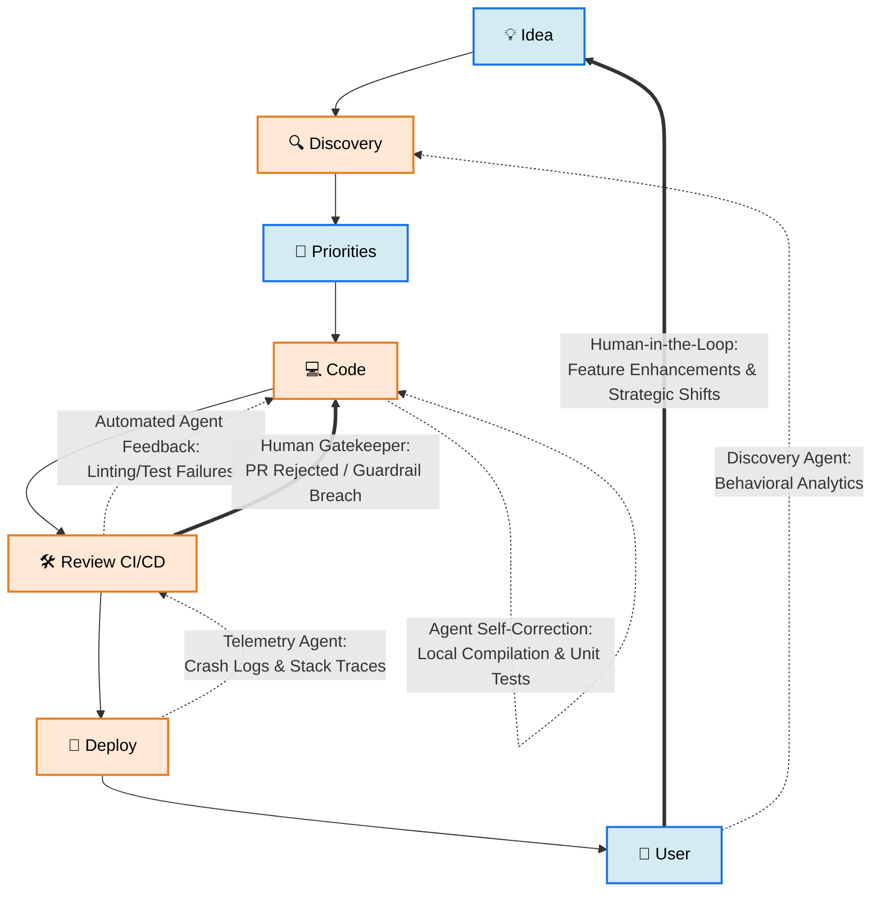

# Rusty Krab Lab

Wear your :construction_worker: - active experiments ongoing.

---

## 3D :rocket:

Powered by Markdown-STL (Stereolithography), see the [STL (Stereolithography) File Format](<https://en.wikipedia.org/wiki/STL_(file_format)>).

```stl
solid space_shuttle_launch_stack
  facet normal 0.34582 0.09266 -0.93371
    outer loop
      vertex 0 2 8
      vertex 2.33827 3.35 9
      vertex 2.7 2 9
    endloop
  endfacet
  facet normal 0.25316 0.25316 -0.93371
    outer loop
      vertex 0 2 8
      vertex 1.35 4.33827 9
      vertex 2.33827 3.35 9
    endloop
  endfacet
  facet normal 0.09266 0.34582 -0.93371
    outer loop
      vertex 0 2 8
      vertex 0 4.7 9
      vertex 1.35 4.33827 9
    endloop
  endfacet
  facet normal -0.09266 0.34582 -0.93371
    outer loop
      vertex 0 2 8
      vertex -1.35 4.33827 9
      vertex 0 4.7 9
    endloop
  endfacet
  facet normal -0.25316 0.25316 -0.93371
    outer loop
      vertex 0 2 8
      vertex -2.33827 3.35 9
      vertex -1.35 4.33827 9
    endloop
  endfacet
  facet normal -0.34582 0.09266 -0.93371
    outer loop
      vertex 0 2 8
      vertex -2.7 2 9
      vertex -2.33827 3.35 9
    endloop
  endfacet
  facet normal -0.34582 -0.09266 -0.93371
    outer loop
      vertex 0 2 8
      vertex -2.33827 0.65 9
      vertex -2.7 2 9
    endloop
  endfacet
  facet normal -0.25316 -0.25316 -0.93371
    outer loop
      vertex 0 2 8
      vertex -1.35 -0.33827 9
      vertex -2.33827 0.65 9
    endloop
  endfacet
  facet normal -0.09266 -0.34582 -0.93371
    outer loop
      vertex 0 2 8
      vertex 0 -0.7 9
      vertex -1.35 -0.33827 9
    endloop
  endfacet
  facet normal 0.09266 -0.34582 -0.93371
    outer loop
      vertex 0 2 8
      vertex 1.35 -0.33827 9
      vertex 0 -0.7 9
    endloop
  endfacet
  facet normal 0.25316 -0.25316 -0.93371
    outer loop
      vertex 0 2 8
      vertex 2.33827 0.65 9
      vertex 1.35 -0.33827 9
    endloop
  endfacet
  facet normal 0.34582 -0.09266 -0.93371
    outer loop
      vertex 0 2 8
      vertex 2.7 2 9
      vertex 2.33827 0.65 9
    endloop
  endfacet
  facet normal 0.85302 0.22857 -0.46916
    outer loop
      vertex 2.7 2 9
      vertex 2.33827 3.35 9
      vertex 3.2909 3.9 11
    endloop
  endfacet
  facet normal 0.85302 0.22856 -0.46916
    outer loop
      vertex 2.7 2 9
      vertex 3.2909 3.9 11
      vertex 3.8 2 11
    endloop
  endfacet
  facet normal 0.62445 0.62445 -0.46916
    outer loop
      vertex 2.33827 3.35 9
      vertex 1.35 4.33827 9
      vertex 1.9 5.2909 11
    endloop
  endfacet
  facet normal 0.62445 0.62445 -0.46916
    outer loop
      vertex 2.33827 3.35 9
      vertex 1.9 5.2909 11
      vertex 3.2909 3.9 11
    endloop
  endfacet
  facet normal 0.22857 0.85302 -0.46916
    outer loop
      vertex 1.35 4.33827 9
      vertex 0 4.7 9
      vertex 0 5.8 11
    endloop
  endfacet
  facet normal 0.22856 0.85302 -0.46916
    outer loop
      vertex 1.35 4.33827 9
      vertex 0 5.8 11
      vertex 1.9 5.2909 11
    endloop
  endfacet
  facet normal -0.22857 0.85302 -0.46916
    outer loop
      vertex 0 4.7 9
      vertex -1.35 4.33827 9
      vertex -1.9 5.2909 11
    endloop
  endfacet
  facet normal -0.22856 0.85302 -0.46916
    outer loop
      vertex 0 4.7 9
      vertex -1.9 5.2909 11
      vertex 0 5.8 11
    endloop
  endfacet
  facet normal -0.62445 0.62445 -0.46916
    outer loop
      vertex -1.35 4.33827 9
      vertex -2.33827 3.35 9
      vertex -3.2909 3.9 11
    endloop
  endfacet
  facet normal -0.62445 0.62445 -0.46916
    outer loop
      vertex -1.35 4.33827 9
      vertex -3.2909 3.9 11
      vertex -1.9 5.2909 11
    endloop
  endfacet
  facet normal -0.85302 0.22857 -0.46916
    outer loop
      vertex -2.33827 3.35 9
      vertex -2.7 2 9
      vertex -3.8 2 11
    endloop
  endfacet
  facet normal -0.85302 0.22856 -0.46916
    outer loop
      vertex -2.33827 3.35 9
      vertex -3.8 2 11
      vertex -3.2909 3.9 11
    endloop
  endfacet
  facet normal -0.85302 -0.22857 -0.46916
    outer loop
      vertex -2.7 2 9
      vertex -2.33827 0.65 9
      vertex -3.2909 0.1 11
    endloop
  endfacet
  facet normal -0.85302 -0.22856 -0.46916
    outer loop
      vertex -2.7 2 9
      vertex -3.2909 0.1 11
      vertex -3.8 2 11
    endloop
  endfacet
  facet normal -0.62445 -0.62445 -0.46916
    outer loop
      vertex -2.33827 0.65 9
      vertex -1.35 -0.33827 9
      vertex -1.9 -1.2909 11
    endloop
  endfacet
  facet normal -0.62445 -0.62445 -0.46916
    outer loop
      vertex -2.33827 0.65 9
      vertex -1.9 -1.2909 11
      vertex -3.2909 0.1 11
    endloop
  endfacet
  facet normal -0.22857 -0.85302 -0.46916
    outer loop
      vertex -1.35 -0.33827 9
      vertex 0 -0.7 9
      vertex 0 -1.8 11
    endloop
  endfacet
  facet normal -0.22856 -0.85302 -0.46916
    outer loop
      vertex -1.35 -0.33827 9
      vertex 0 -1.8 11
      vertex -1.9 -1.2909 11
    endloop
  endfacet
  facet normal 0.22857 -0.85302 -0.46916
    outer loop
      vertex 0 -0.7 9
      vertex 1.35 -0.33827 9
      vertex 1.9 -1.2909 11
    endloop
  endfacet
  facet normal 0.22856 -0.85302 -0.46916
    outer loop
      vertex 0 -0.7 9
      vertex 1.9 -1.2909 11
      vertex 0 -1.8 11
    endloop
  endfacet
  facet normal 0.62445 -0.62445 -0.46916
    outer loop
      vertex 1.35 -0.33827 9
      vertex 2.33827 0.65 9
      vertex 3.2909 0.1 11
    endloop
  endfacet
  facet normal 0.62445 -0.62445 -0.46916
    outer loop
      vertex 1.35 -0.33827 9
      vertex 3.2909 0.1 11
      vertex 1.9 -1.2909 11
    endloop
  endfacet
  facet normal 0.85302 -0.22857 -0.46916
    outer loop
      vertex 2.33827 0.65 9
      vertex 2.7 2 9
      vertex 3.8 2 11
    endloop
  endfacet
  facet normal 0.85302 -0.22856 -0.46916
    outer loop
      vertex 2.33827 0.65 9
      vertex 3.8 2 11
      vertex 3.2909 0.1 11
    endloop
  endfacet
  facet normal 0.96145 0.25762 -0.09614
    outer loop
      vertex 3.8 2 11
      vertex 3.2909 3.9 11
      vertex 3.5507 4.05 14
    endloop
  endfacet
  facet normal 0.96145 0.25762 -0.09615
    outer loop
      vertex 3.8 2 11
      vertex 3.5507 4.05 14
      vertex 4.1 2 14
    endloop
  endfacet
  facet normal 0.70383 0.70383 -0.09614
    outer loop
      vertex 3.2909 3.9 11
      vertex 1.9 5.2909 11
      vertex 2.05 5.5507 14
    endloop
  endfacet
  facet normal 0.70383 0.70383 -0.09614
    outer loop
      vertex 3.2909 3.9 11
      vertex 2.05 5.5507 14
      vertex 3.5507 4.05 14
    endloop
  endfacet
  facet normal 0.25762 0.96145 -0.09615
    outer loop
      vertex 1.9 5.2909 11
      vertex 0 5.8 11
      vertex 0 6.1 14
    endloop
  endfacet
  facet normal 0.25762 0.96145 -0.09614
    outer loop
      vertex 1.9 5.2909 11
      vertex 0 6.1 14
      vertex 2.05 5.5507 14
    endloop
  endfacet
  facet normal -0.25762 0.96145 -0.09614
    outer loop
      vertex 0 5.8 11
      vertex -1.9 5.2909 11
      vertex -2.05 5.5507 14
    endloop
  endfacet
  facet normal -0.25762 0.96145 -0.09615
    outer loop
      vertex 0 5.8 11
      vertex -2.05 5.5507 14
      vertex 0 6.1 14
    endloop
  endfacet
  facet normal -0.70383 0.70383 -0.09614
    outer loop
      vertex -1.9 5.2909 11
      vertex -3.2909 3.9 11
      vertex -3.5507 4.05 14
    endloop
  endfacet
  facet normal -0.70383 0.70383 -0.09614
    outer loop
      vertex -1.9 5.2909 11
      vertex -3.5507 4.05 14
      vertex -2.05 5.5507 14
    endloop
  endfacet
  facet normal -0.96145 0.25762 -0.09615
    outer loop
      vertex -3.2909 3.9 11
      vertex -3.8 2 11
      vertex -4.1 2 14
    endloop
  endfacet
  facet normal -0.96145 0.25762 -0.09614
    outer loop
      vertex -3.2909 3.9 11
      vertex -4.1 2 14
      vertex -3.5507 4.05 14
    endloop
  endfacet
  facet normal -0.96145 -0.25762 -0.09614
    outer loop
      vertex -3.8 2 11
      vertex -3.2909 0.1 11
      vertex -3.5507 -0.05 14
    endloop
  endfacet
  facet normal -0.96145 -0.25762 -0.09615
    outer loop
      vertex -3.8 2 11
      vertex -3.5507 -0.05 14
      vertex -4.1 2 14
    endloop
  endfacet
  facet normal -0.70383 -0.70383 -0.09614
    outer loop
      vertex -3.2909 0.1 11
      vertex -1.9 -1.2909 11
      vertex -2.05 -1.5507 14
    endloop
  endfacet
  facet normal -0.70383 -0.70383 -0.09614
    outer loop
      vertex -3.2909 0.1 11
      vertex -2.05 -1.5507 14
      vertex -3.5507 -0.05 14
    endloop
  endfacet
  facet normal -0.25762 -0.96145 -0.09615
    outer loop
      vertex -1.9 -1.2909 11
      vertex 0 -1.8 11
      vertex 0 -2.1 14
    endloop
  endfacet
  facet normal -0.25762 -0.96145 -0.09614
    outer loop
      vertex -1.9 -1.2909 11
      vertex 0 -2.1 14
      vertex -2.05 -1.5507 14
    endloop
  endfacet
  facet normal 0.25762 -0.96145 -0.09614
    outer loop
      vertex 0 -1.8 11
      vertex 1.9 -1.2909 11
      vertex 2.05 -1.5507 14
    endloop
  endfacet
  facet normal 0.25762 -0.96145 -0.09615
    outer loop
      vertex 0 -1.8 11
      vertex 2.05 -1.5507 14
      vertex 0 -2.1 14
    endloop
  endfacet
  facet normal 0.70383 -0.70383 -0.09614
    outer loop
      vertex 1.9 -1.2909 11
      vertex 3.2909 0.1 11
      vertex 3.5507 -0.05 14
    endloop
  endfacet
  facet normal 0.70383 -0.70383 -0.09614
    outer loop
      vertex 1.9 -1.2909 11
      vertex 3.5507 -0.05 14
      vertex 2.05 -1.5507 14
    endloop
  endfacet
  facet normal 0.96145 -0.25762 -0.09615
    outer loop
      vertex 3.2909 0.1 11
      vertex 3.8 2 11
      vertex 4.1 2 14
    endloop
  endfacet
  facet normal 0.96145 -0.25762 -0.09614
    outer loop
      vertex 3.2909 0.1 11
      vertex 4.1 2 14
      vertex 3.5507 -0.05 14
    endloop
  endfacet
  facet normal 0.96593 0.25882 0
    outer loop
      vertex 4.1 2 14
      vertex 3.5507 4.05 14
      vertex 3.5507 4.05 45
    endloop
  endfacet
  facet normal 0.96593 0.25882 0
    outer loop
      vertex 4.1 2 14
      vertex 3.5507 4.05 45
      vertex 4.1 2 45
    endloop
  endfacet
  facet normal 0.70711 0.70711 0
    outer loop
      vertex 3.5507 4.05 14
      vertex 2.05 5.5507 14
      vertex 2.05 5.5507 45
    endloop
  endfacet
  facet normal 0.70711 0.70711 0
    outer loop
      vertex 3.5507 4.05 14
      vertex 2.05 5.5507 45
      vertex 3.5507 4.05 45
    endloop
  endfacet
  facet normal 0.25882 0.96593 0
    outer loop
      vertex 2.05 5.5507 14
      vertex 0 6.1 14
      vertex 0 6.1 45
    endloop
  endfacet
  facet normal 0.25882 0.96593 0
    outer loop
      vertex 2.05 5.5507 14
      vertex 0 6.1 45
      vertex 2.05 5.5507 45
    endloop
  endfacet
  facet normal -0.25882 0.96593 0
    outer loop
      vertex 0 6.1 14
      vertex -2.05 5.5507 14
      vertex -2.05 5.5507 45
    endloop
  endfacet
  facet normal -0.25882 0.96593 0
    outer loop
      vertex 0 6.1 14
      vertex -2.05 5.5507 45
      vertex 0 6.1 45
    endloop
  endfacet
  facet normal -0.70711 0.70711 0
    outer loop
      vertex -2.05 5.5507 14
      vertex -3.5507 4.05 14
      vertex -3.5507 4.05 45
    endloop
  endfacet
  facet normal -0.70711 0.70711 0
    outer loop
      vertex -2.05 5.5507 14
      vertex -3.5507 4.05 45
      vertex -2.05 5.5507 45
    endloop
  endfacet
  facet normal -0.96593 0.25882 0
    outer loop
      vertex -3.5507 4.05 14
      vertex -4.1 2 14
      vertex -4.1 2 45
    endloop
  endfacet
  facet normal -0.96593 0.25882 0
    outer loop
      vertex -3.5507 4.05 14
      vertex -4.1 2 45
      vertex -3.5507 4.05 45
    endloop
  endfacet
  facet normal -0.96593 -0.25882 0
    outer loop
      vertex -4.1 2 14
      vertex -3.5507 -0.05 14
      vertex -3.5507 -0.05 45
    endloop
  endfacet
  facet normal -0.96593 -0.25882 0
    outer loop
      vertex -4.1 2 14
      vertex -3.5507 -0.05 45
      vertex -4.1 2 45
    endloop
  endfacet
  facet normal -0.70711 -0.70711 0
    outer loop
      vertex -3.5507 -0.05 14
      vertex -2.05 -1.5507 14
      vertex -2.05 -1.5507 45
    endloop
  endfacet
  facet normal -0.70711 -0.70711 0
    outer loop
      vertex -3.5507 -0.05 14
      vertex -2.05 -1.5507 45
      vertex -3.5507 -0.05 45
    endloop
  endfacet
  facet normal -0.25882 -0.96593 0
    outer loop
      vertex -2.05 -1.5507 14
      vertex 0 -2.1 14
      vertex 0 -2.1 45
    endloop
  endfacet
  facet normal -0.25882 -0.96593 0
    outer loop
      vertex -2.05 -1.5507 14
      vertex 0 -2.1 45
      vertex -2.05 -1.5507 45
    endloop
  endfacet
  facet normal 0.25882 -0.96593 0
    outer loop
      vertex 0 -2.1 14
      vertex 2.05 -1.5507 14
      vertex 2.05 -1.5507 45
    endloop
  endfacet
  facet normal 0.25882 -0.96593 0
    outer loop
      vertex 0 -2.1 14
      vertex 2.05 -1.5507 45
      vertex 0 -2.1 45
    endloop
  endfacet
  facet normal 0.70711 -0.70711 0
    outer loop
      vertex 2.05 -1.5507 14
      vertex 3.5507 -0.05 14
      vertex 3.5507 -0.05 45
    endloop
  endfacet
  facet normal 0.70711 -0.70711 0
    outer loop
      vertex 2.05 -1.5507 14
      vertex 3.5507 -0.05 45
      vertex 2.05 -1.5507 45
    endloop
  endfacet
  facet normal 0.96593 -0.25882 0
    outer loop
      vertex 3.5507 -0.05 14
      vertex 4.1 2 14
      vertex 4.1 2 45
    endloop
  endfacet
  facet normal 0.96593 -0.25882 0
    outer loop
      vertex 3.5507 -0.05 14
      vertex 4.1 2 45
      vertex 3.5507 -0.05 45
    endloop
  endfacet
  facet normal 0.95896 0.25695 0.11987
    outer loop
      vertex 4.1 2 45
      vertex 3.5507 4.05 45
      vertex 3.11769 3.8 49
    endloop
  endfacet
  facet normal 0.95896 0.25695 0.11987
    outer loop
      vertex 4.1 2 45
      vertex 3.11769 3.8 49
      vertex 3.6 2 49
    endloop
  endfacet
  facet normal 0.70201 0.70201 0.11987
    outer loop
      vertex 3.5507 4.05 45
      vertex 2.05 5.5507 45
      vertex 1.8 5.11769 49
    endloop
  endfacet
  facet normal 0.70201 0.70201 0.11987
    outer loop
      vertex 3.5507 4.05 45
      vertex 1.8 5.11769 49
      vertex 3.11769 3.8 49
    endloop
  endfacet
  facet normal 0.25695 0.95896 0.11987
    outer loop
      vertex 2.05 5.5507 45
      vertex 0 6.1 45
      vertex 0 5.6 49
    endloop
  endfacet
  facet normal 0.25695 0.95896 0.11987
    outer loop
      vertex 2.05 5.5507 45
      vertex 0 5.6 49
      vertex 1.8 5.11769 49
    endloop
  endfacet
  facet normal -0.25695 0.95896 0.11987
    outer loop
      vertex 0 6.1 45
      vertex -2.05 5.5507 45
      vertex -1.8 5.11769 49
    endloop
  endfacet
  facet normal -0.25695 0.95896 0.11987
    outer loop
      vertex 0 6.1 45
      vertex -1.8 5.11769 49
      vertex 0 5.6 49
    endloop
  endfacet
  facet normal -0.70201 0.70201 0.11987
    outer loop
      vertex -2.05 5.5507 45
      vertex -3.5507 4.05 45
      vertex -3.11769 3.8 49
    endloop
  endfacet
  facet normal -0.70201 0.70201 0.11987
    outer loop
      vertex -2.05 5.5507 45
      vertex -3.11769 3.8 49
      vertex -1.8 5.11769 49
    endloop
  endfacet
  facet normal -0.95896 0.25695 0.11987
    outer loop
      vertex -3.5507 4.05 45
      vertex -4.1 2 45
      vertex -3.6 2 49
    endloop
  endfacet
  facet normal -0.95896 0.25695 0.11987
    outer loop
      vertex -3.5507 4.05 45
      vertex -3.6 2 49
      vertex -3.11769 3.8 49
    endloop
  endfacet
  facet normal -0.95896 -0.25695 0.11987
    outer loop
      vertex -4.1 2 45
      vertex -3.5507 -0.05 45
      vertex -3.11769 0.2 49
    endloop
  endfacet
  facet normal -0.95896 -0.25695 0.11987
    outer loop
      vertex -4.1 2 45
      vertex -3.11769 0.2 49
      vertex -3.6 2 49
    endloop
  endfacet
  facet normal -0.70201 -0.70201 0.11987
    outer loop
      vertex -3.5507 -0.05 45
      vertex -2.05 -1.5507 45
      vertex -1.8 -1.11769 49
    endloop
  endfacet
  facet normal -0.70201 -0.70201 0.11987
    outer loop
      vertex -3.5507 -0.05 45
      vertex -1.8 -1.11769 49
      vertex -3.11769 0.2 49
    endloop
  endfacet
  facet normal -0.25695 -0.95896 0.11987
    outer loop
      vertex -2.05 -1.5507 45
      vertex 0 -2.1 45
      vertex 0 -1.6 49
    endloop
  endfacet
  facet normal -0.25695 -0.95896 0.11987
    outer loop
      vertex -2.05 -1.5507 45
      vertex 0 -1.6 49
      vertex -1.8 -1.11769 49
    endloop
  endfacet
  facet normal 0.25695 -0.95896 0.11987
    outer loop
      vertex 0 -2.1 45
      vertex 2.05 -1.5507 45
      vertex 1.8 -1.11769 49
    endloop
  endfacet
  facet normal 0.25695 -0.95896 0.11987
    outer loop
      vertex 0 -2.1 45
      vertex 1.8 -1.11769 49
      vertex 0 -1.6 49
    endloop
  endfacet
  facet normal 0.70201 -0.70201 0.11987
    outer loop
      vertex 2.05 -1.5507 45
      vertex 3.5507 -0.05 45
      vertex 3.11769 0.2 49
    endloop
  endfacet
  facet normal 0.70201 -0.70201 0.11987
    outer loop
      vertex 2.05 -1.5507 45
      vertex 3.11769 0.2 49
      vertex 1.8 -1.11769 49
    endloop
  endfacet
  facet normal 0.95896 -0.25695 0.11987
    outer loop
      vertex 3.5507 -0.05 45
      vertex 4.1 2 45
      vertex 3.6 2 49
    endloop
  endfacet
  facet normal 0.95896 -0.25695 0.11987
    outer loop
      vertex 3.5507 -0.05 45
      vertex 3.6 2 49
      vertex 3.11769 0.2 49
    endloop
  endfacet
  facet normal 0.90101 0.24143 0.3604
    outer loop
      vertex 3.6 2 49
      vertex 3.11769 3.8 49
      vertex 1.73205 3 53
    endloop
  endfacet
  facet normal 0.90101 0.24143 0.3604
    outer loop
      vertex 3.6 2 49
      vertex 1.73205 3 53
      vertex 2 2 53
    endloop
  endfacet
  facet normal 0.65959 0.65959 0.3604
    outer loop
      vertex 3.11769 3.8 49
      vertex 1.8 5.11769 49
      vertex 1 3.73205 53
    endloop
  endfacet
  facet normal 0.65959 0.65959 0.3604
    outer loop
      vertex 3.11769 3.8 49
      vertex 1 3.73205 53
      vertex 1.73205 3 53
    endloop
  endfacet
  facet normal 0.24143 0.90101 0.3604
    outer loop
      vertex 1.8 5.11769 49
      vertex 0 5.6 49
      vertex 0 4 53
    endloop
  endfacet
  facet normal 0.24143 0.90101 0.3604
    outer loop
      vertex 1.8 5.11769 49
      vertex 0 4 53
      vertex 1 3.73205 53
    endloop
  endfacet
  facet normal -0.24143 0.90101 0.3604
    outer loop
      vertex 0 5.6 49
      vertex -1.8 5.11769 49
      vertex -1 3.73205 53
    endloop
  endfacet
  facet normal -0.24143 0.90101 0.3604
    outer loop
      vertex 0 5.6 49
      vertex -1 3.73205 53
      vertex 0 4 53
    endloop
  endfacet
  facet normal -0.65959 0.65959 0.3604
    outer loop
      vertex -1.8 5.11769 49
      vertex -3.11769 3.8 49
      vertex -1.73205 3 53
    endloop
  endfacet
  facet normal -0.65959 0.65959 0.3604
    outer loop
      vertex -1.8 5.11769 49
      vertex -1.73205 3 53
      vertex -1 3.73205 53
    endloop
  endfacet
  facet normal -0.90101 0.24143 0.3604
    outer loop
      vertex -3.11769 3.8 49
      vertex -3.6 2 49
      vertex -2 2 53
    endloop
  endfacet
  facet normal -0.90101 0.24143 0.3604
    outer loop
      vertex -3.11769 3.8 49
      vertex -2 2 53
      vertex -1.73205 3 53
    endloop
  endfacet
  facet normal -0.90101 -0.24143 0.3604
    outer loop
      vertex -3.6 2 49
      vertex -3.11769 0.2 49
      vertex -1.73205 1 53
    endloop
  endfacet
  facet normal -0.90101 -0.24143 0.3604
    outer loop
      vertex -3.6 2 49
      vertex -1.73205 1 53
      vertex -2 2 53
    endloop
  endfacet
  facet normal -0.65959 -0.65959 0.3604
    outer loop
      vertex -3.11769 0.2 49
      vertex -1.8 -1.11769 49
      vertex -1 0.26795 53
    endloop
  endfacet
  facet normal -0.65959 -0.65959 0.3604
    outer loop
      vertex -3.11769 0.2 49
      vertex -1 0.26795 53
      vertex -1.73205 1 53
    endloop
  endfacet
  facet normal -0.24143 -0.90101 0.3604
    outer loop
      vertex -1.8 -1.11769 49
      vertex 0 -1.6 49
      vertex 0 0 53
    endloop
  endfacet
  facet normal -0.24143 -0.90101 0.3604
    outer loop
      vertex -1.8 -1.11769 49
      vertex 0 0 53
      vertex -1 0.26795 53
    endloop
  endfacet
  facet normal 0.24143 -0.90101 0.3604
    outer loop
      vertex 0 -1.6 49
      vertex 1.8 -1.11769 49
      vertex 1 0.26795 53
    endloop
  endfacet
  facet normal 0.24143 -0.90101 0.3604
    outer loop
      vertex 0 -1.6 49
      vertex 1 0.26795 53
      vertex 0 0 53
    endloop
  endfacet
  facet normal 0.65959 -0.65959 0.3604
    outer loop
      vertex 1.8 -1.11769 49
      vertex 3.11769 0.2 49
      vertex 1.73205 1 53
    endloop
  endfacet
  facet normal 0.65959 -0.65959 0.3604
    outer loop
      vertex 1.8 -1.11769 49
      vertex 1.73205 1 53
      vertex 1 0.26795 53
    endloop
  endfacet
  facet normal 0.90101 -0.24143 0.3604
    outer loop
      vertex 3.11769 0.2 49
      vertex 3.6 2 49
      vertex 2 2 53
    endloop
  endfacet
  facet normal 0.90101 -0.24143 0.3604
    outer loop
      vertex 3.11769 0.2 49
      vertex 2 2 53
      vertex 1.73205 1 53
    endloop
  endfacet
  facet normal 0.81211 0.21761 0.54141
    outer loop
      vertex 2 2 53
      vertex 1.73205 3 53
      vertex 0 2 56
    endloop
  endfacet
  facet normal 0.59451 0.59451 0.54141
    outer loop
      vertex 1.73205 3 53
      vertex 1 3.73205 53
      vertex 0 2 56
    endloop
  endfacet
  facet normal 0.21761 0.81211 0.54141
    outer loop
      vertex 1 3.73205 53
      vertex 0 4 53
      vertex 0 2 56
    endloop
  endfacet
  facet normal -0.21761 0.81211 0.54141
    outer loop
      vertex 0 4 53
      vertex -1 3.73205 53
      vertex 0 2 56
    endloop
  endfacet
  facet normal -0.59451 0.59451 0.54141
    outer loop
      vertex -1 3.73205 53
      vertex -1.73205 3 53
      vertex 0 2 56
    endloop
  endfacet
  facet normal -0.81211 0.21761 0.54141
    outer loop
      vertex -1.73205 3 53
      vertex -2 2 53
      vertex 0 2 56
    endloop
  endfacet
  facet normal -0.81211 -0.21761 0.54141
    outer loop
      vertex -2 2 53
      vertex -1.73205 1 53
      vertex 0 2 56
    endloop
  endfacet
  facet normal -0.59451 -0.59451 0.54141
    outer loop
      vertex -1.73205 1 53
      vertex -1 0.26795 53
      vertex 0 2 56
    endloop
  endfacet
  facet normal -0.21761 -0.81211 0.54141
    outer loop
      vertex -1 0.26795 53
      vertex 0 0 53
      vertex 0 2 56
    endloop
  endfacet
  facet normal 0.21761 -0.81211 0.54141
    outer loop
      vertex 0 0 53
      vertex 1 0.26795 53
      vertex 0 2 56
    endloop
  endfacet
  facet normal 0.59451 -0.59451 0.54141
    outer loop
      vertex 1 0.26795 53
      vertex 1.73205 1 53
      vertex 0 2 56
    endloop
  endfacet
  facet normal 0.81211 -0.21761 0.54141
    outer loop
      vertex 1.73205 1 53
      vertex 2 2 53
      vertex 0 2 56
    endloop
  endfacet
  facet normal 0.94933 0.25437 0.18459
    outer loop
      vertex -4.25 2 1.6
      vertex -4.52465 3.025 1.6
      vertex -4.82776 2.85 3.4
    endloop
  endfacet
  facet normal 0.94933 0.25437 0.18459
    outer loop
      vertex -4.25 2 1.6
      vertex -4.82776 2.85 3.4
      vertex -4.6 2 3.4
    endloop
  endfacet
  facet normal 0.69496 0.69496 0.18459
    outer loop
      vertex -4.52465 3.025 1.6
      vertex -5.275 3.77535 1.6
      vertex -5.45 3.47224 3.4
    endloop
  endfacet
  facet normal 0.69496 0.69496 0.18459
    outer loop
      vertex -4.52465 3.025 1.6
      vertex -5.45 3.47224 3.4
      vertex -4.82776 2.85 3.4
    endloop
  endfacet
  facet normal 0.25437 0.94933 0.18459
    outer loop
      vertex -5.275 3.77535 1.6
      vertex -6.3 4.05 1.6
      vertex -6.3 3.7 3.4
    endloop
  endfacet
  facet normal 0.25437 0.94933 0.18459
    outer loop
      vertex -5.275 3.77535 1.6
      vertex -6.3 3.7 3.4
      vertex -5.45 3.47224 3.4
    endloop
  endfacet
  facet normal -0.25437 0.94933 0.18459
    outer loop
      vertex -6.3 4.05 1.6
      vertex -7.325 3.77535 1.6
      vertex -7.15 3.47224 3.4
    endloop
  endfacet
  facet normal -0.25437 0.94933 0.18459
    outer loop
      vertex -6.3 4.05 1.6
      vertex -7.15 3.47224 3.4
      vertex -6.3 3.7 3.4
    endloop
  endfacet
  facet normal -0.69496 0.69496 0.18459
    outer loop
      vertex -7.325 3.77535 1.6
      vertex -8.07535 3.025 1.6
      vertex -7.77224 2.85 3.4
    endloop
  endfacet
  facet normal -0.69496 0.69496 0.18459
    outer loop
      vertex -7.325 3.77535 1.6
      vertex -7.77224 2.85 3.4
      vertex -7.15 3.47224 3.4
    endloop
  endfacet
  facet normal -0.94933 0.25437 0.18459
    outer loop
      vertex -8.07535 3.025 1.6
      vertex -8.35 2 1.6
      vertex -8 2 3.4
    endloop
  endfacet
  facet normal -0.94933 0.25437 0.18459
    outer loop
      vertex -8.07535 3.025 1.6
      vertex -8 2 3.4
      vertex -7.77224 2.85 3.4
    endloop
  endfacet
  facet normal -0.94933 -0.25437 0.18459
    outer loop
      vertex -8.35 2 1.6
      vertex -8.07535 0.975 1.6
      vertex -7.77224 1.15 3.4
    endloop
  endfacet
  facet normal -0.94933 -0.25437 0.18459
    outer loop
      vertex -8.35 2 1.6
      vertex -7.77224 1.15 3.4
      vertex -8 2 3.4
    endloop
  endfacet
  facet normal -0.69496 -0.69496 0.18459
    outer loop
      vertex -8.07535 0.975 1.6
      vertex -7.325 0.22465 1.6
      vertex -7.15 0.52776 3.4
    endloop
  endfacet
  facet normal -0.69496 -0.69496 0.18459
    outer loop
      vertex -8.07535 0.975 1.6
      vertex -7.15 0.52776 3.4
      vertex -7.77224 1.15 3.4
    endloop
  endfacet
  facet normal -0.25437 -0.94933 0.18459
    outer loop
      vertex -7.325 0.22465 1.6
      vertex -6.3 -0.05 1.6
      vertex -6.3 0.3 3.4
    endloop
  endfacet
  facet normal -0.25437 -0.94933 0.18459
    outer loop
      vertex -7.325 0.22465 1.6
      vertex -6.3 0.3 3.4
      vertex -7.15 0.52776 3.4
    endloop
  endfacet
  facet normal 0.25437 -0.94933 0.18459
    outer loop
      vertex -6.3 -0.05 1.6
      vertex -5.275 0.22465 1.6
      vertex -5.45 0.52776 3.4
    endloop
  endfacet
  facet normal 0.25437 -0.94933 0.18459
    outer loop
      vertex -6.3 -0.05 1.6
      vertex -5.45 0.52776 3.4
      vertex -6.3 0.3 3.4
    endloop
  endfacet
  facet normal 0.69496 -0.69496 0.18459
    outer loop
      vertex -5.275 0.22465 1.6
      vertex -4.52465 0.975 1.6
      vertex -4.82776 1.15 3.4
    endloop
  endfacet
  facet normal 0.69496 -0.69496 0.18459
    outer loop
      vertex -5.275 0.22465 1.6
      vertex -4.82776 1.15 3.4
      vertex -5.45 0.52776 3.4
    endloop
  endfacet
  facet normal 0.94933 -0.25437 0.18459
    outer loop
      vertex -4.52465 0.975 1.6
      vertex -4.25 2 1.6
      vertex -4.6 2 3.4
    endloop
  endfacet
  facet normal 0.94933 -0.25437 0.18459
    outer loop
      vertex -4.52465 0.975 1.6
      vertex -4.6 2 3.4
      vertex -4.82776 1.15 3.4
    endloop
  endfacet
  facet normal 0.96592 0.25882 0
    outer loop
      vertex -4.6 2 3.4
      vertex -4.82776 2.85 3.4
      vertex -4.82776 2.85 5.2
    endloop
  endfacet
  facet normal 0.96592 0.25882 0
    outer loop
      vertex -4.6 2 3.4
      vertex -4.82776 2.85 5.2
      vertex -4.6 2 5.2
    endloop
  endfacet
  facet normal 0.70711 0.70711 0
    outer loop
      vertex -4.82776 2.85 3.4
      vertex -5.45 3.47224 3.4
      vertex -5.45 3.47224 5.2
    endloop
  endfacet
  facet normal 0.70711 0.70711 0
    outer loop
      vertex -4.82776 2.85 3.4
      vertex -5.45 3.47224 5.2
      vertex -4.82776 2.85 5.2
    endloop
  endfacet
  facet normal 0.25882 0.96592 0
    outer loop
      vertex -5.45 3.47224 3.4
      vertex -6.3 3.7 3.4
      vertex -6.3 3.7 5.2
    endloop
  endfacet
  facet normal 0.25882 0.96592 0
    outer loop
      vertex -5.45 3.47224 3.4
      vertex -6.3 3.7 5.2
      vertex -5.45 3.47224 5.2
    endloop
  endfacet
  facet normal -0.25882 0.96592 0
    outer loop
      vertex -6.3 3.7 3.4
      vertex -7.15 3.47224 3.4
      vertex -7.15 3.47224 5.2
    endloop
  endfacet
  facet normal -0.25882 0.96592 0
    outer loop
      vertex -6.3 3.7 3.4
      vertex -7.15 3.47224 5.2
      vertex -6.3 3.7 5.2
    endloop
  endfacet
  facet normal -0.70711 0.70711 0
    outer loop
      vertex -7.15 3.47224 3.4
      vertex -7.77224 2.85 3.4
      vertex -7.77224 2.85 5.2
    endloop
  endfacet
  facet normal -0.70711 0.70711 0
    outer loop
      vertex -7.15 3.47224 3.4
      vertex -7.77224 2.85 5.2
      vertex -7.15 3.47224 5.2
    endloop
  endfacet
  facet normal -0.96592 0.25882 0
    outer loop
      vertex -7.77224 2.85 3.4
      vertex -8 2 3.4
      vertex -8 2 5.2
    endloop
  endfacet
  facet normal -0.96592 0.25882 0
    outer loop
      vertex -7.77224 2.85 3.4
      vertex -8 2 5.2
      vertex -7.77224 2.85 5.2
    endloop
  endfacet
  facet normal -0.96592 -0.25882 0
    outer loop
      vertex -8 2 3.4
      vertex -7.77224 1.15 3.4
      vertex -7.77224 1.15 5.2
    endloop
  endfacet
  facet normal -0.96592 -0.25882 0
    outer loop
      vertex -8 2 3.4
      vertex -7.77224 1.15 5.2
      vertex -8 2 5.2
    endloop
  endfacet
  facet normal -0.70711 -0.70711 0
    outer loop
      vertex -7.77224 1.15 3.4
      vertex -7.15 0.52776 3.4
      vertex -7.15 0.52776 5.2
    endloop
  endfacet
  facet normal -0.70711 -0.70711 0
    outer loop
      vertex -7.77224 1.15 3.4
      vertex -7.15 0.52776 5.2
      vertex -7.77224 1.15 5.2
    endloop
  endfacet
  facet normal -0.25882 -0.96592 0
    outer loop
      vertex -7.15 0.52776 3.4
      vertex -6.3 0.3 3.4
      vertex -6.3 0.3 5.2
    endloop
  endfacet
  facet normal -0.25882 -0.96592 0
    outer loop
      vertex -7.15 0.52776 3.4
      vertex -6.3 0.3 5.2
      vertex -7.15 0.52776 5.2
    endloop
  endfacet
  facet normal 0.25882 -0.96592 0
    outer loop
      vertex -6.3 0.3 3.4
      vertex -5.45 0.52776 3.4
      vertex -5.45 0.52776 5.2
    endloop
  endfacet
  facet normal 0.25882 -0.96592 0
    outer loop
      vertex -6.3 0.3 3.4
      vertex -5.45 0.52776 5.2
      vertex -6.3 0.3 5.2
    endloop
  endfacet
  facet normal 0.70711 -0.70711 0
    outer loop
      vertex -5.45 0.52776 3.4
      vertex -4.82776 1.15 3.4
      vertex -4.82776 1.15 5.2
    endloop
  endfacet
  facet normal 0.70711 -0.70711 0
    outer loop
      vertex -5.45 0.52776 3.4
      vertex -4.82776 1.15 5.2
      vertex -5.45 0.52776 5.2
    endloop
  endfacet
  facet normal 0.96592 -0.25882 0
    outer loop
      vertex -4.82776 1.15 3.4
      vertex -4.6 2 3.4
      vertex -4.6 2 5.2
    endloop
  endfacet
  facet normal 0.96592 -0.25882 0
    outer loop
      vertex -4.82776 1.15 3.4
      vertex -4.6 2 5.2
      vertex -4.82776 1.15 5.2
    endloop
  endfacet
  facet normal 0.93894 0.25159 -0.23474
    outer loop
      vertex -4.6 2 5.2
      vertex -4.82776 2.85 5.2
      vertex -4.65455 2.95 6
    endloop
  endfacet
  facet normal 0.93894 0.25159 -0.23473
    outer loop
      vertex -4.6 2 5.2
      vertex -4.65455 2.95 6
      vertex -4.4 2 6
    endloop
  endfacet
  facet normal 0.68735 0.68735 -0.23474
    outer loop
      vertex -4.82776 2.85 5.2
      vertex -5.45 3.47224 5.2
      vertex -5.35 3.64545 6
    endloop
  endfacet
  facet normal 0.68735 0.68735 -0.23474
    outer loop
      vertex -4.82776 2.85 5.2
      vertex -5.35 3.64545 6
      vertex -4.65455 2.95 6
    endloop
  endfacet
  facet normal 0.25159 0.93894 -0.23473
    outer loop
      vertex -5.45 3.47224 5.2
      vertex -6.3 3.7 5.2
      vertex -6.3 3.9 6
    endloop
  endfacet
  facet normal 0.25159 0.93894 -0.23474
    outer loop
      vertex -5.45 3.47224 5.2
      vertex -6.3 3.9 6
      vertex -5.35 3.64545 6
    endloop
  endfacet
  facet normal -0.25159 0.93894 -0.23474
    outer loop
      vertex -6.3 3.7 5.2
      vertex -7.15 3.47224 5.2
      vertex -7.25 3.64545 6
    endloop
  endfacet
  facet normal -0.25159 0.93894 -0.23473
    outer loop
      vertex -6.3 3.7 5.2
      vertex -7.25 3.64545 6
      vertex -6.3 3.9 6
    endloop
  endfacet
  facet normal -0.68735 0.68735 -0.23474
    outer loop
      vertex -7.15 3.47224 5.2
      vertex -7.77224 2.85 5.2
      vertex -7.94545 2.95 6
    endloop
  endfacet
  facet normal -0.68735 0.68735 -0.23474
    outer loop
      vertex -7.15 3.47224 5.2
      vertex -7.94545 2.95 6
      vertex -7.25 3.64545 6
    endloop
  endfacet
  facet normal -0.93894 0.25159 -0.23473
    outer loop
      vertex -7.77224 2.85 5.2
      vertex -8 2 5.2
      vertex -8.2 2 6
    endloop
  endfacet
  facet normal -0.93894 0.25159 -0.23474
    outer loop
      vertex -7.77224 2.85 5.2
      vertex -8.2 2 6
      vertex -7.94545 2.95 6
    endloop
  endfacet
  facet normal -0.93894 -0.25159 -0.23474
    outer loop
      vertex -8 2 5.2
      vertex -7.77224 1.15 5.2
      vertex -7.94545 1.05 6
    endloop
  endfacet
  facet normal -0.93894 -0.25159 -0.23473
    outer loop
      vertex -8 2 5.2
      vertex -7.94545 1.05 6
      vertex -8.2 2 6
    endloop
  endfacet
  facet normal -0.68735 -0.68735 -0.23474
    outer loop
      vertex -7.77224 1.15 5.2
      vertex -7.15 0.52776 5.2
      vertex -7.25 0.35455 6
    endloop
  endfacet
  facet normal -0.68735 -0.68735 -0.23474
    outer loop
      vertex -7.77224 1.15 5.2
      vertex -7.25 0.35455 6
      vertex -7.94545 1.05 6
    endloop
  endfacet
  facet normal -0.25159 -0.93894 -0.23473
    outer loop
      vertex -7.15 0.52776 5.2
      vertex -6.3 0.3 5.2
      vertex -6.3 0.1 6
    endloop
  endfacet
  facet normal -0.25159 -0.93894 -0.23474
    outer loop
      vertex -7.15 0.52776 5.2
      vertex -6.3 0.1 6
      vertex -7.25 0.35455 6
    endloop
  endfacet
  facet normal 0.25159 -0.93894 -0.23474
    outer loop
      vertex -6.3 0.3 5.2
      vertex -5.45 0.52776 5.2
      vertex -5.35 0.35455 6
    endloop
  endfacet
  facet normal 0.25159 -0.93894 -0.23473
    outer loop
      vertex -6.3 0.3 5.2
      vertex -5.35 0.35455 6
      vertex -6.3 0.1 6
    endloop
  endfacet
  facet normal 0.68735 -0.68735 -0.23474
    outer loop
      vertex -5.45 0.52776 5.2
      vertex -4.82776 1.15 5.2
      vertex -4.65455 1.05 6
    endloop
  endfacet
  facet normal 0.68735 -0.68735 -0.23474
    outer loop
      vertex -5.45 0.52776 5.2
      vertex -4.65455 1.05 6
      vertex -5.35 0.35455 6
    endloop
  endfacet
  facet normal 0.93894 -0.25159 -0.23473
    outer loop
      vertex -4.82776 1.15 5.2
      vertex -4.6 2 5.2
      vertex -4.4 2 6
    endloop
  endfacet
  facet normal 0.93894 -0.25159 -0.23474
    outer loop
      vertex -4.82776 1.15 5.2
      vertex -4.4 2 6
      vertex -4.65455 1.05 6
    endloop
  endfacet
  facet normal 0.94839 0.25412 0.18968
    outer loop
      vertex -4.4 2 6
      vertex -4.65455 2.95 6
      vertex -4.82776 2.85 7
    endloop
  endfacet
  facet normal 0.94839 0.25412 0.18968
    outer loop
      vertex -4.4 2 6
      vertex -4.82776 2.85 7
      vertex -4.6 2 7
    endloop
  endfacet
  facet normal 0.69427 0.69427 0.18968
    outer loop
      vertex -4.65455 2.95 6
      vertex -5.35 3.64545 6
      vertex -5.45 3.47224 7
    endloop
  endfacet
  facet normal 0.69427 0.69427 0.18968
    outer loop
      vertex -4.65455 2.95 6
      vertex -5.45 3.47224 7
      vertex -4.82776 2.85 7
    endloop
  endfacet
  facet normal 0.25412 0.94839 0.18968
    outer loop
      vertex -5.35 3.64545 6
      vertex -6.3 3.9 6
      vertex -6.3 3.7 7
    endloop
  endfacet
  facet normal 0.25412 0.94839 0.18968
    outer loop
      vertex -5.35 3.64545 6
      vertex -6.3 3.7 7
      vertex -5.45 3.47224 7
    endloop
  endfacet
  facet normal -0.25412 0.94839 0.18968
    outer loop
      vertex -6.3 3.9 6
      vertex -7.25 3.64545 6
      vertex -7.15 3.47224 7
    endloop
  endfacet
  facet normal -0.25412 0.94839 0.18968
    outer loop
      vertex -6.3 3.9 6
      vertex -7.15 3.47224 7
      vertex -6.3 3.7 7
    endloop
  endfacet
  facet normal -0.69427 0.69427 0.18968
    outer loop
      vertex -7.25 3.64545 6
      vertex -7.94545 2.95 6
      vertex -7.77224 2.85 7
    endloop
  endfacet
  facet normal -0.69427 0.69427 0.18968
    outer loop
      vertex -7.25 3.64545 6
      vertex -7.77224 2.85 7
      vertex -7.15 3.47224 7
    endloop
  endfacet
  facet normal -0.94839 0.25412 0.18968
    outer loop
      vertex -7.94545 2.95 6
      vertex -8.2 2 6
      vertex -8 2 7
    endloop
  endfacet
  facet normal -0.94839 0.25412 0.18968
    outer loop
      vertex -7.94545 2.95 6
      vertex -8 2 7
      vertex -7.77224 2.85 7
    endloop
  endfacet
  facet normal -0.94839 -0.25412 0.18968
    outer loop
      vertex -8.2 2 6
      vertex -7.94545 1.05 6
      vertex -7.77224 1.15 7
    endloop
  endfacet
  facet normal -0.94839 -0.25412 0.18968
    outer loop
      vertex -8.2 2 6
      vertex -7.77224 1.15 7
      vertex -8 2 7
    endloop
  endfacet
  facet normal -0.69427 -0.69427 0.18968
    outer loop
      vertex -7.94545 1.05 6
      vertex -7.25 0.35455 6
      vertex -7.15 0.52776 7
    endloop
  endfacet
  facet normal -0.69427 -0.69427 0.18968
    outer loop
      vertex -7.94545 1.05 6
      vertex -7.15 0.52776 7
      vertex -7.77224 1.15 7
    endloop
  endfacet
  facet normal -0.25412 -0.94839 0.18968
    outer loop
      vertex -7.25 0.35455 6
      vertex -6.3 0.1 6
      vertex -6.3 0.3 7
    endloop
  endfacet
  facet normal -0.25412 -0.94839 0.18968
    outer loop
      vertex -7.25 0.35455 6
      vertex -6.3 0.3 7
      vertex -7.15 0.52776 7
    endloop
  endfacet
  facet normal 0.25412 -0.94839 0.18968
    outer loop
      vertex -6.3 0.1 6
      vertex -5.35 0.35455 6
      vertex -5.45 0.52776 7
    endloop
  endfacet
  facet normal 0.25412 -0.94839 0.18968
    outer loop
      vertex -6.3 0.1 6
      vertex -5.45 0.52776 7
      vertex -6.3 0.3 7
    endloop
  endfacet
  facet normal 0.69427 -0.69427 0.18968
    outer loop
      vertex -5.35 0.35455 6
      vertex -4.65455 1.05 6
      vertex -4.82776 1.15 7
    endloop
  endfacet
  facet normal 0.69427 -0.69427 0.18968
    outer loop
      vertex -5.35 0.35455 6
      vertex -4.82776 1.15 7
      vertex -5.45 0.52776 7
    endloop
  endfacet
  facet normal 0.94839 -0.25412 0.18968
    outer loop
      vertex -4.65455 1.05 6
      vertex -4.4 2 6
      vertex -4.6 2 7
    endloop
  endfacet
  facet normal 0.94839 -0.25412 0.18968
    outer loop
      vertex -4.65455 1.05 6
      vertex -4.6 2 7
      vertex -4.82776 1.15 7
    endloop
  endfacet
  facet normal 0.96592 0.25882 0
    outer loop
      vertex -4.6 2 7
      vertex -4.82776 2.85 7
      vertex -4.82776 2.85 40
    endloop
  endfacet
  facet normal 0.96592 0.25882 0
    outer loop
      vertex -4.6 2 7
      vertex -4.82776 2.85 40
      vertex -4.6 2 40
    endloop
  endfacet
  facet normal 0.70711 0.70711 0
    outer loop
      vertex -4.82776 2.85 7
      vertex -5.45 3.47224 7
      vertex -5.45 3.47224 40
    endloop
  endfacet
  facet normal 0.70711 0.70711 0
    outer loop
      vertex -4.82776 2.85 7
      vertex -5.45 3.47224 40
      vertex -4.82776 2.85 40
    endloop
  endfacet
  facet normal 0.25882 0.96592 0
    outer loop
      vertex -5.45 3.47224 7
      vertex -6.3 3.7 7
      vertex -6.3 3.7 40
    endloop
  endfacet
  facet normal 0.25882 0.96592 0
    outer loop
      vertex -5.45 3.47224 7
      vertex -6.3 3.7 40
      vertex -5.45 3.47224 40
    endloop
  endfacet
  facet normal -0.25882 0.96592 0
    outer loop
      vertex -6.3 3.7 7
      vertex -7.15 3.47224 7
      vertex -7.15 3.47224 40
    endloop
  endfacet
  facet normal -0.25882 0.96592 0
    outer loop
      vertex -6.3 3.7 7
      vertex -7.15 3.47224 40
      vertex -6.3 3.7 40
    endloop
  endfacet
  facet normal -0.70711 0.70711 0
    outer loop
      vertex -7.15 3.47224 7
      vertex -7.77224 2.85 7
      vertex -7.77224 2.85 40
    endloop
  endfacet
  facet normal -0.70711 0.70711 0
    outer loop
      vertex -7.15 3.47224 7
      vertex -7.77224 2.85 40
      vertex -7.15 3.47224 40
    endloop
  endfacet
  facet normal -0.96592 0.25882 0
    outer loop
      vertex -7.77224 2.85 7
      vertex -8 2 7
      vertex -8 2 40
    endloop
  endfacet
  facet normal -0.96592 0.25882 0
    outer loop
      vertex -7.77224 2.85 7
      vertex -8 2 40
      vertex -7.77224 2.85 40
    endloop
  endfacet
  facet normal -0.96592 -0.25882 0
    outer loop
      vertex -8 2 7
      vertex -7.77224 1.15 7
      vertex -7.77224 1.15 40
    endloop
  endfacet
  facet normal -0.96592 -0.25882 0
    outer loop
      vertex -8 2 7
      vertex -7.77224 1.15 40
      vertex -8 2 40
    endloop
  endfacet
  facet normal -0.70711 -0.70711 0
    outer loop
      vertex -7.77224 1.15 7
      vertex -7.15 0.52776 7
      vertex -7.15 0.52776 40
    endloop
  endfacet
  facet normal -0.70711 -0.70711 0
    outer loop
      vertex -7.77224 1.15 7
      vertex -7.15 0.52776 40
      vertex -7.77224 1.15 40
    endloop
  endfacet
  facet normal -0.25882 -0.96592 0
    outer loop
      vertex -7.15 0.52776 7
      vertex -6.3 0.3 7
      vertex -6.3 0.3 40
    endloop
  endfacet
  facet normal -0.25882 -0.96592 0
    outer loop
      vertex -7.15 0.52776 7
      vertex -6.3 0.3 40
      vertex -7.15 0.52776 40
    endloop
  endfacet
  facet normal 0.25882 -0.96592 0
    outer loop
      vertex -6.3 0.3 7
      vertex -5.45 0.52776 7
      vertex -5.45 0.52776 40
    endloop
  endfacet
  facet normal 0.25882 -0.96592 0
    outer loop
      vertex -6.3 0.3 7
      vertex -5.45 0.52776 40
      vertex -6.3 0.3 40
    endloop
  endfacet
  facet normal 0.70711 -0.70711 0
    outer loop
      vertex -5.45 0.52776 7
      vertex -4.82776 1.15 7
      vertex -4.82776 1.15 40
    endloop
  endfacet
  facet normal 0.70711 -0.70711 0
    outer loop
      vertex -5.45 0.52776 7
      vertex -4.82776 1.15 40
      vertex -5.45 0.52776 40
    endloop
  endfacet
  facet normal 0.96592 -0.25882 0
    outer loop
      vertex -4.82776 1.15 7
      vertex -4.6 2 7
      vertex -4.6 2 40
    endloop
  endfacet
  facet normal 0.96592 -0.25882 0
    outer loop
      vertex -4.82776 1.15 7
      vertex -4.6 2 40
      vertex -4.82776 1.15 40
    endloop
  endfacet
  facet normal 0.93894 0.25159 0.23473
    outer loop
      vertex -4.6 2 40
      vertex -4.82776 2.85 40
      vertex -5.34737 2.55 42.4
    endloop
  endfacet
  facet normal 0.93894 0.25158 0.23473
    outer loop
      vertex -4.6 2 40
      vertex -5.34737 2.55 42.4
      vertex -5.2 2 42.4
    endloop
  endfacet
  facet normal 0.68735 0.68735 0.23473
    outer loop
      vertex -4.82776 2.85 40
      vertex -5.45 3.47224 40
      vertex -5.75 2.95263 42.4
    endloop
  endfacet
  facet normal 0.68735 0.68735 0.23473
    outer loop
      vertex -4.82776 2.85 40
      vertex -5.75 2.95263 42.4
      vertex -5.34737 2.55 42.4
    endloop
  endfacet
  facet normal 0.25159 0.93894 0.23473
    outer loop
      vertex -5.45 3.47224 40
      vertex -6.3 3.7 40
      vertex -6.3 3.1 42.4
    endloop
  endfacet
  facet normal 0.25158 0.93894 0.23473
    outer loop
      vertex -5.45 3.47224 40
      vertex -6.3 3.1 42.4
      vertex -5.75 2.95263 42.4
    endloop
  endfacet
  facet normal -0.25159 0.93894 0.23473
    outer loop
      vertex -6.3 3.7 40
      vertex -7.15 3.47224 40
      vertex -6.85 2.95263 42.4
    endloop
  endfacet
  facet normal -0.25158 0.93894 0.23473
    outer loop
      vertex -6.3 3.7 40
      vertex -6.85 2.95263 42.4
      vertex -6.3 3.1 42.4
    endloop
  endfacet
  facet normal -0.68735 0.68735 0.23473
    outer loop
      vertex -7.15 3.47224 40
      vertex -7.77224 2.85 40
      vertex -7.25263 2.55 42.4
    endloop
  endfacet
  facet normal -0.68735 0.68735 0.23473
    outer loop
      vertex -7.15 3.47224 40
      vertex -7.25263 2.55 42.4
      vertex -6.85 2.95263 42.4
    endloop
  endfacet
  facet normal -0.93894 0.25159 0.23473
    outer loop
      vertex -7.77224 2.85 40
      vertex -8 2 40
      vertex -7.4 2 42.4
    endloop
  endfacet
  facet normal -0.93894 0.25158 0.23473
    outer loop
      vertex -7.77224 2.85 40
      vertex -7.4 2 42.4
      vertex -7.25263 2.55 42.4
    endloop
  endfacet
  facet normal -0.93894 -0.25159 0.23473
    outer loop
      vertex -8 2 40
      vertex -7.77224 1.15 40
      vertex -7.25263 1.45 42.4
    endloop
  endfacet
  facet normal -0.93894 -0.25158 0.23473
    outer loop
      vertex -8 2 40
      vertex -7.25263 1.45 42.4
      vertex -7.4 2 42.4
    endloop
  endfacet
  facet normal -0.68735 -0.68735 0.23473
    outer loop
      vertex -7.77224 1.15 40
      vertex -7.15 0.52776 40
      vertex -6.85 1.04737 42.4
    endloop
  endfacet
  facet normal -0.68735 -0.68735 0.23473
    outer loop
      vertex -7.77224 1.15 40
      vertex -6.85 1.04737 42.4
      vertex -7.25263 1.45 42.4
    endloop
  endfacet
  facet normal -0.25159 -0.93894 0.23473
    outer loop
      vertex -7.15 0.52776 40
      vertex -6.3 0.3 40
      vertex -6.3 0.9 42.4
    endloop
  endfacet
  facet normal -0.25158 -0.93894 0.23473
    outer loop
      vertex -7.15 0.52776 40
      vertex -6.3 0.9 42.4
      vertex -6.85 1.04737 42.4
    endloop
  endfacet
  facet normal 0.25159 -0.93894 0.23473
    outer loop
      vertex -6.3 0.3 40
      vertex -5.45 0.52776 40
      vertex -5.75 1.04737 42.4
    endloop
  endfacet
  facet normal 0.25158 -0.93894 0.23473
    outer loop
      vertex -6.3 0.3 40
      vertex -5.75 1.04737 42.4
      vertex -6.3 0.9 42.4
    endloop
  endfacet
  facet normal 0.68735 -0.68735 0.23473
    outer loop
      vertex -5.45 0.52776 40
      vertex -4.82776 1.15 40
      vertex -5.34737 1.45 42.4
    endloop
  endfacet
  facet normal 0.68735 -0.68735 0.23473
    outer loop
      vertex -5.45 0.52776 40
      vertex -5.34737 1.45 42.4
      vertex -5.75 1.04737 42.4
    endloop
  endfacet
  facet normal 0.93894 -0.25159 0.23473
    outer loop
      vertex -4.82776 1.15 40
      vertex -4.6 2 40
      vertex -5.2 2 42.4
    endloop
  endfacet
  facet normal 0.93894 -0.25158 0.23473
    outer loop
      vertex -4.82776 1.15 40
      vertex -5.2 2 42.4
      vertex -5.34737 1.45 42.4
    endloop
  endfacet
  facet normal 0.89415 0.23958 0.37829
    outer loop
      vertex -5.2 2 42.4
      vertex -5.34737 2.55 42.4
      vertex -6.3 2 45
    endloop
  endfacet
  facet normal 0.65456 0.65456 0.37829
    outer loop
      vertex -5.34737 2.55 42.4
      vertex -5.75 2.95263 42.4
      vertex -6.3 2 45
    endloop
  endfacet
  facet normal 0.23958 0.89415 0.37829
    outer loop
      vertex -5.75 2.95263 42.4
      vertex -6.3 3.1 42.4
      vertex -6.3 2 45
    endloop
  endfacet
  facet normal -0.23958 0.89415 0.37829
    outer loop
      vertex -6.3 3.1 42.4
      vertex -6.85 2.95263 42.4
      vertex -6.3 2 45
    endloop
  endfacet
  facet normal -0.65456 0.65456 0.37829
    outer loop
      vertex -6.85 2.95263 42.4
      vertex -7.25263 2.55 42.4
      vertex -6.3 2 45
    endloop
  endfacet
  facet normal -0.89415 0.23958 0.37829
    outer loop
      vertex -7.25263 2.55 42.4
      vertex -7.4 2 42.4
      vertex -6.3 2 45
    endloop
  endfacet
  facet normal -0.89415 -0.23958 0.37829
    outer loop
      vertex -7.4 2 42.4
      vertex -7.25263 1.45 42.4
      vertex -6.3 2 45
    endloop
  endfacet
  facet normal -0.65456 -0.65456 0.37829
    outer loop
      vertex -7.25263 1.45 42.4
      vertex -6.85 1.04737 42.4
      vertex -6.3 2 45
    endloop
  endfacet
  facet normal -0.23958 -0.89415 0.37829
    outer loop
      vertex -6.85 1.04737 42.4
      vertex -6.3 0.9 42.4
      vertex -6.3 2 45
    endloop
  endfacet
  facet normal 0.23958 -0.89415 0.37829
    outer loop
      vertex -6.3 0.9 42.4
      vertex -5.75 1.04737 42.4
      vertex -6.3 2 45
    endloop
  endfacet
  facet normal 0.65456 -0.65456 0.37829
    outer loop
      vertex -5.75 1.04737 42.4
      vertex -5.34737 1.45 42.4
      vertex -6.3 2 45
    endloop
  endfacet
  facet normal 0.89415 -0.23958 0.37829
    outer loop
      vertex -5.34737 1.45 42.4
      vertex -5.2 2 42.4
      vertex -6.3 2 45
    endloop
  endfacet
  facet normal 0 0 -1
    outer loop
      vertex -6.3 2 1.6
      vertex -4.52465 3.025 1.6
      vertex -4.25 2 1.6
    endloop
  endfacet
  facet normal 0 0 -1
    outer loop
      vertex -6.3 2 1.6
      vertex -5.275 3.77535 1.6
      vertex -4.52465 3.025 1.6
    endloop
  endfacet
  facet normal 0 0 -1
    outer loop
      vertex -6.3 2 1.6
      vertex -6.3 4.05 1.6
      vertex -5.275 3.77535 1.6
    endloop
  endfacet
  facet normal 0 0 -1
    outer loop
      vertex -6.3 2 1.6
      vertex -7.325 3.77535 1.6
      vertex -6.3 4.05 1.6
    endloop
  endfacet
  facet normal 0 0 -1
    outer loop
      vertex -6.3 2 1.6
      vertex -8.07535 3.025 1.6
      vertex -7.325 3.77535 1.6
    endloop
  endfacet
  facet normal 0 0 -1
    outer loop
      vertex -6.3 2 1.6
      vertex -8.35 2 1.6
      vertex -8.07535 3.025 1.6
    endloop
  endfacet
  facet normal 0 0 -1
    outer loop
      vertex -6.3 2 1.6
      vertex -8.07535 0.975 1.6
      vertex -8.35 2 1.6
    endloop
  endfacet
  facet normal 0 0 -1
    outer loop
      vertex -6.3 2 1.6
      vertex -7.325 0.22465 1.6
      vertex -8.07535 0.975 1.6
    endloop
  endfacet
  facet normal 0 0 -1
    outer loop
      vertex -6.3 2 1.6
      vertex -6.3 -0.05 1.6
      vertex -7.325 0.22465 1.6
    endloop
  endfacet
  facet normal 0 0 -1
    outer loop
      vertex -6.3 2 1.6
      vertex -5.275 0.22465 1.6
      vertex -6.3 -0.05 1.6
    endloop
  endfacet
  facet normal 0 0 -1
    outer loop
      vertex -6.3 2 1.6
      vertex -4.52465 0.975 1.6
      vertex -5.275 0.22465 1.6
    endloop
  endfacet
  facet normal 0 0 -1
    outer loop
      vertex -6.3 2 1.6
      vertex -4.25 2 1.6
      vertex -4.52465 0.975 1.6
    endloop
  endfacet
  facet normal 0.91165 0.29622 0.28488
    outer loop
      vertex -4.85 2 0
      vertex -5.12693 2.85229 0
      vertex -5.53143 2.5584 1.6
    endloop
  endfacet
  facet normal 0.91165 0.2962 0.28489
    outer loop
      vertex -4.85 2 0
      vertex -5.53143 2.5584 1.6
      vertex -5.35 2 1.6
    endloop
  endfacet
  facet normal 0.56343 0.77549 0.28489
    outer loop
      vertex -5.12693 2.85229 0
      vertex -5.85193 3.37903 0
      vertex -6.00643 2.9035 1.6
    endloop
  endfacet
  facet normal 0.56342 0.7755 0.28488
    outer loop
      vertex -5.12693 2.85229 0
      vertex -6.00643 2.9035 1.6
      vertex -5.53143 2.5584 1.6
    endloop
  endfacet
  facet normal 0 0.95856 0.28489
    outer loop
      vertex -5.85193 3.37903 0
      vertex -6.74807 3.37903 0
      vertex -6.59357 2.9035 1.6
    endloop
  endfacet
  facet normal 0 0.95856 0.28489
    outer loop
      vertex -5.85193 3.37903 0
      vertex -6.59357 2.9035 1.6
      vertex -6.00643 2.9035 1.6
    endloop
  endfacet
  facet normal -0.56343 0.77549 0.28488
    outer loop
      vertex -6.74807 3.37903 0
      vertex -7.47307 2.85229 0
      vertex -7.06857 2.5584 1.6
    endloop
  endfacet
  facet normal -0.56342 0.7755 0.28489
    outer loop
      vertex -6.74807 3.37903 0
      vertex -7.06857 2.5584 1.6
      vertex -6.59357 2.9035 1.6
    endloop
  endfacet
  facet normal -0.91164 0.29622 0.28489
    outer loop
      vertex -7.47307 2.85229 0
      vertex -7.75 2 0
      vertex -7.25 2 1.6
    endloop
  endfacet
  facet normal -0.91165 0.2962 0.28488
    outer loop
      vertex -7.47307 2.85229 0
      vertex -7.25 2 1.6
      vertex -7.06857 2.5584 1.6
    endloop
  endfacet
  facet normal -0.91165 -0.29622 0.28488
    outer loop
      vertex -7.75 2 0
      vertex -7.47307 1.14771 0
      vertex -7.06857 1.4416 1.6
    endloop
  endfacet
  facet normal -0.91165 -0.2962 0.28489
    outer loop
      vertex -7.75 2 0
      vertex -7.06857 1.4416 1.6
      vertex -7.25 2 1.6
    endloop
  endfacet
  facet normal -0.56343 -0.77549 0.28489
    outer loop
      vertex -7.47307 1.14771 0
      vertex -6.74807 0.62097 0
      vertex -6.59357 1.0965 1.6
    endloop
  endfacet
  facet normal -0.56342 -0.7755 0.28488
    outer loop
      vertex -7.47307 1.14771 0
      vertex -6.59357 1.0965 1.6
      vertex -7.06857 1.4416 1.6
    endloop
  endfacet
  facet normal 0 -0.95856 0.28489
    outer loop
      vertex -6.74807 0.62097 0
      vertex -5.85193 0.62097 0
      vertex -6.00643 1.0965 1.6
    endloop
  endfacet
  facet normal 0 -0.95856 0.28489
    outer loop
      vertex -6.74807 0.62097 0
      vertex -6.00643 1.0965 1.6
      vertex -6.59357 1.0965 1.6
    endloop
  endfacet
  facet normal 0.56343 -0.77549 0.28488
    outer loop
      vertex -5.85193 0.62097 0
      vertex -5.12693 1.14771 0
      vertex -5.53143 1.4416 1.6
    endloop
  endfacet
  facet normal 0.56342 -0.7755 0.28489
    outer loop
      vertex -5.85193 0.62097 0
      vertex -5.53143 1.4416 1.6
      vertex -6.00643 1.0965 1.6
    endloop
  endfacet
  facet normal 0.91164 -0.29622 0.28489
    outer loop
      vertex -5.12693 1.14771 0
      vertex -4.85 2 0
      vertex -5.35 2 1.6
    endloop
  endfacet
  facet normal 0.91165 -0.2962 0.28488
    outer loop
      vertex -5.12693 1.14771 0
      vertex -5.35 2 1.6
      vertex -5.53143 1.4416 1.6
    endloop
  endfacet
  facet normal 0 0 -1
    outer loop
      vertex -6.3 2 0
      vertex -5.12693 2.85229 0
      vertex -4.85 2 0
    endloop
  endfacet
  facet normal 0 0 -1
    outer loop
      vertex -6.3 2 0
      vertex -5.85193 3.37903 0
      vertex -5.12693 2.85229 0
    endloop
  endfacet
  facet normal 0 0 -1
    outer loop
      vertex -6.3 2 0
      vertex -6.74807 3.37903 0
      vertex -5.85193 3.37903 0
    endloop
  endfacet
  facet normal 0 0 -1
    outer loop
      vertex -6.3 2 0
      vertex -7.47307 2.85229 0
      vertex -6.74807 3.37903 0
    endloop
  endfacet
  facet normal 0 0 -1
    outer loop
      vertex -6.3 2 0
      vertex -7.75 2 0
      vertex -7.47307 2.85229 0
    endloop
  endfacet
  facet normal 0 0 -1
    outer loop
      vertex -6.3 2 0
      vertex -7.47307 1.14771 0
      vertex -7.75 2 0
    endloop
  endfacet
  facet normal 0 0 -1
    outer loop
      vertex -6.3 2 0
      vertex -6.74807 0.62097 0
      vertex -7.47307 1.14771 0
    endloop
  endfacet
  facet normal 0 0 -1
    outer loop
      vertex -6.3 2 0
      vertex -5.85193 0.62097 0
      vertex -6.74807 0.62097 0
    endloop
  endfacet
  facet normal 0 0 -1
    outer loop
      vertex -6.3 2 0
      vertex -5.12693 1.14771 0
      vertex -5.85193 0.62097 0
    endloop
  endfacet
  facet normal 0 0 -1
    outer loop
      vertex -6.3 2 0
      vertex -4.85 2 0
      vertex -5.12693 1.14771 0
    endloop
  endfacet
  facet normal 0 0 1
    outer loop
      vertex -6.3 2 1.6
      vertex -5.35 2 1.6
      vertex -5.53143 2.5584 1.6
    endloop
  endfacet
  facet normal 0 0 1
    outer loop
      vertex -6.3 2 1.6
      vertex -5.53143 2.5584 1.6
      vertex -6.00643 2.9035 1.6
    endloop
  endfacet
  facet normal 0 0 1
    outer loop
      vertex -6.3 2 1.6
      vertex -6.00643 2.9035 1.6
      vertex -6.59357 2.9035 1.6
    endloop
  endfacet
  facet normal 0 0 1
    outer loop
      vertex -6.3 2 1.6
      vertex -6.59357 2.9035 1.6
      vertex -7.06857 2.5584 1.6
    endloop
  endfacet
  facet normal 0 0 1
    outer loop
      vertex -6.3 2 1.6
      vertex -7.06857 2.5584 1.6
      vertex -7.25 2 1.6
    endloop
  endfacet
  facet normal 0 0 1
    outer loop
      vertex -6.3 2 1.6
      vertex -7.25 2 1.6
      vertex -7.06857 1.4416 1.6
    endloop
  endfacet
  facet normal 0 0 1
    outer loop
      vertex -6.3 2 1.6
      vertex -7.06857 1.4416 1.6
      vertex -6.59357 1.0965 1.6
    endloop
  endfacet
  facet normal 0 0 1
    outer loop
      vertex -6.3 2 1.6
      vertex -6.59357 1.0965 1.6
      vertex -6.00643 1.0965 1.6
    endloop
  endfacet
  facet normal 0 0 1
    outer loop
      vertex -6.3 2 1.6
      vertex -6.00643 1.0965 1.6
      vertex -5.53143 1.4416 1.6
    endloop
  endfacet
  facet normal 0 0 1
    outer loop
      vertex -6.3 2 1.6
      vertex -5.53143 1.4416 1.6
      vertex -5.35 2 1.6
    endloop
  endfacet
  facet normal 0.94933 0.25437 0.18459
    outer loop
      vertex 8.35 2 1.6
      vertex 8.07535 3.025 1.6
      vertex 7.77224 2.85 3.4
    endloop
  endfacet
  facet normal 0.94933 0.25437 0.18459
    outer loop
      vertex 8.35 2 1.6
      vertex 7.77224 2.85 3.4
      vertex 8 2 3.4
    endloop
  endfacet
  facet normal 0.69496 0.69496 0.18459
    outer loop
      vertex 8.07535 3.025 1.6
      vertex 7.325 3.77535 1.6
      vertex 7.15 3.47224 3.4
    endloop
  endfacet
  facet normal 0.69496 0.69496 0.18459
    outer loop
      vertex 8.07535 3.025 1.6
      vertex 7.15 3.47224 3.4
      vertex 7.77224 2.85 3.4
    endloop
  endfacet
  facet normal 0.25437 0.94933 0.18459
    outer loop
      vertex 7.325 3.77535 1.6
      vertex 6.3 4.05 1.6
      vertex 6.3 3.7 3.4
    endloop
  endfacet
  facet normal 0.25437 0.94933 0.18459
    outer loop
      vertex 7.325 3.77535 1.6
      vertex 6.3 3.7 3.4
      vertex 7.15 3.47224 3.4
    endloop
  endfacet
  facet normal -0.25437 0.94933 0.18459
    outer loop
      vertex 6.3 4.05 1.6
      vertex 5.275 3.77535 1.6
      vertex 5.45 3.47224 3.4
    endloop
  endfacet
  facet normal -0.25437 0.94933 0.18459
    outer loop
      vertex 6.3 4.05 1.6
      vertex 5.45 3.47224 3.4
      vertex 6.3 3.7 3.4
    endloop
  endfacet
  facet normal -0.69496 0.69496 0.18459
    outer loop
      vertex 5.275 3.77535 1.6
      vertex 4.52465 3.025 1.6
      vertex 4.82776 2.85 3.4
    endloop
  endfacet
  facet normal -0.69496 0.69496 0.18459
    outer loop
      vertex 5.275 3.77535 1.6
      vertex 4.82776 2.85 3.4
      vertex 5.45 3.47224 3.4
    endloop
  endfacet
  facet normal -0.94933 0.25437 0.18459
    outer loop
      vertex 4.52465 3.025 1.6
      vertex 4.25 2 1.6
      vertex 4.6 2 3.4
    endloop
  endfacet
  facet normal -0.94933 0.25437 0.18459
    outer loop
      vertex 4.52465 3.025 1.6
      vertex 4.6 2 3.4
      vertex 4.82776 2.85 3.4
    endloop
  endfacet
  facet normal -0.94933 -0.25437 0.18459
    outer loop
      vertex 4.25 2 1.6
      vertex 4.52465 0.975 1.6
      vertex 4.82776 1.15 3.4
    endloop
  endfacet
  facet normal -0.94933 -0.25437 0.18459
    outer loop
      vertex 4.25 2 1.6
      vertex 4.82776 1.15 3.4
      vertex 4.6 2 3.4
    endloop
  endfacet
  facet normal -0.69496 -0.69496 0.18459
    outer loop
      vertex 4.52465 0.975 1.6
      vertex 5.275 0.22465 1.6
      vertex 5.45 0.52776 3.4
    endloop
  endfacet
  facet normal -0.69496 -0.69496 0.18459
    outer loop
      vertex 4.52465 0.975 1.6
      vertex 5.45 0.52776 3.4
      vertex 4.82776 1.15 3.4
    endloop
  endfacet
  facet normal -0.25437 -0.94933 0.18459
    outer loop
      vertex 5.275 0.22465 1.6
      vertex 6.3 -0.05 1.6
      vertex 6.3 0.3 3.4
    endloop
  endfacet
  facet normal -0.25437 -0.94933 0.18459
    outer loop
      vertex 5.275 0.22465 1.6
      vertex 6.3 0.3 3.4
      vertex 5.45 0.52776 3.4
    endloop
  endfacet
  facet normal 0.25437 -0.94933 0.18459
    outer loop
      vertex 6.3 -0.05 1.6
      vertex 7.325 0.22465 1.6
      vertex 7.15 0.52776 3.4
    endloop
  endfacet
  facet normal 0.25437 -0.94933 0.18459
    outer loop
      vertex 6.3 -0.05 1.6
      vertex 7.15 0.52776 3.4
      vertex 6.3 0.3 3.4
    endloop
  endfacet
  facet normal 0.69496 -0.69496 0.18459
    outer loop
      vertex 7.325 0.22465 1.6
      vertex 8.07535 0.975 1.6
      vertex 7.77224 1.15 3.4
    endloop
  endfacet
  facet normal 0.69496 -0.69496 0.18459
    outer loop
      vertex 7.325 0.22465 1.6
      vertex 7.77224 1.15 3.4
      vertex 7.15 0.52776 3.4
    endloop
  endfacet
  facet normal 0.94933 -0.25437 0.18459
    outer loop
      vertex 8.07535 0.975 1.6
      vertex 8.35 2 1.6
      vertex 8 2 3.4
    endloop
  endfacet
  facet normal 0.94933 -0.25437 0.18459
    outer loop
      vertex 8.07535 0.975 1.6
      vertex 8 2 3.4
      vertex 7.77224 1.15 3.4
    endloop
  endfacet
  facet normal 0.96592 0.25882 0
    outer loop
      vertex 8 2 3.4
      vertex 7.77224 2.85 3.4
      vertex 7.77224 2.85 5.2
    endloop
  endfacet
  facet normal 0.96592 0.25882 0
    outer loop
      vertex 8 2 3.4
      vertex 7.77224 2.85 5.2
      vertex 8 2 5.2
    endloop
  endfacet
  facet normal 0.70711 0.70711 0
    outer loop
      vertex 7.77224 2.85 3.4
      vertex 7.15 3.47224 3.4
      vertex 7.15 3.47224 5.2
    endloop
  endfacet
  facet normal 0.70711 0.70711 0
    outer loop
      vertex 7.77224 2.85 3.4
      vertex 7.15 3.47224 5.2
      vertex 7.77224 2.85 5.2
    endloop
  endfacet
  facet normal 0.25882 0.96592 0
    outer loop
      vertex 7.15 3.47224 3.4
      vertex 6.3 3.7 3.4
      vertex 6.3 3.7 5.2
    endloop
  endfacet
  facet normal 0.25882 0.96592 0
    outer loop
      vertex 7.15 3.47224 3.4
      vertex 6.3 3.7 5.2
      vertex 7.15 3.47224 5.2
    endloop
  endfacet
  facet normal -0.25882 0.96592 0
    outer loop
      vertex 6.3 3.7 3.4
      vertex 5.45 3.47224 3.4
      vertex 5.45 3.47224 5.2
    endloop
  endfacet
  facet normal -0.25882 0.96592 0
    outer loop
      vertex 6.3 3.7 3.4
      vertex 5.45 3.47224 5.2
      vertex 6.3 3.7 5.2
    endloop
  endfacet
  facet normal -0.70711 0.70711 0
    outer loop
      vertex 5.45 3.47224 3.4
      vertex 4.82776 2.85 3.4
      vertex 4.82776 2.85 5.2
    endloop
  endfacet
  facet normal -0.70711 0.70711 0
    outer loop
      vertex 5.45 3.47224 3.4
      vertex 4.82776 2.85 5.2
      vertex 5.45 3.47224 5.2
    endloop
  endfacet
  facet normal -0.96592 0.25882 0
    outer loop
      vertex 4.82776 2.85 3.4
      vertex 4.6 2 3.4
      vertex 4.6 2 5.2
    endloop
  endfacet
  facet normal -0.96592 0.25882 0
    outer loop
      vertex 4.82776 2.85 3.4
      vertex 4.6 2 5.2
      vertex 4.82776 2.85 5.2
    endloop
  endfacet
  facet normal -0.96592 -0.25882 0
    outer loop
      vertex 4.6 2 3.4
      vertex 4.82776 1.15 3.4
      vertex 4.82776 1.15 5.2
    endloop
  endfacet
  facet normal -0.96592 -0.25882 0
    outer loop
      vertex 4.6 2 3.4
      vertex 4.82776 1.15 5.2
      vertex 4.6 2 5.2
    endloop
  endfacet
  facet normal -0.70711 -0.70711 0
    outer loop
      vertex 4.82776 1.15 3.4
      vertex 5.45 0.52776 3.4
      vertex 5.45 0.52776 5.2
    endloop
  endfacet
  facet normal -0.70711 -0.70711 0
    outer loop
      vertex 4.82776 1.15 3.4
      vertex 5.45 0.52776 5.2
      vertex 4.82776 1.15 5.2
    endloop
  endfacet
  facet normal -0.25882 -0.96592 0
    outer loop
      vertex 5.45 0.52776 3.4
      vertex 6.3 0.3 3.4
      vertex 6.3 0.3 5.2
    endloop
  endfacet
  facet normal -0.25882 -0.96592 0
    outer loop
      vertex 5.45 0.52776 3.4
      vertex 6.3 0.3 5.2
      vertex 5.45 0.52776 5.2
    endloop
  endfacet
  facet normal 0.25882 -0.96592 0
    outer loop
      vertex 6.3 0.3 3.4
      vertex 7.15 0.52776 3.4
      vertex 7.15 0.52776 5.2
    endloop
  endfacet
  facet normal 0.25882 -0.96592 0
    outer loop
      vertex 6.3 0.3 3.4
      vertex 7.15 0.52776 5.2
      vertex 6.3 0.3 5.2
    endloop
  endfacet
  facet normal 0.70711 -0.70711 0
    outer loop
      vertex 7.15 0.52776 3.4
      vertex 7.77224 1.15 3.4
      vertex 7.77224 1.15 5.2
    endloop
  endfacet
  facet normal 0.70711 -0.70711 0
    outer loop
      vertex 7.15 0.52776 3.4
      vertex 7.77224 1.15 5.2
      vertex 7.15 0.52776 5.2
    endloop
  endfacet
  facet normal 0.96592 -0.25882 0
    outer loop
      vertex 7.77224 1.15 3.4
      vertex 8 2 3.4
      vertex 8 2 5.2
    endloop
  endfacet
  facet normal 0.96592 -0.25882 0
    outer loop
      vertex 7.77224 1.15 3.4
      vertex 8 2 5.2
      vertex 7.77224 1.15 5.2
    endloop
  endfacet
  facet normal 0.93894 0.25159 -0.23474
    outer loop
      vertex 8 2 5.2
      vertex 7.77224 2.85 5.2
      vertex 7.94545 2.95 6
    endloop
  endfacet
  facet normal 0.93894 0.25159 -0.23473
    outer loop
      vertex 8 2 5.2
      vertex 7.94545 2.95 6
      vertex 8.2 2 6
    endloop
  endfacet
  facet normal 0.68735 0.68735 -0.23474
    outer loop
      vertex 7.77224 2.85 5.2
      vertex 7.15 3.47224 5.2
      vertex 7.25 3.64545 6
    endloop
  endfacet
  facet normal 0.68735 0.68735 -0.23474
    outer loop
      vertex 7.77224 2.85 5.2
      vertex 7.25 3.64545 6
      vertex 7.94545 2.95 6
    endloop
  endfacet
  facet normal 0.25159 0.93894 -0.23473
    outer loop
      vertex 7.15 3.47224 5.2
      vertex 6.3 3.7 5.2
      vertex 6.3 3.9 6
    endloop
  endfacet
  facet normal 0.25159 0.93894 -0.23474
    outer loop
      vertex 7.15 3.47224 5.2
      vertex 6.3 3.9 6
      vertex 7.25 3.64545 6
    endloop
  endfacet
  facet normal -0.25159 0.93894 -0.23474
    outer loop
      vertex 6.3 3.7 5.2
      vertex 5.45 3.47224 5.2
      vertex 5.35 3.64545 6
    endloop
  endfacet
  facet normal -0.25159 0.93894 -0.23473
    outer loop
      vertex 6.3 3.7 5.2
      vertex 5.35 3.64545 6
      vertex 6.3 3.9 6
    endloop
  endfacet
  facet normal -0.68735 0.68735 -0.23474
    outer loop
      vertex 5.45 3.47224 5.2
      vertex 4.82776 2.85 5.2
      vertex 4.65455 2.95 6
    endloop
  endfacet
  facet normal -0.68735 0.68735 -0.23474
    outer loop
      vertex 5.45 3.47224 5.2
      vertex 4.65455 2.95 6
      vertex 5.35 3.64545 6
    endloop
  endfacet
  facet normal -0.93894 0.25159 -0.23473
    outer loop
      vertex 4.82776 2.85 5.2
      vertex 4.6 2 5.2
      vertex 4.4 2 6
    endloop
  endfacet
  facet normal -0.93894 0.25159 -0.23474
    outer loop
      vertex 4.82776 2.85 5.2
      vertex 4.4 2 6
      vertex 4.65455 2.95 6
    endloop
  endfacet
  facet normal -0.93894 -0.25159 -0.23474
    outer loop
      vertex 4.6 2 5.2
      vertex 4.82776 1.15 5.2
      vertex 4.65455 1.05 6
    endloop
  endfacet
  facet normal -0.93894 -0.25159 -0.23473
    outer loop
      vertex 4.6 2 5.2
      vertex 4.65455 1.05 6
      vertex 4.4 2 6
    endloop
  endfacet
  facet normal -0.68735 -0.68735 -0.23474
    outer loop
      vertex 4.82776 1.15 5.2
      vertex 5.45 0.52776 5.2
      vertex 5.35 0.35455 6
    endloop
  endfacet
  facet normal -0.68735 -0.68735 -0.23474
    outer loop
      vertex 4.82776 1.15 5.2
      vertex 5.35 0.35455 6
      vertex 4.65455 1.05 6
    endloop
  endfacet
  facet normal -0.25159 -0.93894 -0.23473
    outer loop
      vertex 5.45 0.52776 5.2
      vertex 6.3 0.3 5.2
      vertex 6.3 0.1 6
    endloop
  endfacet
  facet normal -0.25159 -0.93894 -0.23474
    outer loop
      vertex 5.45 0.52776 5.2
      vertex 6.3 0.1 6
      vertex 5.35 0.35455 6
    endloop
  endfacet
  facet normal 0.25159 -0.93894 -0.23474
    outer loop
      vertex 6.3 0.3 5.2
      vertex 7.15 0.52776 5.2
      vertex 7.25 0.35455 6
    endloop
  endfacet
  facet normal 0.25159 -0.93894 -0.23473
    outer loop
      vertex 6.3 0.3 5.2
      vertex 7.25 0.35455 6
      vertex 6.3 0.1 6
    endloop
  endfacet
  facet normal 0.68735 -0.68735 -0.23474
    outer loop
      vertex 7.15 0.52776 5.2
      vertex 7.77224 1.15 5.2
      vertex 7.94545 1.05 6
    endloop
  endfacet
  facet normal 0.68735 -0.68735 -0.23474
    outer loop
      vertex 7.15 0.52776 5.2
      vertex 7.94545 1.05 6
      vertex 7.25 0.35455 6
    endloop
  endfacet
  facet normal 0.93894 -0.25159 -0.23473
    outer loop
      vertex 7.77224 1.15 5.2
      vertex 8 2 5.2
      vertex 8.2 2 6
    endloop
  endfacet
  facet normal 0.93894 -0.25159 -0.23474
    outer loop
      vertex 7.77224 1.15 5.2
      vertex 8.2 2 6
      vertex 7.94545 1.05 6
    endloop
  endfacet
  facet normal 0.94839 0.25412 0.18968
    outer loop
      vertex 8.2 2 6
      vertex 7.94545 2.95 6
      vertex 7.77224 2.85 7
    endloop
  endfacet
  facet normal 0.94839 0.25412 0.18968
    outer loop
      vertex 8.2 2 6
      vertex 7.77224 2.85 7
      vertex 8 2 7
    endloop
  endfacet
  facet normal 0.69427 0.69427 0.18968
    outer loop
      vertex 7.94545 2.95 6
      vertex 7.25 3.64545 6
      vertex 7.15 3.47224 7
    endloop
  endfacet
  facet normal 0.69427 0.69427 0.18968
    outer loop
      vertex 7.94545 2.95 6
      vertex 7.15 3.47224 7
      vertex 7.77224 2.85 7
    endloop
  endfacet
  facet normal 0.25412 0.94839 0.18968
    outer loop
      vertex 7.25 3.64545 6
      vertex 6.3 3.9 6
      vertex 6.3 3.7 7
    endloop
  endfacet
  facet normal 0.25412 0.94839 0.18968
    outer loop
      vertex 7.25 3.64545 6
      vertex 6.3 3.7 7
      vertex 7.15 3.47224 7
    endloop
  endfacet
  facet normal -0.25412 0.94839 0.18968
    outer loop
      vertex 6.3 3.9 6
      vertex 5.35 3.64545 6
      vertex 5.45 3.47224 7
    endloop
  endfacet
  facet normal -0.25412 0.94839 0.18968
    outer loop
      vertex 6.3 3.9 6
      vertex 5.45 3.47224 7
      vertex 6.3 3.7 7
    endloop
  endfacet
  facet normal -0.69427 0.69427 0.18968
    outer loop
      vertex 5.35 3.64545 6
      vertex 4.65455 2.95 6
      vertex 4.82776 2.85 7
    endloop
  endfacet
  facet normal -0.69427 0.69427 0.18968
    outer loop
      vertex 5.35 3.64545 6
      vertex 4.82776 2.85 7
      vertex 5.45 3.47224 7
    endloop
  endfacet
  facet normal -0.94839 0.25412 0.18968
    outer loop
      vertex 4.65455 2.95 6
      vertex 4.4 2 6
      vertex 4.6 2 7
    endloop
  endfacet
  facet normal -0.94839 0.25412 0.18968
    outer loop
      vertex 4.65455 2.95 6
      vertex 4.6 2 7
      vertex 4.82776 2.85 7
    endloop
  endfacet
  facet normal -0.94839 -0.25412 0.18968
    outer loop
      vertex 4.4 2 6
      vertex 4.65455 1.05 6
      vertex 4.82776 1.15 7
    endloop
  endfacet
  facet normal -0.94839 -0.25412 0.18968
    outer loop
      vertex 4.4 2 6
      vertex 4.82776 1.15 7
      vertex 4.6 2 7
    endloop
  endfacet
  facet normal -0.69427 -0.69427 0.18968
    outer loop
      vertex 4.65455 1.05 6
      vertex 5.35 0.35455 6
      vertex 5.45 0.52776 7
    endloop
  endfacet
  facet normal -0.69427 -0.69427 0.18968
    outer loop
      vertex 4.65455 1.05 6
      vertex 5.45 0.52776 7
      vertex 4.82776 1.15 7
    endloop
  endfacet
  facet normal -0.25412 -0.94839 0.18968
    outer loop
      vertex 5.35 0.35455 6
      vertex 6.3 0.1 6
      vertex 6.3 0.3 7
    endloop
  endfacet
  facet normal -0.25412 -0.94839 0.18968
    outer loop
      vertex 5.35 0.35455 6
      vertex 6.3 0.3 7
      vertex 5.45 0.52776 7
    endloop
  endfacet
  facet normal 0.25412 -0.94839 0.18968
    outer loop
      vertex 6.3 0.1 6
      vertex 7.25 0.35455 6
      vertex 7.15 0.52776 7
    endloop
  endfacet
  facet normal 0.25412 -0.94839 0.18968
    outer loop
      vertex 6.3 0.1 6
      vertex 7.15 0.52776 7
      vertex 6.3 0.3 7
    endloop
  endfacet
  facet normal 0.69427 -0.69427 0.18968
    outer loop
      vertex 7.25 0.35455 6
      vertex 7.94545 1.05 6
      vertex 7.77224 1.15 7
    endloop
  endfacet
  facet normal 0.69427 -0.69427 0.18968
    outer loop
      vertex 7.25 0.35455 6
      vertex 7.77224 1.15 7
      vertex 7.15 0.52776 7
    endloop
  endfacet
  facet normal 0.94839 -0.25412 0.18968
    outer loop
      vertex 7.94545 1.05 6
      vertex 8.2 2 6
      vertex 8 2 7
    endloop
  endfacet
  facet normal 0.94839 -0.25412 0.18968
    outer loop
      vertex 7.94545 1.05 6
      vertex 8 2 7
      vertex 7.77224 1.15 7
    endloop
  endfacet
  facet normal 0.96592 0.25882 0
    outer loop
      vertex 8 2 7
      vertex 7.77224 2.85 7
      vertex 7.77224 2.85 40
    endloop
  endfacet
  facet normal 0.96592 0.25882 0
    outer loop
      vertex 8 2 7
      vertex 7.77224 2.85 40
      vertex 8 2 40
    endloop
  endfacet
  facet normal 0.70711 0.70711 0
    outer loop
      vertex 7.77224 2.85 7
      vertex 7.15 3.47224 7
      vertex 7.15 3.47224 40
    endloop
  endfacet
  facet normal 0.70711 0.70711 0
    outer loop
      vertex 7.77224 2.85 7
      vertex 7.15 3.47224 40
      vertex 7.77224 2.85 40
    endloop
  endfacet
  facet normal 0.25882 0.96592 0
    outer loop
      vertex 7.15 3.47224 7
      vertex 6.3 3.7 7
      vertex 6.3 3.7 40
    endloop
  endfacet
  facet normal 0.25882 0.96592 0
    outer loop
      vertex 7.15 3.47224 7
      vertex 6.3 3.7 40
      vertex 7.15 3.47224 40
    endloop
  endfacet
  facet normal -0.25882 0.96592 0
    outer loop
      vertex 6.3 3.7 7
      vertex 5.45 3.47224 7
      vertex 5.45 3.47224 40
    endloop
  endfacet
  facet normal -0.25882 0.96592 0
    outer loop
      vertex 6.3 3.7 7
      vertex 5.45 3.47224 40
      vertex 6.3 3.7 40
    endloop
  endfacet
  facet normal -0.70711 0.70711 0
    outer loop
      vertex 5.45 3.47224 7
      vertex 4.82776 2.85 7
      vertex 4.82776 2.85 40
    endloop
  endfacet
  facet normal -0.70711 0.70711 0
    outer loop
      vertex 5.45 3.47224 7
      vertex 4.82776 2.85 40
      vertex 5.45 3.47224 40
    endloop
  endfacet
  facet normal -0.96592 0.25882 0
    outer loop
      vertex 4.82776 2.85 7
      vertex 4.6 2 7
      vertex 4.6 2 40
    endloop
  endfacet
  facet normal -0.96592 0.25882 0
    outer loop
      vertex 4.82776 2.85 7
      vertex 4.6 2 40
      vertex 4.82776 2.85 40
    endloop
  endfacet
  facet normal -0.96592 -0.25882 0
    outer loop
      vertex 4.6 2 7
      vertex 4.82776 1.15 7
      vertex 4.82776 1.15 40
    endloop
  endfacet
  facet normal -0.96592 -0.25882 0
    outer loop
      vertex 4.6 2 7
      vertex 4.82776 1.15 40
      vertex 4.6 2 40
    endloop
  endfacet
  facet normal -0.70711 -0.70711 0
    outer loop
      vertex 4.82776 1.15 7
      vertex 5.45 0.52776 7
      vertex 5.45 0.52776 40
    endloop
  endfacet
  facet normal -0.70711 -0.70711 0
    outer loop
      vertex 4.82776 1.15 7
      vertex 5.45 0.52776 40
      vertex 4.82776 1.15 40
    endloop
  endfacet
  facet normal -0.25882 -0.96592 0
    outer loop
      vertex 5.45 0.52776 7
      vertex 6.3 0.3 7
      vertex 6.3 0.3 40
    endloop
  endfacet
  facet normal -0.25882 -0.96592 0
    outer loop
      vertex 5.45 0.52776 7
      vertex 6.3 0.3 40
      vertex 5.45 0.52776 40
    endloop
  endfacet
  facet normal 0.25882 -0.96592 0
    outer loop
      vertex 6.3 0.3 7
      vertex 7.15 0.52776 7
      vertex 7.15 0.52776 40
    endloop
  endfacet
  facet normal 0.25882 -0.96592 0
    outer loop
      vertex 6.3 0.3 7
      vertex 7.15 0.52776 40
      vertex 6.3 0.3 40
    endloop
  endfacet
  facet normal 0.70711 -0.70711 0
    outer loop
      vertex 7.15 0.52776 7
      vertex 7.77224 1.15 7
      vertex 7.77224 1.15 40
    endloop
  endfacet
  facet normal 0.70711 -0.70711 0
    outer loop
      vertex 7.15 0.52776 7
      vertex 7.77224 1.15 40
      vertex 7.15 0.52776 40
    endloop
  endfacet
  facet normal 0.96592 -0.25882 0
    outer loop
      vertex 7.77224 1.15 7
      vertex 8 2 7
      vertex 8 2 40
    endloop
  endfacet
  facet normal 0.96592 -0.25882 0
    outer loop
      vertex 7.77224 1.15 7
      vertex 8 2 40
      vertex 7.77224 1.15 40
    endloop
  endfacet
  facet normal 0.93894 0.25159 0.23473
    outer loop
      vertex 8 2 40
      vertex 7.77224 2.85 40
      vertex 7.25263 2.55 42.4
    endloop
  endfacet
  facet normal 0.93894 0.25158 0.23473
    outer loop
      vertex 8 2 40
      vertex 7.25263 2.55 42.4
      vertex 7.4 2 42.4
    endloop
  endfacet
  facet normal 0.68735 0.68735 0.23473
    outer loop
      vertex 7.77224 2.85 40
      vertex 7.15 3.47224 40
      vertex 6.85 2.95263 42.4
    endloop
  endfacet
  facet normal 0.68735 0.68735 0.23473
    outer loop
      vertex 7.77224 2.85 40
      vertex 6.85 2.95263 42.4
      vertex 7.25263 2.55 42.4
    endloop
  endfacet
  facet normal 0.25159 0.93894 0.23473
    outer loop
      vertex 7.15 3.47224 40
      vertex 6.3 3.7 40
      vertex 6.3 3.1 42.4
    endloop
  endfacet
  facet normal 0.25158 0.93894 0.23473
    outer loop
      vertex 7.15 3.47224 40
      vertex 6.3 3.1 42.4
      vertex 6.85 2.95263 42.4
    endloop
  endfacet
  facet normal -0.25159 0.93894 0.23473
    outer loop
      vertex 6.3 3.7 40
      vertex 5.45 3.47224 40
      vertex 5.75 2.95263 42.4
    endloop
  endfacet
  facet normal -0.25158 0.93894 0.23473
    outer loop
      vertex 6.3 3.7 40
      vertex 5.75 2.95263 42.4
      vertex 6.3 3.1 42.4
    endloop
  endfacet
  facet normal -0.68735 0.68735 0.23473
    outer loop
      vertex 5.45 3.47224 40
      vertex 4.82776 2.85 40
      vertex 5.34737 2.55 42.4
    endloop
  endfacet
  facet normal -0.68735 0.68735 0.23473
    outer loop
      vertex 5.45 3.47224 40
      vertex 5.34737 2.55 42.4
      vertex 5.75 2.95263 42.4
    endloop
  endfacet
  facet normal -0.93894 0.25159 0.23473
    outer loop
      vertex 4.82776 2.85 40
      vertex 4.6 2 40
      vertex 5.2 2 42.4
    endloop
  endfacet
  facet normal -0.93894 0.25158 0.23473
    outer loop
      vertex 4.82776 2.85 40
      vertex 5.2 2 42.4
      vertex 5.34737 2.55 42.4
    endloop
  endfacet
  facet normal -0.93894 -0.25159 0.23473
    outer loop
      vertex 4.6 2 40
      vertex 4.82776 1.15 40
      vertex 5.34737 1.45 42.4
    endloop
  endfacet
  facet normal -0.93894 -0.25158 0.23473
    outer loop
      vertex 4.6 2 40
      vertex 5.34737 1.45 42.4
      vertex 5.2 2 42.4
    endloop
  endfacet
  facet normal -0.68735 -0.68735 0.23473
    outer loop
      vertex 4.82776 1.15 40
      vertex 5.45 0.52776 40
      vertex 5.75 1.04737 42.4
    endloop
  endfacet
  facet normal -0.68735 -0.68735 0.23473
    outer loop
      vertex 4.82776 1.15 40
      vertex 5.75 1.04737 42.4
      vertex 5.34737 1.45 42.4
    endloop
  endfacet
  facet normal -0.25159 -0.93894 0.23473
    outer loop
      vertex 5.45 0.52776 40
      vertex 6.3 0.3 40
      vertex 6.3 0.9 42.4
    endloop
  endfacet
  facet normal -0.25158 -0.93894 0.23473
    outer loop
      vertex 5.45 0.52776 40
      vertex 6.3 0.9 42.4
      vertex 5.75 1.04737 42.4
    endloop
  endfacet
  facet normal 0.25159 -0.93894 0.23473
    outer loop
      vertex 6.3 0.3 40
      vertex 7.15 0.52776 40
      vertex 6.85 1.04737 42.4
    endloop
  endfacet
  facet normal 0.25158 -0.93894 0.23473
    outer loop
      vertex 6.3 0.3 40
      vertex 6.85 1.04737 42.4
      vertex 6.3 0.9 42.4
    endloop
  endfacet
  facet normal 0.68735 -0.68735 0.23473
    outer loop
      vertex 7.15 0.52776 40
      vertex 7.77224 1.15 40
      vertex 7.25263 1.45 42.4
    endloop
  endfacet
  facet normal 0.68735 -0.68735 0.23473
    outer loop
      vertex 7.15 0.52776 40
      vertex 7.25263 1.45 42.4
      vertex 6.85 1.04737 42.4
    endloop
  endfacet
  facet normal 0.93894 -0.25159 0.23473
    outer loop
      vertex 7.77224 1.15 40
      vertex 8 2 40
      vertex 7.4 2 42.4
    endloop
  endfacet
  facet normal 0.93894 -0.25158 0.23473
    outer loop
      vertex 7.77224 1.15 40
      vertex 7.4 2 42.4
      vertex 7.25263 1.45 42.4
    endloop
  endfacet
  facet normal 0.89415 0.23958 0.37829
    outer loop
      vertex 7.4 2 42.4
      vertex 7.25263 2.55 42.4
      vertex 6.3 2 45
    endloop
  endfacet
  facet normal 0.65456 0.65456 0.37829
    outer loop
      vertex 7.25263 2.55 42.4
      vertex 6.85 2.95263 42.4
      vertex 6.3 2 45
    endloop
  endfacet
  facet normal 0.23958 0.89415 0.37829
    outer loop
      vertex 6.85 2.95263 42.4
      vertex 6.3 3.1 42.4
      vertex 6.3 2 45
    endloop
  endfacet
  facet normal -0.23958 0.89415 0.37829
    outer loop
      vertex 6.3 3.1 42.4
      vertex 5.75 2.95263 42.4
      vertex 6.3 2 45
    endloop
  endfacet
  facet normal -0.65456 0.65456 0.37829
    outer loop
      vertex 5.75 2.95263 42.4
      vertex 5.34737 2.55 42.4
      vertex 6.3 2 45
    endloop
  endfacet
  facet normal -0.89415 0.23958 0.37829
    outer loop
      vertex 5.34737 2.55 42.4
      vertex 5.2 2 42.4
      vertex 6.3 2 45
    endloop
  endfacet
  facet normal -0.89415 -0.23958 0.37829
    outer loop
      vertex 5.2 2 42.4
      vertex 5.34737 1.45 42.4
      vertex 6.3 2 45
    endloop
  endfacet
  facet normal -0.65456 -0.65456 0.37829
    outer loop
      vertex 5.34737 1.45 42.4
      vertex 5.75 1.04737 42.4
      vertex 6.3 2 45
    endloop
  endfacet
  facet normal -0.23958 -0.89415 0.37829
    outer loop
      vertex 5.75 1.04737 42.4
      vertex 6.3 0.9 42.4
      vertex 6.3 2 45
    endloop
  endfacet
  facet normal 0.23958 -0.89415 0.37829
    outer loop
      vertex 6.3 0.9 42.4
      vertex 6.85 1.04737 42.4
      vertex 6.3 2 45
    endloop
  endfacet
  facet normal 0.65456 -0.65456 0.37829
    outer loop
      vertex 6.85 1.04737 42.4
      vertex 7.25263 1.45 42.4
      vertex 6.3 2 45
    endloop
  endfacet
  facet normal 0.89415 -0.23958 0.37829
    outer loop
      vertex 7.25263 1.45 42.4
      vertex 7.4 2 42.4
      vertex 6.3 2 45
    endloop
  endfacet
  facet normal 0 0 -1
    outer loop
      vertex 6.3 2 1.6
      vertex 8.07535 3.025 1.6
      vertex 8.35 2 1.6
    endloop
  endfacet
  facet normal 0 0 -1
    outer loop
      vertex 6.3 2 1.6
      vertex 7.325 3.77535 1.6
      vertex 8.07535 3.025 1.6
    endloop
  endfacet
  facet normal 0 0 -1
    outer loop
      vertex 6.3 2 1.6
      vertex 6.3 4.05 1.6
      vertex 7.325 3.77535 1.6
    endloop
  endfacet
  facet normal 0 0 -1
    outer loop
      vertex 6.3 2 1.6
      vertex 5.275 3.77535 1.6
      vertex 6.3 4.05 1.6
    endloop
  endfacet
  facet normal 0 0 -1
    outer loop
      vertex 6.3 2 1.6
      vertex 4.52465 3.025 1.6
      vertex 5.275 3.77535 1.6
    endloop
  endfacet
  facet normal 0 0 -1
    outer loop
      vertex 6.3 2 1.6
      vertex 4.25 2 1.6
      vertex 4.52465 3.025 1.6
    endloop
  endfacet
  facet normal 0 0 -1
    outer loop
      vertex 6.3 2 1.6
      vertex 4.52465 0.975 1.6
      vertex 4.25 2 1.6
    endloop
  endfacet
  facet normal 0 0 -1
    outer loop
      vertex 6.3 2 1.6
      vertex 5.275 0.22465 1.6
      vertex 4.52465 0.975 1.6
    endloop
  endfacet
  facet normal 0 0 -1
    outer loop
      vertex 6.3 2 1.6
      vertex 6.3 -0.05 1.6
      vertex 5.275 0.22465 1.6
    endloop
  endfacet
  facet normal 0 0 -1
    outer loop
      vertex 6.3 2 1.6
      vertex 7.325 0.22465 1.6
      vertex 6.3 -0.05 1.6
    endloop
  endfacet
  facet normal 0 0 -1
    outer loop
      vertex 6.3 2 1.6
      vertex 8.07535 0.975 1.6
      vertex 7.325 0.22465 1.6
    endloop
  endfacet
  facet normal 0 0 -1
    outer loop
      vertex 6.3 2 1.6
      vertex 8.35 2 1.6
      vertex 8.07535 0.975 1.6
    endloop
  endfacet
  facet normal 0.91165 0.29622 0.28488
    outer loop
      vertex 7.75 2 0
      vertex 7.47307 2.85229 0
      vertex 7.06857 2.5584 1.6
    endloop
  endfacet
  facet normal 0.91165 0.2962 0.28489
    outer loop
      vertex 7.75 2 0
      vertex 7.06857 2.5584 1.6
      vertex 7.25 2 1.6
    endloop
  endfacet
  facet normal 0.56343 0.77549 0.28489
    outer loop
      vertex 7.47307 2.85229 0
      vertex 6.74807 3.37903 0
      vertex 6.59357 2.9035 1.6
    endloop
  endfacet
  facet normal 0.56342 0.7755 0.28488
    outer loop
      vertex 7.47307 2.85229 0
      vertex 6.59357 2.9035 1.6
      vertex 7.06857 2.5584 1.6
    endloop
  endfacet
  facet normal 0 0.95856 0.28489
    outer loop
      vertex 6.74807 3.37903 0
      vertex 5.85193 3.37903 0
      vertex 6.00643 2.9035 1.6
    endloop
  endfacet
  facet normal 0 0.95856 0.28489
    outer loop
      vertex 6.74807 3.37903 0
      vertex 6.00643 2.9035 1.6
      vertex 6.59357 2.9035 1.6
    endloop
  endfacet
  facet normal -0.56343 0.77549 0.28488
    outer loop
      vertex 5.85193 3.37903 0
      vertex 5.12693 2.85229 0
      vertex 5.53143 2.5584 1.6
    endloop
  endfacet
  facet normal -0.56342 0.7755 0.28489
    outer loop
      vertex 5.85193 3.37903 0
      vertex 5.53143 2.5584 1.6
      vertex 6.00643 2.9035 1.6
    endloop
  endfacet
  facet normal -0.91164 0.29622 0.28489
    outer loop
      vertex 5.12693 2.85229 0
      vertex 4.85 2 0
      vertex 5.35 2 1.6
    endloop
  endfacet
  facet normal -0.91165 0.2962 0.28488
    outer loop
      vertex 5.12693 2.85229 0
      vertex 5.35 2 1.6
      vertex 5.53143 2.5584 1.6
    endloop
  endfacet
  facet normal -0.91165 -0.29622 0.28488
    outer loop
      vertex 4.85 2 0
      vertex 5.12693 1.14771 0
      vertex 5.53143 1.4416 1.6
    endloop
  endfacet
  facet normal -0.91165 -0.2962 0.28489
    outer loop
      vertex 4.85 2 0
      vertex 5.53143 1.4416 1.6
      vertex 5.35 2 1.6
    endloop
  endfacet
  facet normal -0.56343 -0.77549 0.28489
    outer loop
      vertex 5.12693 1.14771 0
      vertex 5.85193 0.62097 0
      vertex 6.00643 1.0965 1.6
    endloop
  endfacet
  facet normal -0.56342 -0.7755 0.28488
    outer loop
      vertex 5.12693 1.14771 0
      vertex 6.00643 1.0965 1.6
      vertex 5.53143 1.4416 1.6
    endloop
  endfacet
  facet normal 0 -0.95856 0.28489
    outer loop
      vertex 5.85193 0.62097 0
      vertex 6.74807 0.62097 0
      vertex 6.59357 1.0965 1.6
    endloop
  endfacet
  facet normal 0 -0.95856 0.28489
    outer loop
      vertex 5.85193 0.62097 0
      vertex 6.59357 1.0965 1.6
      vertex 6.00643 1.0965 1.6
    endloop
  endfacet
  facet normal 0.56343 -0.77549 0.28488
    outer loop
      vertex 6.74807 0.62097 0
      vertex 7.47307 1.14771 0
      vertex 7.06857 1.4416 1.6
    endloop
  endfacet
  facet normal 0.56342 -0.7755 0.28489
    outer loop
      vertex 6.74807 0.62097 0
      vertex 7.06857 1.4416 1.6
      vertex 6.59357 1.0965 1.6
    endloop
  endfacet
  facet normal 0.91164 -0.29622 0.28489
    outer loop
      vertex 7.47307 1.14771 0
      vertex 7.75 2 0
      vertex 7.25 2 1.6
    endloop
  endfacet
  facet normal 0.91165 -0.2962 0.28488
    outer loop
      vertex 7.47307 1.14771 0
      vertex 7.25 2 1.6
      vertex 7.06857 1.4416 1.6
    endloop
  endfacet
  facet normal 0 0 -1
    outer loop
      vertex 6.3 2 0
      vertex 7.47307 2.85229 0
      vertex 7.75 2 0
    endloop
  endfacet
  facet normal 0 0 -1
    outer loop
      vertex 6.3 2 0
      vertex 6.74807 3.37903 0
      vertex 7.47307 2.85229 0
    endloop
  endfacet
  facet normal 0 0 -1
    outer loop
      vertex 6.3 2 0
      vertex 5.85193 3.37903 0
      vertex 6.74807 3.37903 0
    endloop
  endfacet
  facet normal 0 0 -1
    outer loop
      vertex 6.3 2 0
      vertex 5.12693 2.85229 0
      vertex 5.85193 3.37903 0
    endloop
  endfacet
  facet normal 0 0 -1
    outer loop
      vertex 6.3 2 0
      vertex 4.85 2 0
      vertex 5.12693 2.85229 0
    endloop
  endfacet
  facet normal 0 0 -1
    outer loop
      vertex 6.3 2 0
      vertex 5.12693 1.14771 0
      vertex 4.85 2 0
    endloop
  endfacet
  facet normal 0 0 -1
    outer loop
      vertex 6.3 2 0
      vertex 5.85193 0.62097 0
      vertex 5.12693 1.14771 0
    endloop
  endfacet
  facet normal 0 0 -1
    outer loop
      vertex 6.3 2 0
      vertex 6.74807 0.62097 0
      vertex 5.85193 0.62097 0
    endloop
  endfacet
  facet normal 0 0 -1
    outer loop
      vertex 6.3 2 0
      vertex 7.47307 1.14771 0
      vertex 6.74807 0.62097 0
    endloop
  endfacet
  facet normal 0 0 -1
    outer loop
      vertex 6.3 2 0
      vertex 7.75 2 0
      vertex 7.47307 1.14771 0
    endloop
  endfacet
  facet normal 0 0 1
    outer loop
      vertex 6.3 2 1.6
      vertex 7.25 2 1.6
      vertex 7.06857 2.5584 1.6
    endloop
  endfacet
  facet normal 0 0 1
    outer loop
      vertex 6.3 2 1.6
      vertex 7.06857 2.5584 1.6
      vertex 6.59357 2.9035 1.6
    endloop
  endfacet
  facet normal 0 0 1
    outer loop
      vertex 6.3 2 1.6
      vertex 6.59357 2.9035 1.6
      vertex 6.00643 2.9035 1.6
    endloop
  endfacet
  facet normal 0 0 1
    outer loop
      vertex 6.3 2 1.6
      vertex 6.00643 2.9035 1.6
      vertex 5.53143 2.5584 1.6
    endloop
  endfacet
  facet normal 0 0 1
    outer loop
      vertex 6.3 2 1.6
      vertex 5.53143 2.5584 1.6
      vertex 5.35 2 1.6
    endloop
  endfacet
  facet normal 0 0 1
    outer loop
      vertex 6.3 2 1.6
      vertex 5.35 2 1.6
      vertex 5.53143 1.4416 1.6
    endloop
  endfacet
  facet normal 0 0 1
    outer loop
      vertex 6.3 2 1.6
      vertex 5.53143 1.4416 1.6
      vertex 6.00643 1.0965 1.6
    endloop
  endfacet
  facet normal 0 0 1
    outer loop
      vertex 6.3 2 1.6
      vertex 6.00643 1.0965 1.6
      vertex 6.59357 1.0965 1.6
    endloop
  endfacet
  facet normal 0 0 1
    outer loop
      vertex 6.3 2 1.6
      vertex 6.59357 1.0965 1.6
      vertex 7.06857 1.4416 1.6
    endloop
  endfacet
  facet normal 0 0 1
    outer loop
      vertex 6.3 2 1.6
      vertex 7.06857 1.4416 1.6
      vertex 7.25 2 1.6
    endloop
  endfacet
  facet normal 0.93199 0.36071 -0.03589
    outer loop
      vertex 2.6 -5 6
      vertex 2.25167 -4.1 6
      vertex 2.42487 -4.05 11
    endloop
  endfacet
  facet normal 0.92947 0.36702 -0.03718
    outer loop
      vertex 2.6 -5 6
      vertex 2.42487 -4.05 11
      vertex 2.8 -5 11
    endloop
  endfacet
  facet normal 0.56902 0.82192 -0.02562
    outer loop
      vertex 2.25167 -4.1 6
      vertex 1.3 -3.44115 6
      vertex 1.4 -3.35455 11
    endloop
  endfacet
  facet normal 0.56129 0.82716 -0.02771
    outer loop
      vertex 2.25167 -4.1 6
      vertex 1.4 -3.35455 11
      vertex 2.42487 -4.05 11
    endloop
  endfacet
  facet normal 0.18235 0.98304 -0.01966
    outer loop
      vertex 1.3 -3.44115 6
      vertex 0 -3.2 6
      vertex 0 -3.1 11
    endloop
  endfacet
  facet normal 0.17885 0.98366 -0.02061
    outer loop
      vertex 1.3 -3.44115 6
      vertex 0 -3.1 11
      vertex 1.4 -3.35455 11
    endloop
  endfacet
  facet normal -0.18235 0.98302 -0.02067
    outer loop
      vertex 0 -3.2 6
      vertex -1.3 -3.44115 6
      vertex -1.4 -3.35455 11
    endloop
  endfacet
  facet normal -0.17885 0.98368 -0.01967
    outer loop
      vertex 0 -3.2 6
      vertex -1.4 -3.35455 11
      vertex 0 -3.1 11
    endloop
  endfacet
  facet normal -0.56899 0.82187 -0.02793
    outer loop
      vertex -1.3 -3.44115 6
      vertex -2.25167 -4.1 6
      vertex -2.42487 -4.05 11
    endloop
  endfacet
  facet normal -0.56132 0.8272 -0.02555
    outer loop
      vertex -1.3 -3.44115 6
      vertex -2.42487 -4.05 11
      vertex -1.4 -3.35455 11
    endloop
  endfacet
  facet normal -0.93194 0.36069 -0.03728
    outer loop
      vertex -2.25167 -4.1 6
      vertex -2.6 -5 6
      vertex -2.8 -5 11
    endloop
  endfacet
  facet normal -0.92951 0.36704 -0.03587
    outer loop
      vertex -2.25167 -4.1 6
      vertex -2.8 -5 11
      vertex -2.42487 -4.05 11
    endloop
  endfacet
  facet normal -0.93199 -0.36071 -0.03589
    outer loop
      vertex -2.6 -5 6
      vertex -2.25167 -5.9 6
      vertex -2.42487 -5.95 11
    endloop
  endfacet
  facet normal -0.92947 -0.36702 -0.03718
    outer loop
      vertex -2.6 -5 6
      vertex -2.42487 -5.95 11
      vertex -2.8 -5 11
    endloop
  endfacet
  facet normal -0.56902 -0.82192 -0.02562
    outer loop
      vertex -2.25167 -5.9 6
      vertex -1.3 -6.55885 6
      vertex -1.4 -6.64545 11
    endloop
  endfacet
  facet normal -0.56129 -0.82716 -0.02771
    outer loop
      vertex -2.25167 -5.9 6
      vertex -1.4 -6.64545 11
      vertex -2.42487 -5.95 11
    endloop
  endfacet
  facet normal -0.18235 -0.98304 -0.01966
    outer loop
      vertex -1.3 -6.55885 6
      vertex 0 -6.8 6
      vertex 0 -6.9 11
    endloop
  endfacet
  facet normal -0.17885 -0.98366 -0.02061
    outer loop
      vertex -1.3 -6.55885 6
      vertex 0 -6.9 11
      vertex -1.4 -6.64545 11
    endloop
  endfacet
  facet normal 0.18235 -0.98302 -0.02067
    outer loop
      vertex 0 -6.8 6
      vertex 1.3 -6.55885 6
      vertex 1.4 -6.64545 11
    endloop
  endfacet
  facet normal 0.17885 -0.98368 -0.01967
    outer loop
      vertex 0 -6.8 6
      vertex 1.4 -6.64545 11
      vertex 0 -6.9 11
    endloop
  endfacet
  facet normal 0.56899 -0.82187 -0.02793
    outer loop
      vertex 1.3 -6.55885 6
      vertex 2.25167 -5.9 6
      vertex 2.42487 -5.95 11
    endloop
  endfacet
  facet normal 0.56132 -0.8272 -0.02555
    outer loop
      vertex 1.3 -6.55885 6
      vertex 2.42487 -5.95 11
      vertex 1.4 -6.64545 11
    endloop
  endfacet
  facet normal 0.93194 -0.36069 -0.03728
    outer loop
      vertex 2.25167 -5.9 6
      vertex 2.6 -5 6
      vertex 2.8 -5 11
    endloop
  endfacet
  facet normal 0.92951 -0.36704 -0.03587
    outer loop
      vertex 2.25167 -5.9 6
      vertex 2.8 -5 11
      vertex 2.42487 -5.95 11
    endloop
  endfacet
  facet normal 0.93011 0.36728 0
    outer loop
      vertex 2.8 -5 11
      vertex 2.42487 -4.05 11
      vertex 2.42487 -4.05 27
    endloop
  endfacet
  facet normal 0.93011 0.36728 0
    outer loop
      vertex 2.8 -5 11
      vertex 2.42487 -4.05 27
      vertex 2.8 -5 27
    endloop
  endfacet
  facet normal 0.5615 0.82747 0
    outer loop
      vertex 2.42487 -4.05 11
      vertex 1.4 -3.35455 11
      vertex 1.4 -3.35455 27
    endloop
  endfacet
  facet normal 0.5615 0.82747 0
    outer loop
      vertex 2.42487 -4.05 11
      vertex 1.4 -3.35455 27
      vertex 2.42487 -4.05 27
    endloop
  endfacet
  facet normal 0.17889 0.98387 0
    outer loop
      vertex 1.4 -3.35455 11
      vertex 0 -3.1 11
      vertex 0 -3.1 27
    endloop
  endfacet
  facet normal 0.17889 0.98387 0
    outer loop
      vertex 1.4 -3.35455 11
      vertex 0 -3.1 27
      vertex 1.4 -3.35455 27
    endloop
  endfacet
  facet normal -0.17889 0.98387 0
    outer loop
      vertex 0 -3.1 11
      vertex -1.4 -3.35455 11
      vertex -1.4 -3.35455 27
    endloop
  endfacet
  facet normal -0.17889 0.98387 0
    outer loop
      vertex 0 -3.1 11
      vertex -1.4 -3.35455 27
      vertex 0 -3.1 27
    endloop
  endfacet
  facet normal -0.5615 0.82747 0
    outer loop
      vertex -1.4 -3.35455 11
      vertex -2.42487 -4.05 11
      vertex -2.42487 -4.05 27
    endloop
  endfacet
  facet normal -0.5615 0.82747 0
    outer loop
      vertex -1.4 -3.35455 11
      vertex -2.42487 -4.05 27
      vertex -1.4 -3.35455 27
    endloop
  endfacet
  facet normal -0.93011 0.36728 0
    outer loop
      vertex -2.42487 -4.05 11
      vertex -2.8 -5 11
      vertex -2.8 -5 27
    endloop
  endfacet
  facet normal -0.93011 0.36728 0
    outer loop
      vertex -2.42487 -4.05 11
      vertex -2.8 -5 27
      vertex -2.42487 -4.05 27
    endloop
  endfacet
  facet normal -0.93011 -0.36728 0
    outer loop
      vertex -2.8 -5 11
      vertex -2.42487 -5.95 11
      vertex -2.42487 -5.95 27
    endloop
  endfacet
  facet normal -0.93011 -0.36728 0
    outer loop
      vertex -2.8 -5 11
      vertex -2.42487 -5.95 27
      vertex -2.8 -5 27
    endloop
  endfacet
  facet normal -0.5615 -0.82747 0
    outer loop
      vertex -2.42487 -5.95 11
      vertex -1.4 -6.64545 11
      vertex -1.4 -6.64545 27
    endloop
  endfacet
  facet normal -0.5615 -0.82747 0
    outer loop
      vertex -2.42487 -5.95 11
      vertex -1.4 -6.64545 27
      vertex -2.42487 -5.95 27
    endloop
  endfacet
  facet normal -0.17889 -0.98387 0
    outer loop
      vertex -1.4 -6.64545 11
      vertex 0 -6.9 11
      vertex 0 -6.9 27
    endloop
  endfacet
  facet normal -0.17889 -0.98387 0
    outer loop
      vertex -1.4 -6.64545 11
      vertex 0 -6.9 27
      vertex -1.4 -6.64545 27
    endloop
  endfacet
  facet normal 0.17889 -0.98387 0
    outer loop
      vertex 0 -6.9 11
      vertex 1.4 -6.64545 11
      vertex 1.4 -6.64545 27
    endloop
  endfacet
  facet normal 0.17889 -0.98387 0
    outer loop
      vertex 0 -6.9 11
      vertex 1.4 -6.64545 27
      vertex 0 -6.9 27
    endloop
  endfacet
  facet normal 0.5615 -0.82747 0
    outer loop
      vertex 1.4 -6.64545 11
      vertex 2.42487 -5.95 11
      vertex 2.42487 -5.95 27
    endloop
  endfacet
  facet normal 0.5615 -0.82747 0
    outer loop
      vertex 1.4 -6.64545 11
      vertex 2.42487 -5.95 27
      vertex 1.4 -6.64545 27
    endloop
  endfacet
  facet normal 0.93011 -0.36728 0
    outer loop
      vertex 2.42487 -5.95 11
      vertex 2.8 -5 11
      vertex 2.8 -5 27
    endloop
  endfacet
  facet normal 0.93011 -0.36728 0
    outer loop
      vertex 2.42487 -5.95 11
      vertex 2.8 -5 27
      vertex 2.42487 -5.95 27
    endloop
  endfacet
  facet normal 0.92772 0.36633 0.0716
    outer loop
      vertex 2.8 -5 27
      vertex 2.42487 -4.05 27
      vertex 2.07846 -4.15 32
    endloop
  endfacet
  facet normal 0.95891 0.26811 0.0928
    outer loop
      vertex 2.8 -5 27
      vertex 2.07846 -4.15 32
      vertex 2.4 -5.3 32
    endloop
  endfacet
  facet normal 0.56144 0.82738 0.01478
    outer loop
      vertex 2.42487 -4.05 27
      vertex 1.4 -3.35455 27
      vertex 1.2 -3.30814 32
    endloop
  endfacet
  facet normal 0.69056 0.72059 0.06226
    outer loop
      vertex 2.42487 -4.05 27
      vertex 1.2 -3.30814 32
      vertex 2.07846 -4.15 32
    endloop
  endfacet
  facet normal 0.17885 0.98368 -0.01967
    outer loop
      vertex 1.4 -3.35455 27
      vertex 0 -3.1 27
      vertex 0 -3 32
    endloop
  endfacet
  facet normal 0.24871 0.96858 0.00096
    outer loop
      vertex 1.4 -3.35455 27
      vertex 0 -3 32
      vertex 1.2 -3.30814 32
    endloop
  endfacet
  facet normal -0.17889 0.98387 -0.00198
    outer loop
      vertex 0 -3.1 27
      vertex -1.4 -3.35455 27
      vertex -1.2 -3.30814 32
    endloop
  endfacet
  facet normal -0.24867 0.9684 -0.01937
    outer loop
      vertex 0 -3.1 27
      vertex -1.2 -3.30814 32
      vertex 0 -3 32
    endloop
  endfacet
  facet normal -0.56064 0.82621 0.05537
    outer loop
      vertex -1.4 -3.35455 27
      vertex -2.42487 -4.05 27
      vertex -2.07846 -4.15 32
    endloop
  endfacet
  facet normal -0.69175 0.72183 0.02097
    outer loop
      vertex -1.4 -3.35455 27
      vertex -2.07846 -4.15 32
      vertex -1.2 -3.30814 32
    endloop
  endfacet
  facet normal -0.92582 0.36558 0.096
    outer loop
      vertex -2.42487 -4.05 27
      vertex -2.8 -5 27
      vertex -2.4 -5.3 32
    endloop
  endfacet
  facet normal -0.96057 0.26858 0.07192
    outer loop
      vertex -2.42487 -4.05 27
      vertex -2.4 -5.3 32
      vertex -2.07846 -4.15 32
    endloop
  endfacet
  facet normal -0.92975 -0.36714 0.0277
    outer loop
      vertex -2.8 -5 27
      vertex -2.42487 -5.95 27
      vertex -2.07846 -6.45 32
    endloop
  endfacet
  facet normal -0.96128 -0.26877 0.06078
    outer loop
      vertex -2.8 -5 27
      vertex -2.07846 -6.45 32
      vertex -2.4 -5.3 32
    endloop
  endfacet
  facet normal -0.55951 -0.82454 -0.08422
    outer loop
      vertex -2.42487 -5.95 27
      vertex -1.4 -6.64545 27
      vertex -1.2 -7.29186 32
    endloop
  endfacet
  facet normal -0.6917 -0.72177 -0.02425
    outer loop
      vertex -2.42487 -5.95 27
      vertex -1.2 -7.29186 32
      vertex -2.07846 -6.45 32
    endloop
  endfacet
  facet normal -0.17722 -0.97467 -0.13645
    outer loop
      vertex -1.4 -6.64545 27
      vertex 0 -6.9 27
      vertex 0 -7.6 32
    endloop
  endfacet
  facet normal -0.24708 -0.96221 -0.11451
    outer loop
      vertex -1.4 -6.64545 27
      vertex 0 -7.6 32
      vertex -1.2 -7.29186 32
    endloop
  endfacet
  facet normal 0.17761 -0.97686 -0.11919
    outer loop
      vertex 0 -6.9 27
      vertex 1.4 -6.64545 27
      vertex 1.2 -7.29186 32
    endloop
  endfacet
  facet normal 0.24646 -0.95979 -0.13437
    outer loop
      vertex 0 -6.9 27
      vertex 1.2 -7.29186 32
      vertex 0 -7.6 32
    endloop
  endfacet
  facet normal 0.56096 -0.82668 -0.0438
    outer loop
      vertex 1.4 -6.64545 27
      vertex 2.42487 -5.95 27
      vertex 2.07846 -6.45 32
    endloop
  endfacet
  facet normal 0.69042 -0.72044 -0.06552
    outer loop
      vertex 1.4 -6.64545 27
      vertex 2.07846 -6.45 32
      vertex 1.2 -7.29186 32
    endloop
  endfacet
  facet normal 0.92884 -0.36677 0.0523
    outer loop
      vertex 2.42487 -5.95 27
      vertex 2.8 -5 27
      vertex 2.4 -5.3 32
    endloop
  endfacet
  facet normal 0.9623 -0.26906 0.03976
    outer loop
      vertex 2.42487 -5.95 27
      vertex 2.4 -5.3 32
      vertex 2.07846 -6.45 32
    endloop
  endfacet
  facet normal 0.95007 0.26564 0.16369
    outer loop
      vertex 2.4 -5.3 32
      vertex 2.07846 -4.15 32
      vertex 1.64545 -4.45 35
    endloop
  endfacet
  facet normal 0.95686 0.23197 0.17494
    outer loop
      vertex 2.4 -5.3 32
      vertex 1.64545 -4.45 35
      vertex 1.9 -5.5 35
    endloop
  endfacet
  facet normal 0.6845 0.71426 0.1459
    outer loop
      vertex 2.07846 -4.15 32
      vertex 1.2 -3.30814 32
      vertex 0.95 -3.68135 35
    endloop
  endfacet
  facet normal 0.73054 0.66097 0.17154
    outer loop
      vertex 2.07846 -4.15 32
      vertex 0.95 -3.68135 35
      vertex 1.64545 -4.45 35
    endloop
  endfacet
  facet normal 0.24667 0.9606 0.12808
    outer loop
      vertex 1.2 -3.30814 32
      vertex 0 -3 32
      vertex 0 -3.4 35
    endloop
  endfacet
  facet normal 0.28111 0.94919 0.14151
    outer loop
      vertex 1.2 -3.30814 32
      vertex 0 -3.4 35
      vertex 0.95 -3.68135 35
    endloop
  endfacet
  facet normal -0.24627 0.95906 0.13983
    outer loop
      vertex 0 -3 32
      vertex -1.2 -3.30814 32
      vertex -0.95 -3.68135 35
    endloop
  endfacet
  facet normal -0.28167 0.95109 0.12681
    outer loop
      vertex 0 -3 32
      vertex -0.95 -3.68135 35
      vertex 0 -3.4 35
    endloop
  endfacet
  facet normal -0.68189 0.71153 0.16957
    outer loop
      vertex -1.2 -3.30814 32
      vertex -2.07846 -4.15 32
      vertex -1.64545 -4.45 35
    endloop
  endfacet
  facet normal -0.73383 0.66395 0.14375
    outer loop
      vertex -1.2 -3.30814 32
      vertex -1.64545 -4.45 35
      vertex -0.95 -3.68135 35
    endloop
  endfacet
  facet normal -0.94808 0.26508 0.17569
    outer loop
      vertex -2.07846 -4.15 32
      vertex -2.4 -5.3 32
      vertex -1.9 -5.5 35
    endloop
  endfacet
  facet normal -0.95906 0.2325 0.16168
    outer loop
      vertex -2.07846 -4.15 32
      vertex -1.9 -5.5 35
      vertex -1.64545 -4.45 35
    endloop
  endfacet
  facet normal -0.95502 -0.26702 0.12894
    outer loop
      vertex -2.4 -5.3 32
      vertex -2.07846 -6.45 32
      vertex -1.64545 -6.55 35
    endloop
  endfacet
  facet normal -0.96162 -0.23312 0.14473
    outer loop
      vertex -2.4 -5.3 32
      vertex -1.64545 -6.55 35
      vertex -1.9 -5.5 35
    endloop
  endfacet
  facet normal -0.691 -0.72104 0.05114
    outer loop
      vertex -2.07846 -6.45 32
      vertex -1.2 -7.29186 32
      vertex -0.95 -7.31865 35
    endloop
  endfacet
  facet normal -0.73889 -0.66852 0.08436
    outer loop
      vertex -2.07846 -6.45 32
      vertex -0.95 -7.31865 35
      vertex -1.64545 -6.55 35
    endloop
  endfacet
  facet normal -0.24871 -0.96858 0
    outer loop
      vertex -1.2 -7.29186 32
      vertex 0 -7.6 32
      vertex 0 -7.6 35
    endloop
  endfacet
  facet normal -0.28393 -0.95872 0.0151
    outer loop
      vertex -1.2 -7.29186 32
      vertex 0 -7.6 35
      vertex -0.95 -7.31865 35
    endloop
  endfacet
  facet normal 0.2487 -0.96851 0.01208
    outer loop
      vertex 0 -7.6 32
      vertex 1.2 -7.29186 32
      vertex 0.95 -7.31865 35
    endloop
  endfacet
  facet normal 0.28397 -0.95883 0
    outer loop
      vertex 0 -7.6 32
      vertex 0.95 -7.31865 35
      vertex 0 -7.6 35
    endloop
  endfacet
  facet normal 0.68993 -0.71992 0.07558
    outer loop
      vertex 1.2 -7.29186 32
      vertex 2.07846 -6.45 32
      vertex 1.64545 -6.55 35
    endloop
  endfacet
  facet normal 0.74038 -0.66987 0.05572
    outer loop
      vertex 1.2 -7.29186 32
      vertex 1.64545 -6.55 35
      vertex 0.95 -7.31865 35
    endloop
  endfacet
  facet normal 0.95342 -0.26658 0.14113
    outer loop
      vertex 2.07846 -6.45 32
      vertex 2.4 -5.3 32
      vertex 1.9 -5.5 35
    endloop
  endfacet
  facet normal 0.96344 -0.23357 0.13127
    outer loop
      vertex 2.07846 -6.45 32
      vertex 1.9 -5.5 35
      vertex 1.64545 -6.55 35
    endloop
  endfacet
  facet normal 0.94582 0.22929 0.22989
    outer loop
      vertex 1.9 -5.5 35
      vertex 1.64545 -4.45 35
      vertex 0.95263 -4.6 38
    endloop
  endfacet
  facet normal 0.94995 0.19999 0.23999
    outer loop
      vertex 1.9 -5.5 35
      vertex 0.95263 -4.6 38
      vertex 1.1 -5.3 38
    endloop
  endfacet
  facet normal 0.72854 0.65916 0.18639
    outer loop
      vertex 1.64545 -4.45 35
      vertex 0.95 -3.68135 35
      vertex 0.55 -4.08756 38
    endloop
  endfacet
  facet normal 0.76915 0.60433 0.20784
    outer loop
      vertex 1.64545 -4.45 35
      vertex 0.55 -4.08756 38
      vertex 0.95263 -4.6 38
    endloop
  endfacet
  facet normal 0.28041 0.94682 0.1578
    outer loop
      vertex 0.95 -3.68135 35
      vertex 0 -3.4 35
      vertex 0 -3.9 38
    endloop
  endfacet
  facet normal 0.31814 0.93291 0.16874
    outer loop
      vertex 0.95 -3.68135 35
      vertex 0 -3.9 38
      vertex 0.55 -4.08756 38
    endloop
  endfacet
  facet normal -0.28006 0.94563 0.16538
    outer loop
      vertex 0 -3.4 35
      vertex -0.95 -3.68135 35
      vertex -0.55 -4.08756 38
    endloop
  endfacet
  facet normal -0.31882 0.93492 0.15582
    outer loop
      vertex 0 -3.4 35
      vertex -0.55 -4.08756 38
      vertex 0 -3.9 38
    endloop
  endfacet
  facet normal -0.72646 0.65727 0.20063
    outer loop
      vertex -0.95 -3.68135 35
      vertex -1.64545 -4.45 35
      vertex -0.95263 -4.6 38
    endloop
  endfacet
  facet normal -0.77271 0.60713 0.18524
    outer loop
      vertex -0.95 -3.68135 35
      vertex -0.95263 -4.6 38
      vertex -0.55 -4.08756 38
    endloop
  endfacet
  facet normal -0.94427 0.22892 0.23654
    outer loop
      vertex -1.64545 -4.45 35
      vertex -1.9 -5.5 35
      vertex -1.1 -5.3 38
    endloop
  endfacet
  facet normal -0.95233 0.20049 0.22995
    outer loop
      vertex -1.64545 -4.45 35
      vertex -1.1 -5.3 38
      vertex -0.95263 -4.6 38
    endloop
  endfacet
  facet normal -0.93881 -0.22759 0.25853
    outer loop
      vertex -1.9 -5.5 35
      vertex -1.64545 -6.55 35
      vertex -0.95263 -6 38
    endloop
  endfacet
  facet normal -0.9436 -0.19865 0.26487
    outer loop
      vertex -1.9 -5.5 35
      vertex -0.95263 -6 38
      vertex -1.1 -5.3 38
    endloop
  endfacet
  facet normal -0.71422 -0.64621 0.26889
    outer loop
      vertex -1.64545 -6.55 35
      vertex -0.95 -7.31865 35
      vertex -0.55 -6.51244 38
    endloop
  endfacet
  facet normal -0.75422 -0.5926 0.28282
    outer loop
      vertex -1.64545 -6.55 35
      vertex -0.55 -6.51244 38
      vertex -0.95263 -6 38
    endloop
  endfacet
  facet normal -0.2729 -0.92147 0.27644
    outer loop
      vertex -0.95 -7.31865 35
      vertex 0 -7.6 35
      vertex 0 -6.7 38
    endloop
  endfacet
  facet normal -0.30938 -0.90721 0.28505
    outer loop
      vertex -0.95 -7.31865 35
      vertex 0 -6.7 38
      vertex -0.55 -6.51244 38
    endloop
  endfacet
  facet normal 0.27232 -0.91952 0.28342
    outer loop
      vertex 0 -7.6 35
      vertex 0.95 -7.31865 35
      vertex 0.55 -6.51244 38
    endloop
  endfacet
  facet normal 0.31049 -0.91049 0.27315
    outer loop
      vertex 0 -7.6 35
      vertex 0.55 -6.51244 38
      vertex 0 -6.7 38
    endloop
  endfacet
  facet normal 0.71138 -0.64363 0.28228
    outer loop
      vertex 0.95 -7.31865 35
      vertex 1.64545 -6.55 35
      vertex 0.95263 -6 38
    endloop
  endfacet
  facet normal 0.75897 -0.59633 0.26145
    outer loop
      vertex 0.95 -7.31865 35
      vertex 0.95263 -6 38
      vertex 0.55 -6.51244 38
    endloop
  endfacet
  facet normal 0.93709 -0.22718 0.26504
    outer loop
      vertex 1.64545 -6.55 35
      vertex 1.9 -5.5 35
      vertex 1.1 -5.3 38
    endloop
  endfacet
  facet normal 0.94619 -0.1992 0.25503
    outer loop
      vertex 1.64545 -6.55 35
      vertex 1.1 -5.3 38
      vertex 0.95263 -6 38
    endloop
  endfacet
  facet normal 0.86904 0.18296 0.45967
    outer loop
      vertex 1.1 -5.3 38
      vertex 0.95263 -4.6 38
      vertex 0 -5.1 40
    endloop
  endfacet
  facet normal 0.69506 0.54612 0.4676
    outer loop
      vertex 0.95263 -4.6 38
      vertex 0.55 -4.08756 38
      vertex 0 -5.1 40
    endloop
  endfacet
  facet normal 0.28067 0.82303 0.49382
    outer loop
      vertex 0.55 -4.08756 38
      vertex 0 -3.9 38
      vertex 0 -5.1 40
    endloop
  endfacet
  facet normal -0.28067 0.82303 0.49382
    outer loop
      vertex 0 -3.9 38
      vertex -0.55 -4.08756 38
      vertex 0 -5.1 40
    endloop
  endfacet
  facet normal -0.69506 0.54612 0.4676
    outer loop
      vertex -0.55 -4.08756 38
      vertex -0.95263 -4.6 38
      vertex 0 -5.1 40
    endloop
  endfacet
  facet normal -0.86904 0.18296 0.45967
    outer loop
      vertex -0.95263 -4.6 38
      vertex -1.1 -5.3 38
      vertex 0 -5.1 40
    endloop
  endfacet
  facet normal -0.85423 -0.17984 0.48781
    outer loop
      vertex -1.1 -5.3 38
      vertex -0.95263 -6 38
      vertex 0 -5.1 40
    endloop
  endfacet
  facet normal -0.65851 -0.5174 0.54649
    outer loop
      vertex -0.95263 -6 38
      vertex -0.55 -6.51244 38
      vertex 0 -5.1 40
    endloop
  endfacet
  facet normal -0.25732 -0.75457 0.60366
    outer loop
      vertex -0.55 -6.51244 38
      vertex 0 -6.7 38
      vertex 0 -5.1 40
    endloop
  endfacet
  facet normal 0.25732 -0.75457 0.60366
    outer loop
      vertex 0 -6.7 38
      vertex 0.55 -6.51244 38
      vertex 0 -5.1 40
    endloop
  endfacet
  facet normal 0.65851 -0.5174 0.54649
    outer loop
      vertex 0.55 -6.51244 38
      vertex 0.95263 -6 38
      vertex 0 -5.1 40
    endloop
  endfacet
  facet normal 0.85423 -0.17984 0.48781
    outer loop
      vertex 0.95263 -6 38
      vertex 1.1 -5.3 38
      vertex 0 -5.1 40
    endloop
  endfacet
  facet normal 0 0 -1
    outer loop
      vertex 0 -5 6
      vertex 2.25167 -4.1 6
      vertex 2.6 -5 6
    endloop
  endfacet
  facet normal 0 0 -1
    outer loop
      vertex 0 -5 6
      vertex 1.3 -3.44115 6
      vertex 2.25167 -4.1 6
    endloop
  endfacet
  facet normal 0 0 -1
    outer loop
      vertex 0 -5 6
      vertex 0 -3.2 6
      vertex 1.3 -3.44115 6
    endloop
  endfacet
  facet normal 0 0 -1
    outer loop
      vertex 0 -5 6
      vertex -1.3 -3.44115 6
      vertex 0 -3.2 6
    endloop
  endfacet
  facet normal 0 0 -1
    outer loop
      vertex 0 -5 6
      vertex -2.25167 -4.1 6
      vertex -1.3 -3.44115 6
    endloop
  endfacet
  facet normal 0 0 -1
    outer loop
      vertex 0 -5 6
      vertex -2.6 -5 6
      vertex -2.25167 -4.1 6
    endloop
  endfacet
  facet normal 0 0 -1
    outer loop
      vertex 0 -5 6
      vertex -2.25167 -5.9 6
      vertex -2.6 -5 6
    endloop
  endfacet
  facet normal 0 0 -1
    outer loop
      vertex 0 -5 6
      vertex -1.3 -6.55885 6
      vertex -2.25167 -5.9 6
    endloop
  endfacet
  facet normal 0 0 -1
    outer loop
      vertex 0 -5 6
      vertex 0 -6.8 6
      vertex -1.3 -6.55885 6
    endloop
  endfacet
  facet normal 0 0 -1
    outer loop
      vertex 0 -5 6
      vertex 1.3 -6.55885 6
      vertex 0 -6.8 6
    endloop
  endfacet
  facet normal 0 0 -1
    outer loop
      vertex 0 -5 6
      vertex 2.25167 -5.9 6
      vertex 1.3 -6.55885 6
    endloop
  endfacet
  facet normal 0 0 -1
    outer loop
      vertex 0 -5 6
      vertex 2.6 -5 6
      vertex 2.25167 -5.9 6
    endloop
  endfacet
  facet normal 0 -1 0
    outer loop
      vertex -2 -5.15 7.3
      vertex -2 -5.15 27
      vertex -4.2 -5.15 18
    endloop
  endfacet
  facet normal 0 1 0
    outer loop
      vertex -2 -4.55 7.3
      vertex -4.2 -4.55 18
      vertex -2 -4.55 27
    endloop
  endfacet
  facet normal 0 -1 0
    outer loop
      vertex -2 -5.15 7.3
      vertex -4.2 -5.15 18
      vertex -11.4 -5.15 10.5
    endloop
  endfacet
  facet normal 0 1 0
    outer loop
      vertex -2 -4.55 7.3
      vertex -11.4 -4.55 10.5
      vertex -4.2 -4.55 18
    endloop
  endfacet
  facet normal 0 -1 0
    outer loop
      vertex -2 -5.15 7.3
      vertex -11.4 -5.15 10.5
      vertex -12 -5.15 8
    endloop
  endfacet
  facet normal 0 1 0
    outer loop
      vertex -2 -4.55 7.3
      vertex -12 -4.55 8
      vertex -11.4 -4.55 10.5
    endloop
  endfacet
  facet normal 1 0 0
    outer loop
      vertex -2 -5.15 7.3
      vertex -2 -4.55 27
      vertex -2 -5.15 27
    endloop
  endfacet
  facet normal 1 0 0
    outer loop
      vertex -2 -5.15 7.3
      vertex -2 -4.55 7.3
      vertex -2 -4.55 27
    endloop
  endfacet
  facet normal -0.9714 0 0.23745
    outer loop
      vertex -2 -5.15 27
      vertex -4.2 -4.55 18
      vertex -4.2 -5.15 18
    endloop
  endfacet
  facet normal -0.9714 0 0.23745
    outer loop
      vertex -2 -5.15 27
      vertex -2 -4.55 27
      vertex -4.2 -4.55 18
    endloop
  endfacet
  facet normal -0.72139 0 0.69253
    outer loop
      vertex -4.2 -5.15 18
      vertex -11.4 -4.55 10.5
      vertex -11.4 -5.15 10.5
    endloop
  endfacet
  facet normal -0.72139 0 0.69253
    outer loop
      vertex -4.2 -5.15 18
      vertex -4.2 -4.55 18
      vertex -11.4 -4.55 10.5
    endloop
  endfacet
  facet normal -0.97239 0 0.23337
    outer loop
      vertex -11.4 -5.15 10.5
      vertex -12 -4.55 8
      vertex -12 -5.15 8
    endloop
  endfacet
  facet normal -0.97239 0 0.23337
    outer loop
      vertex -11.4 -5.15 10.5
      vertex -11.4 -4.55 10.5
      vertex -12 -4.55 8
    endloop
  endfacet
  facet normal -0.06983 0 -0.99756
    outer loop
      vertex -12 -5.15 8
      vertex -2 -4.55 7.3
      vertex -2 -5.15 7.3
    endloop
  endfacet
  facet normal -0.06983 0 -0.99756
    outer loop
      vertex -12 -5.15 8
      vertex -12 -4.55 8
      vertex -2 -4.55 7.3
    endloop
  endfacet
  facet normal 0 -1 0
    outer loop
      vertex 2 -5.15 7.3
      vertex 4.2 -5.15 18
      vertex 2 -5.15 27
    endloop
  endfacet
  facet normal 0 1 0
    outer loop
      vertex 2 -4.55 7.3
      vertex 2 -4.55 27
      vertex 4.2 -4.55 18
    endloop
  endfacet
  facet normal 0 -1 0
    outer loop
      vertex 2 -5.15 7.3
      vertex 11.4 -5.15 10.5
      vertex 4.2 -5.15 18
    endloop
  endfacet
  facet normal 0 1 0
    outer loop
      vertex 2 -4.55 7.3
      vertex 4.2 -4.55 18
      vertex 11.4 -4.55 10.5
    endloop
  endfacet
  facet normal 0 -1 0
    outer loop
      vertex 2 -5.15 7.3
      vertex 12 -5.15 8
      vertex 11.4 -5.15 10.5
    endloop
  endfacet
  facet normal 0 1 0
    outer loop
      vertex 2 -4.55 7.3
      vertex 11.4 -4.55 10.5
      vertex 12 -4.55 8
    endloop
  endfacet
  facet normal -1 0 0
    outer loop
      vertex 2 -5.15 7.3
      vertex 2 -5.15 27
      vertex 2 -4.55 27
    endloop
  endfacet
  facet normal -1 0 0
    outer loop
      vertex 2 -5.15 7.3
      vertex 2 -4.55 27
      vertex 2 -4.55 7.3
    endloop
  endfacet
  facet normal 0.9714 0 0.23745
    outer loop
      vertex 2 -5.15 27
      vertex 4.2 -5.15 18
      vertex 4.2 -4.55 18
    endloop
  endfacet
  facet normal 0.9714 0 0.23745
    outer loop
      vertex 2 -5.15 27
      vertex 4.2 -4.55 18
      vertex 2 -4.55 27
    endloop
  endfacet
  facet normal 0.72139 0 0.69253
    outer loop
      vertex 4.2 -5.15 18
      vertex 11.4 -5.15 10.5
      vertex 11.4 -4.55 10.5
    endloop
  endfacet
  facet normal 0.72139 0 0.69253
    outer loop
      vertex 4.2 -5.15 18
      vertex 11.4 -4.55 10.5
      vertex 4.2 -4.55 18
    endloop
  endfacet
  facet normal 0.97239 0 0.23337
    outer loop
      vertex 11.4 -5.15 10.5
      vertex 12 -5.15 8
      vertex 12 -4.55 8
    endloop
  endfacet
  facet normal 0.97239 0 0.23337
    outer loop
      vertex 11.4 -5.15 10.5
      vertex 12 -4.55 8
      vertex 11.4 -4.55 10.5
    endloop
  endfacet
  facet normal 0.06983 0 -0.99756
    outer loop
      vertex 12 -5.15 8
      vertex 2 -5.15 7.3
      vertex 2 -4.55 7.3
    endloop
  endfacet
  facet normal 0.06983 0 -0.99756
    outer loop
      vertex 12 -5.15 8
      vertex 2 -4.55 7.3
      vertex 12 -4.55 8
    endloop
  endfacet
  facet normal -1 0 0
    outer loop
      vertex -0.32 -6 6
      vertex -0.32 -11.3 5
      vertex -0.32 -11.3 9
    endloop
  endfacet
  facet normal 1 0 0
    outer loop
      vertex 0.32 -6 6
      vertex 0.32 -11.3 9
      vertex 0.32 -11.3 5
    endloop
  endfacet
  facet normal -1 0 0
    outer loop
      vertex -0.32 -6 6
      vertex -0.32 -11.3 9
      vertex -0.32 -6 17
    endloop
  endfacet
  facet normal 1 0 0
    outer loop
      vertex 0.32 -6 6
      vertex 0.32 -6 17
      vertex 0.32 -11.3 9
    endloop
  endfacet
  facet normal 0 0.18541 -0.98266
    outer loop
      vertex -0.32 -6 6
      vertex 0.32 -11.3 5
      vertex -0.32 -11.3 5
    endloop
  endfacet
  facet normal 0 0.18541 -0.98266
    outer loop
      vertex -0.32 -6 6
      vertex 0.32 -6 6
      vertex 0.32 -11.3 5
    endloop
  endfacet
  facet normal 0 -1 0
    outer loop
      vertex -0.32 -11.3 5
      vertex 0.32 -11.3 9
      vertex -0.32 -11.3 9
    endloop
  endfacet
  facet normal 0 -1 0
    outer loop
      vertex -0.32 -11.3 5
      vertex 0.32 -11.3 5
      vertex 0.32 -11.3 9
    endloop
  endfacet
  facet normal 0 -0.83365 0.55229
    outer loop
      vertex -0.32 -11.3 9
      vertex 0.32 -6 17
      vertex -0.32 -6 17
    endloop
  endfacet
  facet normal 0 -0.83365 0.55229
    outer loop
      vertex -0.32 -11.3 9
      vertex 0.32 -11.3 9
      vertex 0.32 -6 17
    endloop
  endfacet
  facet normal 0 1 0
    outer loop
      vertex -0.32 -6 17
      vertex 0.32 -6 6
      vertex -0.32 -6 6
    endloop
  endfacet
  facet normal 0 1 0
    outer loop
      vertex -0.32 -6 17
      vertex 0.32 -6 17
      vertex 0.32 -6 6
    endloop
  endfacet
  facet normal 0.94152 0.30592 0.14123
    outer loop
      vertex -0.4 -4.8 3.8
      vertex -0.60053 -4.18283 3.8
      vertex -0.96459 -4.44733 6.8
    endloop
  endfacet
  facet normal 0.94152 0.30592 0.14123
    outer loop
      vertex -0.4 -4.8 3.8
      vertex -0.96459 -4.44733 6.8
      vertex -0.85 -4.8 6.8
    endloop
  endfacet
  facet normal 0.5819 0.8009 0.14123
    outer loop
      vertex -0.60053 -4.18283 3.8
      vertex -1.12553 -3.80139 3.8
      vertex -1.26459 -4.22937 6.8
    endloop
  endfacet
  facet normal 0.58189 0.80091 0.14123
    outer loop
      vertex -0.60053 -4.18283 3.8
      vertex -1.26459 -4.22937 6.8
      vertex -0.96459 -4.44733 6.8
    endloop
  endfacet
  facet normal 0 0.98998 0.14123
    outer loop
      vertex -1.12553 -3.80139 3.8
      vertex -1.77447 -3.80139 3.8
      vertex -1.63541 -4.22937 6.8
    endloop
  endfacet
  facet normal 0 0.98998 0.14123
    outer loop
      vertex -1.12553 -3.80139 3.8
      vertex -1.63541 -4.22937 6.8
      vertex -1.26459 -4.22937 6.8
    endloop
  endfacet
  facet normal -0.5819 0.8009 0.14123
    outer loop
      vertex -1.77447 -3.80139 3.8
      vertex -2.29947 -4.18283 3.8
      vertex -1.93541 -4.44733 6.8
    endloop
  endfacet
  facet normal -0.58189 0.80091 0.14123
    outer loop
      vertex -1.77447 -3.80139 3.8
      vertex -1.93541 -4.44733 6.8
      vertex -1.63541 -4.22937 6.8
    endloop
  endfacet
  facet normal -0.94152 0.30592 0.14123
    outer loop
      vertex -2.29947 -4.18283 3.8
      vertex -2.5 -4.8 3.8
      vertex -2.05 -4.8 6.8
    endloop
  endfacet
  facet normal -0.94152 0.30592 0.14123
    outer loop
      vertex -2.29947 -4.18283 3.8
      vertex -2.05 -4.8 6.8
      vertex -1.93541 -4.44733 6.8
    endloop
  endfacet
  facet normal -0.94152 -0.30592 0.14123
    outer loop
      vertex -2.5 -4.8 3.8
      vertex -2.29947 -5.41717 3.8
      vertex -1.93541 -5.15267 6.8
    endloop
  endfacet
  facet normal -0.94152 -0.30592 0.14123
    outer loop
      vertex -2.5 -4.8 3.8
      vertex -1.93541 -5.15267 6.8
      vertex -2.05 -4.8 6.8
    endloop
  endfacet
  facet normal -0.5819 -0.8009 0.14123
    outer loop
      vertex -2.29947 -5.41717 3.8
      vertex -1.77447 -5.79861 3.8
      vertex -1.63541 -5.37063 6.8
    endloop
  endfacet
  facet normal -0.58189 -0.80091 0.14123
    outer loop
      vertex -2.29947 -5.41717 3.8
      vertex -1.63541 -5.37063 6.8
      vertex -1.93541 -5.15267 6.8
    endloop
  endfacet
  facet normal 0 -0.98998 0.14123
    outer loop
      vertex -1.77447 -5.79861 3.8
      vertex -1.12553 -5.79861 3.8
      vertex -1.26459 -5.37063 6.8
    endloop
  endfacet
  facet normal 0 -0.98998 0.14123
    outer loop
      vertex -1.77447 -5.79861 3.8
      vertex -1.26459 -5.37063 6.8
      vertex -1.63541 -5.37063 6.8
    endloop
  endfacet
  facet normal 0.5819 -0.8009 0.14123
    outer loop
      vertex -1.12553 -5.79861 3.8
      vertex -0.60053 -5.41717 3.8
      vertex -0.96459 -5.15267 6.8
    endloop
  endfacet
  facet normal 0.58189 -0.80091 0.14123
    outer loop
      vertex -1.12553 -5.79861 3.8
      vertex -0.96459 -5.15267 6.8
      vertex -1.26459 -5.37063 6.8
    endloop
  endfacet
  facet normal 0.94152 -0.30592 0.14123
    outer loop
      vertex -0.60053 -5.41717 3.8
      vertex -0.4 -4.8 3.8
      vertex -0.85 -4.8 6.8
    endloop
  endfacet
  facet normal 0.94152 -0.30592 0.14123
    outer loop
      vertex -0.60053 -5.41717 3.8
      vertex -0.85 -4.8 6.8
      vertex -0.96459 -5.15267 6.8
    endloop
  endfacet
  facet normal 0 0 -1
    outer loop
      vertex -1.45 -4.8 3.8
      vertex -0.60053 -4.18283 3.8
      vertex -0.4 -4.8 3.8
    endloop
  endfacet
  facet normal 0 0 -1
    outer loop
      vertex -1.45 -4.8 3.8
      vertex -1.12553 -3.80139 3.8
      vertex -0.60053 -4.18283 3.8
    endloop
  endfacet
  facet normal 0 0 -1
    outer loop
      vertex -1.45 -4.8 3.8
      vertex -1.77447 -3.80139 3.8
      vertex -1.12553 -3.80139 3.8
    endloop
  endfacet
  facet normal 0 0 -1
    outer loop
      vertex -1.45 -4.8 3.8
      vertex -2.29947 -4.18283 3.8
      vertex -1.77447 -3.80139 3.8
    endloop
  endfacet
  facet normal 0 0 -1
    outer loop
      vertex -1.45 -4.8 3.8
      vertex -2.5 -4.8 3.8
      vertex -2.29947 -4.18283 3.8
    endloop
  endfacet
  facet normal 0 0 -1
    outer loop
      vertex -1.45 -4.8 3.8
      vertex -2.29947 -5.41717 3.8
      vertex -2.5 -4.8 3.8
    endloop
  endfacet
  facet normal 0 0 -1
    outer loop
      vertex -1.45 -4.8 3.8
      vertex -1.77447 -5.79861 3.8
      vertex -2.29947 -5.41717 3.8
    endloop
  endfacet
  facet normal 0 0 -1
    outer loop
      vertex -1.45 -4.8 3.8
      vertex -1.12553 -5.79861 3.8
      vertex -1.77447 -5.79861 3.8
    endloop
  endfacet
  facet normal 0 0 -1
    outer loop
      vertex -1.45 -4.8 3.8
      vertex -0.60053 -5.41717 3.8
      vertex -1.12553 -5.79861 3.8
    endloop
  endfacet
  facet normal 0 0 -1
    outer loop
      vertex -1.45 -4.8 3.8
      vertex -0.4 -4.8 3.8
      vertex -0.60053 -5.41717 3.8
    endloop
  endfacet
  facet normal 0 0 1
    outer loop
      vertex -1.45 -4.8 6.8
      vertex -0.85 -4.8 6.8
      vertex -0.96459 -4.44733 6.8
    endloop
  endfacet
  facet normal 0 0 1
    outer loop
      vertex -1.45 -4.8 6.8
      vertex -0.96459 -4.44733 6.8
      vertex -1.26459 -4.22937 6.8
    endloop
  endfacet
  facet normal 0 0 1
    outer loop
      vertex -1.45 -4.8 6.8
      vertex -1.26459 -4.22937 6.8
      vertex -1.63541 -4.22937 6.8
    endloop
  endfacet
  facet normal 0 0 1
    outer loop
      vertex -1.45 -4.8 6.8
      vertex -1.63541 -4.22937 6.8
      vertex -1.93541 -4.44733 6.8
    endloop
  endfacet
  facet normal 0 0 1
    outer loop
      vertex -1.45 -4.8 6.8
      vertex -1.93541 -4.44733 6.8
      vertex -2.05 -4.8 6.8
    endloop
  endfacet
  facet normal 0 0 1
    outer loop
      vertex -1.45 -4.8 6.8
      vertex -2.05 -4.8 6.8
      vertex -1.93541 -5.15267 6.8
    endloop
  endfacet
  facet normal 0 0 1
    outer loop
      vertex -1.45 -4.8 6.8
      vertex -1.93541 -5.15267 6.8
      vertex -1.63541 -5.37063 6.8
    endloop
  endfacet
  facet normal 0 0 1
    outer loop
      vertex -1.45 -4.8 6.8
      vertex -1.63541 -5.37063 6.8
      vertex -1.26459 -5.37063 6.8
    endloop
  endfacet
  facet normal 0 0 1
    outer loop
      vertex -1.45 -4.8 6.8
      vertex -1.26459 -5.37063 6.8
      vertex -0.96459 -5.15267 6.8
    endloop
  endfacet
  facet normal 0 0 1
    outer loop
      vertex -1.45 -4.8 6.8
      vertex -0.96459 -5.15267 6.8
      vertex -0.85 -4.8 6.8
    endloop
  endfacet
  facet normal 0.94152 0.30592 0.14123
    outer loop
      vertex 2.5 -4.8 3.8
      vertex 2.29947 -4.18283 3.8
      vertex 1.93541 -4.44733 6.8
    endloop
  endfacet
  facet normal 0.94152 0.30592 0.14123
    outer loop
      vertex 2.5 -4.8 3.8
      vertex 1.93541 -4.44733 6.8
      vertex 2.05 -4.8 6.8
    endloop
  endfacet
  facet normal 0.5819 0.8009 0.14123
    outer loop
      vertex 2.29947 -4.18283 3.8
      vertex 1.77447 -3.80139 3.8
      vertex 1.63541 -4.22937 6.8
    endloop
  endfacet
  facet normal 0.58189 0.80091 0.14123
    outer loop
      vertex 2.29947 -4.18283 3.8
      vertex 1.63541 -4.22937 6.8
      vertex 1.93541 -4.44733 6.8
    endloop
  endfacet
  facet normal 0 0.98998 0.14123
    outer loop
      vertex 1.77447 -3.80139 3.8
      vertex 1.12553 -3.80139 3.8
      vertex 1.26459 -4.22937 6.8
    endloop
  endfacet
  facet normal 0 0.98998 0.14123
    outer loop
      vertex 1.77447 -3.80139 3.8
      vertex 1.26459 -4.22937 6.8
      vertex 1.63541 -4.22937 6.8
    endloop
  endfacet
  facet normal -0.5819 0.8009 0.14123
    outer loop
      vertex 1.12553 -3.80139 3.8
      vertex 0.60053 -4.18283 3.8
      vertex 0.96459 -4.44733 6.8
    endloop
  endfacet
  facet normal -0.58189 0.80091 0.14123
    outer loop
      vertex 1.12553 -3.80139 3.8
      vertex 0.96459 -4.44733 6.8
      vertex 1.26459 -4.22937 6.8
    endloop
  endfacet
  facet normal -0.94152 0.30592 0.14123
    outer loop
      vertex 0.60053 -4.18283 3.8
      vertex 0.4 -4.8 3.8
      vertex 0.85 -4.8 6.8
    endloop
  endfacet
  facet normal -0.94152 0.30592 0.14123
    outer loop
      vertex 0.60053 -4.18283 3.8
      vertex 0.85 -4.8 6.8
      vertex 0.96459 -4.44733 6.8
    endloop
  endfacet
  facet normal -0.94152 -0.30592 0.14123
    outer loop
      vertex 0.4 -4.8 3.8
      vertex 0.60053 -5.41717 3.8
      vertex 0.96459 -5.15267 6.8
    endloop
  endfacet
  facet normal -0.94152 -0.30592 0.14123
    outer loop
      vertex 0.4 -4.8 3.8
      vertex 0.96459 -5.15267 6.8
      vertex 0.85 -4.8 6.8
    endloop
  endfacet
  facet normal -0.5819 -0.8009 0.14123
    outer loop
      vertex 0.60053 -5.41717 3.8
      vertex 1.12553 -5.79861 3.8
      vertex 1.26459 -5.37063 6.8
    endloop
  endfacet
  facet normal -0.58189 -0.80091 0.14123
    outer loop
      vertex 0.60053 -5.41717 3.8
      vertex 1.26459 -5.37063 6.8
      vertex 0.96459 -5.15267 6.8
    endloop
  endfacet
  facet normal 0 -0.98998 0.14123
    outer loop
      vertex 1.12553 -5.79861 3.8
      vertex 1.77447 -5.79861 3.8
      vertex 1.63541 -5.37063 6.8
    endloop
  endfacet
  facet normal 0 -0.98998 0.14123
    outer loop
      vertex 1.12553 -5.79861 3.8
      vertex 1.63541 -5.37063 6.8
      vertex 1.26459 -5.37063 6.8
    endloop
  endfacet
  facet normal 0.5819 -0.8009 0.14123
    outer loop
      vertex 1.77447 -5.79861 3.8
      vertex 2.29947 -5.41717 3.8
      vertex 1.93541 -5.15267 6.8
    endloop
  endfacet
  facet normal 0.58189 -0.80091 0.14123
    outer loop
      vertex 1.77447 -5.79861 3.8
      vertex 1.93541 -5.15267 6.8
      vertex 1.63541 -5.37063 6.8
    endloop
  endfacet
  facet normal 0.94152 -0.30592 0.14123
    outer loop
      vertex 2.29947 -5.41717 3.8
      vertex 2.5 -4.8 3.8
      vertex 2.05 -4.8 6.8
    endloop
  endfacet
  facet normal 0.94152 -0.30592 0.14123
    outer loop
      vertex 2.29947 -5.41717 3.8
      vertex 2.05 -4.8 6.8
      vertex 1.93541 -5.15267 6.8
    endloop
  endfacet
  facet normal 0 0 -1
    outer loop
      vertex 1.45 -4.8 3.8
      vertex 2.29947 -4.18283 3.8
      vertex 2.5 -4.8 3.8
    endloop
  endfacet
  facet normal 0 0 -1
    outer loop
      vertex 1.45 -4.8 3.8
      vertex 1.77447 -3.80139 3.8
      vertex 2.29947 -4.18283 3.8
    endloop
  endfacet
  facet normal 0 0 -1
    outer loop
      vertex 1.45 -4.8 3.8
      vertex 1.12553 -3.80139 3.8
      vertex 1.77447 -3.80139 3.8
    endloop
  endfacet
  facet normal 0 0 -1
    outer loop
      vertex 1.45 -4.8 3.8
      vertex 0.60053 -4.18283 3.8
      vertex 1.12553 -3.80139 3.8
    endloop
  endfacet
  facet normal 0 0 -1
    outer loop
      vertex 1.45 -4.8 3.8
      vertex 0.4 -4.8 3.8
      vertex 0.60053 -4.18283 3.8
    endloop
  endfacet
  facet normal 0 0 -1
    outer loop
      vertex 1.45 -4.8 3.8
      vertex 0.60053 -5.41717 3.8
      vertex 0.4 -4.8 3.8
    endloop
  endfacet
  facet normal 0 0 -1
    outer loop
      vertex 1.45 -4.8 3.8
      vertex 1.12553 -5.79861 3.8
      vertex 0.60053 -5.41717 3.8
    endloop
  endfacet
  facet normal 0 0 -1
    outer loop
      vertex 1.45 -4.8 3.8
      vertex 1.77447 -5.79861 3.8
      vertex 1.12553 -5.79861 3.8
    endloop
  endfacet
  facet normal 0 0 -1
    outer loop
      vertex 1.45 -4.8 3.8
      vertex 2.29947 -5.41717 3.8
      vertex 1.77447 -5.79861 3.8
    endloop
  endfacet
  facet normal 0 0 -1
    outer loop
      vertex 1.45 -4.8 3.8
      vertex 2.5 -4.8 3.8
      vertex 2.29947 -5.41717 3.8
    endloop
  endfacet
  facet normal 0 0 1
    outer loop
      vertex 1.45 -4.8 6.8
      vertex 2.05 -4.8 6.8
      vertex 1.93541 -4.44733 6.8
    endloop
  endfacet
  facet normal 0 0 1
    outer loop
      vertex 1.45 -4.8 6.8
      vertex 1.93541 -4.44733 6.8
      vertex 1.63541 -4.22937 6.8
    endloop
  endfacet
  facet normal 0 0 1
    outer loop
      vertex 1.45 -4.8 6.8
      vertex 1.63541 -4.22937 6.8
      vertex 1.26459 -4.22937 6.8
    endloop
  endfacet
  facet normal 0 0 1
    outer loop
      vertex 1.45 -4.8 6.8
      vertex 1.26459 -4.22937 6.8
      vertex 0.96459 -4.44733 6.8
    endloop
  endfacet
  facet normal 0 0 1
    outer loop
      vertex 1.45 -4.8 6.8
      vertex 0.96459 -4.44733 6.8
      vertex 0.85 -4.8 6.8
    endloop
  endfacet
  facet normal 0 0 1
    outer loop
      vertex 1.45 -4.8 6.8
      vertex 0.85 -4.8 6.8
      vertex 0.96459 -5.15267 6.8
    endloop
  endfacet
  facet normal 0 0 1
    outer loop
      vertex 1.45 -4.8 6.8
      vertex 0.96459 -5.15267 6.8
      vertex 1.26459 -5.37063 6.8
    endloop
  endfacet
  facet normal 0 0 1
    outer loop
      vertex 1.45 -4.8 6.8
      vertex 1.26459 -5.37063 6.8
      vertex 1.63541 -5.37063 6.8
    endloop
  endfacet
  facet normal 0 0 1
    outer loop
      vertex 1.45 -4.8 6.8
      vertex 1.63541 -5.37063 6.8
      vertex 1.93541 -5.15267 6.8
    endloop
  endfacet
  facet normal 0 0 1
    outer loop
      vertex 1.45 -4.8 6.8
      vertex 1.93541 -5.15267 6.8
      vertex 2.05 -4.8 6.8
    endloop
  endfacet
  facet normal 0.94152 0.30592 0.14123
    outer loop
      vertex 1.05 -6.5 3.8
      vertex 0.84947 -5.88283 3.8
      vertex 0.48541 -6.14733 6.8
    endloop
  endfacet
  facet normal 0.94152 0.30592 0.14123
    outer loop
      vertex 1.05 -6.5 3.8
      vertex 0.48541 -6.14733 6.8
      vertex 0.6 -6.5 6.8
    endloop
  endfacet
  facet normal 0.5819 0.8009 0.14123
    outer loop
      vertex 0.84947 -5.88283 3.8
      vertex 0.32447 -5.50139 3.8
      vertex 0.18541 -5.92937 6.8
    endloop
  endfacet
  facet normal 0.58189 0.80091 0.14123
    outer loop
      vertex 0.84947 -5.88283 3.8
      vertex 0.18541 -5.92937 6.8
      vertex 0.48541 -6.14733 6.8
    endloop
  endfacet
  facet normal 0 0.98998 0.14123
    outer loop
      vertex 0.32447 -5.50139 3.8
      vertex -0.32447 -5.50139 3.8
      vertex -0.18541 -5.92937 6.8
    endloop
  endfacet
  facet normal 0 0.98998 0.14123
    outer loop
      vertex 0.32447 -5.50139 3.8
      vertex -0.18541 -5.92937 6.8
      vertex 0.18541 -5.92937 6.8
    endloop
  endfacet
  facet normal -0.5819 0.8009 0.14123
    outer loop
      vertex -0.32447 -5.50139 3.8
      vertex -0.84947 -5.88283 3.8
      vertex -0.48541 -6.14733 6.8
    endloop
  endfacet
  facet normal -0.58189 0.80091 0.14123
    outer loop
      vertex -0.32447 -5.50139 3.8
      vertex -0.48541 -6.14733 6.8
      vertex -0.18541 -5.92937 6.8
    endloop
  endfacet
  facet normal -0.94152 0.30592 0.14123
    outer loop
      vertex -0.84947 -5.88283 3.8
      vertex -1.05 -6.5 3.8
      vertex -0.6 -6.5 6.8
    endloop
  endfacet
  facet normal -0.94152 0.30592 0.14123
    outer loop
      vertex -0.84947 -5.88283 3.8
      vertex -0.6 -6.5 6.8
      vertex -0.48541 -6.14733 6.8
    endloop
  endfacet
  facet normal -0.94152 -0.30592 0.14123
    outer loop
      vertex -1.05 -6.5 3.8
      vertex -0.84947 -7.11717 3.8
      vertex -0.48541 -6.85267 6.8
    endloop
  endfacet
  facet normal -0.94152 -0.30592 0.14123
    outer loop
      vertex -1.05 -6.5 3.8
      vertex -0.48541 -6.85267 6.8
      vertex -0.6 -6.5 6.8
    endloop
  endfacet
  facet normal -0.5819 -0.8009 0.14123
    outer loop
      vertex -0.84947 -7.11717 3.8
      vertex -0.32447 -7.49861 3.8
      vertex -0.18541 -7.07063 6.8
    endloop
  endfacet
  facet normal -0.58189 -0.80091 0.14123
    outer loop
      vertex -0.84947 -7.11717 3.8
      vertex -0.18541 -7.07063 6.8
      vertex -0.48541 -6.85267 6.8
    endloop
  endfacet
  facet normal 0 -0.98998 0.14123
    outer loop
      vertex -0.32447 -7.49861 3.8
      vertex 0.32447 -7.49861 3.8
      vertex 0.18541 -7.07063 6.8
    endloop
  endfacet
  facet normal 0 -0.98998 0.14123
    outer loop
      vertex -0.32447 -7.49861 3.8
      vertex 0.18541 -7.07063 6.8
      vertex -0.18541 -7.07063 6.8
    endloop
  endfacet
  facet normal 0.5819 -0.8009 0.14123
    outer loop
      vertex 0.32447 -7.49861 3.8
      vertex 0.84947 -7.11717 3.8
      vertex 0.48541 -6.85267 6.8
    endloop
  endfacet
  facet normal 0.58189 -0.80091 0.14123
    outer loop
      vertex 0.32447 -7.49861 3.8
      vertex 0.48541 -6.85267 6.8
      vertex 0.18541 -7.07063 6.8
    endloop
  endfacet
  facet normal 0.94152 -0.30592 0.14123
    outer loop
      vertex 0.84947 -7.11717 3.8
      vertex 1.05 -6.5 3.8
      vertex 0.6 -6.5 6.8
    endloop
  endfacet
  facet normal 0.94152 -0.30592 0.14123
    outer loop
      vertex 0.84947 -7.11717 3.8
      vertex 0.6 -6.5 6.8
      vertex 0.48541 -6.85267 6.8
    endloop
  endfacet
  facet normal 0 0 -1
    outer loop
      vertex 0 -6.5 3.8
      vertex 0.84947 -5.88283 3.8
      vertex 1.05 -6.5 3.8
    endloop
  endfacet
  facet normal 0 0 -1
    outer loop
      vertex 0 -6.5 3.8
      vertex 0.32447 -5.50139 3.8
      vertex 0.84947 -5.88283 3.8
    endloop
  endfacet
  facet normal 0 0 -1
    outer loop
      vertex 0 -6.5 3.8
      vertex -0.32447 -5.50139 3.8
      vertex 0.32447 -5.50139 3.8
    endloop
  endfacet
  facet normal 0 0 -1
    outer loop
      vertex 0 -6.5 3.8
      vertex -0.84947 -5.88283 3.8
      vertex -0.32447 -5.50139 3.8
    endloop
  endfacet
  facet normal 0 0 -1
    outer loop
      vertex 0 -6.5 3.8
      vertex -1.05 -6.5 3.8
      vertex -0.84947 -5.88283 3.8
    endloop
  endfacet
  facet normal 0 0 -1
    outer loop
      vertex 0 -6.5 3.8
      vertex -0.84947 -7.11717 3.8
      vertex -1.05 -6.5 3.8
    endloop
  endfacet
  facet normal 0 0 -1
    outer loop
      vertex 0 -6.5 3.8
      vertex -0.32447 -7.49861 3.8
      vertex -0.84947 -7.11717 3.8
    endloop
  endfacet
  facet normal 0 0 -1
    outer loop
      vertex 0 -6.5 3.8
      vertex 0.32447 -7.49861 3.8
      vertex -0.32447 -7.49861 3.8
    endloop
  endfacet
  facet normal 0 0 -1
    outer loop
      vertex 0 -6.5 3.8
      vertex 0.84947 -7.11717 3.8
      vertex 0.32447 -7.49861 3.8
    endloop
  endfacet
  facet normal 0 0 -1
    outer loop
      vertex 0 -6.5 3.8
      vertex 1.05 -6.5 3.8
      vertex 0.84947 -7.11717 3.8
    endloop
  endfacet
  facet normal 0 0 1
    outer loop
      vertex 0 -6.5 6.8
      vertex 0.6 -6.5 6.8
      vertex 0.48541 -6.14733 6.8
    endloop
  endfacet
  facet normal 0 0 1
    outer loop
      vertex 0 -6.5 6.8
      vertex 0.48541 -6.14733 6.8
      vertex 0.18541 -5.92937 6.8
    endloop
  endfacet
  facet normal 0 0 1
    outer loop
      vertex 0 -6.5 6.8
      vertex 0.18541 -5.92937 6.8
      vertex -0.18541 -5.92937 6.8
    endloop
  endfacet
  facet normal 0 0 1
    outer loop
      vertex 0 -6.5 6.8
      vertex -0.18541 -5.92937 6.8
      vertex -0.48541 -6.14733 6.8
    endloop
  endfacet
  facet normal 0 0 1
    outer loop
      vertex 0 -6.5 6.8
      vertex -0.48541 -6.14733 6.8
      vertex -0.6 -6.5 6.8
    endloop
  endfacet
  facet normal 0 0 1
    outer loop
      vertex 0 -6.5 6.8
      vertex -0.6 -6.5 6.8
      vertex -0.48541 -6.85267 6.8
    endloop
  endfacet
  facet normal 0 0 1
    outer loop
      vertex 0 -6.5 6.8
      vertex -0.48541 -6.85267 6.8
      vertex -0.18541 -7.07063 6.8
    endloop
  endfacet
  facet normal 0 0 1
    outer loop
      vertex 0 -6.5 6.8
      vertex -0.18541 -7.07063 6.8
      vertex 0.18541 -7.07063 6.8
    endloop
  endfacet
  facet normal 0 0 1
    outer loop
      vertex 0 -6.5 6.8
      vertex 0.18541 -7.07063 6.8
      vertex 0.48541 -6.85267 6.8
    endloop
  endfacet
  facet normal 0 0 1
    outer loop
      vertex 0 -6.5 6.8
      vertex 0.48541 -6.85267 6.8
      vertex 0.6 -6.5 6.8
    endloop
  endfacet
endsolid space_shuttle_launch_stack
```

---

## Software Development Life Cycle (SDLC)

Powered by Markdown-Mermaid, see the [Mermaid documentation](https://mermaid.js.org/#/).


